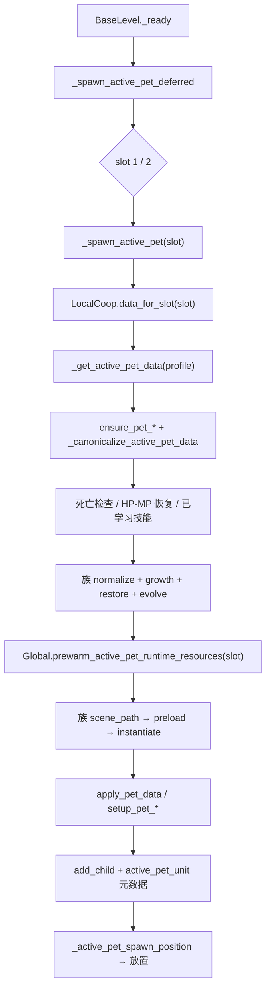

# Phase 23 宠物关卡调用面与族规则矩阵（历史快照）

> **归档日期**：2026-11-10
> **状态**：Archived snapshot; historical facts are not current contracts.
> **关联**：[`iteration_23_pet_domain_boundary.md`](iteration_23_pet_domain_boundary.md)；当前关卡宠物职责见 [`../reference/architecture.md`](../reference/architecture.md) §4.3，档案 View/Command 见 [`../reference/pet_domain_contract.md`](../reference/pet_domain_contract.md)。

---

## 1. 结论

1. 当前有 **8 个宠物族**、**30 个召唤场景**（除子鼠 2 阶外，其余每族 4 阶）。
2. 23-0 基线中 `BaseLevel` 自身包含 **73 个宠物相关函数**；八族迁出后当前为 **16 个**，其余为槽位、规范化、生成生命周期与死亡查询等通用职责。同一套规则还分散在 `BaseMonster`、`PetInterface` 与 `PlayerData`：
   - `BaseLevel` 与 `BaseMonster` 重名 **22 个**；
   - `BaseLevel` 与 `PetInterface` 重名 **19 个**；
   - `BaseMonster` 与 `PetInterface` 重名 **20 个**。
3. **首批选择 `PetTurtle`（龟布系）**。理由不是文件行数，而是：
   - 4 阶规则标准，无子鼠 2 阶、丑牛/寅虎名称折叠、凤凰“存储阶优先”的特殊分支；
   - `coop_probe_runner` 已直接用 `PetTurtle` 数据覆盖 P1/P2 宠物经验、生命加成、槽位归属与 HUD 死亡态；
   - 单位接口 `setup_pet_turtle` 同时是月兔、子鼠、丑牛、寅虎的基类接口，首批可用最小规则验证后续复用面；
   - `BaseLevel` 的龟族分支是完整的 `normalize → growth → restore → evolve → path` 标准链，适合先抽出通用生命周期。
4. 23-1 已新增 `pet/` 下的 `PetLevelController` 与 `PetTurtleFamily`；23-2 首批新增 `PetTigerFamily`，随后新增 `PetDragonFamily`、`PetPhoenixFamily`、`PetRabbitFamily`、`PetMouseFamily`、`PetNeatFamily` 与 `PetYinTigerFamily`，`BaseLevel` 不再保留任何族的规则函数与旧生成分派；八族生成只经 `PetLevelController` 入口。
5. **已由 23-1 修复并回归**：`BaseMonster._cure_active_pet_exp(slot)` 的进化与成长函数显式接收当前槽位档案，P2 升级不再写回 1P `出战宠物`。
6. **已由 23-2 共享槽位边界批次修复并回归**：
   - `Global.prewarm_active_pet_runtime_resources(slot)` 与 `get_active_pet_preload_data(slot)` 按槽位解析，签名缓存按槽位隔离；`BaseLevel`、`PetLevelController` 与加载页均传槽位；
   - 八仙法宝复活按持有者槽位读写死亡元数据并重建对应槽位；
   - 宠物单位装备加成经 `BaseObject.PlayerData` 的槽位解析验证，P2 使用 P2 阵法/装备；新增 `LocalCoopPetSlotProbe` 固化三条路径。
7. 以下剩余风险不阻塞当前批次，但会影响后续批次：
   - 活跃名清理仍只比较规范名，显示名别名清理待族规则统一。

未修复项为静态阅读结论；运行期反例与修复放入后续批次，不在本页冒充已验证缺陷。

---

## 2. 当前调用链



外部触发：

| 入口 | 作用 | 槽位来源 | 当前问题 |
|:---|:---|:---|:---|
| `BaseLevel._ready` → `_spawn_active_pet_deferred` | 关卡开始生成 1P，再在双人可用时生成 2P | 显式 1 / 2 | 无 |
| `PetInterface.fight_click` / `rest_click` | 出战/休息后重建或销毁单位 | `LocalCoop.ui_slot` | `PetInterface` 自己的归一化与进化副本 |
| `BaseMonster.set_exp` → `_cure_active_pet_exp` | 宠物经验与升级进化 | `slot` 参数 | 进化已按槽位写回；8 族含 `PetNeat` |
| `SummonBaseMonster._persist_active_pet_death` | 记录本局死亡，禁止再次出战 | `LocalCoop.slot_for(self)` | 依赖调用方别名表 |
| `EightImmortalMagicWeapon` 复活 | 清除死亡态并重新生成 | `LocalCoop.slot_for(player)` | 已按槽位隔离 |
| `Global.prewarm_active_pet_runtime_resources` | 战斗前预热场景/帧/弹体 | 显式 `slot` | 已按槽位隔离；寅虎仍无分支 |
| `BaseRole` HUD 查询 | 读取 `active_pet_unit` 与死亡态 | `LocalCoop.slot_for(self)` | 与 Level/UI 覆盖同一组凤凰别名 |

---

## 3. 八族矩阵

| 族 | 单位基类 | 场景 | `BaseLevel` 专门规则 | 特殊点 | 现有覆盖 | 首批判定 |
|:---|:---|:---:|:---|:---|:---|:---|
| `PetTurtle` | `PetTurtleSummonBase` | 4 | 已迁入 `PetTurtleFamily`：阶段/技能/归一化/进化/场景路径 | 标准 4 阶；资质上限固定为 4000/1800/1500/4000 | `coop` 宠物经验、生命加成、槽位归属、HUD 死亡态直接使用龟族数据 | 23-1 已完成 |
| `PetTiger` | `PetTigerSummonBase` | 4 | 已迁入 `PetTigerFamily`：阶段/技能/归一化/进化/场景路径 | 标准 4 阶；技能表含“奥义”差异 | `pet-runtime` 头像 4 阶；`LocalCoopPetExperienceProbe` | 23-2 已完成 |
| `PetDragon` | `PetDragonSummonBase` | 4 | 已迁入 `PetDragonFamily`：阶段/技能/归一化/进化/场景路径 | 标准 4 阶；`IS` 分身与飞行动作复杂 | `pet-runtime` 头像 4 阶；`LocalCoopPetDragonProbe` 覆盖族规则/升级/双槽生成 | 23-2 已完成 |
| `PetPhoenix` | `PetPhoenixSummonBase` | 4 | 已迁入 `PetPhoenixFamily`：阶段/技能/归一化/进化/场景路径/死亡别名 | 生成归一化优先使用存储 `阶段`，再由进化按等级重算；有涅槃/复活 | `pet-runtime` 树外初始化、动画轨道；`LocalCoopPetPhoenixProbe` | 23-2 已完成 |
| `PetRabbit` | `PetRabbitSummonBase`（继承龟） | 4 | 已迁入 `PetRabbitFamily`：阶段/技能/归一化/进化/场景路径/死亡别名 | 标准 4 阶；按等级重算阶段；有永久解锁标记 | `LocalCoopPetRabbitProbe` 覆盖族规则、P2 升级写回、死亡别名与双槽生成 | 23-2 已完成 |
| `PetMouse` | `PetMouseSummonBase`（继承龟） | 2 | 已迁入 `PetMouseFamily`：两阶、等级技能、归一化、进化、场景路径与死亡别名 | 仅 2 阶；技能按 30/50 级分档 | `LocalCoopPetMouseProbe` 覆盖族规则、P2 升级写回、死亡别名与双槽生成 | 23-2 已完成 |
| `PetNeat` | `PetNeatSummonBase`（继承龟） | 4 | 已迁入 `PetNeatFamily`：四阶、阶段技能、归一化、进化、场景路径与死亡别名 | 4 阶但显示名只有“丑牛元帅/大元帅”；`BaseMonster` 升级循环已覆盖 | `LocalCoopPetNeatProbe` 覆盖族规则、P2 升级写回、死亡别名与双槽生成 | 23-2 已完成 |
| `PetYinTiger` | `PetYinTigerSummonBase`（继承龟） | 4 | 已迁入 `PetYinTigerFamily`：四阶、阶段技能、归一化、进化、场景路径与死亡别名 | 4 阶但显示名只有“寅虎元帅/大元帅”；使用独立动作帧目录 | `LocalCoopPetYinTigerProbe` 覆盖族规则、升级、死亡别名、预热与双槽生成 | 23-2 已完成 |

---

## 4. `BaseLevel` 函数/字段迁移表

### 4.1 生命周期与选择

| 当前符号 | 位置 | 当前职责 | 目标所有者 | 23-1 动作 |
|:---|:---|:---|:---|:---|
| `_spawn_active_pet_deferred` | `base_through_level.gd:252-262` | 等待落地后按槽位生成 | `PetLevelController` | 保留为入口；调用控制器 |
| `_spawn_active_pet` | `:264-455` | 取档案、死亡/HP/MP、技能、族规则、预热、实例化、注册、放置 | `PetLevelController` | 通用流程迁移；删除龟族分支 |
| `_get_active_pet_data` | `:1257-1314` | `ensure_pet_*`、活跃名归一、凤凰特判、返回当前宠物 | `PetLevelController` + `PlayerData` 读取 | 通用选择迁移；删除龟族特判 |
| `_canonicalize_active_pet_data` | `:1146-1248` | 按族优先级把 `出战` 收敛到单只 | `PetLevelController` + 族规则 | 删除龟族分支；最终由族规则注册表处理 |
| `_pet_active_name` | `:1112-1131` | 把数据映射为 `PetTurtle` 等规范名 | 族规则元数据 | 龟族由 `PetTurtleFamily.kind` 提供 |
| `_set_only_active_pet` | `:1137-1144` | 清其他 `出战`，写当前活跃名 | `PlayerData` 命令/控制器 | 保留语义，移出 Level |
| `_pet_is_fighting` | `:1133-1135` | 读取 `出战` | 控制器 | 保留 |
| `_active_pet_list_key` / `_active_pet_name_key` | `:1104-1110` | 档案键兼容 | `PlayerData` 常量 | 改由档案/控制器提供 |
| `_active_pet_spawn_position` / 碰撞锚点 / `_place_active_pet_near_role` | `:1062-1103` | 按角色与宠物碰撞盒计算落点 | `PetLevelController` | 通用逻辑迁移 |

### 4.2 死亡与槽位

| 当前符号 | 位置 | 当前职责 | 目标所有者 | 23-1 动作 |
|:---|:---|:---|:---|:---|
| `_is_active_pet_dead_this_level` | `:197-212` | 读槽位死亡元数据，判断当前宠物是否本局死亡 | `PetSlotState` / 控制器 | 通用逻辑迁移 |
| `_active_pet_dead_aliases` | `:214-251` | 族名/类型/显示名归一 | 族规则元数据 | 凤凰别名已由族规则补齐 |
| `active_pet_unit` 元数据 | `:449` | 记录槽位当前单位 | 控制器 | 保留键与槽位 |
| `active_pet_dead_*` 元数据 | `:198-211`；`summon_base_monster.gd:1107-1116` | 死亡态跨阶段/重战保持 | 控制器 + 召唤物 | 统一读写入口 |
| `coop_slot` 元数据 | `:406` | 标记单位所属槽位 | 控制器 | 保留 |

### 4.3 族规则（23-1 已处理 `PetTurtle`，23-2 已处理其余七族）

| 族 | `BaseLevel` 方法 | 迁移目标 | 状态 |
|:---|:---|:---|:---|
| `PetTurtle` | `_pet_turtle_stage_for_level`、`_pet_turtle_stage_name`、`_pet_turtle_stage_skills`、`_normalize_pet_turtle_spawn_data`、`_update_pet_turtle_evolution`、`_pet_turtle_scene_path`、`_is_pet_turtle_data`（23-0 时为 `:532-604`） | `PetTurtleFamily`（`RefCounted`） | **已删除并迁移** |
| `PetTiger` | `_pet_tiger_stage_for_level`、`_pet_tiger_stage_name`、`_pet_tiger_stage_skills`、`_normalize_pet_tiger_spawn_data`、`_update_pet_tiger_evolution`、`_pet_tiger_scene_path`、`_is_pet_tiger_data`（23-0 时为 `:832-970`、`:1249-1255`） | `PetTigerFamily`（`RefCounted`） | **已删除并迁移** |
| `PetDragon` | 已删除 `_pet_dragon_stage_for_level`、`_pet_dragon_stage_name`、`_pet_dragon_stage_skills`、`_normalize_pet_dragon_spawn_data`、`_update_pet_dragon_evolution`、`_pet_dragon_scene_path`、`_is_pet_dragon_data` | `PetDragonFamily` | 23-2 已完成 |
| `PetPhoenix` | 已删除 `_pet_phoenix_stage_for_level`、`_pet_phoenix_stage_name`、`_pet_phoenix_stage_skills`、`_normalize_pet_phoenix_spawn_data`、`_update_pet_phoenix_evolution`、`_pet_phoenix_scene_path`、`_is_pet_phoenix_data` / `_is_pet_phoenix_name` | `PetPhoenixFamily` | 23-2 已完成 |
| `PetRabbit` | 已删除 `_is_pet_rabbit_data`、`_pet_rabbit_stage_name`、`_pet_rabbit_stage_skills`、`_normalize_pet_rabbit_spawn_data`、`_update_pet_rabbit_evolution`、`_pet_rabbit_scene_path` | `PetRabbitFamily` | 23-2 已完成 |
| `PetMouse` | 已删除 `_is_pet_mouse_data`、`_pet_mouse_stage_for_level`、`_pet_mouse_stage_name`、`_pet_mouse_skills_for_level`、`_normalize_pet_mouse_spawn_data`、`_update_pet_mouse_evolution`、`_pet_mouse_scene_path` | `PetMouseFamily` | 23-2 已完成 |
| `PetNeat` | 已删除 `_is_pet_neat_data`、`_pet_neat_stage_for_level`、`_pet_neat_stage_name`、`_pet_neat_stage_skills`、`_normalize_pet_neat_spawn_data`、`_update_pet_neat_evolution`、`_pet_neat_scene_path` | `PetNeatFamily` | 23-2 已完成 |
| `PetYinTiger` | 已删除 `_is_pet_yin_tiger_data`、`_pet_yin_tiger_stage_for_level`、`_pet_yin_tiger_stage_name`、`_pet_yin_tiger_stage_skills`、`_normalize_pet_yin_tiger_spawn_data`、`_update_pet_yin_tiger_evolution`、`_pet_yin_tiger_scene_path` | `PetYinTigerFamily` | 23-2 已完成 |

### 4.4 通用成长/技能引用

| 当前符号 | 位置 | 职责 | 目标 |
|:---|:---|:---|:---|
| `PET_LIFE_BONUS_RUNTIME.learned_skill_names` / `.new()` | `:4`、`:286-289`、`:444-448` | 已学习技能的常驻/生命加成运行时 | 保留；由控制器挂到单位 |
| `PET_SKILL_PROGRESSION.get_level` / `ensure_levels` | `:5`、`:289`、`:366` | 技能等级补齐 | 保留；档案/成长命令 |
| `_ensure_pet_growth_fields_for_spawn` | `:876-907` | 资质的 0-25 钳制与悟性加成 | 控制器/成长规则 |
| `_recalculate_active_pet_growth_stats` | `:909-940` | 升级后的生命/魔法/攻击/防御 | 控制器/成长规则 |
| `_restore_active_pet_for_level_start` | `:942-947` | 关卡开始回满 HP/MP | 控制器 |

---

## 5. 槽位调用面

| 入口/函数 | 槽位来源 | 读 | 写 | 当前判定 |
|:---|:---|:---|:---|:---|
| `BaseLevel._spawn_active_pet(slot)` | 显式 `1/2` | `LocalCoop.data_for_slot(slot)` | `active_pet_unit`、`coop_slot`、单位树 | 槽位基本正确 |
| `BaseLevel._get_active_pet_data(profile)` | 调用方传入档案 | `宠物列表`、`出战宠物` | `出战`、活跃名 | 槽位基本正确；会先 `ensure_pet_*` 全族 |
| `BaseLevel._active_pet_dead_aliases` | 调用方传 `slot` | `active_pet_dead_*_{p2}` | 无 | 八族别名均已由族规则提供 |
| `BaseMonster._cure_active_pet_exp(value, slot)` | 显式 `slot` | `data_for_slot`、槽位单位 | 槽位宠物经验 | 数据按槽位读，但进化副本写全局 `PlayerData` |
| `PetInterface._spawn_active_pet_now` | `LocalCoop.ui_slot` | 当前面板档案 | 单位树 | 正确 |
| `PetInterface._despawn_active_pet_nodes` | `LocalCoop.ui_slot` | `coop_slot` | 单位树 | 正确 |
| `SummonBaseMonster._persist_active_pet_death` | `LocalCoop.slot_for(self)` | 单位元数据 | `active_pet_dead_*` | 槽位正确；别名依赖外部 |
| `EightImmortalMagicWeapon` 复活 | `LocalCoop.slot_for(player)` | 槽位死亡元数据 | 槽位宠物与死亡态 | 已按槽位隔离 |
| `Global.prewarm_active_pet_runtime_resources` | 显式 `slot` | 槽位档案与预载路径 | 按槽位签名缓存 | 已按槽位隔离；八族均识别 |
| `PetTurtleSummonBase.setup_pet_turtle` | `BaseObject.PlayerData` → `LocalCoop.data_for(self)` | 槽位装备/阵法加成 | 单位属性 | 已由 `LocalCoopPetSlotProbe` 验证 |
| `BaseRole._get_cached_active_pet_unit` | `LocalCoop.slot_for(self)` | `active_pet_unit` 元数据 | 清理失效元数据 | 槽位正确 |

### 5.1 已确认的静态风险

| 风险 | 证据 | 影响 | 归属批次 |
|:---|:---|:---|:---|
| P2 预热 1P 宠物 | `Global.prewarm_active_pet_runtime_resources(slot)`、`get_active_pet_preload_data(slot)` 与加载页双槽遍历 | 已修复；P2 预载/预热门禁按槽位 | 23-2 共享槽位批次完成 |
| P2 升级写 1P 活跃名 | `base_monster.gd` 的进化与成长函数已改为接收当前槽位档案 | 已修复；P2 升级不再改 1P `出战宠物` | 23-1 已完成 |
| 凤凰死亡别名 | `BaseLevel`/`PetInterface` 已改用 `PetPhoenixFamily.append_death_aliases` | 已修复；两处与 BaseRole 覆盖同一组四阶名/别名 | 23-2 凤凰批次完成 |
| 寅虎无预热门禁 | `Global` 已加入 `ensure_pet_yin_tiger`、预载识别、路径与预热分支 | 已修复；`LocalCoopPetYinTigerProbe` 验证路径与签名 | 23-2 寅虎批次完成 |
| 法宝复活 1P | `eight_immortal_magic_weapon.gd` 已改用槽位死亡元数据与 `_spawn_active_pet(slot)` | 已修复；2P 复活只重建 P2 | 23-2 共享槽位批次完成 |
| 宠物单位全局装备加成 | `BaseObject.PlayerData` 按 `coop_slot` 解析；`LocalCoopPetSlotProbe` 验证 P2 阵法加成 | 已验证；未发现 1P 串槽 | 23-2 共享槽位批次完成 |
| 丑牛升级无进化 | `base_monster.gd` 升级循环已加入 `PetNeatFamily.evolve` | 已修复；`LocalCoopPetNeatProbe` 验证 P2 49→50 阶段/技能刷新 | 23-2 丑牛批次完成 |
| 活跃名清理不覆盖显示名 | `base_through_level.gd:274-278` 仅比较规范名 `pet_name` | 死亡后可能残留显示名，重复进入仍尝试生成 | 23-2 族批次 |

---

## 6. 族规则抽取结构

### 6.1 当前结构

新增 `source/Script/pet/` 下的普通控制器，不新增 Autoload，不新增场景：

```text
PetLevelController (RefCounted)
  spawn_for_slot(level: BaseLevel, slot: int) -> bool
  despawn_for_slot(level: BaseLevel, slot: int) -> void
  resolve_active_pet(profile: PlayerDataStore, slot: int) -> Dictionary
  family_for(pet_data: Dictionary) -> PetFamilySpec

PetFamilySpec (RefCounted, 各族实现)
  kind: String
  unit_meta: String
  matches(pet_data) -> bool
  normalize(pet_data, profile) -> void
  evolve(pet_data, profile) -> void
  scene_path(stage: int) -> String
  setup(unit: Node, stage: int) -> void
```

八族均已完成迁移；`BaseLevel` 只剩 `PetLevelController` 入口，族规则由 `Pet*Family` 提供。

### 6.2 批次结果

23-1 龟族与 23-2 七族的迁移清单、验证与 P2 写回修复见 [`../archive/iteration_23_pet_domain_boundary.md`](../archive/iteration_23_pet_domain_boundary.md)。当前结构：八族均由 `PetLevelController` + 族规则持有，`BaseLevel` 只保留控制器入口；`PlayerData` 载入补全与宠物域 View/命令见 [`pet_domain_contract.md`](pet_domain_contract.md)。


## 7. 历史覆盖与现状说明

Phase 23 当时的验证结果和未覆盖项见 [`iteration_23_pet_domain_boundary.md`](iteration_23_pet_domain_boundary.md)；此快照用于还原调查时的调用面、族规则和迁移判定，不能作为当前实现或当前验证状态。当前实现见 [`../reference/architecture.md`](../reference/architecture.md)；近期验证见 [`../reference/status.md`](../reference/status.md)。