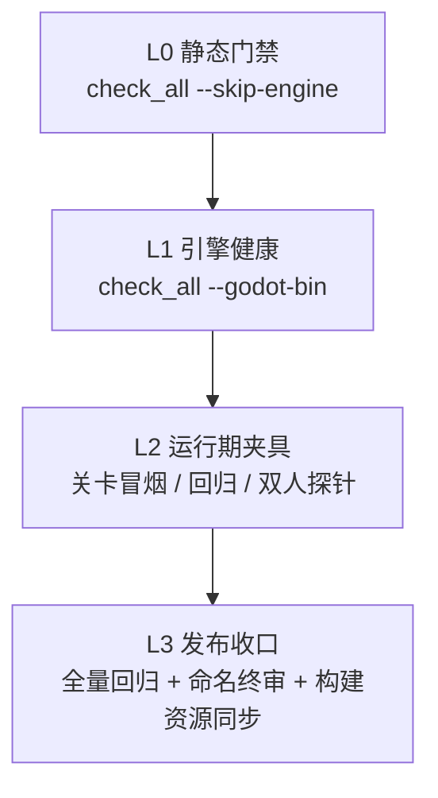

# BHYH 验收标准 (Acceptance)

> **状态**：活跃参考文档（2026-10-25 新建）。
>
> **定位**：回答“一个改动凭什么算通过”。本文记录当前门禁的**实际行为**、通过判据、失败语义与分档验收矩阵。
>
> **事实源**：门禁实际行为以 `scripts/` 为准；验证事实见 [`status.md`](status.md)，当前实现见 [`architecture.md`](architecture.md)；跨模块不变量与目标见 [`总体目标契约`](../standards/target_architecture_contract.md)。目标新增要求不代表已有自动门禁覆盖。
>
> **重要前提**：完整验收依赖本地合法授权的完整素材工作区。公开 clone 缺少 `source/Art/`、`Music/`、`Font/`、`Spritesheet/`，出现缺失资源提示属于预期，不据此判定失败。

---

## 1. 验收原则

1. **证据优先**：只接受实际执行的命令、退出码、日志、报告或截图；代码审阅、反编译成功、单测通过都不能替代运行时验收。
2. **不放宽门禁**：不得通过删除检查、扩大白名单、跳过维度或把失败改写成警告来“通过”。
3. **完整工作区口径**：0 ERROR / 0 WARNING 以含本地素材的完整工作区为准；公开 clone 的缺失资源不计。
4. **测试即规格**：探针与冒烟夹具是可执行规格，放在 `scripts/`，不进入生产 `source/`。
5. **原子验证**：每个功能域单独移植、单独验证、单独提交；不要用一个巨型提交掩盖失败来源。
6. **失败可复现**：记录失败命令、首个错误、日志位置与复现步骤；修复后重跑同一命令。

---

## 2. 验收分层



| 档位 | 适用场景 | 最低要求 |
|:---|:---|:---|
| **L0 静态门禁** | 每次提交；无 Godot 环境 | `check_all.py --skip-engine` 7/7 PASS |
| **L1 引擎健康** | 改脚本、场景、资源、输入、物理层 | L0 + `check_all.py --godot-bin <godot>` 8/8 PASS |
| **L2 运行期夹具** | 改玩法、关卡、双人、HUD、加载流程 | L1 + 相关关卡冒烟 / 回归 / 双人探针 |
| **L3 发布收口** | 版本迁移、里程碑、发布前 | L2 + 全量关卡回归 + 命名终审 + 构建期资源同步 + 文档链接检查 |

---

## 3. L0：`check_all.py` 八维总门禁

### 3.1 调用方式

```bash
# 无 Godot：跳过第 4 维，历史口径称 7/7
python scripts/check_all.py --skip-engine

# 有 Godot：8/8
python scripts/check_all.py --godot-bin "<Godot 4.7.2 可执行文件>"

# 串行修复行尾与格式后，再并发跑其余维度
python scripts/check_all.py --fix

# 其他开关
python scripts/check_all.py --fast            # 只跳过引擎编译，等同该维度的 --skip-engine
python scripts/check_all.py --skip-contract   # 跳过整个契约域（子命令以 contract_gate.COMMANDS 为准）
python scripts/check_all.py --skip-naming
python scripts/check_all.py --skip-runtime
python scripts/check_all.py --skip-resource
python scripts/check_all.py --no-cache -j 6
```

- 默认并发 **6** 个线程；只读模式下 8 个维度并行，`--fix` 模式下维度 1→2 串行写修复，维度 3~8 并行。
- 汇总顺序固定为维度 1→8；全部通过返回 `0`，任一失败返回 `1`。
- 启动时切换到仓库根，因此命令可在任意当前目录执行。
- Godot 可执行文件通过 `--godot-bin` / `--godot` 或 `GODOT_BIN` 环境变量指定，不写入仓库。

### 3.2 八维定义与通过判据

| 维度 | 门禁项 | 实际命令 | 通过判据 | 需要 Godot |
|:---:|:---|:---|:---|:---:|
| 1 | 跨平台行尾 LF | `normalize_eol.py source --dry-run` | 输出含 `发现并清洗 CRLF 文件数: 0`；`--fix` 模式下只看退出码 0 | ❌ |
| 2 | GDScript 格式化 | `format_all.py source --check` | 输出含 `所有代码完全符合代码格式规范`（或修复模式的 `代码格式化操作完成`）且退出码 0 | ❌ |
| 3 | 静态异味 | `gdlint` 作用于核心脚本子集 | 退出码 0 且输出含 `no problems found` | ❌ |
| 4 | 引擎静态编译 | `health_check.py [--godot-bin X]` | 退出码 0，且输出命中 `0 Parse Error`（或 `0 严重编译错误`）与 `0 处断裂引用` | ✅ |
| 5 | 契约与资源域 | `contract_gate.py` | 退出码 0；`docs/reports/contract_audit.json` 存在且 `ERROR == 0`、`WARNING <= 1050` | ❌ |
| 6 | 全量命名 | `naming_audit.py --all` | 退出码 0 | ❌ |
| 7 | 运行时引用 | `runtime_reference_audit.py` | 退出码 0 | ❌ |
| 8 | 资源路径与工厂 | `resource_path_audit.py --project source` | 退出码 0 | ❌ |

### 3.3 必须知道的实现口径

1. **七维与八维是同一脚本的两种运行口径**：`--skip-engine` 跳过维度 4；`status.md` 中的“7/7 PASS”通常指此口径。
2. **维度 1 的失败判定依赖 stdout 文本**：`normalize_eol.py` 自身永远返回 0（目标不存在时返回 2）；CRLF 未清零由 `check_all.py` 的文本匹配拦截。
3. **维度 3 只覆盖核心脚本子集**：清单硬编码在 `check_all.py`；不是全量 lint。
4. **维度 4 在没有 Godot 时不会“通过”**：`health_check.py` 在无引擎时可能返回 `skipped` 且退出码 0，但 `check_all` 找不到成功文本，仍会 FAIL。无引擎环境必须显式 `--skip-engine`。
5. **维度 5 是双重判据**：`contract_gate` 任一子命令非零直接失败；子命令全通过后，才检查 JSON 的 ERROR 与 WARNING 预算。
6. **WARNING 预算 1050 是棘轮**：ERROR 必须为 0；WARNING 不得超过当前预算。新增 WARNING 需要先降低存量或调整预算，不能静默增长。

---

## 4. 契约域：`contract_gate.py`

`contract_gate.py` 并发执行所列子门禁，任一失败即整体失败；实现清单以 `COMMANDS` 为准：

| 子门禁 | 命令 | 作用 |
|:---|:---|:---|
| 契约扫描 | `contract_scan.py --fail-on-error` | 六类字面量契约 |
| Atlas 同步 | `convert_atlas_metadata.py --check` | `manifest.json` 与 `metadata.tres` 逐字一致 |
| Atlas 负向自测 | `convert_atlas_metadata.py --self-test` | `source_frames` 帧数校验的负向样本 |
| FrameSequence 同步 | `convert_frame_sequences.py --check` | 内容、schema、`asset_id` 唯一、单目录单序列、UID、Catalog、延迟纹理路径闭包与陈旧输出；不等于导出包完整 |
| 怪物帧同步 | `convert_monster_frames.py --check` | 148 个目标的动画名集合、帧数、页闭包、`region`/`margin`、PNG 边界、确定性 UID 与全局 UID 冲突；历史无 UID 目标记为已评审例外 |
| PNG 流 guard | `png_stream_audit.py --fail-on-error` | 未登记使用、已迁移消费者旧数组/扫描/猜名回归 |
| 白名单冻结 | `whitelist_audit.py --fail-on-error` | 冻结摘要、磁盘登记与评审记录 |

### 4.1 `contract_scan.py` 六类契约

扫描范围：`.gd`、`.tscn`、`.tres`、`project.godot`、`.cfg`、`.import`；跳过 `.godot`、`godot`、`.git`；`addons/godot_mcp` 通过 `suppressed_files` 整体豁免。

| 类别 | 检查内容 | 失败级别 |
|:---|:---|:---|
| 资源路径 | `res://` 路径逐段大小写；缺失文件 | 大小写不符 → ERROR；缺失且像文件路径 → ERROR，否则 WARNING |
| 节点路径 | `get_node`、`get_node_or_null`、`NodePath`、`$` 与场景树真实节点名 | 大小写不符 → ERROR；无场景绑定仅末段比对 → WARNING |
| 动态反射 | `call` / `call_deferred` / `has_method` / 信号连接等字符串参数 | 仅大小写或下划线不同 → ERROR；未知方法 → INFO；未知信号 → WARNING |
| 动画轨道 | `.tscn` 动画轨道的节点路径与方法轨道方法名 | 大小写不符 → ERROR |
| 字典键 | `.gd` 中的中文键字面量 | 已收录 `DataKeys` → WARNING；未收录 → INFO |
| 运行时 manifest | 同时使用 `FileAccess` / `JSON` 与 manifest 标识的脚本 | ERROR（`RUNTIME_MANIFEST_FORBIDDEN`） |

只有 **ERROR** 参与 `--fail-on-error` 的退出判定；WARNING 与 INFO 进入报告但不阻断。

### 4.2 白名单机制

- `suppressed_literals`：字面量完全相等才豁免；
- `suppressed_files`：文件路径子串命中；
- `missing_asset_known_allowlist`：已知缺失资源；
- `known_extension_methods`：仅反射类别的扩展方法；
- `numeric_scene_allowlist`：数字 ID 场景，仅供冻结摘要计算。

白名单是**冻结表**：`schema_version=2`、`frozen=true`、含 `frozen_at` 与 `frozen_manifest_sha256`；磁盘实有项与登记表必须双向一致（未登记、已失效都要报错）。

### 4.3 `--self-test` 的边界

- `convert_atlas_metadata.py --self-test` 在 `contract_gate` 内；
- `contract_scan.py --self-test` **不在** `contract_gate` 内，属于人工复核命令；
- 涉及契约扫描规则变更时，应单独执行 `python scripts/contract_scan.py --self-test`。

---

## 5. L1：引擎健康检查

### 5.1 命令

```bash
python scripts/health_check.py --project source --godot-bin "<godot>"
```

### 5.2 检查内容

| 阶段 | 规则 | 是否影响退出码 |
|:---|:---|:---|
| 资产清点 | 统计 `.gd`、`.tscn` 与其他资源；排除 `.godot`、`godot`、`.git`、`addons` | 否 |
| Autoload 解析 | 读取 `project.godot` 的 `[autoload]` | 否 |
| 场景拓扑 | 解析 `.tscn` 的 `[ext_resource]`，磁盘不存在的目标记为断裂引用 | 间接：`check_all` 要求输出 `0 处断裂引用` |
| 符号拓扑 | 统计 `class_name`、`extends`、静态加载与动态前缀 | 否 |
| 死代码候选 | 未被引用且无 `class_name` / 动态前缀 / `@tool` 的脚本写入报告 | 否，仅建议 |
| Headless 编译 | 生成临时驱动场景，加载全部 `.gd`，30 秒超时 | 是 |
| 日志门禁 | 解析编译输出的 Parse Error、SCRIPT ERROR 与 warning | 是 |

### 5.3 0 ERROR / 0 WARNING 的实际含义

`health_check.py` 的失败条件是：

- 日志中检测到 `Parse Error` 或 `SCRIPT ERROR:`；
- 检测到白名单外的 GDScript 静态分析 warning。

当前 `WARNING_ALLOWLIST` 为**空**，即默认严格 0 warning；解析已登记的 GDScript 警告码，未识别项记 `UNKNOWN`：

`CONFUSABLE_LOCAL_DECLARATION`、`CONFUSABLE_LOCAL_USAGE`、`INCOMPATIBLE_TERNARY`、`UNUSED_PRIVATE_CLASS_VARIABLE`、`REDUNDANT_AWAIT`、`STANDALONE_EXPRESSION`、`STANDALONE_TERNARY`、`UNREACHABLE_CODE`、`PROPERTY_WILL_BE_MODIFIED`。

### 5.4 实现边界（不要过度宣称）

1. `health_check` **不把普通 `ERROR:` 行计入失败**；严格的 `0 ERROR` 由关卡冒烟夹具另行检查。
2. 临时驱动加载失败的 `failed` 列表当前未被 Python 侧消费；若引擎没有输出 `SCRIPT ERROR` / `Parse Error`，该失败可能不改变状态。
3. `health_check` 在 `skipped`、超时或内部 `error` 时退出码仍为 0；只有 `status == "failed"` 才返回 1。因此**不能只依赖退出码**，必须同时检查 `check_all` 的文本判据。
4. 场景断裂引用与死代码只写报告；`check_all` 通过文本 `0 处断裂引用` 间接强制前者，死代码数量不阻断。

---

## 6. L2：运行期验收

发布前 L2 固定验收项为以下三条命令，必须全部 PASS；任一项 FAIL 均阻断发布：

```bash
python scripts/level_test_runner.py --godot "<godot>" --level res://Scene/level/level_1.tscn
python scripts/coop_probe_runner.py --godot "<godot>"
python scripts/scene_probe_runner.py --godot "<godot>"
# 第三条内部固定执行 constellation / level-selection / role-skills / magic-weapons
```

变更触及特定关卡或资源链路时，另加对应关卡冒烟；双人探针的 `SKIP` 不计为 PASS，场景探针不提供 `SKIP`。

第三条固定项内部固定执行 `constellation`、`level-selection`、`role-skills`、`magic-weapons` 四个探针；角色 2/4 技能与法宝探针不再作为独立命令重复执行。除非只修改对应资源，可使用 `--probe role-skills` 或 `--probe magic-weapons` 单独复跑；发布门禁仍以完整套件为准。每个探针的实际耗时写入 `docs/reports/*_probe_report.{md,json}`，耗时快照见 [`status.md`](status.md)。

### 6.1 单关冒烟：`level_test_runner.py`

```bash
python scripts/level_test_runner.py --godot "<godot>" --level res://Scene/level/level_1.tscn
```

| 项目 | 默认/规则 |
|:---|:---|
| 超时 | 300 秒 |
| 关卡加载上限 | 45,000 ms / 20,000 帧 |
| 主角稳定 | 60 帧 |
| 阶段等待 | 15 帧，最多 40 次尝试 |
| 倍速 | 3.0 |
| 沙盒 | 内存态 HP/护盾极大、无敌、秒杀、禁用坠落死亡 |
| 阶段断言 | 读取 `_stage_count`、`_stage_trigger_x`、`_screen_starts`、`_screen_rights`，逐阶段瞬移并断言 `current_stage` 推进 |
| 日志门禁 | `SCRIPT ERROR`、以 `ERROR` 开头、以 `WARNING` 开头的行都必须为 0 |
| 唯一噪声豁免 | `ERROR: Parameter "t" is null.` 及其缩进栈（headless dummy 渲染噪声） |
| 产物 | 临时驱动/报告/日志写入 `source/`，运行后自动清理；**不写 `docs/reports/`** |

通过条件：驱动报告 `ok` 且三类日志计数全为 0。退出码：`0` PASS，`1` FAIL，`2` 夹具异常（仍输出可解析 JSON）。

### 6.2 关卡回归：`level_regression_all.py`

```bash
python scripts/level_regression_all.py
python scripts/level_regression_all.py --jobs 4 --timeout 90
python scripts/level_regression_all.py --changed-only --diff-base HEAD
python scripts/level_regression_all.py --changed-only --diff-base HEAD~1
```

| 项目 | 规则 |
|:---|:---|
| 候选发现 | `Scene/level/` 下 `level_<数字>` 为编号关；脚本登记的 `EXTRA_LEVELS` 与非纯数字 `level_*` 场景为特殊关 |
| 当前规模 | 候选数由当前 `Scene/level/` 清单动态发现，不在文档中硬编码 |
| SKIP | 命中 `NON_BATTLE_SPECIALS` 的菜单/地图/交互场景直接 `passed=True, skipped=True`，**SKIP 计入通过**（这是关卡回归的既定口径；与双人探针的 SKIP 语义不同） |
| 单关超时 | 默认 150 秒；子进程超时为 `timeout + 90` 秒 |
| 并发 | 默认 `auto = min(12, max(4, CPU 核数))`；实测 12 并发全量 275.7s，瞬态失败自动串行重试；`--jobs 4` 为稳定排障口径 |
| 重试 | 失败关串行重试 1 次 |
| changed-only | 关卡/脚本/Art 目录直接映射；其他源码走反向依赖；无法映射时全量回退 |
| 日常口径 | 提交前跑 `--changed-only --diff-base HEAD~1`，只跑受影响关卡 |
| 发布口径 | 发布前跑全量（默认 auto 并发）；`--warmup` 默认 0（实测无收益）；进程复用未采用（5 关/组实测更慢） |
| 产物 | `docs/reports/level_regression_manifest.json` + 报告 `.md/.json` |

退出码：`0` 全部通过（含 SKIP）；`1` 有 FAIL 或筛选后无候选；`2` 工程缺失/git diff 失败。

### 6.3 双人探针：`coop_probe_runner.py`

```bash
python scripts/coop_probe_runner.py --godot "<godot>"
```

- 用例清单由 `coop_probe_runner.py` 的 `CASES` 维护，覆盖状态、玩法、技能切换、怪物数值、面板、性能、宠物、共享魂、按键、被动、剑/坐骑、创建 UI 与无双归属；执行前以脚本实际列表为准；
- 串行执行，单探针超时 **180 秒**；
- 输出中以 `SCRIPT ERROR:` 或 `ERROR:` 开头的行判 FAIL；唯一豁免为 `resources still in use at exit`；
- 结果取最后一条 `COOP_MATRIX_RESULT=<json>`；缺失结果或超时判 FAIL；
- `SKIP` 不计为 PASS；当前矩阵的 `_skip` 没有调用点，实际只产出 PASS/FAIL；
- 产物：`docs/reports/coop_probe_matrix_report.{md,json}`。

### 6.4 场景探针套件：`scene_probe_runner.py`

```bash
python scripts/scene_probe_runner.py --godot "<godot>"
python scripts/scene_probe_runner.py --godot "<godot>" --probe level-selection
python scripts/scene_probe_runner.py --godot "<godot>" --probe role-skills
python scripts/scene_probe_runner.py --godot "<godot>" --probe magic-weapons
```

| 项目 | 规则 |
|:---|:---|
| 启动方式 | `--scene` 启动临时场景，使用完整项目生命周期；不使用 `--script` |
| 探针规格 | `scripts/scene_probes/` 下的 `constellation_probe`、`level_selection_probe`、`role_skill_probe` 与 `magic_weapon_probe`；运行期复制到 `source/`，结束后清理 |
| L2 固定子项 | `constellation`、`level-selection`、`role-skills`、`magic-weapons` 全部执行，不提供 `SKIP`；单次耗时写入报告 |
| 星座覆盖 | body Catalog/首帧、技能显式唯一后端、纹理预热、共享请求、末帧保持、手动跳帧、销毁后请求回收；不是逐帧视觉或性能验收 |
| 选择态覆盖 | `level_bxgh` 八仙 8 个选择值 + 非法值回退；`level_stz` 三太子 3 个选择值 + 非法值回退；逐项断言 `monster_group["stage_1"]`、关卡自预载场景缓存与背景可见性 |
| 角色技能覆盖 | 角色 2 `by` 触发 BingYuEffect、角色 4 `cmly` 触发 CangMuLongYunEffect；校验 5 个角色特效 `preload_effect_data` 为 true |
| 法宝/角色特效覆盖 | 诛仙剑阵、青莲、青龙剑/太极、八仙 8 场景；Lyfb 兼容特效与哪吒阴阳剑/光环/Launch；校验构建期 `.tres` 加载、动画名、帧数、duration、loop/speed |
| 结果通道 | 各探针最后一条 `*_PROBE_RESULT=<json>`；缺失或 JSON 无效判 FAIL |
| 日志门禁 | `SCRIPT ERROR`、以 `ERROR` 开头的行、以 `WARNING` 开头的行均为 0；唯一豁免为 `ERROR: Parameter "t" is null.` 及其缩进栈 |
| 退出阶段 | 探针输出 `*_PROBE_TEARDOWN` 后进入引擎退出；退出期 RID/ObjectDB 清理噪声不计入门禁 |
| 超时 | 星座 90 秒、选择态 240 秒、角色技能 180 秒、法宝 180 秒；`--timeout` 可覆盖 |
| 产物 | `docs/reports/constellation_probe_report.{md,json}`、`docs/reports/level_selection_probe_report.{md,json}`、`docs/reports/role_skill_probe_report.{md,json}`、`docs/reports/magic_weapon_probe_report.{md,json}` |
| 退出码 | `0` PASS；`1` 任一探针失败；`2` 规格/工程缺失 |

### 6.5 构建期资源校验

```bash
python scripts/convert_atlas_metadata.py --check
python scripts/convert_atlas_metadata.py --self-test
python scripts/convert_numbered_frames.py --all --check
python scripts/convert_nezha_preview_frames.py --check
```

```bash
python scripts/convert_monster_frames.py --check
python scripts/convert_frame_sequences.py --check
python scripts/convert_frame_sequences.py --export-preset
python scripts/frame_sequence_pack_probe.py --self-test
python scripts/frame_sequence_pack_probe.py --godot "<godot>"
```

`convert_level_preload_catalog.py --check` 由 `contract_gate.py` 调用，校验 `source/Script/data/level_preload_catalog.tres` 与 `source/Script/data/level_preload_export_dependencies.json` 均与源脚本/动态路径数据源一致。

`--export-preset` 只读检查 `source/export_presets.cfg` 的声明覆盖；仓库内只有一个**验证用**预设（`all_resources`），它不是发布裁剪策略，也不代表 PCK 已验证。

> 延迟纹理在导出包内表现为 `.import` 声明与 `.ctex` 容器，源路径本身不可直接 `FileAccess` 打开；探针因此使用 `ResourceLoader.exists()` 判定。2026-10-27 实测该预设导出 PCK 内 **4,100 条**依赖全部可达（FrameSequence 与关卡预载两份清单合并，约 2.74 GB，含全部私有素材）。这证明包内路径闭包，不等于 release 加载、目标设备 VRAM 与首帧耗时已验证。

`frame_sequence_pack_probe.py` 才验证发布包闭包：实际 `--export-pack` 生成 PCK，再在最小空工程中挂载该 PCK，由引擎 `FileAccess` 判定每条依赖（含 `.remap`）是否存在。三种证据必须分开记录：

| 证据 | 命令 | 覆盖范围 |
|:---|:---|:---|
| 源闭包 | `convert_frame_sequences.py --check` + `convert_level_preload_catalog.py --check` | 源文件存在、schema、UID、Catalog、FrameSequence 与关卡预载依赖清单一致 |
| 预设声明 | `convert_frame_sequences.py --export-preset` | 预设过滤器不会排除依赖；仍是配置级 |
| 发布包 | `frame_sequence_pack_probe.py` | 合并两份清单后，引擎挂载 PCK 逐条判定 Catalog/序列/延迟纹理/怪物场景/弹体/动态纹理可达；缺模板、无 PCK 或探针无结果返回 2（BLOCKED） |

判定：

- Atlas：`metadata.tres` 与 `manifest.json` 重新渲染结果逐字一致，且 `source_frames` 与实际帧数一致；
- 编号帧：登记 profile 的输出存在且内容未过期；
- 哪吒：输出存在、内容与预览 JSON 一致、源 schema 合法；分类报告 `missing` / `stale` / `invalid`，任一非零即失败。

Atlas、FrameSequence、编号帧与 sheet 帧检查经 `contract_gate` 进入 `check_all`；哪吒转换器仍需在对应资源变更时单独执行。`frame_sequence_pack_probe.py` 依赖本机导出模板，不进入日常门禁，发布前单独执行；缺模板时明确 BLOCKED，不得记为通过。源码枚举门禁与向 `source/` 临时安装夹具的运行探针串行执行。

---

## 7. 命名、引用与资源路径审计

| 脚本 | 检查范围 | 失败判据 | 是否在 `check_all` |
|:---|:---|:---|:---|
| `naming_audit.py` | 目录与文件 `snake_case`；默认只查 Git 新增，`--all` 全量 | 任一目录/文件 stem 违规 | ✅ 维度 6（固定 `--all`） |
| `naming_compliance_audit.py` | 四张表：目录、文件、代码标识符、白名单登记 | 任一违规 | ❌ 人工终审 |
| `runtime_reference_audit.py` | `@onready` 行中的 NodePath、`Global.<method>()` | 路径无法在挂载场景解析；Global 方法未声明 | ✅ 维度 7 |
| `resource_path_audit.py` | 静态 `res://` 大小写、`%d/%s/%f` 动态路径、Spine atlas 页名、`add_role_bullet` / `add_role_special_effect` 工厂目标 | 任一不匹配 | ✅ 维度 8 |
| `whitelist_audit.py` | 冻结摘要、磁盘实有项与登记表双向比对、评审记录 | 未登记/失效/摘要不符 | ✅ 经 `contract_gate` |
| `png_stream_audit.py` | `StreamedPngEffect` 未登记使用 | allowlist 外引用 | ✅ 经 `contract_gate`（必须带 `--fail-on-error`） |

### 7.1 命名审计的实际边界

- `naming_audit.py` 的目录检查**跳过 `source/` 顶层目录**；顶层目录按历史约定保留；
- 白名单是精确集合，不做 `DefineSprite_*` 或数字前缀通配；
- 受检扩展名：`.tscn`、`.gd`、`.tres`、`.res`、`.gdshader`、`.mp3`、`.ogg`、`.wav`、`.png`、`.webp`、`.jpg`、`.jpeg`、`.ttf`、`.otf`、`.json`；其他扩展名静默跳过；
- `naming_compliance_audit.py` 允许函数/变量前导下划线（`_snake_case`），与 `naming_audit.py` 的目录规则不同；
- `PlayerData`、`RoleProp`、`PlayerInput` 三个 Autoload 桥接变量允许 PascalCase，仅限这三个名字。

### 7.2 资源路径审计的公开 clone 行为

`resource_path_audit.py` 在 `Art`、`Font`、`Music`、`Spritesheet` 任一目录不存在时，跳过对应前缀下的静态/动态素材路径校验；这保证公开 clone 可运行静态门禁，但不能替代完整工作区验收。

### 7.3 人工审计与迁移工具

| 工具 | 用途 | 验收方式 |
|:---|:---|:---|
| `asset_reference_audit.py` | 单遍 `rg` 扫描旧资产基名引用 | 手动执行；`--fail-on-match` 时命中返回 `3`，否则只报告 |
| `rename_path.py` | `source/` 内原子重命名、引用同步、回滚 | 迁移后必须重跑静态门禁、命名审计与受影响关卡冒烟 |
| `naming_compliance_audit.py` | 全量命名终审四张表 | 人工终审；`--fail-on-error` 有违规返回 `1` |
| `contract_scan.py --self-test` | 契约扫描负向/正向样本 | 规则变更或迁移前后手动执行 |

这些工具**不在** `check_all` 的日常八维内；使用后仍需执行对应门禁，不能以“工具跑过”替代通过证据。

---

## 8. 硬性阈值与基线数字

| 项目 | 值 | 归属/说明 |
|:---|:---|:---|
| `check_all` 并发 | 默认 6 | 可用 `-j` 调整 |
| `gdlint` 覆盖 | 核心脚本子集 | 不是全量 lint；清单见 `check_all.py` |
| `health_check` 编译超时 | 30 秒 | 超时后 Windows 使用 `taskkill /F /T` |
| GDScript warning 白名单 | 0 条 | 白名单外必须为 0 |
| warning 码映射 | 已登记警告码 | 未识别记 `UNKNOWN` |
| 契约 WARNING 预算 | ≤ 1050 | ERROR 必须为 0 |
| 契约规则 | 六类契约 | ERROR 才阻断 |
| 白名单冻结 | schema 2 / frozen | SHA-256 校验 |
| PNG 流 allowlist | 由 `scripts/png_stream_allowlist.json` 维护 | 清单外的 `StreamedPngEffect` 使用失败 |
| 关卡冒烟倍速 | 3.0 | `level_test_runner.py` |
| 关卡冒烟超时 | 300 秒 | 加载上限 45,000 ms / 20,000 帧 |
| 关卡回归候选 | 由 `Scene/level/` 清单动态发现 | 非战斗场景按 `NON_BATTLE_SPECIALS` 跳过 |
| 关卡回归并发 | 默认 `auto`（`min(12, max(4, CPU 核数))`）；`--jobs 4` 为稳定排障口径 | 失败重试 1 次 |
| 关卡回归单关超时 | 默认 150 秒 | 子进程 +90 秒 |
| 双人探针 | 用例清单由 `coop_probe_runner.py` 维护 | 单探针 180 秒，串行 |
| 场景探针套件 | `scene_probe_runner.py` | 固定 4 项（星座/关卡选择态/角色 2/4 技能/法宝）；单项 90/240/180/180 秒；`--scene` 启动；日志 0/0 |
| 数字 ID 场景 | 由冻结白名单登记 | 改名需评审 |
| 格式行宽 | 120 | `format_all.py` |
| 格式批次 | 100 | `format_all.py` |

### 8.1 历史基线（引用，不是本次复跑）

截至 `status.md`（2026-10-24）：

- 八维门禁 **8/8 PASS**；
- 关卡回归 **128/128 PASS + 5 SKIP**；
- 双人探针 **16/16 PASS**；
- Atlas 元数据 **379/379 同步**；
- 引擎健康检查 **706 脚本 0 Parse / 0 Error / 0 Warning**；
- **1,136 场景 0 断裂引用**。

这些数字是历史快照，不是本文的实测结果。当前规模与最新验证状态以 [`status.md`](status.md) 为准。

---

## 9. 按变更类型的验收矩阵

| 变更类型 | 最低门禁 | 追加验证 | 不算通过的情况 |
|:---|:---|:---|:---|
| 纯文档 | 相对链接检查；`normalize_eol.py docs --dry-run` | 更新索引与状态引用 | 只改文字、不更新索引/链接 |
| 纯 GDScript（无场景/资源） | L1 八维 | 受影响关卡冒烟或定向探针 | `--skip-engine` 后宣称 8/8 |
| 场景/节点改动 | L1 八维 | `level_test_runner` 代表关；NodePath/动画轨道契约 | 只跑 `gdlint` |
| 新增/修改美术或音频 | L1 八维 + `--import` | Atlas/编号帧/哪吒 `--check`；相关关卡冒烟 | 未生成 `.import`/UID；未重建导入缓存 |
| 存档/数据结构 | L1 八维 | 当前格式已有档/新档读取、缺字段补全、损坏档拒绝、备份策略、保存/重载与退出、双人槽位 | 只测新档；猜旧结构；失败空档覆盖原档；将“旧档”误作跨版本兼容 |
| 输入/物理层 | L1 八维 | 单/双人按键路径；相关关卡冒烟 | 只改 `project.godot` 不实机验证 |
| 双人/LocalCoop | L1 八维 | `coop_probe_runner` 全部用例；P1/P2 归属探针 | 只测 1P；把 SKIP 当 PASS |
| UI/HUD/显示 | L1 八维 | 单/双人多分辨率截图；`level_1` 冒烟 | 只测一个分辨率；截图无 HUD/边界检查 |
| 关卡/玩法 | L1 八维 | 单关冒烟 + changed-only 回归 | 只验证第 1 阶段；未验证出口 |
| 构建期资源管线 | L1 八维 | 对应转换器 `--check`；负向样本 | 只检查文件存在，不检查内容 |
| 应用/场景编排、缓存/池/异步 | L1 八维 + 定向运行路径 | 冷启动/返回/重战、覆盖式切换与 HUD 就绪、提前退出/过期回调、资源交接与池重置；涉及发布则 PCK/release | 只搬字段、只清字典或编译；后台请求/旧 API 仍留存 |
| 档案会话/2P 面板上下文 | L1 八维 + 双人定向探针 | P2 面板开关/暂停/切档、保存快照恢复 1P 视图、共享库存与个体状态、退出未决保存 | 只改 UI 或只改 LocalCoop；1P 档案混入 2P；两套可写真源 |
| 战斗来源/结算边界 | L1 八维 + 生产攻击/关卡路径 | 弹体/召唤/法宝延迟归属、池化复用、吸血/无双/Buff 槽位、通关/重战与重复结算 | 仅场景存在；来源默认 1P；只验证第一阶段 |
| 版本迁移 | L3 全量 | 全量回归 + 双人矩阵 + 命名终审 + Atlas/帧同步；逐文件处置结论 | 整包覆盖；复制反编译代码；临时探针入库 |


### 9.1 总体架构收敛的验证边界

- 正常路径、边界、失败与退出均以真实生产调用验证；阶段套件不能替代新增行为的定向场景。
- 上述矩阵是变更验收义务，不声称现有 `coop_probe_runner`/`scene_probe_runner` 已覆盖全部保存竞态、过期回调和 UI 交换；缺覆盖时补定向夹具并登记。
- 接口替换须核对生产调用方、删除旧入口；不以 deprecated facade、双实现或无法复现的只读审查充当完成。正式职责仍正确的唯一入口可保留名称。
- 仅文档修改执行链接、行尾/空白、规范/索引与修改范围检查，不因目标范围扩大重跑引擎，也不刷新已有 release 验证时间。
- 资源路径、类型或导出依赖变化触发实际包验证；不强制每个只读调查或 API 内部改动都重导 release。
---

## 10. 失败处置

1. **先复现**：保留失败命令、首个错误与日志；不要用重跑覆盖证据。
2. **定根因**：区分代码缺陷、数据缺陷、资源缺失、契约漂移与环境差异；不以公告文案代替证据。
3. **最小修复**：只改必要范围；禁止为通过门禁而删除检查、扩大白名单或增加兼容分支。
4. **回归**：重跑同一门禁，再跑受影响面；共享状态、暂停、场景生命周期属于高风险路径，失败时回退整个逻辑批次。
5. **记录**：更新 `status.md` 的验证结果与已知边界；机器报告不手改、不提交历史报告。
6. **未认证边界**：未执行的平台、分辨率、硬件或探针必须明确写出“未验证”，不能默认为通过。

**不构成验收证据**：

- 仅代码审阅或类型检查；
- 仅编译成功，没有运行时路径；
- 单个用例通过，没有覆盖失败分支；
- 反编译/解包成功；
- 未说明跳过维度的“全绿”；
- 未附分辨率与场景的截图；
- 临时探针留在 `source/` 或报告中。

---

## 11. 环境、平台与交付边界

- `.gitignore` 排除 `source/Art/`、`Music/`、`Font/`、`Spritesheet/` 及其导入产物；
- 禁止使用 `git add -f` 绕过忽略规则；
- 公开 clone 无法直接运行，Godot 报告缺失资源属于预期；
- 自有代码 MIT；第三方组件与 Spine 运行时分别遵循其许可证，见 `LICENSE`、`THIRD_PARTY_NOTICES.md`；
- 完整验收必须在本地合法授权的完整素材工作区执行；文档不得记录本地二进制、解密沙盒或绝对路径；
- Spine 运行时当前仅入库 **Windows x86_64**；其他平台发布前必须补齐运行库并验证；
- Steam Deck 全屏、Android 实机与移动端触控布局未在当前硬件环境完整验收；未执行的平台必须标注“未验证”；
- 本地 `git commit` 可在门禁通过后执行；未经明确允许不得 `git push`；
- 提交信息遵循中文 Conventional Commits，核心修复/重构需在正文写明根因、方案与实测证据。

---

## 12. 维护约定

1. 门禁规则变更时，先改 `scripts/` 与对应规范，再更新本文；
2. 阈值变化必须同步 §8 的数字表；
3. 新增门禁脚本必须登记到 [`../../scripts/README.md`](../../scripts/README.md) 与本文；
4. 历史验证结果只写入 `status.md`，本文只保留判据与当前阈值；
5. 文档移动后更新相对链接，并执行链接检查。

---

## 13. 关联文档

- [`architecture.md`](architecture.md)：运行时架构、分层与遗留边界
- [`atlas_metadata_schema.md`](atlas_metadata_schema.md)：Phase 14-1 生产者、schema、消费者与失败矩阵
- [`status.md`](status.md)：版本、规模与历史验证结果
- [`../standards/naming_standard.md`](../standards/naming_standard.md)：命名与契约规范
- [`../standards/godot_design_standard.md`](../standards/godot_design_standard.md)：Godot 设计规范
- [`../standards/target_architecture_contract.md`](../standards/target_architecture_contract.md)：总体目标、所有权、生命周期与分域验收不变量
- [`../guides/migration_playbook.md`](../guides/migration_playbook.md)：版本迁移流程与红线
- [`../audit/README.md`](../audit/README.md)：人工代码质量审计模板、报告与证据规则
- [`../../scripts/README.md`](../../scripts/README.md)：脚本索引、命令与产物
