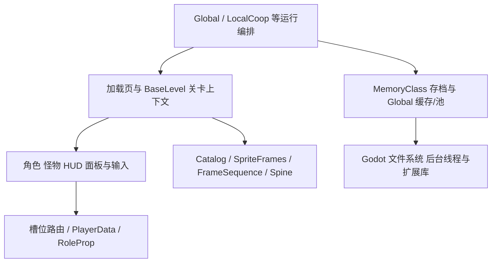
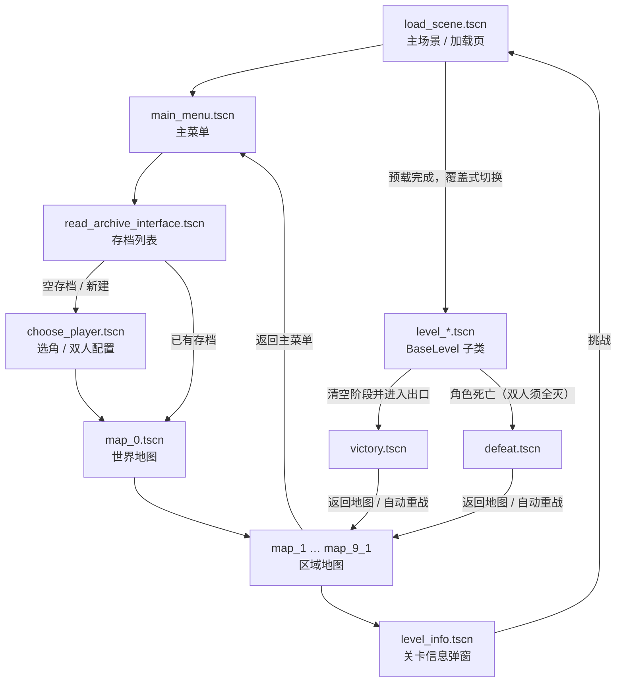
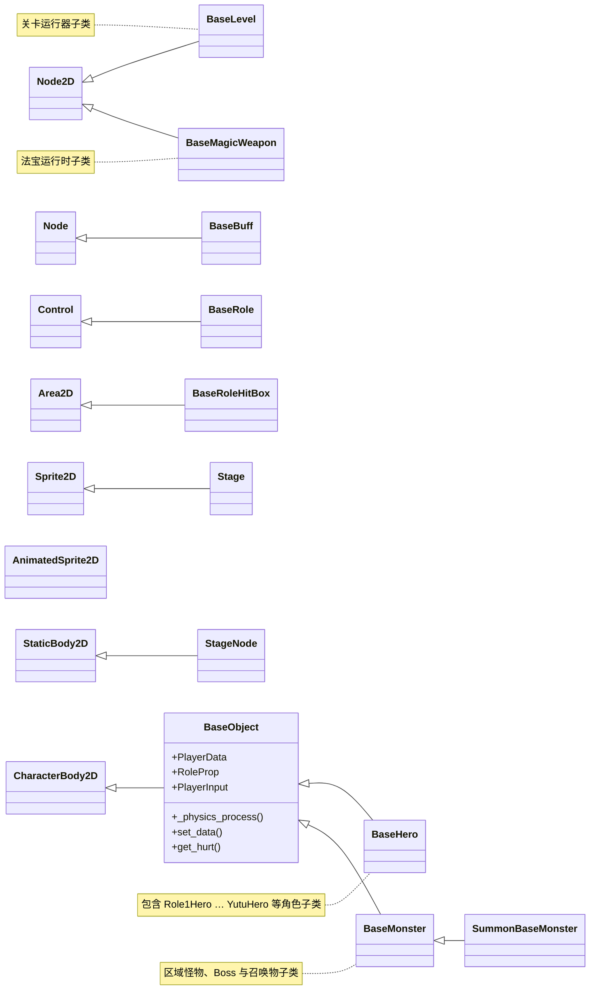

# BHYH 运行时架构 (Architecture)

> **状态**：活跃参考文档（2026-10-27 对齐总体目标契约）。
>
> **定位**：描述 `source/` 当前**实际运行**的工程结构、启动与场景流、对象模型、数据与资源分层、UI/输入边界，以及遗留结构与现代化模块的分界。
>
> **不在本文范围**：总体目标与跨模块不变量见 [`项目总体目标架构契约`](../standards/target_architecture_contract.md)；详细设计与命名见 [`../standards/`](../standards/README.md)；验收命令见 [`acceptance.md`](acceptance.md)；验证事实见 [`status.md`](status.md)。
>
> **事实口径**：本文按代码与工程配置取证，不把规划目标写成现状。标注「目标」或「未落地」的条目尚未在代码中实现。

---

## 1. 系统总览

### 1.1 工程边界

仓库只保留一个活跃 Godot 工程：

```text
BHYH/
├── source/                 # 唯一活跃工程（project.godot 在此）
├── docs/                   # 规范、参考、决策、路线、指南、归档
└── scripts/                # 门禁、审计、回归、构建期转换器
```

- 业务改动只进入 `source/`；
- `source/addons/` 是第三方插件，非插件维护任务不修改；
- 第三方素材目录 `source/Art/`、`Music/`、`Font/`、`Spritesheet/` 不进入公开仓库；
- 迁移工具、解密沙盒与本地二进制路径不进入仓库。

### 1.2 运行基线

| 项目 | 当前值 | 证据 |
|:---|:---|:---|
| 引擎 | Godot **4.7.2** | `source/project.godot`、`docs/reference/status.md` |
| 语言 | GDScript 2.0，优先静态类型 | `docs/standards/godot_design_standard.md` |
| 主场景 | `res://Scene/other_scene/load_scene.tscn` | `source/project.godot` |
| 渲染后端 | 默认 `mobile`；Web 使用 `forward_plus` | `source/project.godot` `[rendering]` |
| 设计画布 / 默认窗口 | **1280×800 / 1600×1000**（16:10，1.25×） | `source/project.godot` `[display]` |
| 拉伸策略 | `canvas_items` + `expand` | `source/project.godot` |
| 最大 FPS | 150（`run/max_fps`） | `source/project.godot` |
| Autoload | **11**：10 个业务单例 + 1 个编辑器调试桥 | `source/project.godot` `[autoload]` |
| 输入动作 | 集中定义于 `source/project.godot`；数量以配置为准 | `source/project.godot` `[input]` |
| 2D 物理层 | 具名层；名称与数量以 `source/project.godot` 为准 | `source/project.godot` `[layer_names]` |
| 场景树分组 | `Player`、`Monster` | `source/project.godot` `[global_group]` |

### 1.3 分层视图



这是当前主要运行依赖的简图，不是严格分层：`Global`、档案、UI 与双人会话仍有交叉依赖。目标依赖方向见总体契约 §2。当前目录保留类型顶层，新功能在内部使用功能子目录；不以全仓目录搬迁为目标。

---

## 2. Autoload 与全局状态

### 2.1 注册顺序与职责

Autoload 按 `project.godot` 中的顺序初始化：

| # | 名称 | 脚本 | 职责 | 备注 |
|:---:|:---|:---|:---|:---|
| 1 | `RoleProp` | `Script/base/base_role_properies.gd` | 角色属性聚合器的单例形态 | 同时提供 `BaseRoleProperties` 类型 |
| 2 | `PlayerData` | `Script/memory_class/player_data.gd` | 存档数据仓库与 `ensure_*` 补全 | `class_name PlayerDataStore` |
| 3 | `MemoryClass` | `Script/memory_class/memory_class.gd` | 本地存档加密读写、备份、后台保存、设置文件 | 本地存档 IO 主入口；云存档导入/导出在归档界面单独加密读写 |
| 4 | `MainSet` | `Script/memory_class/main_set.gd` | 全局设置字典、帧率策略、主菜单背景解锁 | `set_data` |
| 5 | `AE` | `all_equipment.gd` | 装备数值门面，懒加载大体量装备表 | 无业务依赖 |
| 6 | `MLdl` | `Script/ldl/main_ldl.gd` | 锻造台 UI 会话状态 | 无业务依赖 |
| 7 | `PaSkill` | `passive_skills.gd` | 被动技能数值表与灵魂收益 | 读取 `PlayerData`、`RoleProp` |
| 8 | `Signals` | `signals.gd` | 全局确认框信号 `choose_pressed` | 唯一全局信号路由 |
| 9 | `Global` | `global.gd` | 场景切换、UI 工厂、资源缓存、对象池、异步预载、部分业务判定 | 遗留上帝对象；拆分边界见 [`autoload_boundary_matrix.md`](autoload_boundary_matrix.md) |
| 10 | `LocalCoop` | `Script/coop/local_coop.gd` | 本地双人会话、2P 数据/属性/输入/面板 | 最后注册的业务单例 |
| 11 | `MCPGameBridge` | `addons/godot_mcp/game_bridge/mcp_game_bridge.gd` | 编辑器调试桥 | 无 `*` 前缀，非业务 |

### 2.2 依赖与初始化约束

- `MemoryClass`、`PaSkill`、`Global`、`LocalCoop` 之间存在读取依赖；新增 Autoload 必须说明初始化顺序。
- `Global`、`PlayerData`、`BaseRoleProperties` 对 `LocalCoop` 使用 `get_node_or_null("/root/LocalCoop")` 探测，避免“声明在最后”导致的启动期空引用。
- `LocalCoop` 通过 `class_name` 反查 `BaseHero` / `BaseLevel`，用于槽位归属解析；这是当前双人模型的关键耦合点。
- 新代码访问角色状态时，应使用 `BaseObject` 暴露的 `PlayerData`、`RoleProp`、`PlayerInput`，或 `BaseRole` 暴露的 `PlayerData`、`RoleProp`。这些属性内部经 `LocalCoop` 路由，不能假定永远是 1P。

### 2.3 边界

11 个 Autoload 是历史结构，登记为遗留例外：

- `global.gd` 不得继续扩张为新的业务数据仓库；
- 新增 Autoload 必须评审生命周期、依赖、清理方式与替代方案；
- 能用场景节点、`Resource`、静态函数或 `class_name` 工具类解决的，不新增 Autoload；
- 新功能不得以“方便访问”为理由塞进全局单例。
- 11 个注册项的逐项处置、`Global` 切面与迁移顺序见 [`autoload_boundary_matrix.md`](autoload_boundary_matrix.md)（Phase 20-1B；`BaseHit` 已删除、`MainMusic` 并入 `AudioRuntime`，W1~W8 已执行，S5 按族推进（当前 16 族，剩余清单见矩阵 §8）；Spine 跨平台、`_bundled` 与类型化 Atlas accessor 转入 Phase 21-1）。

### 2.4 运行时服务

`Global` 在 `_ready` 创建 26 个普通子节点，并持有 1 个 `RefCounted` 运行上下文，均不是 Autoload：

- `UiRuntime`：UI 宿主 `windows`、popup 层、hover popup、临时 UI 登记与 UI 实例缓存；`add_*` 工厂经 `Global.get_ui_runtime()` 使用生命周期 API；`LocalCoop` 面板使用 `push_windows()` / `pop_windows()`。
- `AudioRuntime`：BGM 单实例与主菜单 BGM、SFX 声部仲裁（45ms 节流、同音效 4/8、总声部 24/48）与 `sound_settings_changed` 信号；通过 `Global.get_audio_runtime()` 访问。
- `RuntimeDiagnostics`：调试性能浮层与只读诊断快照（运行时代次、后台保存/失败状态、缓存作用域、关卡租约、预载单槽）。
- `ResourceRuntime`：场景/精灵帧/音频/纹理四类缓存、怪物场景缓存、常驻小 UI 场景缓存、关卡资源租约、单槽预载与线程/分帧预热；通过 `Global.get_resource_runtime()` 访问，业务侧仍用 `Global.is_resource_cached` / `handoff_loaded_resource` / `begin_level_resource_lease` 等窄入口。
- `SceneFlow`：场景切换流、请求代次守卫与 `target_scene`；通过 `Global.get_scene_flow()` 读取代次，`Global.change_scene` 是唯一正式切换入口。
- `PopupFactory` / `ShopFactory` / `BackpackFactory` / `RewardFactory` / `CombatPresentationFactory`：按功能族的场景工厂，各自持有本族场景缓存；`Global.add_*` 保留同名签名并转发到族级 API，分别通过 `Global.get_popup_factory()` / `get_shop_factory()` / `get_backpack_factory()` / `get_reward_factory()` / `get_combat_factory()` 访问。
- `CombatPoolRuntime`：伤害数字/怪物受击/角色受击/命中音效四池、池根、伤害数字 80 上限计数、受击 55ms 节流与剑阵按帧限流；通过 `Global.get_combat_pool()` 访问，业务侧仍用 `Global.recycle_damage_text` / `recycle_mr_hurt` / `recycle_role_be_hit` / `can_show_sword_*`。
- `MagicWeaponRuntime`：两个槽位的当前法宝召唤物与创建/替换/清理；通过 `Global.get_magic_weapon_runtime()` 访问，业务侧仍用 `Global.add_magic_weapon` / `get_magic_summon_for` / `set_magic_summon_for`。
- `LevelEntryRuntime`：关卡信息面板常驻场景槽位、关卡掉落概率表与进入编排（面板分支、非 res:// 直进分支、强制信息面板关卡）；通过 `Global.get_level_entry_runtime()` 访问，业务侧仍用 `Global.add_level_info` / `get_current_level_fall_pro` / `sync_level_drop_pro_data`。
- `MonsterSpawnRuntime`：怪物 ID 到场景路径的解析（预载覆盖优先）与 `create_monster`；通过 `Global.get_monster_spawn_runtime()` 访问，业务侧仍用 `Global.create_monster`。
- `RoleVisualRuntime`：角色身体/装备静态贴图加载、当前角色 ID 与同槽位上一张贴图释放；通过 `Global.get_role_visual_runtime()` 访问，业务侧仍用 `Global.load_role1_body` / `load_role1_eq`。
- `MonsterDisplayFactory`：怪物头像属性面板、Boss 信息面板与通用提示文本三个常驻场景槽位；通过 `Global.get_monster_display_factory()` 访问，业务侧仍用 `Global.add_monster_head` / `add_monster_info` / `add_basic_monment_info`。
- `LevelHintFactory`：掉落箱与道具箱（共用 `box_1.tscn`，元数据不同）、进入条件提示、回收提示与物品悬浮提示四个常驻场景槽位；通过 `Global.get_level_hint_factory()` 访问，业务侧仍用 `Global.add_level_fall_box` / `add_item_box` / `add_game_need_know` / `add_hc_help` / `add_help_thing`。
- `ZhenFaFactory`：阵法说明、突破提示、阵眼疗伤等级、阵法信息、阵法类型按钮与阵眼按钮六个常驻场景槽位；通过 `Global.get_zhen_fa_factory()` 访问，业务侧仍用 `Global.add_zhen_fa_help` / `add_zhen_fa_tu_po` / `add_zhen_yan_cure_level` / `add_zhen_fa_info` / `add_zhenfalxbutton` / `addzhenyanbutton`。
- `ForgeFactory`：锻造说明、锻造主面板、分解说明与分解主面板四个常驻场景槽位；通过 `Global.get_forge_factory()` 访问，业务侧仍用 `Global.add_forge_help` / `add_forges` / `add_decompose_help` / `add_decompose_instance`。
- `ProjectileFactory`：Role4 弹体、通用弹体、角色 slim 弹体、怪物弹体、法宝弹体与基础丹药；slim/streaming 路径按名称解析，来源写入仍经 `Global._assign_attack_source`；通过 `Global.get_projectile_factory()` 访问。
- `EffectFactory`：灵魄光效、灵魄获取提示、技能特效、Boss 光环、无双特效与线性特效；灵魄加成仍由 `PaSkill` 计算；通过 `Global.get_effect_factory()` 访问。
- `ShowTextFactory`：任务标题、评分文字、自定义字体文本、怪物帮助与玩家信件五个常驻场景槽位；通过 `Global.get_show_text_factory()` 访问，业务侧仍用 `Global.add_font_instance` / `add_task_title` / `add_pj` / `add_some_monster_help` / `add_letter_for_player`。
- `SkillPanelFactory`：角色/变身技能面板与法宝说明三个常驻场景槽位；预热经 `prime_skill_scenes()` 接管已缓存场景；通过 `Global.get_skill_panel_factory()` 访问，业务侧仍用 `Global.add_zd_skillscene` / `add_bd_skillscene` / `add_magic_help`。
- `LevelSceneFactory`：极彩天地板、逐浪飞行地板、招照镜台陷阱与关卡选择面板四个常驻场景槽位；通过 `Global.get_level_scene_factory()` 访问，业务侧仍用 `Global.add_stage` / `add_z_lw_stage` / `add_zztw_trap` / `add_dsg_choose`。
- `MenuPanelFactory`：游戏设置、技能键位、音乐设置、炼丹炉、游戏说明、学习技能、镶嵌帮助、镶嵌面板、存档按钮、背景切换与读档界面十一个常驻场景槽位；游戏说明根节点是 `CanvasLayer`，只在 `CanvasItem` 上写层级/位置；背景切换根节点为 `CanvasLayer` 时写 `offset`；通过 `Global.get_menu_panel_factory()` 访问。
- `MapOverlayFactory`：活动之谜、`lsh` 与 `lxdy` 三个主菜单地图浮层常驻场景槽位；三个入口登记临时 UI，活动之谜继续挂窗口守卫；通过 `Global.get_map_overlay_factory()` 访问，业务侧仍用 `Global.add_hdzm` / `add_lsh` / `add_lxdy`。
- `RunContext`（`RefCounted`，`Global` 持有单一实例）：关卡显示名、玲珑宝塔层数与 13 项战斗统计（造成/受到的总量与物/魔/真分桶、治疗、攻击/受伤/暴击/闪避次数）；写入只经 `set_current_level_name` / `set_tower_floor` / `advance_tower_floor` 与 `RunContext` 的 `add_*` / `count_*` / `reset_combat_stats`，读取走 `Global.get_run_context()` 或 `Global.get_current_level_name` / `get_tower_floor`；四个特殊副本无尽模式与八仙选择同在此处，写入走 `set_special_dungeon_endless` / `clear_special_dungeon_endless` / `set_selected_eight_immortal_id`，同一时刻至多一个副本为真；结算面板 `after_level_end` 只读同一实例。

业务状态仍归 `Global` 与 `MemoryClass` 所有，诊断节点只读。旧 `Global.windows`、`Global.get_ui_popup_layer()`、`Global.add_bgm/add_sound`、`MainMusic`、`Global.get_*_snapshot()`、`Global._resource_cache` 等私有缓存字段、`Global._level_resource_lease`、`Global._pool_data`、`Global._active_damage_texts`、`Global.current_magic_summon`、`Global.current_level`、`Global.llbt_level`、13 个 `Global.total_*` 字段、9 个写多读零的 `Global.is_*` 减益标志、四个无尽模式标志、`selected_eight_immortal_id`、两个角色贴图槽位字段，以及 `get_ancestor`/`get_position_between`/`get_dis_betweem`/`get_clean_name`/`get_all_item_num`/`load_item_icon` 等工具函数、`monster_head`/`monster_info`/`basic_monment_info` 三个怪物展示场景槽位、`level_fall_box`/`game_need_know`/`hc_help`/`help_thing` 四个提示场景槽位与 6 个阵法场景槽位已删除（`add_zhen_fa_ui` 无调用方一并删除）；无状态工具现为 `NodeUtils`/`ItemUtils` 静态类。

---

## 3. 启动、场景流转与加载管线

### 3.1 场景流转



要点：

- 冷启动时 `Global.target_scene` 为空，加载页回落到 `main_menu.tscn`。
- 主菜单“开始游戏”打开存档列表；空档进入选角/双人配置，已有档直接载入并进入 `map_0.tscn`；选角完成后建立双人会话并进入 `map_0.tscn`。
- 地图按钮调用 `Global.add_level_info(...)` 打开 `level_info.tscn`；挑战时通过 `Global.change_scene(target_stage_path)` 进入加载页。
- 关卡胜利/失败后返回地图；自动战斗可重战当前关卡。

### 3.2 `Global.change_scene` 与加载页

`Global.change_scene(target, force_loading_screen=false) -> bool` 是规范场景切换入口：

1. 先校验目标：非空、`.tscn`/`.scn`，且 `ResourceLoader.exists` 为真；空目标或缺失目标直接返回 `false`，不清理缓存、不写 `target_scene`；
2. 校验通过后递增 `_scene_request_generation` 与 `_runtime_generation`，使旧加载页/预载回调失效；`ResourceLoader` 无公开线程取消 API，取消语义是停止轮询、写回与提交，后台结果丢弃；
3. 先关闭临时 UI（让面板关闭保存走完），若目标是“退出存档”场景再结束存档会话；
4. 清理临时 UI、UI 运行时缓存与关卡资源缓存；
5. 若目标是已预载且缓存的 `res://Scene/level/*`（`level_hdzm.tscn` 除外），写入 `target_scene = target` 后直接 `change_scene_to_packed`，返回引擎调用结果；
6. 否则写入 `target_scene = target`，切换到 `load_scene.tscn`，返回引擎调用结果。

返回值只表示**请求已接受并已提交场景切换**，不表示加载页最终完成；异步预载失败通过加载页失败状态处理（Phase 15-2C/15-3C），失败/取消/超时保留加载页，不提交未完成目标。

加载页 `Scene/other_scene/load_scene.gd` 负责：

- 窗口策略：可用屏幕小于 1600×1000 时进入全屏；
- Android 首启完整性校验（仅 Android 且存在平台单例时）；
- 构建预载清单：目标场景、角色/宠物/剑阵/法宝、首波怪物、必要背景与音效；关卡怪物与弹体场景来自构建期 `LevelPreloadCatalog`；
- 线程化预载与分阶段预热：角色运行时清单 → 角色专属特效 → 剑阵 → 法宝 → 战斗命中资源 → 宠物 → 关卡怪物；
- 目标快照：`load_scene` 在 `_ready` 固定 `_target_scene` 与 `_request_generation`，后续预载、缓存写入与完成切换都使用快照，不再读取可变的 `Global.target_scene`；
- 窄交接 API：加载页只使用 `Global.is_resource_cached` 查询、`Global.get_cached_packed_scene` 读取已完成场景、`Global.handoff_loaded_resource` 提交加载结果；不直接读写 `_resource_cache` / `_audio_cache` / `_texture_cache`，也不调用 `_cache_threaded_resource` / `_track_level_resource`；
- 关卡资源租约：`Global.change_scene` 先释放上一租约，再为当前目标建立租约；加载交接、怪物/弹体/纹理预载与热身标记只登记到当前租约。释放只删除本租约拥有的路径，永久 UI 与未登记路径保留；`clear_combat_runtime_cache` 不再按资源前缀批量删除；
- 覆盖式切换：先挂入新场景并设为 current_scene，等待实际绘制后揭示 HUD，再释放旧场景；冷启动与后续切换复用同一加载页，不只是一个独立进度界面；
- 目标场景无法加载、实例化、加入场景树或加载后失效时，加载页不调用任何 `change_scene_to_*`，保留当前加载页并显示失败文本；不会把未完成目标设为 current_scene；
- 失败/取消/超时：`_target_packed_scene` 绑定目标路径，完成阶段校验目标与请求代次；120 秒看门狗（`application/run/load_timeout_msec` 可覆盖）只置失败态；`_exit_tree` 清除待处理队列；过期目标已加入树时释放本次场景，不恢复旧可玩关卡；
- 预载单槽：`Global._preloaded_scene` 绑定 `_preloaded_scene_path`，消费、失败、换目标或 `clear_preloaded_scene_slot` 时清空；缺失路径不占用单槽；
- 预载清单边界：加载页只读 `LevelPreloadStore` / 构建期 `LevelPreloadCatalog`；不在运行时扫描目录、调用 `ResourceLoader.get_dependencies` 或解析 manifest；Store 返回数组副本，`level()` 入口收窄为内部读取；目录与依赖展开由构建期转换器负责；
- 战斗加载时输出 VRAM 基线日志，供性能回归对照。

**入口边界**：`Script/level/hdzm.gd` 的 4 处直接切换已迁入 `Global.change_scene`；业务代码与 `load_scene.gd` 均不再直接调用 `change_scene_to_file/packed`。低层切换只保留 `Global.change_scene` 的快速路径；加载页通过 `_target_scene` 快照与 `Global` 请求代次完成交接。

### 3.3 关卡进入判定

- `Global.add_level_info` 转发到 `LevelEntryRuntime`：经 `Global.set_current_level_name` 记录关卡显示名，并按 `MainSet.set_data["LevelInfo"]` 决定显示信息弹窗还是直进；四类特殊副本强制显示信息，无尽模式复位收敛为 `Global.apply_level_entry_mode_reset(target_path)`（内部委托 `RunContext.set_special_dungeon_endless`）；
- 三太子、四剑、二十八星宿、八仙尽伏等特殊副本强制显示信息或模式对话框；
- 挑战按钮先校验模式选择，再调用 `Global.change_scene`；
- 部分特殊关卡使用 `force_loading_screen=true`，确保走加载页与资源预热。

---

## 4. 对象模型与战斗运行时

### 4.1 继承关系



### 4.2 核心类职责

| 类 | 文件 | 职责 | 生命周期要点 |
|:---|:---|:---|:---|
| `BaseObject` | `Script/base/base_object.gd` | 所有战斗单位的基类（`CharacterBody2D`）；提供槽位感知的 `PlayerData` / `RoleProp` / `PlayerInput` | 只做 HP 夹取与基础字段重置；具体移动/攻击在子类 |
| `BaseHero` | `Script/base/base_hero.gd` | 玩家角色：移动、普攻、技能、无双、法宝、剑阵、坐骑、时装、自动战斗 | `_ready` 绑定 `RoleProp.source_player`；`_exit_tree` 清理；死亡触发复活或失败 |
| `BaseMonster` | `Script/base/base_monster.gd` | 怪物与 Boss：受击、击退、掉落、阶段保护、难度 | 由关卡按阶段实例化；死亡结算掉落并计数 |
| `SummonBaseMonster` | `Script/base/summon_base_monster.gd` | 召唤物基类 | 由技能/宠物生成，归属通过 meta 与槽位解析 |
| `BaseLevel` | `Script/base/base_through_level.gd` | 关卡运行器：4 阶段刷怪表、相机边界、出口判定、通关记账、宠物/2P 生成 | `_ready` 生成角色/HUD/相机；`_physics_process` 推进阶段与出口 |
| `BaseMagicWeapon` | `Script/base/base_magic_weapon.gd` | 法宝运行时：跟随角色、MP 消耗、CD、`use_skill` 模板方法 | 由角色装备/法宝系统实例化 |
| `BaseBuff` | `Script/base/base_buff.gd` | Buff 载体：时长、减益、免疫、特效 | 首次处理时绑定目标；非战斗目标自释放 |
| `BaseRole` | `Script/base/base_role.gd` | **HUD**：头像、HP/MP/经验、无双槽、技能 CD、Buff、宠物面板 | `Control`，不是战斗体；由 HUD 容器实例化 |
| `BaseRoleHitBox` | `Script/base/base_role_hit_box.gd` | 纯标记类，用于识别“角色攻击判定” | 无成员；怪物受击侧据此判定来源 |
| `Stage` / `StageNode` | `Script/level/stage.gd`、`xyd_stage.gd` | 关卡台座/触发标记 | 由关卡场景或关卡脚本生成 |
| `SpecialAffect` | `Script/base/special_affect.gd` | 一次性特效播放器 | 无 `class_name`；播放后自释放，由 slim 场景引用 |

### 4.3 关卡状态机

`BaseLevel` 的默认契约：

- `monster_group` 与 `monster_position_x/y` 按 `stage_1`…`stage_4` 组织；
- `_stage_count()`、`_stage_trigger_x()`、`_screen_starts()`、`_screen_rights()` 提供给夹具与子类覆写；
- 角色越过触发点推进 `current_stage`，按阶段实例化怪物；
- 当前阶段刷怪表清空且场上无存活阶段怪物时开放出口；
- 通关调用 `add_tg(...)` 记录主线/副本进度；
- 自动战斗可按 `AutoBattleRetry` 存盘并重战。

`BaseLevel` 同时负责 2P 生成、活动宠物生成与关卡资源预热请求。新关卡应继承 `BaseLevel` 并复用阶段契约，不要复制一套独立的刷怪循环。

### 4.4 命中与归属

- 角色攻击 → 怪物受击区域；怪物攻击 → 角色受击区域；法宝使用独立层；
- 伤害来源通过 `LocalCoop` 的槽位解析确定实际出手者，不能默认取怪物当前 `get_player()`（通常为 1P）；
- 技能、弹道、法宝、召唤物与特殊怪物需要显式绑定/恢复伤害来源上下文；
- 双人模式下 P2 的无双、伤害统计、吸血与 Buff 归属必须与 P1 分离。

---

## 5. 数据与持久化

### 5.1 数据分层

| 层 | 载体 | 说明 |
|:---|:---|:---|
| 单局档案 | `PlayerData.player_data` | 巨型中文键字典：背包、装备、道具、等级经验、技能、宠物、坐骑、万灵、炼体、进度等 |
| 角色运行时属性 | `BaseRoleProperties` | `roleprop` 最终值 + `baseroleprop` 等级经验 + 各槽位加成 + `pasl_prop` |
| 会话设置 | `MainSet.set_data` | 音乐、画质、剧情跳过、自动战斗、难度、刷怪速度/数量、主菜单背景等 |
| 持久化 | `MemoryClass` | `user://MyAr_<n>.json` 加密档、`.bak`、`.tmp`、后台线程、`user://MainGame.json` 设置、`user://.save_key` 稳定密钥 |
| 契约常量 | `DataKeys` | 字典键的统一常量入口与安全访问器 |

### 5.2 `PlayerDataStore`

- `player_data` 是当前槽位档案的唯一内存副本（1P 由 `PlayerData` 持有，2P 由 `LocalCoop.secondary_data` 持有）；
- `initialized_data` 提供默认档；
- `ensure_*` 函数族在载入时补全缺失字段、规范化数据、清理已退役内容；
- `PlayerData` 的 `RoleProp` getter 经 `LocalCoop.props_for(self)` 解析，因此同一脚本可服务 1P/2P 两个实例；
- 新增字段应加入默认档与 `ensure_*` 补全逻辑；新结构化数据优先使用 `Resource` / `.tres`，不继续扩大裸字典。

### 5.3 存档读写

- `MemoryClass.load_game`：读取加密档 → 取 `.bak` 备份 → 按 `status` 拒绝缺失/空/损坏/无效档 → 重置内存档 → 合并到 `player_data` → 执行 `ensure_*` / 有限的数据规范化与退役清理 → 载入双人档案；返回 `{ok, status, archive_number, message}`；
- `safe_write_archive`：写入 `.tmp` → 读取校验 → 备份旧档到 `.bak` → 原子替换；
- 后台保存使用线程队列，退出前 `flush_pending_saves`；
- `_prepare_player_save_data()` 直接序列化 1P 档案并写入 2P profile；全局别名不再交换，快照期间以 `is_save_snapshot_in_progress()` 拒绝面板打开/切换，互斥由单一入口保证。
- 稳定密钥保存在 `user://.save_key`，兼容读取会依次尝试稳定密钥与历史密钥；
- **不建立按版本号递增的通用迁移链**：旧 `user://` 目录、旧任务键与旧配置不迁移；缺失的新字段用默认值补全，非法/不可读档明确失败，不回退到“猜测结构”；
- 业务保存优先使用 `MemoryClass.request_save(reason)`：路径由持久化边界从 `Global.cd_path` 解析，业务不再拼路径；16-2A 五批合计迁移 118 处（`back_pack` 25、`skill` 18、`ldl` 15、`main_menu` 19、`level` 11、收尾 13），业务侧 `save_game` 直调归零；16-2B 起 `Global.set_cd_path()` 为唯一身份写入口，`save_game` 以「档案号 + `_archive_identity_epoch`」拒绝过期回写；16-2D 以固定补全清单与后置条件阻止「补全失败但保存成功」；
- `load_game` 中允许存在**有限、幂等**的字段规范化/退役清理（例如道具存储迁移、已退役装备清理），但它们不是通用版本迁移框架，新增迁移必须评估幂等性与失败语义。
- Phase 16-1 的保存入口、档案身份、会话字段、直接写入分域、补全清单与视图交换事实见 [`archive_session_matrix.md`](archive_session_matrix.md)。

### 5.4 本地双人数据模型

`LocalCoop` 不复制 Autoload，而是为 2P 创建独立实例：

- `secondary_data`：`PlayerDataStore` 实例，挂 `coop_slot=2`；
- `secondary_props`：`BaseRoleProperties` 实例；
- `secondary_passives`：被动技能实例；
- `inputs`：`CoopInput` 数组，自动注册 `p2_*` 输入动作；
- 存档格式：`player_data["本地双人"] = {版本, 启用, 2P: profile}`；
- 共享项：装备/道具/消耗品/宠物背包、被动技能、主线剑阵、灵魂、炼体、万灵图录；
- 归属解析：meta → 祖先 `coop_slot` → `owner_hero()` 反射 → 脚本路径前缀 → 默认 1；
- 面板：2P 打开背包/技能/宠物/法宝/坐骑时，面板根节点与弹出层携带 `coop_slot`，面板脚本的 `PlayerData`/`RoleProp` 属性按槽位解析；全局别名恒为 1P，不存在视图交换；保存快照期间 `open_panel` 拒绝打开/切换；
- 死亡判定：双人模式下只有全部玩家死亡才进入 `defeat`。

**新代码约束**：不得直接假定 `/root/PlayerData` 或 `/root/RoleProp` 是当前操作者；使用 `BaseObject` / `BaseRole` 的槽位感知属性，或显式调用 `LocalCoop.data_for` / `props_for` / `input_for`。

---

## 6. 资源层与视觉资产契约

> 视觉选型、三层资源与生命周期子契约见 [`总体目标契约 §7`](../standards/target_architecture_contract.md#7-资源与视觉资产子契约)；应用、档案、战斗与 UI 目标分别在该文档其它章节。本节只描述实际实现。

### 6.1 三层契约

| 层 | 职责 | 允许的产物 |
|:---|:---|:---|
| **构建层** | 确定性生成、schema/UID/依赖闭包检查 | 原生 `.tres`、独立发布依赖清单；导入配置 `.import` 与缓存分开 |
| **资源层** | 共享只读视觉数据与预热定义 | `SpriteFrames`、`Texture2D` / `AtlasTexture`、`FrameSequence`、`AtlasMetadata`、Spine 资源 |
| **运行时层** | 用 Godot 原生或受控第三方节点播放资源 | `AnimatedSprite2D`、`Sprite2D` / `TextureRect`、`SpineSprite`、流式帧播放器 |

三层之间只通过资源引用和明确 API 交互。运行时不得反向解析源文件，也不得根据目录猜测资源。

新增、重命名或恢复资源必须：

- 外部图片等源资源维护 `.import` 导入配置，`.godot/imported` 为可重建缓存；
- 原生 `.tres/.tscn` 使用资源头 UID；脚本/着色器按引擎规则维护伴生 `.uid`，不伪造 `.import`；
- 生成 FrameSequence/Catalog 已写确定性 UID，并做碰撞检查；
- Godot 导入后再验证实际加载，不能只复制导入缓存。

### 6.2 默认选型

| 内容类型 | 默认方案 | 运行时节点 |
|:---|:---|:---|
| 普通逐帧内容 | 构建期 `SpriteFrames` | `AnimatedSprite2D`，必要时配合 `AnimationPlayer` |
| 静态图、UI、单张特效 | `Texture2D` / `AtlasTexture` | `Sprite2D` / `TextureRect` |
| 现有 Spine 内容 | Spine 资源 | `SpineSprite`；新增原生骨骼可按目标契约评审 |
| 按需驻留序列 | 已落地 `FrameSequence` + 流式播放器 | `StreamedPngEffect` |
| 图集帧数据源 | `AtlasMetadata.tres` | 已有消费者仍含运行时转换，属于待收口边界 |

**合法例外**：

| 场景 | 处理 |
|:---|:---|
| 静态图像/UI | 直接 `Texture2D`，无需 SpriteFrames |
| 骨骼动画 | 保留 Spine，不转换 |
| 有明确按需驻留需求的帧序列 | 使用 `FrameSequence` + 流式播放器，依据目标平台驻留、并发、首帧与加载峰值，不要求高频复用 |
| 舞台/关卡背景大图 | 直接纹理或 Streaming，不强制 SpriteFrames |

**不允许的“统一”**：

- 不把 Spine 动画烘焙成 SpriteFrames；
- 不把静态 PNG/UI 强行包装成 SpriteFrames；
- 不把所有超大序列一次性装入 SpriteFrames；
- 不新增万能播放器，把帧动画、Spine、流式加载混在同一个类中；
- 不为了兼容旧资产同时保留两套加载路径。

### 6.3 当前实现状态

已落地：

- `RoleRuntimeCatalog` + `RoleRuntimeResourceManifest`：静态预加载角色清单；资源缺失可在解析阶段暴露，清单查询断言仅是 debug 辅助，不冒充 release 失败处理；
- `AtlasMetadata` + `AtlasMetadataStore`：`manifest.json` 构建期生成 `metadata.tres`；`view_for` 为 `PalaceBossProjectile`、`MountVisual`、`PalaceFlyingBoss`、East、Cloud 与 North 返回经过深度校验的只读 `AtlasMetadataView`；
- 哪吒官方部件与 BiLuoTian / LeiTingJieZhen 重技能帧已迁移到构建期 `SpriteFrames`；
- Spine 资源保持 `.atlas` / `.spine-json` 由 Spine 运行时加载，不转 SpriteFrames。
- `FrameSequenceStore` 在接纳 Catalog 条目时校验 schema；`StreamedPngEffect` 再校验注入资源，错误时发出 `failed` 并拒绝播放；
- `FrameSequence` 的 `asset_id` 是内容身份，`default_fps/default_loop/default_hold_last_frame/default_prefetch_frames` 只是默认播放值；`FrameSequenceCatalog` 以 `asset_id` 为键；
- `StreamedPngEffect.configure_playback()` 允许实例覆盖 fps/loop/hold/prefetch，未设置时继承资源默认值；同一资产可被不同策略复用，不再为策略生成重复资源；
- `FrameSequenceStore.directory_asset_id()` 固定 `dir/<Art 相对路径>` 映射，批量目录资产在构建期与运行时使用同一确定性规则；
- `FrameTextureRequests` 对纹理请求去重并持有租约，播放器销毁后跨帧取回未完成请求结果；`_closing` 阻止进程关闭后继续轮询；进程关闭由 `Global._exit_tree` 做最终收尾；
- `prewarm_sequence` 预热真实纹理并保持引用，关卡缓存清理释放预热租约；Catalog 元数据加载不再称为纹理预热；
- `WutaiMinghaiProjectile` 主视觉与 impact 显式声明 SpriteFrames/FrameSequence/NONE；FrameSequence 只接受 `frame_asset_id`/`impact_frame_asset_id`，声明错误不改走其它后端；
- `LevelPreloadCatalog` + `LevelPreloadStore`：关卡首波、完整怪物 ID 集合、怪物弹体场景、别名场景覆盖、动态纹理文件与额外场景由构建期生成；加载页不在运行时解析 `.gd` / `.tscn` 源文本，也不再扫描动态纹理目录或做 ID→ID 映射；
- `Global._runtime_generation`：场景切换、档案会话开始/结束与应用退出递增；角色/关卡/纹理/UI 异步预热在写回缓存前检查代次，过期结果丢弃；`_exit_tree` 统一结束档案、角色/战斗/UI 缓存、对象池、预载槽与纹理请求；

仍然存在的边界：

- `AtlasMetadata.data` 仅作为 `.tres` 序列化内部字段；六个直接消费者均改用 `view_for()`；`data_for()`、`validate_path()` 与 `clear_cache()` 已删除。空路径与无效 path 由 `view_for()` 报告并返回 `null`；`contract_scan.py` 的 `atlas_boundary` 规则阻断旧入口、非 View `.data` 读取与 `source_masks` 覆盖。
- `runtime_frames_audit.py` 与 `scripts/runtime_frames_allowlist.json` 冻结剩余运行时建帧；清单是实际范围来源，本文不复制条目计数。
- 19-3A 逐项复核的运行时建帧例外见 [运行时建帧例外决策](runtime_frames_exceptions.md)：`tao_wu_boss` 单图回退已删除；21-4A 已把八仙与木吒/金吒动作帧迁移到构建期资源；21-4B 修正 `weiyang_palace_boss` 符号层路径；`pet_tiger_boss_base` 因源网格 PNG 缺失明确拒绝转换。
- allowlist 只减不增；保留项不得作为新增运行时建帧的先例。恢复资源或迁移相应职责时移除登记并重新验收。
- 具体迁移经过保留在 [Phase 13 归档](../archive/iteration_13_visual_asset_contract.md)，当前实现不重复保存逐批台账。


### 6.4 构建期转换器

| 输入 | 工具 | 输出 | 校验 |
|:---|:---|:---|:---|
| 图集 `manifest.json` | `scripts/convert_atlas_metadata.py` | `AtlasMetadata.tres` | `--check` 逐字比较 + `source_frames` 帧数；`--self-test` 负向样本 |
| 哪吒 `preview_<layer>.json` + 图集 PNG | `scripts/convert_nezha_preview_frames.py` | 哪吒专用 `SpriteFrames.tres` | `--check` 存在性 + 内容一致性 + 源 schema |
| 连续编号 PNG 序列 | `scripts/convert_numbered_frames.py` | `SpriteFrames.tres` | `--all --check` 存在且未过期；覆盖 BiLuoTian/LeiTingJieZhen/3077 tornado、212/215/130 弹体、东胜神洲 loose 特效、法宝与宠物弹体、八仙与木吒/金吒多动作帧（21-4A） |
| 纹理 sheet 固定网格 | `scripts/convert_sheet_frames.py` | `SpriteFrames.tres`（AtlasTexture 子资源） | `--check` 逐字比较；覆盖青龙剑/太极/八仙模型与 Lyfb/哪吒特效区域 |
| 固定/按需驻留帧序列 | `scripts/convert_frame_sequences.py` | `FrameSequence.tres`（可读 slug 命名）+ Catalog + 发布依赖 JSON | `--check` 内容、schema、`asset_id` 唯一、单目录单序列、UID、路径闭包与陈旧输出；`--export-preset` 仅配置级覆盖 |
| 动作视图（`play` 子集或连续 PNG + duration） | `scripts/convert_monster_action_views.py` | `monster_130/212/215/*_action_frames.tres`、宠物寅虎 stage1/2 | `--check` 逐字比较；帧索引、逐帧 duration、loop/speed |
| 流沙河 `ACTIONS` 动作表 | `scripts/convert_liu_sha_frames.py` | 按 boss_kind 拆分的 `liu_sha_*_frames.tres` | `--check` 逐字比较；逐帧 duration 与确定性 UID |
| 怪物 `AtlasMetadata.sequences` + 动作映射 | `scripts/convert_monster_frames.py` | 既有 `Art/monster/**/*_frames.tres`（sequence + 动作别名） | `--check` 动画名集合、帧数、页路径闭包、`region`/`margin`、PNG 边界、确定性 UID 与全局 UID 冲突；`--all` 追加动作别名并修正 loop；`--rewrite` 只补 UID 头 |
| Spine `.atlas` + `.spine-json` | Spine 运行时导入 | Spine 资源 | 运行时 `loaded` 探针 |
| 关卡脚本刷怪表（`monster_group`、`"monster":`、`preload_level_monster_*`）、怪物脚本弹体名与 `monster_dynamic_paths.json` | `scripts/convert_level_preload_catalog.py` | `source/Script/data/level_preload_catalog.tres`（`LevelPreloadEntry`、弹体表、别名场景、动态纹理、额外场景）+ `source/Script/data/level_preload_export_dependencies.json` | `--check` 逐字比较 Catalog 与依赖清单；无法静态解析的条目输出到 stderr，由关卡自身预载；动态路径缺失/悬空直接失败 |

关卡预载数据契约：

- `first_wave_ids` 只包含 `stage_1`，用于加载页首波优先级；
- `monster_ids` 是完整覆盖集合，必须包含所有阶段（含 `stage_5` 及以后）与脚本内引用的怪物 ID；
- 不建立 `stage_2`…`stage_N` 的静态优先级分层：加载页在切换场景前等待 `monster_ids` 预载完成，关卡运行期由 `_request_stage_resource_preload(current_stage + 1)` 前向预取；
- 生成器拒绝 `stage>=5` 出生点怪物未进入 `monster_ids` 的输出。

规则：

- 通用输入格式使用通用工具；角色专用 schema 可使用角色专用适配器，但名称必须反映真实作用域；
- 转换器必须支持 `--check`，能验证内容时验证内容一致性；
- 构建产物必须可重复生成，生成顺序不得依赖运行时时序；
- 新增运行时目录扫描、运行时 manifest 解析或“文件不存在就回退旧路径”属于违规。

### 6.5 缓存、预热与对象池

`Global` 维护四类缓存：

- `_resource_cache`：`PackedScene` 与其他资源；
- `_sprite_frames_cache`：`SpriteFrames`；
- `_audio_cache`：`AudioStream`；
- `_texture_cache`：`Texture2D`。

作用域与清理：

| 作用域 | 所有者 | 容量/驻留依据 | 清理事件 |
|:---|:---|:---|:---|
| 构建期只读 | 构建转换器 + `LevelPreloadStore` | 构建期生成；运行时无增长 | 无 |
| 永久 | `Global` | 4 条永久小 UI；角色/宠物预热标记各 1 | 退出档案、角色切换、`release_ui_runtime_cache(true)` |
| 关卡 | `Global._level_resource_lease` + `_monster_scene_cache` | 按当前关卡路径；无固定上限 | `change_scene` / `clear_level_resource_cache` |
| 战斗 | `Global` | 池上限 80/32/24/32；预置 12/16/16/6 | `end_archive_session` → `clear_combat_runtime_cache` |
| UI | `Global` 实例登记与 UI 纹理前缀 | 按运行时实例/场景；无固定上限 | 实例退出、切换、`release_ui_runtime_cache` |
| 共享运行时 | `Global` 四类资源缓存 | 按租约/UI/永久所有权；无固定上限 | 租约/UI/角色资源释放 |

`Global.get_runtime_diagnostics().get_cache_scope_snapshot()` 返回六类作用域的只读计数与容量元数据；`level-resource-lease` 与 `load-guard` 探针分别验证租约/战斗池和 UI 实例清理。

配套机制：

- 加载页线程化预载，移动端并发槽位 2、桌面 4；
- 角色/宠物/法宝/怪物/战斗命中资源分阶段预热；
- 关卡级缓存按租约精确失效，战斗缓存不再按宽泛前缀删除；
- 伤害数字、受击特效、音效播放器等使用有限容量对象池（上限 80/32/24/32）；池根 `RuntimePool` 属于 `Global`，跨关卡/重战保留，档案结束清空，取出/池根排队删除时不复用；
- UI 场景使用 `CACHE_MODE_IGNORE_DEEP`，避免 UI 资源长期占用缓存；
- 战斗加载输出 `[Battle VRAM]` 日志，用于对比显存增量。

**新代码约束**：

- 不在 `_process` / `_physics_process` 中执行磁盘 IO、运行时 JSON 解析或高频 `load()`；
- 固定视觉资产遵守构建期资源规则；程序化几何与机读登记例外不被“有限帧”一词一概禁止；
- 资源预热必须有明确的所有者与释放路径；
- 角色、怪物、特效的资源选择由 Manifest、Catalog 或 typed Resource 驱动。

### 6.6 发布依赖与待收敛边界

- 角色资源清单、AtlasMetadata、构建帧、FrameSequence、关卡预载 Catalog 已落地；具体范围由生成器与 `--check` 决定，不在本文维护数量。
- `Art/frame_sequences/frame_sequence_export_dependencies.json` 由素材侧 Catalog/页派生，随私有素材管理；`Script/data/level_preload_export_dependencies.json` 由公共关卡/怪物及 `scripts/monster_dynamic_paths.json` 派生，随代码管理。两者不在运行时加载，由 `frame_sequence_pack_probe.py` 合并验证实际包路径闭包。
- 怪物别名与动态来源已在构建期展开为 Catalog；运行时不再解析源码或扫描纹理目录。旧纹理别名表及其解析入口已移除，不兼容旧路径。
- PCK 闭包与 Windows release 的已执行结果见 `status.md`；包内可达不等于目标设备加载与峰值性能通过。

| 当前边界 | 收敛方向与状态 |
|:---|:---|
| `AtlasMetadata.data` 与字典返回入口 | [Phase 14 矩阵](atlas_metadata_schema.md)：六个直接消费者已用只读 View；`data_for`、`validate_path`、`clear_cache` 与惰性配置已删除；`contract_scan.py` 阻断旧入口 |
| Global 缓存/池/场景流与资源请求交织 | Phase 15 已收口并归档：调用面/所有权矩阵、场景入口、预载交接、缓存/池/UI 与退出生命周期完成；Phase 16、Phase 17 已完成归档；当前候选为 [Phase 21 独立立项与平台发布验证](../roadmap/current-iteration.md) |
| 冻结运行时建帧 | 保持机读边界，不重新打开 Phase 13 |
| Spine 平台库与性能 | [独立平台工作](../roadmap/roadmap.md#41-spine-与目标平台)，按实际目标平台验证 |


---

## 7. UI、HUD 与输入

### 7.1 UI 组织

- 战斗 HUD 容器为 `Scene/level/role_information.tscn` / `Script/level/role_information.gd`，加入 `RoleInformation` 组；
- HUD 由两个 `BaseRole` 实例组成（P1 / P2），负责 HP/MP/经验、无双、技能 CD、Buff、宠物；
- 桌面布局：底部居中 5 按钮（54×54，间距 5，底边距 4），左下无双圆盘与 Y/U/I/O/L 技能槽；双人 P2 镜像贴右；
- 移动端保留右上角/触控布局，使用虚拟摇杆与自动隐藏策略；
- 场景加载完成后调用 `reveal_after_scene_loaded()`，避免覆盖式切换期间 HUD 提前显示。

弹窗与面板：

- 由 `Global.add_*` 工厂延迟实例化，挂到 `Global.get_ui_runtime().windows` 或 `GlobalUiPopupLayer`；
- `UiRuntime.windows` 由当前场景设置；`LocalCoop` 打开 2P 面板时使用 `push_windows()`，关闭时 `pop_windows()`，不再复制 `_previous_windows`；
- 确认框统一通过 `Signals.choose_pressed` 回调；
- 临时 UI 通过 `Global.get_ui_runtime().register_transient_ui(node, close_method, scene_path)` 显式登记；LevelInfo、GameSet、LDL、商店、技能、奖励、选择框、轮回/星座/返回地图等工厂均已登记。`UiRuntime.cleanup_transient_ui` 只关闭登记实例并清理弹出层；永久小 UI 路径跳过，active 守卫保留。名称兜底和 51 处业务显式调用已删除；地图/商店阴影与 `message_show` 由所属场景/父节点释放；

- 新 UI 优先场景组合、`@export` 注入与 `%UniqueName`，不新增跨场景深层 `get_node()`。

### 7.2 输入

- 输入动作集中定义于 `project.godot`，数量以实际配置为准；
- 双人输入由 `LocalCoop._ready()` 动态注册 `p2_*`，键位表见 `P2_KEYS`；
- 业务代码通过 `CoopInput`（`PlayerInput` 属性）读取，`slot == 2` 时自动加 `p2_` 前缀；
- 代码不得散落裸按键字符串；新增动作必须写入 `project.godot` 并说明平台影响。

### 7.3 物理层

`project.godot` 使用具名 2D 物理层：

| 层 | 名称 | 层 | 名称 |
|:---:|:---|:---:|:---|
| 1 | 环境 | 10 | 陷阱检测 |
| 2 | 角色 | 11 | 法宝 |
| 3 | 怪物 | 12 | 角色攻击检测怪物受伤 |
| 4 | 吸血 | 13 | 蝙蝠石像检测陷阱 |
| 5 | 出口 | 14 | 牛魔四专用 |
| 6 | 台阶 | 15 | 汪汪检测地面 |
| 7 | 火魔斩检测范围 | 16 | 汪汪检测墙壁 |
| 8 | 怪物攻击范围检测玩家受伤；蝙蝠吸血 | 17 | 汪汪检测可跳跃墙壁 |
| 9 | 陷阱 |  |  |

新代码必须使用具名层或集中常量，不新增无注释的裸整数掩码。现有基础场景的 mask 分配属于遗留实现，重构前先逐场景核对。

---

## 8. 子系统索引

| 子系统 | 位置 | 职责 | 代表文件 |
|:---|:---|:---|:---|
| 角色 | `Script/hero/`、`Scene/hero/` | `BaseHero` 子类、角色专属特效、时装/翅膀/剑阵 | `role1.gd`、`role_2.gd`、`ne_zha_hero.gd`、`yutu_hero.gd` |
| 怪物 | `Script/monster/` | `BaseMonster` 子类、Boss、召唤物、区域怪物 | `constellation_boss.gd`、`east_continent_monster.gd`、`sword_boss_base.gd` |
| 关卡 | `Script/level/`、`Scene/level/` | `BaseLevel` 子类、HUD、相机、特殊副本 | `level_1.gd`、`level_tzsijian.gd`、`level_zhen_yao_tower.gd`、`victory.gd` |
| 法宝 | `Script/magic_weapon/` | `BaseMagicWeapon` 子类、场景映射、技能效果 | `main_sword_array_weapon.gd`、`mirror.gd`、`taiji_bagua.gd` |
| 技能 | `Script/skill/` | 主动技能、学习、键位、觉醒 | `zd_skill.gd`、`learn_skill.gd`、`skill_key_set.gd` |
| 宠物 | `Script/pet/`、`Scene/pet/` | 多类宠物、进化、技能、宠物背包 | `pet_interface.gd`、`pet_*_summon_base.gd` |
| 坐骑 | `Script/mount/` | 坐骑运行时、图鉴、技能效果 | `mount_runtime.gd`、`mount_catalog.gd` |
| 丹药 | `Script/pellet/` | 丹药属性缓存与消耗 | `basic_pellet.gd` |
| 锻造 | `Script/ldl/` | 强化、合成、镶嵌、分解、打造、神铸、淬骨 | `ldl.gd`、`strength.gd`、`divine_forge.gd` |
| 背包 | `Script/back_pack/`、`Script/backpack.gd` | 背包、装备、售卖、法宝信息 | `main_backpack.gd`、`magic_weapon_infor.gd` |
| 地图/主菜单 | `Script/main_menu/` | 世界地图、区域地图、设置、公告、坐骑面板 | `main_menu.gd`、`map_0.gd`…`map_9_1.gd` |
| 存档界面 | `Script/archive_interface/` | 存档列表、云存档、删档 | `read_archive_interface.gd` |
| 任务 | `Script/task/` | 任务面板与奖励 | `basic_task.gd`、`task_reward.gd` |
| 商店 | `Script/shop/` | 商店、神秘商店、购买确认 | `shop.gd`、`mystery_shop.gd` |
| 伤害文本 | `Script/hittext/` | 伤害数字/文字/Miss，走对象池 | `damage_number.gd`、`damage_text.gd` |
| 子弹 | `Script/bullet/`、`Scene/bullet/` | 直线/追踪弹与 slim 场景 | `fly_bullet.gd`、`chase_bullet.gd` |
| 音频 | `Script/all_sound/`、`Script/runtime/audio_runtime.gd` | BGM 单实例、主菜单 BGM、命中音效池与声部仲裁 | `AudioRuntime`、`bgm.gd`、`monster_be_hit.gd` |
| 特殊玩法 | `Script/other_menu/`、`Scene/other_scene/` | 幻化、换装、阵法、星宿、玲珑宝塔 | `transmogrified.gd`、`zhen_fa_ui.gd` |
| 工具/输入 | `Script/tools/` | 虚拟摇杆、按键设置、场景 viewport | `set_com.gd`、`user_key.gd` |

---

## 9. 遗留结构与现代化分界

### 9.1 遗留例外（不得继续扩张）

| 项目 | 现状 | 约束 |
|:---|:---|:---|
| 11 个 Autoload、`Global` 上帝对象 | 承担场景、UI、缓存、池、预载与业务判定 | 注册是遗留基线，不是数量目标；按职责闭环迁移，旧 API 不永久 facade 化；边界与顺序见 [`autoload_boundary_matrix.md`](autoload_boundary_matrix.md) |
| 中文裸字典键业务数据 | `player_data` / `initialized_data` 大量中文键 | 新增键必须走 `DataKeys`；新结构化数据优先 Resource |
| 脚本内静态数据表 | `level_info`、`all_equipment_data`、怪物路径表 | 新增数据不复制此模式 |
| 运行时 `SpriteFrames.new()` | 机读 allowlist 登记的动态/裁剪/占位边界 | 固定资产离线构建；冻结例外不得扩张，不用帧数决定后端 |
| 场景切换入口 | `Global.change_scene` 统一校验、清理、代次与切换；加载页用目标快照完成交接 | 新代码只走 `Global.change_scene`；加载页不直接切场景 |
| 临时 UI 登记 | `UiRuntime.register_transient_ui` 与 `UiRuntime.cleanup_transient_ui`（经 `Global.get_ui_runtime()` 访问） | 新增工厂必须登记；业务不得直接调用 `cleanup_transient_ui`；永久小 UI 跳过 |
| `AtlasMetadata.data: Dictionary` | 图集元数据弱类型 | 六个直接消费者已用只读 `AtlasMetadataView`；`.data` 仅为序列化内部字段，不扩大无类型面 |
| 2P 面板操作者 | 面板根节点/弹出层 `coop_slot` meta + 脚本属性 getter | 新增面板必须沿用槽位解析；不得改写全局 `PlayerData`/`RoleProp` |
| 深层 `get_node()` / 绝对路径 | 存量场景与脚本 | 新代码禁止；重构时同步清理 |

> 已登记在 [`missing_assets_registry.md`](../standards/missing_assets_registry.md) 的缺失资产回退（文本回退、atlas manifest 回退）属于**历史遗留例外**，不是新增回退的依据；资源恢复后必须移除对应回退并重新验收。

### 9.2 已现代化（新代码应复用）

| 模块 | 机制 |
|:---|:---|
| 角色运行资源清单 | `RoleRuntimeCatalog` + `RoleRuntimeResourceManifest`，`preload` 静态注册，缺失即失败 |
| 图集元数据 | `AtlasMetadata` + `AtlasMetadataStore`；`view_for` 返回只读 `AtlasMetadataView`（覆盖 `pages+sequences` 与 `animation+frames`） |
| 字典键契约 | `DataKeys` 命名空间与安全访问器 |
| 构建期动画资源 | `convert_numbered_frames.py`、`convert_frame_sequences.py`、`convert_monster_frames.py`、`convert_nezha_preview_frames.py` |
| 流式帧序列 | `FrameSequence` + `FrameSequenceCatalog` + `FrameSequenceStore`，构建期生成、运行时只读 |
| 关卡预载清单 | `LevelPreloadCatalog` + `LevelPreloadStore`，构建期从关卡脚本生成，运行时只读 |
| 双人会话 | `LocalCoop` 独立数据/属性/输入实例与槽位路由；`slot_snapshot()` 枚举槽位所有者，`shared_keys()` 登记共享账本键，`save_profile` 剥离 2P 档案的共享副本 |
| 资源加载 | 四类缓存、线程预载、精确失效、对象池 |
| 场景切换 | 加载页预载 + 覆盖式切换 + VRAM 观测 |
| 存档 | 加密 JSON、`.tmp`/`.bak` 原子写、后台保存、稳定密钥 |
| 质量门禁 | `check_all.py` 八维 + 运行期夹具，详见验收文档 |

### 9.3 文档与代码的已知差异

以下差异在写文档或验收时必须显式承认，不能按旧文档宣称：

1. **`FrameSequence` 已落地**：类型、Catalog、转换器、固定目录、四剑阵技能、星座动态 body、星座技能与五台弹道非 swf 序列均已迁移；`StreamedPngEffect` 只消费 `FrameSequence`。资产身份为 `asset_id`，播放策略由实例覆盖，不再是复合 key。
2. **Autoload 数量**：共 11 个注册项，其中 10 个是业务单例，`MCPGameBridge` 是调试桥；说“11 个业务 Autoload”不准确。
3. **门禁维度**：`check_all.py` 当前是八维；历史记录中的“七维门禁”是 `--skip-engine`（或 `--fast`）口径。
4. **双人探针**：用例清单由 `coop_probe_runner.py` 维护；历史文档中的旧基线不代表当前用例数量。
5. **规模数字**：具体规模以 [`status.md`](status.md) 的当前快照为准；本文不复制脚本、场景与资源数量。
6. **渲染后端**：`project.godot` 默认 `mobile`、Web `forward_plus`；以工程配置为准，不要沿用旧文档中的渲染后端名称。

---

## 10. 架构变更流程

1. 先修改总体目标契约、相关详细规范与必要 ADR；明确适用范围、不变量、调用面与退出计划。
2. 具体阶段/批次进入 roadmap/current-iteration；不把未实现目标写成本文现状。
3. 按职责切片实施，迁移全部受影响生产调用方，删除旧实现与过时入口；正式职责仍正确的唯一入口可保留名称。
4. 执行 `acceptance.md` 对应门禁与生产行为验证，再更新本文的实际实现。
5. 在 `status.md` 记录带日期的验证及未验证边界；不以目标修订刷新运行时验收。
6. 禁止兼容/失败回退/双加载路径，回滚通过版本控制。
7. 保留类型顶层；路径迁移按收益与依赖单独评估，不混入无关玩法。

---

## 11. 关联文档

- [`acceptance.md`](acceptance.md)：验收分层、门禁命令、阈值与变更矩阵
- [`autoload_boundary_matrix.md`](autoload_boundary_matrix.md)：Phase 20-1B 的 11 个当前 Autoload 处置（决策时 13）、`Global` 切面与迁移顺序
- [`atlas_metadata_schema.md`](atlas_metadata_schema.md)：Phase 14 的 AtlasMetadata 生产者、schema、消费者、只读 View 与失败矩阵
- [`status.md`](status.md)：版本、规模与验证状态单一事实源
- [`../decisions/README.md`](../decisions/README.md)：已做出的架构决策记录（ADR）
- [`../audit/README.md`](../audit/README.md)：人工代码质量审计模板与报告
- [`../standards/godot_design_standard.md`](../standards/godot_design_standard.md)：场景、Resource、Autoload 与项目结构规范
- [`../standards/target_architecture_contract.md`](../standards/target_architecture_contract.md)：项目总体目标、所有权、生命周期与各子系统契约
- [`../standards/naming_standard.md`](../standards/naming_standard.md)：命名与契约白皮书
- [`../standards/naming_whitelist.md`](../standards/naming_whitelist.md)：机器导出与数字 ID 冻结登记
- [`../standards/spriteframes_generation_policy.md`](../standards/spriteframes_generation_policy.md)：SpriteFrames 生成策略
- [`../standards/missing_assets_registry.md`](../standards/missing_assets_registry.md)：缺失资产与恢复台账
- [`../guides/migration_playbook.md`](../guides/migration_playbook.md)：版本迁移方法与红线
- [`../../scripts/README.md`](../../scripts/README.md)：门禁、审计与回归工具索引
