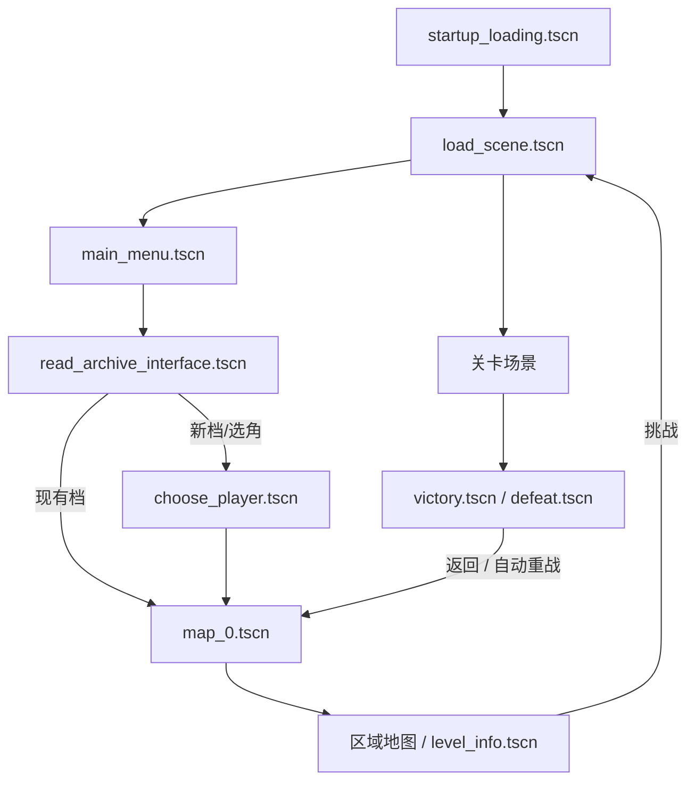

# BHYH 运行时架构

> **事实源**：运行时结构与行为以 `source/` 当前源码及 `source/project.godot` 为准。本文只描述已实现结构与仍生效边界；验证事实只见 [`status.md`](status.md)，阶段状态只见 [`../roadmap/roadmap.md`](../roadmap/roadmap.md)，门禁判据只见 [`acceptance.md`](acceptance.md)。总体目标与跨模块规则见 [`../standards/target_architecture_contract.md`](../standards/target_architecture_contract.md)。

## 1. 工程与引擎基线

仓库只有一个活跃 Godot 工程：`source/`（`project.godot` 所在处）；`docs/` 保存项目文档，`scripts/` 保存门禁与构建期工具。`source/addons/` 属第三方插件；`Art/`、`Music/`、`Font/`、`Spritesheet/` 受素材/发布边界约束，不属于公开素材内容。

| 配置 | 当前值 |
|:---|:---|
| 引擎 / 语言 | Godot **4.7.2** / GDScript 2.0，新增代码优先静态类型 |
| 主场景 | `res://Scene/runtime/startup_loading.tscn` |
| 渲染 | 默认 `mobile`；Web renderer 配置为 `forward_plus`（不代表 Web 已验收） |
| 设计画布 / 默认窗口 | **1280×800 / 1600×1000**，16:10、1.25× |
| 拉伸 / FPS | `canvas_items` + `expand`；`run/max_fps=120` |
| 自动加载 | `project.godot` 注册顺序和职责见 §2.1 |
| 物理层 / 全局组 | `[layer_names]` 见 §7；场景组为 `Player`、`Monster` |

`Scene/` 保存场景/资源，`.gd` 脚本位于 `Script/<domain>/`；命名与资源配对规则见 [`../standards/naming_standard.md`](../standards/naming_standard.md) 和 [`../standards/godot_design_standard.md`](../standards/godot_design_standard.md)。

## 2. 自动加载与运行时服务

### 2.1 `project.godot` 注册表

注册顺序属于初始化契约。下表与 `source/project.godot` `[autoload]` 保持一致：**10 项，其中 9 个业务单例与 1 个编辑器调试桥**。

| 顺序 | 名称 | 脚本 | 当前职责 |
|:---:|:---|:---|:---|
| 1 | `RoleProp` | `Script/base/base_role_properies.gd` | 角色运行时属性聚合；提供 `BaseRoleProperties` 类型 |
| 2 | `PlayerData` | `Script/memory_class/player_data.gd` | 当前 1P 档案与 `PlayerDataStore` 补全入口 |
| 3 | `MemoryClass` | `Script/memory_class/memory_class.gd` | 加密档案/设置 IO、同步与后台保存、备份 |
| 4 | `MainSet` | `Script/memory_class/main_set.gd` | 会话设置与帧率策略 |
| 5 | `MLdl` | `Script/ldl/main_ldl.gd` | 锻造台 UI 会话状态 |
| 6 | `PaSkill` | `Script/skill/passive_skills.gd` | 玩家被动属性快照；唯一写 `RoleProp.pasl_prop` 的业务入口 |
| 7 | `Global` | `global.gd` | 场景/资源/工厂组合根与既有窄 API；不得继续扩张业务状态 |
| 8 | `LocalCoop` | `Script/coop/local_coop.gd` | 本地双人档案、槽位属性、输入、共享账本与面板宿主 |
| 9 | `MCPGameBridge` | `addons/godot_mcp/game_bridge/mcp_game_bridge.gd` | Godot MCP 编辑器调试桥，不承载业务状态 |
| 10 | `ZmwsConfig` | `Script/config/config.gd` | ZMWS 数值配置查询，按需读取 |

`Global`、`PlayerData` 与属性对象通过 `get_node_or_null("/root/LocalCoop")` 处理 `LocalCoop` 较后注册的启动时序。角色代码使用 `BaseObject` / `BaseRole` 的槽位感知属性，或显式 `LocalCoop.data_for` / `props_for` / `input_for`，不假定所有对象都属于 1P。Autoload 新增/移除评审、Global 边界见 [`autoload_boundary_matrix.md`](autoload_boundary_matrix.md)；Global 的自动化表面基线由 [`../../scripts/global_surface_baseline.json`](../../scripts/global_surface_baseline.json) 管理。

### 2.2 `Global` 持有的普通运行节点

`Global._ready()` 创建并初始化 UI、音频、资源、场景流、只读诊断、工厂族与战斗运行节点；它们是普通子节点，不是 Autoload。`Global` 还持有 `RunContext`（`RefCounted`）作为单局场景/结算读取上下文。

- `UiRuntime` 拥有窗口宿主、popup 层、临时 UI 登记和缓存；关闭/切场景时只清理登记的临时 UI。
- `AudioRuntime` 拥有跨场景 BGM 与命中 SFX 仲裁；新业务声音经其公开入口。当前边界包含 45 ms 节流、同音效移动端/桌面声部上限 4/8、总声部上限 24/48。
- `ResourceRuntime` 管理场景、`SpriteFrames`、音频与纹理缓存、异步加载、预热和关卡资源租约；租约只释放自身登记的路径。加载页使用窄交接入口，不访问私有缓存。
- `SceneFlow` 校验场景路径、维护目标与请求代次，并实现唯一正式切换入口；当前入口实现为 `Global.change_scene`。
- `RuntimeDiagnostics` 暴露只读诊断；`CombatPoolRuntime` 拥有伤害文本、怪物/角色受击与声音四类池，容量分别为 **80/32/24/32**；伤害文本活动上限 80、怪物受击按父节点 55 ms 节流。
- `Global` 还组合 UI 场景工厂、关卡/怪物入口、法宝与角色资源等功能节点。具体创建、清理与普通节点边界见 [`autoload_boundary_matrix.md`](autoload_boundary_matrix.md) 与 [`runtime_lifecycle_matrix.md`](runtime_lifecycle_matrix.md)。

新服务优先采用场景节点、`Resource`、`RefCounted` 或静态工具；Global 新增字段、信号或 `add_*` 入口须通过边界评审和对应门禁。当前运行期边界不保留已删除入口的兼容 facade。

## 3. 启动、场景流与加载

`startup_loading.tscn` 是工程主场景；启动脚本在线程中加载 `load_scene.tscn`，将首帧进度作为元数据交接。冷启动没有目标场景时，加载页默认目标为 `main_menu.tscn`。新档进入选角/双人配置，现有档进入 `map_0.tscn`；地图关卡信息界面通过 `Global.change_scene` 发起挑战。双人失败须全部玩家死亡。

`Global.change_scene(target, force_loading_screen=false, require_archive_session=true) -> bool` 的实际行为：

1. `SceneFlow` 要求目标非空、后缀为 `.tscn`/`.scn` 且 `ResourceLoader.exists`；启用默认会话要求时，`res://Scene/level/` 目标还要求有效档案会话。无效目标直接 `false`，不清理运行态。
2. 接受后推进场景请求与运行时代次，关闭已登记临时 UI，按退出场景需要结束档案会话；释放旧关卡资源租约并为新目标建立租约。
3. 已预载 PackedScene 的普通 `res://Scene/level/` 目标可直接切换（`level_hdzm.tscn` 与 `force_loading_screen` 除外）；其他目标经 `load_scene.tscn`。
4. 加载页在 `_ready` 固定目标路径和请求代次。线程结果只有在代次仍有效且目标匹配时才可缓存或提交；旧请求不覆盖新请求。

返回 `true` 只表示当前引擎切换调用已接受，不保证后续加载完成。加载页使用构建期 `LevelPreloadCatalog` / `LevelPreloadStore` 与已登记资源，不运行时扫描目录或解析 manifest；加载超时默认 **120,000 ms**，`application/run/load_timeout_msec` 可覆盖。失败、取消或超时会留在加载页并显示失败，不提交未完成目标；Godot 没有公开线程加载取消接口，因此过期后台结果只停止轮询/写回/提交并丢弃。

更完整的租约、清理、退出和异步失败语义见 [`runtime_lifecycle_matrix.md`](runtime_lifecycle_matrix.md)。

## 4. 关卡、战斗对象与宠物域

### 4.1 战斗对象

| 类型 | 实际职责 |
|:---|:---|
| `BaseObject` (`CharacterBody2D`) | 战斗单位基类；暴露槽位感知的档案、属性和输入 |
| `BaseHero` / `BaseMonster` | 玩家角色行为 / 怪物与 Boss 的受击、移动、掉落及死亡结算 |
| `SummonBaseMonster` | 技能、宠物等召唤物；归属随实体元数据和槽位解析 |
| `BaseLevel` (`Node2D`) | 关卡、阶段、玩家/HUD/相机、刷怪、出口与结算编排 |
| `BaseMagicWeapon` (`Node2D`) | 法宝运行实例；跟随、MP、冷却及技能执行 |
| `BaseRole` (`Control`) | P1/P2 HUD，不是战斗实体 |

英雄的自动战斗由每个实例持有的 `AutoBattleContext` / `AutoBattleController` 推进；法宝展示、Boss 保护与通用受击反应也有按实体生命周期持有的 `RefCounted` 控制器。伤害/吸血/Buff/统计按实际出手槽位解析；弹体、召唤物、法宝与池化对象必须保留攻击者来源，不能默认归给 1P。对象池取出不代替业务 `setup()`；归还时调用清理/重置入口。

### 4.2 关卡数据与生命周期

`BaseLevel` 管理当前阶段与刷怪/出口；阶段只能单调推进。注册于 `LevelLayoutCatalog` 的关卡经 `LevelLayoutStore` 读取 `LevelLayoutEntry`，由布局提供阶段触发、屏幕/刷怪点、玩家出生点和挡板数据；关卡在 `_ready` 将已登记刷怪点展开到当前生成表。`exit_rect` 仅供 `ZmwsLevel` 定位已有出口节点；`exit_open_when` 当前未被运行时代码读取，出口开放判定仍由关卡实现。未登记关卡仍按现有脚本表/默认值运行。数据类型和构建契约见 [`level_layout_contract.md`](level_layout_contract.md)。

`ZmwsLevel` 是 `Game4ImportedLevel` 子类：把原始地图场景作为子节点组合进 BHYH 关卡，地图保留背景/地面，基类持有关卡刷怪、HUD 与结算；外部怪物 ID 经 `ExternalMonsterStore` 映射后进入现有生成/预载路径。新关卡应复用基类的阶段和退出编排。

### 4.3 宠物与玩家槽位

`LocalCoop` 在启用的桌面双人会话中创建第二个 `PlayerDataStore`、`BaseRoleProperties`、被动技能实例与 `CoopInput`，并集中注册 `p2_*` 输入。共享背包/成长账本与个体属性/技能/出战状态按 [`archive_session_matrix.md`](archive_session_matrix.md) 分属各自所有者，不交换全局 1P 档案视图。

`BaseLevel` 将关卡宠物生成委托给 `PetLevelController`；控制器按显式槽位选 `PlayerDataStore` 与 `Pet*Family` 规则，处理复原/成长属性、预热、实例化、槽位元数据和落点。宠物档案列表使用只读 `PetDomainView`；出战、休息、成长、阵法和宠物被动提交由 `PetDomainCommand` 负责并在保存失败时恢复快照。**该 View/Command 契约不代表所有宠物面板操作均已命令化**；面板其它写入边界见 [`ui_panel_contract_matrix.md`](ui_panel_contract_matrix.md)。

## 5. 档案、数据与会话

| 数据 | 当前所有者 |
|:---|:---|
| 1P 档案、加载补全与字典安全键 | `PlayerDataStore` / `PlayerData`；中文字典键经 `DataKeys` |
| 2P 档案、属性、被动与输入 | `LocalCoop` 持有的第二槽位对象；宿主负责槽位与共享数据连接 |
| 角色计算属性、被动快照 | `BaseRoleProperties`；`PaSkill` 唯一写被动属性快照，`PassiveSkillTable` 提供只读规则 |
| 音乐、画质、自动战斗等会话配置 | `MainSet.set_data` |
| 静态定义/规则 | 强类型 `Resource` / `.tres` 与对应只读 Catalog/Store；玩家实例状态留在档案/槽位 |
| 磁盘存档/设置 IO | `MemoryClass`；业务保存使用 `request_save` / `request_save_result` |

本地双人档保存在 `player_data["本地双人"]`，包含 `SAVE_VERSION=3`、启用标记及 2P 档案；低于 `SHARED_SOUL_VERSION=2` 的旧双人档仍由加载路径合并其共享灵魂。共享键登记、档案剥离和当前读写边界见 [`archive_session_matrix.md`](archive_session_matrix.md)。

本地玩家档是加密 JSON（`user://MyAr_<n>.json`）；密钥位于 `user://.save_key`，设置文件为 `user://MainGame.json`。写档先写 `.tmp`、回读校验，再轮替 `.bak` 并替换主档；后台写任务绑定档案身份代次，切档/退出先 flush，旧身份任务不写回当前档。无有效会话、非法路径/档案、补全失败或写入失败必须有可观察失败结果，不以新空档覆盖旧档。只允许当前格式有限、幂等规范化，不建立跨版本迁移链或旧目录回退。

## 6. 构建资源与运行时资产

- **构建层**从可审查的源/清单确定性生成 `.tres`、Catalog 与发布依赖清单，并通过注册转换器的 `--check` 校验；`source/Art/` 外部图像仍依赖 Godot 导入配置，缓存不能替代源与资源 UID。`.tres` / `.tscn` 使用资源头 UID，脚本/着色器按引擎规则维护伴生 `.uid`。
- **运行时层**读取共享只读 Resource 与 Catalog；关卡预载数据、布局、装备定义、外部怪物映射、角色资源清单与 `FrameSequence` 均使用当前构建生成结果，不在运行时遍历目录或解析来源 manifest。
- **AtlasMetadata** 经 `AtlasMetadataStore.view_for(path)` 提供 `AtlasMetadataView` 给消费者；序列化 `.data` 不是业务 API。schema、直接消费者和失败返回见 [`atlas_metadata_schema.md`](atlas_metadata_schema.md)。
- 普通逐帧内容优先构建期 `SpriteFrames` + `AnimatedSprite2D`；有按需驻留需要时使用 `FrameSequence` + `StreamedPngEffect`。`asset_id` 是序列身份，实例可以覆盖默认播放策略。运行时 `SpriteFrames.new()` 的许可范围以 [`../../scripts/runtime_frames_allowlist.json`](../../scripts/runtime_frames_allowlist.json) 和 [`runtime_frames_exceptions.md`](runtime_frames_exceptions.md) 为准。
- Spine 资源继续由 Spine 运行时加载，不转换成 `SpriteFrames`；运行库当前唯一承诺为 Windows x86_64 / Spine 4.3 + Godot 4.7.2，其他平台未承诺/未验证。具体平台约束见 [`spine_platform_baseline.md`](spine_platform_baseline.md)。
- `ResourceRuntime` 按作用域缓存、关卡租约与 UI 所有权释放资源；异步写回校验运行时代次。源码/预设声明不等于 PCK 闭包或目标平台性能通过；包验证命令与阻断语义见 [`acceptance.md`](acceptance.md)。

不得新增运行时 manifest 解析、目录猜路径、磁盘逐帧 IO 或缺失资源静默回退。每项预热/缓存必须有所有者、作用域和释放路径。

## 7. UI、显示、输入与物理层

### 7.1 HUD 与面板

- 战斗 HUD 由 `role_information.tscn` 挂载两个 `BaseRole`，各绑定 P1/P2 槽位；场景就绪后再揭示，覆盖式切换时不提前显示。
- 桌面布局契约：底部居中宠物/技能/法宝/背包/设置 **5 个 54×54 按钮**，间距 5、底边距 4；左下无双槽及 `Y/U/I/O/L` 技能键槽；P2 镜像布局用小键盘 3/4/5/6/8 标签。移动端保留触控布局，不套用桌面 HUD。
- 面板/弹窗由 `Global` 的场景工厂创建，挂入 `UiRuntime.windows` 或 popup 层；临时 UI 显式登记清理。协作面板通过 `CoopPanelHost` 管窗口栈、暂停、槽位和关闭保存。
- 唯一正式 Theme 为 `Scene/theme/bhyh_theme.tres`；不配置全局 `gui/theme/custom`。Theme token、字体角色及静态/动态覆盖判据见 [`ui_theme_contract.md`](ui_theme_contract.md)、[`typography_tokens.md`](typography_tokens.md) 与 [`../standards/ui_typography_contract.md`](../standards/ui_typography_contract.md)。

### 7.2 显示与相机

`project.godot` 的画布、默认窗口与拉伸契约见 §1.2。关卡相机 zoom 固定基线为 **1.2**；纵向偏移按当前 viewport 高度、设计 zoom 与原取景 zoom **1.3559** 计算，以保留原下缘视野；双人时取存活玩家中心。桌面/触控分辨率约束见 [ADR-016](../decisions/ADR-016-display-canvas-window-and-hud-baseline.md)。

### 7.3 输入与具名 2D 物理层

常规动作写于 `project.godot` `[input]`；`LocalCoop` 从集中 `P2_KEYS` 映射注册 `p2_*`，行为脚本通过 `CoopInput` / `PlayerInput` 读取。新增动作不得散写裸键字符串；具体平台布局以输入配置和双人会话为准。

物理层名称来自 `project.godot` `[layer_names]`，层号与脚本掩码位值按 Godot 的 `1 << (layer - 1)` 对应。`PhysicsLayers` 只为脚本实际使用的层定义具名常量；新代码使用已定义常量或具名层配置，不新增无说明的裸掩码。

| 层 | 配置名 | 层 | 配置名 |
|:---:|:---|:---:|:---|
| 1 | 环境 | 10 | 陷阱检测 |
| 2 | 角色 | 11 | 法宝 |
| 3 | 怪物 | 12 | 角色攻击检测怪物受伤（） |
| 4 | 吸血 | 13 | 蝙蝠石像检测陷阱 |
| 5 | 出口 | 14 | 牛魔四其他的不要选这个 |
| 6 | 台阶 | 15 | 汪汪检测的地面 |
| 7 | 火魔斩检测范围 | 16 | 汪汪检测墙壁 |
| 8 | 怪物攻击范围检测玩家受伤范围，蝙蝠吸血 | 17 | 汪汪检测可跳跃墙壁 |
| 9 | 陷阱 |  |  |

## 8. 当前契约入口

本文只保留运行时架构与少数必要实现事实；专题行为以其唯一维护页为准：

- [`autoload_boundary_matrix.md`](autoload_boundary_matrix.md)：Autoload 评审、Global 边界。
- [`runtime_lifecycle_matrix.md`](runtime_lifecycle_matrix.md)：场景切换、缓存租约、异步结果与清理。
- [`archive_session_matrix.md`](archive_session_matrix.md)：存档入口、会话、槽位、共享账本与失败语义。
- [`pet_domain_contract.md`](pet_domain_contract.md) 与 [`ui_panel_contract_matrix.md`](ui_panel_contract_matrix.md)：宠物 View/Command 与面板调用边界。
- [`level_layout_contract.md`](level_layout_contract.md)、[`equipment_data_contract.md`](equipment_data_contract.md)：关卡布局和装备定义/实例边界。
- [`atlas_metadata_schema.md`](atlas_metadata_schema.md)、[`runtime_frames_exceptions.md`](runtime_frames_exceptions.md)：图集 View、构建帧与运行时建帧例外。
- [`ui_theme_contract.md`](ui_theme_contract.md)、[`spine_platform_baseline.md`](spine_platform_baseline.md)：UI 资源和 Spine 平台边界。
- [`../standards/godot_design_standard.md`](../standards/godot_design_standard.md)：新增/重构代码的场景、Resource 与 Autoload 设计规范。
- [`../decisions/README.md`](../decisions/README.md)：已接受架构决策；[`../../scripts/README.md`](../../scripts/README.md)：门禁与工具索引。
