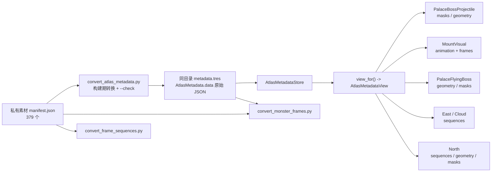

# AtlasMetadata 生产者、schema 与消费者矩阵

> **状态**：Phase 14 已完成并归档（2026-10-28）。六个直接消费者均已迁移到 `AtlasMetadataView`；`AtlasMetadataStore.data_for`、`validate_path`、`clear_cache`、`NorthBossProjectile.source_masks` 与惰性 atlas 配置已删除；`contract_scan.py` 的 `atlas_boundary` 规则已阻断旧入口、非 View `.data` 与 `source_masks` 覆盖。
> **范围**：`manifest.json` → `metadata.tres` → `AtlasMetadataStore` → 生产消费者，以及直接读取源文件的构建工具。
> **事实快照**：本页数量来自当前私有完整素材工作区；公开 clone 缺少 `source/Art/`，不能复现本页的 379 个 manifest 与 267 个运行时可达资源。当前实现与验证事实分别见 [`architecture.md`](architecture.md)、[`status.md`](status.md)。
> **目标边界**：总体目标见 [`target_architecture_contract.md`](../standards/target_architecture_contract.md) §5、§7；Phase 14 批次见 [`iteration_14_atlas_metadata_boundary.md`](../archive/iteration_14_atlas_metadata_boundary.md)。

## 1. 数据流与职责



- 仓库内唯一的 AtlasMetadata 生产者是 `scripts/convert_atlas_metadata.py`；它把每个 `manifest.json` 原样写入同目录 `metadata.tres`，只对顶层数组包装 `__top_level=array` 与 `items`。
- 运行时入口只有 `AtlasMetadataStore.view_for(path)`，返回只读 `AtlasMetadataView`；`data_for` 已删除。六个直接消费者均走该入口，空路径与无效 path 由 Store 报告并返回 `null`。
- 构建期工具直接读取 `metadata.tres` 文本或源 manifest；它们不应被误算成运行时 `AtlasMetadataStore` 消费者。
- `manifest.json` 的生成链路不在公共仓库；本页只覆盖已入库的转换器与运行时读取边界。

## 2. 源文件形态

### 2.1 当前快照

`source/Art/**/manifest.json` 共 **379** 个，均有同目录 `metadata.tres`，`convert_atlas_metadata.py --check` 为 **379/379 同步**。按顶层键/值形态分为 8 组：

| 形态 | 数量 | 代表路径 | 运行时读取 |
|:---|:---:|:---|:---|
| `pages + sequences + files` | 95 | `monster/swf_png/3005/atlas/manifest.json` | `sequences` 可被 East 读取；`files` 未被 Store 消费者读取 |
| `pages + sequences` | 63 | `monster/swf_png/.../atlas/manifest.json` | East 读取 `sequences` |
| `pages + sequences + masks` | 54 | `monster/cloud_boss/model_3352/manifest.json` | Cloud/North/Palace/Projectile 读取 `geometry`、`masks`、`sequences` |
| `animation + frames` | 130 | `mount/runtime/mounts/.../manifest.json` | MountVisual 读取完整动画结构 |
| `animations`（旧形态） | 18 | 剑 Boss、北俱芦洲道具、角色特效 | 无 Store 读取；剑 Boss 由构建期帧转换器读取 |
| 顶层数组 | 16 | 关卡地图、角色装备图集 | 无 Store 读取 |
| `files`（独立关卡图集） | 1 | `level/game_4_level/runtime_atlas/level_50_52` | 无 Store 读取 |
| 索引/其它字典 | 2 | `constellations/`、`monster/swf_png/` 索引 | 无 Store 读取 |

合计 379。不同目录的键组合共有 18 种签名；它们不构成 18 套运行时类型。

### 2.2 结论

原先“四种 schema”的说法不足以覆盖真实输入：

- `files` 既可以是 `pages + sequences` 的可选字段，也可以是独立关卡图集；
- 存在旧 `animations` 形态、顶层数组和纯索引入口；
- 运行时 Store 实际只直接使用两类顶层数据：
  1. `pages + sequences`（可带 `files`、`geometry`、`masks`）；
  2. `animation + frames`（MountVisual）。
- `files`、旧 `animations`、顶层数组与索引字典是构建/溯源边界，不应为了“统一”强行生成运行时对象。

## 3. 资源域与运行时可达范围

按 Store 的路径规则统计，**267** 个 metadata 资源可被当前运行时入口按路径触达；这不等于所有资源都会在每一局加载。`view_for` 支持 `pages+sequences` 与 `animation+frames`：137 个序列资源、130 个 Mount 动画资源均可建立 View。

| 资源域 | 路径规则 | 可触达数量 | 实际读取者 |
|:---|:---|:---:|:---|
| East 普通怪物 | `Art/monster/swf_png/<id>/atlas/metadata.tres` | 83 | `EastContinentMonster` 及子类 |
| North 怪物 | `Art/monster/north_original/<model>/metadata.tres` | 51 | `NorthContinentMonster` |
| Palace Boss | `Art/monster/palace_boss/<kind>/metadata.tres` | 2 | `PalaceFlyingBoss` |
| Cloud Boss | `Art/monster/cloud_boss/model_3352/metadata.tres` | 1 | `CloudBoss` |
| 坐骑运行时 | `Art/mount/runtime/mounts/<mount>/<candidate>/metadata.tres` | 86 | `MountVisual` |
| 坐骑特效 | `Art/mount/runtime/effects/<mount>/<candidate>/metadata.tres` | 44 | `MountVisual`（effect root） |
| **合计** | | **267** | 6 个代码调用点 + 间接弹体读取 |

其余 112 个 metadata 未被 `AtlasMetadataStore` 路径规则触达；它们可能只服务构建、溯源、地图/角色图集或尚未迁移的代码，不能据此断言“无消费者”。本阶段只确认 Store 边界。

## 4. 运行时消费者矩阵

**直接 Store 调用点**共 6 个，全部使用 `view_for`：Cloud、East、North、PalaceBossProjectile、PalaceFlyingBoss 与 MountVisual。`data_for` 已删除；弹体会从 Cloud/North/Palace 接收同一批 metadata 路径，形成间接读取，但不新增资源域。

| # | 消费者 | 路径来源 | 使用字段 | 共享/复制 | 失败路径 |
|:---:|:---|:---|:---|:---|:---|
| 1 | `Script/monster/cloud_boss.gd` | 固定 `cloud_boss/model_3352/metadata.tres` | View 的 `geometry[sequence].center`；继承 East 读取 `sequences`；向 `PalaceBossProjectile` 传同一路径 | `_cloud_view` 为只读 View，不再保存共享字典 | View 无效时视觉偏移为零；Store 报告失败 |
| 2 | `Script/monster/east_continent_monster.gd` | `swf_png/<monster_kind>/atlas/metadata.tres`，不存在时返回空路径；PalaceFlyingBoss/CloudBoss 继承此路径 | View 的 `sequence_frame_count`、`frame_reg_anchor`、`frame_size`、`frame_center` | Store 按路径缓存只读 View；删除 `_east_metadata_cache` | View 无效或路径为空时帧数为 0、anchor 为零、帧几何为哨兵；不直接索引裸字典 |
| 3 | `Script/monster/north_continent_monster.gd` | `north_original/<model>/metadata.tres` | View 的 `sequences`、`geometry`（`center`/`size`/`origin`）、`masks`；传路径给弹体 | `_north_view` 为只读 View；`source_masks` 已删除，mask alias 由 `mask_sequence` + View 处理 | View 无效时序列为 0/哨兵、几何为零；`NorthBossProjectile` 无 View 时拒绝配置 |
| 4 | `Script/monster/palace_boss_projectile.gd` | 配置键 `source_masks_metadata`，来自 Cloud/North/Palace | View 的 `masks` / `geometry`；NorthBossProjectile 使用 `mask_sequence` 别名选择 mask，不再写 `source_masks` | `view_for` 返回只读 View；无额外覆盖字典 | 非空路径 view 无效时 `configure()` 返回 false；空路径表示未请求 masks |
| 5 | `Script/monster/palace_flying_boss.gd` | `palace_boss/<monster_kind>/metadata.tres` | View 的 `geometry`（`center`/`size`/`origin`）与 `masks["hit1"]`；`sequences` 仍经 East 继承；传路径给弹体 | `_palace_view` 为只读 View，不再保存共享字典 | View 无效时自有几何为零、hit1 碰撞禁用；Store 报告失败；继承 East 序列仍为迁移期行为 |
| 6 | `Script/mount/mount_visual.gd` | `Art/mount/runtime/mounts|effects/<mount>/<candidate>/metadata.tres` | View 的 `animation`/`fps`/`loop`/`frame_count`、帧层 `page`/`region`/`offset`、`ride`/`official_ride`；原生骨骼 parts 分支不走 metadata | `view_for` 返回只读 View；骨骼分支保留 parts 数据 | 非空路径 View 无效时 `play()` 返回 false；缺失候选在 `ResourceLoader.exists` 处返回 false |

### 4.1 字段契约

| 字段 | 实际结构 | 使用者 | 说明 |
|:---|:---|:---|:---|
| `pages` | `[{path: String}]` | 构建期 `convert_monster_frames` | 运行时消费者不读取；不可用它推断加载依赖 |
| `sequences` | `{name: {frames: [[frame, page, x, y, w, h, margin_l, margin_t, margin_r, margin_b]]}}` | East、Cloud、North、Palace | 运行时几何使用 `w/h/margin`；构建期使用页索引与 region |
| `geometry` | `{name: {center: [x,y], size: [w,h], origin: [x,y]}}` | Cloud、North、Palace、Projectile | `center` 用于视觉/受击中心，`size`/`origin` 用于碰撞与取景；`source_*` 仅是溯源 |
| `masks` | `{name: [[x, y, w, h] or []]}` | North、Cloud、Palace、Projectile | 空 mask 是合法“无碰撞”；不能把空数组当作缺失资源 |
| `animation` + `frames` + `back_atlases`/`front_atlases` | 动画名、FPS、loop、帧数、图集页名、逐帧 back/front/ride | MountVisual | 页名相对于 `_base_path`；`region` 与 `offset` 是显示几何 |
| `files` | 路径映射/清单 | 未发现 Store 消费者 | 不建立运行时 accessor；仅作为构建/溯源数据 |
| `animations` | 旧动画名到帧条目的映射 | `convert_monster_frames`（剑 Boss 目标） | 不作为运行时统一 schema |
| 顶层数组 `items` | 地图图层或装备图集条目 | 未发现 Store 消费者 | 不建立通用运行时模型 |

`AtlasMetadataView` 已覆盖 `pages+sequences` 的序列帧元组、页索引、geometry、masks，以及 `animation+frames` 的 fps/loop/frame_count/图层/transform 校验；`AtlasMetadata.validate()` 仍保留浅层资源级检查。East、Cloud、PalaceFlyingBoss、East 继承序列路径与 North 已在 14-3B-2/14-3B-3 迁移；六个直接消费者均使用 View。

## 5. 构建期消费者

| 工具 | 读取范围 | 当前结果 | 与运行时边界 |
|:---|:---|:---|:---|
| `scripts/convert_atlas_metadata.py` | 全部 379 个 manifest | `--check` 379 同步；`--self-test` 4 个帧数样本通过 | 生产者；输出 `metadata.tres` |
| `scripts/convert_monster_frames.py` | `Art/monster/**/metadata.tres`，其中 194 个含序列/旧动画 | 152 个目标（148 个 `sequences`，4 个旧 `animations`）；41 个空序列 + 1 个聚合宠物跳过 | 生成 `*_frames.tres`；不进入运行时 Store |
| `scripts/convert_frame_sequences.py` | 4 个剑阵 `manifest.json` 的 `pages`/`animations` | 4 套 × 3 个动作 | 生成流式帧序列；不进入运行时 Store |
| `scripts/contract_scan.py` | `.tres` 中 `script_class="AtlasMetadata"` | 跳过其内部源路径，不作为运行时依赖扫描 | 防止把构建溯源路径误算成依赖 |

构建工具的成功条件不能证明运行时消费正确；同样，运行时读取通过不能代替 `--check` 的源/生成同步。

## 6. 已发现但不在 Store 边界的引用

以下配置/常量在当前代码中没有形成 AtlasMetadata 读取链，不能在 Phase 14 中当作消费者继续类型化：

- `emei_boss3040.gd`、`emei_boss3041.gd`、`linggan_king_boss.gd`、`monster_3370.gd` 写入 `atlas_metadata`/`atlas_sequence` 配置；
- `nanhai_projectile.gd` 把 `atlas_metadata`、`impact_atlas_metadata` 读入成员变量，但当前没有读取这些成员来加载 AtlasMetadata；`_configure_atlas_visual()` 直接返回 `false`；
- `minghai_boss3117.gd`、`zhuque_street_monster.gd` 定义 `ATLAS_METADATA` 常量，但静态检索未发现其使用；
- `source_masks_metadata` 是唯一的运行时“间接 metadata 路径”配置，读取者为 `palace_boss_projectile.gd`，来源为 Cloud/North/Palace；
- 4 个 `atlas_metadata` 写入方、2 个未使用常量与 `nanhai_projectile` 惰性成员已在 Phase 14-4 清理；`contract_scan.py` 守卫旧入口。

`AtlasMetadataStore.validate_path()`、`clear_cache()` 与 `data_for()` 已删除；`view_for("")` 统一报告空路径并返回 `null`，不再存在静默空字典入口。

## 7. 失败、缓存与身份风险

| 问题 | 证据 | Phase 14 处理方向 |
|:---|:---|:---|
| 共享字典泄露可写面 | `data_for` 已删除，六个直接消费者均只读 View；`AtlasMetadata.data` 仍为序列化内部字段 | 业务不可直接读 `.data`；保留序列化拥有者内部边界 |
| 空数据静默退化 | 各 View 消费者在无效路径下返回零/哨兵或拒绝配置；North 的 View 无效时同样退化且 `NorthBossProjectile` 拒绝配置 | 14-4 继续核对失败语义与边界守卫；不再保留裸字典回退 |
| schema 校验浅层 | `AtlasMetadata.validate()` 未验证帧元组、页索引、geometry/masks、Mount 帧 | `AtlasMetadataView` 已深度校验 `pages+sequences` 与 `animation+frames` |
| Store 公共 API 未使用 | `validate_path`/`clear_cache` 已删除 | 保留 `view_for` 作为唯一公开入口 |
| metadata 缺少资源头 UID | `render_tres()` 未生成 `uid://`，资源身份当前是路径 | 已按 ADR-022 登记为路径身份例外；不在本次或 14-3B-3 中加 UID |
| 旧配置残留 | 4 个 `atlas_metadata` 写入方、2 个未使用常量与 `nanhai_projectile` 惰性成员已清理 | 不把它们加入 typed 消费者清单；由 `contract_scan.py` 守卫旧入口与 `.data`/`source_masks` |

## 8. Phase 14-2/14-3A/14-3B-1 已实现子集

本次已实现：

1. **只读 View**：`AtlasMetadataView` 覆盖 `pages+sequences` 的长度、帧几何、geometry、masks，以及 `animation+frames` 的播放参数/图层/rider transform；不建立 `pages`/`files` 的通用对象图。
2. **Store 入口**：`view_for(path)` 做路径、资源类型、浅层与深度 schema 校验，按路径缓存 View；失败返回 `null` 并报告。
3. **消费者**：`PalaceBossProjectile` 使用 View 读取 masks/geometry；`MountVisual` 使用 View 读取 metadata 动画；`PalaceFlyingBoss` 使用 View 读取自有 `geometry`（`center`/`size`/`origin`）与 `masks`；East/Cloud/North 使用 View 读取序列/几何；`NorthBossProjectile` 的 `source_masks` 已删除，mask alias 通过 `mask_sequence` 选择。
4. **14-4 收口**：清理 4 个 `atlas_metadata` 写入方、2 个未使用常量与 `nanhai_projectile` 惰性成员；新增 `contract_scan.py` 的 `atlas_boundary` 规则，阻断旧 `data_for`/`validate_path`/`clear_cache`、非 View `.data` 读取与 `source_masks` 覆盖。

约束：

- 不建立 `files` 通用 accessor、旧 `animations` 运行时模型、顶层数组模型或索引字典模型。
- 所有声明路径的缺失/类型错误必须由消费者显式处理；不得用 typed 失败后读 `.data` 或旧路径回退。
- `convert_monster_frames` 继续直接读取源 metadata；其 152 目标与 4 个旧动画形态不要求运行时 typed 化。

## 9. 验证与复现

构建期调查与本次实现验证：

```bash
python scripts/convert_atlas_metadata.py --check
python scripts/convert_atlas_metadata.py --self-test
python scripts/convert_monster_frames.py --check
```

结果：Atlas 同步 **379/379**；帧数负向自测 **4/4**；怪物帧检查 **152 目标 / 152 校验 / 0 缺失 / 0 失败**，跳过 **42**（41 空序列、1 聚合宠物）。

运行时验证：

- 临时 GDScript 探针对全部 **267** 个运行时资源建立 View（137 个 `pages+sequences`、130 个 `animation+frames`），**267/267 PASS**；
- `MountVisual` 的 metadata 动画 `aoyi_skill` 播放与 `get_animation_visual_bounds` PASS；
- 临时 GDScript 探针对 Palace 3323/3343 的 `geometry`（`center`/`size`/`origin`）与 `hit1` masks 逐值比对原始 `.data`，**PASS**；
- East/Cloud 辅助探针覆盖 **149** 个序列资源、**1310** 个序列、**40222** 帧，逐帧比较帧数、registration anchor、center/size/has_visual，**PASS**；
- North View 探针覆盖 **51** 个资源、**586** 个序列、**20263** 帧、**1788** 个 mask，逐值比较 **PASS**；
- `level_72`、`level_75`、`level_76`、`level_81` 定向冒烟 PASS；L2：`level_1` PASS、`coop_probe_runner` **16/16 PASS**、`scene_probe_runner` **4/4 PASS**；全量关卡回归 **PASS 128/128 + SKIP 5，FAIL 0**（731.3s；`level_dsg_1` 单次瞬态重试通过），日志门禁 **0 ERROR / 0 WARNING**；
- `contract_scan.py --self-test` 的 AtlasMetadata 边界坏样本 **5/5** 拦截、好样本 **4/4** 放行；
- `check_all --godot-bin` **8/8 PASS**；`health_check` **0 Parse / 0 Error / 0 Warning**。

临时探针已删除；未修改素材、既有 UID 或归档。再次调查时应从当前源码、资源与命令输出重新生成，不把本页数量当作长期 SLA。
