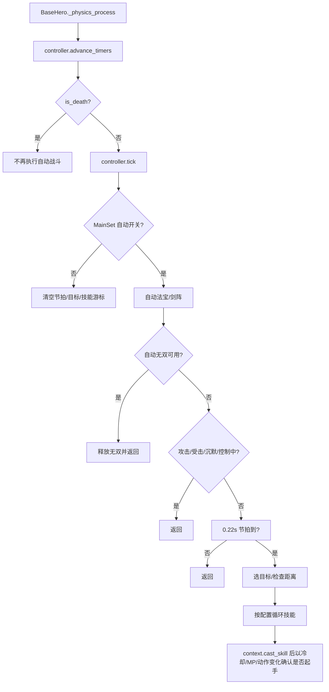
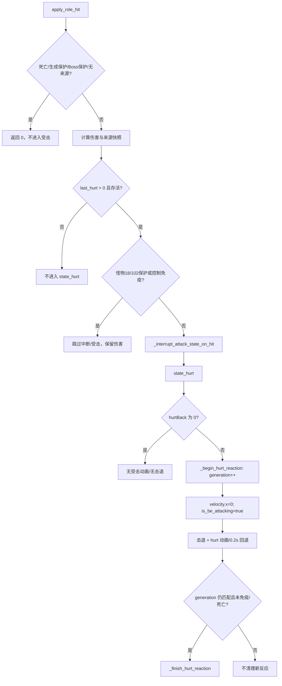

# 战斗实体行为与验证映射（Phase 25-0~25-5）

> **状态**：Phase 25-0 行为映射、25-1 自动战斗控制器、25-2 法宝展示实例、25-3 Boss 保护状态、25-4 受击/来源归属加固与 25-5 阶段验收已完成（2026-11-04 最终验证），Phase 25 已关闭。本页保留行为切片、调用方、验收场景与回滚边界；阶段验收结论见 [`current-iteration.md`](../roadmap/current-iteration.md) §25-5。
> **范围**：`BaseHero` 自动战斗与受击反应、`BaseMonster` 受击反应/控制免疫/死亡，以及 `MainSet`、`BaseLevel`、`BaseThroughLevel`、胜利/失败场景和现有探针的调用面。
> **非目标**：不改战斗数值、动作时序、碰撞层、输入映射或存档格式；不引入 ECS；不把这些调查结论写成已完成迁移。

---

## 1. 首批切片选择

| 候选 | 状态面 | 调用面 | 独立性与风险 | 结论 |
|:---|:---|:---|:---|:---|
| 自动战斗 | 6 个状态字段、20 个方法已迁入 `AutoBattleController`；配置/重试入口保留 | `BaseHero`、`AutoBattleContext`、`AutoBattleController`、`MainSet`、`auto_battle_config`、`BaseLevel`、`BaseThroughLevel`、胜利/失败场景 | 目标、技能游标、节拍、移动/跳跃与装备调用顺序已独立；不直接决定伤害归属；新增 `LocalCoopAutoBattleProbe` | **25-1 已完成** |
| 受击反应 | `_hurt_reaction_active`、`_hurt_reaction_generation`、`is_be_attacking`、控制免疫、Boss 保护、死亡 | 37 个文件包含 `state_hurt` 定义（含基类与覆写），3 个文件包含 `play_hit_effect` 定义，并与伤害/来源/死亡/Boss 保护交叉 | 子类覆写多，和来源归属、Boss 阶段、死亡结算共享状态；独立生命周期较弱 | 25-4 已完成加固，先保留映射记录 |

**决策**：25-1 已先抽 `BaseHero` 自动战斗；25-4 已做受击与来源归属加固。理由不是文件行数，而是自动战斗有独立输入/节拍/目标/技能游标，受击反应与伤害、控制免疫和子类覆写耦合更深。

---

## 2. `BaseHero` 自动战斗（25-1 已迁移）

### 2.1 状态与所有者

| 状态 | 当前位置 | 写入方 | 含义/重置 |
|:---|:---|:---|:---|
| `MainSet.auto_battle_enabled_runtime` | `Script/memory_class/main_set.gd` | `auto_battle_config._on_save_pressed` 置 true；`set_menu` 置 false | 仅运行时标志，不写持久设置；应用重启回到 false |
| `AutoBattleSkills` / `AutoBattleSkillsByRole` / `AutoBattleSkillsBySlot` | `MainSet.set_data` | `auto_battle_config._persist_current_skill_config` | 技能列表、角色回退、槽位覆盖；按 `coop_slot` 读取 |
| `AutoBattlePlayerSlot` | `MainSet.set_data` | `auto_battle_config` | 只选择配置界面正在编辑的 1P/2P；当前不被 `BaseHero` 用来选择目标或启用开关 |
| `AutoBattleWushuang` / `AutoBattleRetry` / `AutoBattleSkillOnly` / `AutoBattleMagicWeapon` / `AutoBattleSwordArray` | `MainSet.set_data` | `auto_battle_config` | 无双、自动重试、仅技能、自动法宝、自动剑阵 |
| `AutoBattleController._elapsed` | `Script/base/auto_battle_controller.gd` | `tick` | 技能节拍；关闭自动时归零 |
| `AutoBattleController._target_search_elapsed` | 同上 | `advance_timers` 累加、`get_target_for_tick` 归零 | 目标缓存/重选节拍；关闭自动时归零 |
| `AutoBattleController._target` | 同上 | `get_target_for_tick`、关闭自动、`reset` | 当前目标；失效、死亡、出树或不是 `BaseMonster` 时替换 |
| `AutoBattleController._skill_cursor` | 同上 | 技能循环 | 下一次技能尝试位置；关闭自动/空列表时归零 |
| `AutoBattleController._skill_cast_counts` | 同上 | 技能循环 | 每个技能已释放次数；与配置 `count` 比较；关闭自动/空列表/失效 ID 时清理 |
| `AutoBattleController._jump_elapsed` | 同上 | `advance_timers` 累加、跳跃成功归零 | 障碍跳跃冷却；关闭自动不重置，下一次启用可能立即允许跳跃 |

### 2.2 输入与调用链

| 来源 | 消费方 | 语义 |
|:---|:---|:---|
| `MainSet.is_auto_battle_enabled()` | `AutoBattleController.tick`、`process_movement`、`BaseLevel`/`BaseThroughLevel` | 全局开关；1P/2P 共用，不由 `AutoBattlePlayerSlot` 单独启用 |
| `AutoBattleSkillsBySlot[slot][role]` → `AutoBattleSkillsByRole[role]` → `AutoBattleSkills` | `AutoBattleContext.get_skill_entries` | 槽位优先、角色回退、旧配置最后；按 `coop_slot` 取，不按配置界面的当前编辑槽位取 |
| `current_scene.get_active_monsters()`，否则 `get_tree().get_nodes_in_group("monsters")` | `AutoBattleContext.get_target_candidates` / `AutoBattleController.get_target_for_tick` | 目标候选；排除死亡、`no_target`、召唤/宠物、出树/待释放对象 |
| `BaseMonster` 位置/生命周期 | `BaseHero.is_auto_battle_target_valid`、`AutoBattleContext` 距离查询、控制器移动 | 目标在 1800 搜索半径、攻击距离/垂直 220 内才施法；失效后重新选择 |
| `MainSet.set_data["AutoBattleSkillOnly"]` | `AutoBattleController.tick`、`process_movement` | 仅技能：跳过目标距离门禁、清空目标并停止移动 |
| `get_skill`、`BaseHero.is_auto_battle_skill_active`、`AutoBattleContext.can_use_skill`/`cast_skill` | `AutoBattleController.tick` 及子类覆盖 | 技能释放；冷却/MP 不足跳过；子类可声明技能处于激活态，避免重复释放 |
| `use_fb`、`_try_use_main_sword_array`、`ws_skill` | `AutoBattleContext.try_use_magic_weapon`/`use_sword_array`/`try_activate_wushuang` | 自动法宝/剑阵/无双配置；控制器保持先法宝、后剑阵、再无双的顺序 |
| `PlayerInput` | `BaseHero._physics_process`/`noarmal_control` | 自动战斗开启且非仅技能时，`noarmal_control` 调用控制器移动后直接返回，跳过手动移动/技能/跳跃分支 |

### 2.3 单帧顺序与生命周期

- `_exit_tree` 调用 `AutoBattleController.reset()`，清空目标、技能游标、计数和全部计时器；新英雄重新开始。
- 死亡路径在 `_physics_process` 中设置 `is_death`、清控制并播放死亡；自动战斗从下一帧起跳过。
- 暂停由 SceneTree 暂停控制；自动战斗没有独立暂停状态。
- 场景切换销毁旧英雄；新英雄在自动开关仍为 true 时重新开始，旧目标不得跨场景复用。
- `AutoBattleRetry` 由 `BaseThroughLevel._restart_level_for_auto_battle`、`victory.gd`/`defeat.gd` 的自动重战和 `level_llbt.gd` 的自动推进消费；自动控制器不拥有保存/切场景。

### 2.4 失败与边界

| 场景 | 当前行为 | 25-1 验证/结果 |
|:---|:---|:---|
| 无目标/全部死亡 | 目标为 null；非仅技能时向右移动，可能持续到墙边 | 不空引用、不无界移动；停止/巡逻策略必须先取证再改 |
| 目标无效/死亡/召唤物 | `BaseHero.is_auto_battle_target_valid` 排除并重选 | 不误选宠物、召唤物、待释放对象、`no_target` 怪物 |
| 技能列表为空/全部已满 | 清空游标/计数，不施法 | 不空循环、不重复清状态 |
| 冷却/MP 不足 | `AutoBattleContext.can_use_skill` 跳过；循环尝试其他技能 | 不扣 MP、不推进错误技能计数 |
| `get_skill` 无起手 | 以冷却/MP/`is_using_skills`/`get_action` 变化判定；无变化则继续尝试 | 不把失败起手计入 `count`，不无限重复同一技能 |
| 技能激活态 | 子类 `is_auto_battle_skill_active` 返回 true 时清计数并推进游标 | 角色 3 `sd`、角色 4 `wdzt`、哪吒阴阳/火莲等覆盖不得回退 |
| 地形阻挡 | 滑动碰撞 + 射线；障碍时按 0.8s 冷却跳跃；`is_bound_to_the_ground`/空中/攻击中禁止 | 不穿墙、不丢失跳跃冷却、不改碰撞层 |
| 沉默/眩晕/冰冻/定身/攻击/受击 | 自动技能与移动提前返回；装备/无双在控制门禁前执行 | 保持现有优先级；25-1 不把装备/无双误移入控制门禁之后 |
| 仅技能模式 | 停止移动、清目标，只按节拍释放技能 | 不意外追击或回头移动 |
| 手动输入 | 自动移动分支绕过手动移动/技能/跳跃；但 `is_t_mc` 的角色 3 分支仍读取手动技能键，手动法宝输入也仍在外层读取 | 现状保留，未在 25-1 隔离；不声称已消除冲突 |
| 双人 | 开关为全局；每个英雄按自身 `coop_slot` 读技能；配置界面只编辑 `AutoBattlePlayerSlot` 对应档案 | 验证 P1/P2 配置隔离、目标互不覆盖；不把 `AutoBattlePlayerSlot` 当运行时启用开关 |
| 自动重试/切关 | `BaseThroughLevel`/胜利/失败/玲珑塔分别拥有重试/转场；保存失败保留当前场景 | 未改转场与保存次数；场景退出清目标已覆盖 |
| 退出/死亡/暂停 | 死亡跳过、暂停冻结、退出清理；未清理的计时器在重新启用时可能已累计 | 验证重新启用不残留旧目标/计数 |
| 冷却时间基 | `role1_skill_inter` 在 `_physics_process` 中按每帧 `0.1` 递减；自动节拍按 `delta` 累加 | 25-1 不得顺手把冷却改成 delta 或改变释放节奏；先记录该现状 |
| 目标候选声明 | 25-1 已删除重复声明，保留单一声明 | 行为不变；由 `LocalCoopAutoBattleProbe` 覆盖目标缓存 |

### 2.5 25-1 已完成边界

- 已落地：`AutoBattleController` 拥有目标缓存/筛选、技能游标与计数、0.22s 节拍、移动/朝向/障碍跳跃、自动法宝/剑阵/无双的调用顺序；`AutoBattleContext` 是唯一查询/命令边界。
- `BaseHero` 保留：实体根、`_physics_process` 顺序、`get_skill`/`use_fb`/`ws_skill` 等公开能力、输入视图与死亡/场景生命周期。
- 控制器通过显式上下文读取：自动开关、配置、当前场景活跃怪物、自身位置/朝向/移动状态、技能冷却/MP/起手结果、槽位与角色键；不直接读取/写入 UI 或存档。
- 不在 25-1 迁移 `BaseThroughLevel` 的自动重试/转场；不在同一批改手动输入映射、碰撞层或动作时序。
- 回滚边界：保留现有 `MainSet` 配置键和 `BaseHero` 公开入口；控制器不得成为 Autoload；关闭自动开关立即停止目标/移动/技能并清理游标。
- 25-1 新增文件：`source/Script/base/auto_battle_context.gd`、`auto_battle_controller.gd`；`BaseHero` 保留 `auto_battle_context`/`auto_battle_controller` 实例字段与 `is_auto_battle_target_valid`/`is_auto_battle_skill_active` 公开钩子。

### 2.6 25-2 法宝展示实例

| 状态 | 位置 | 写入/读取 | 说明 |
|:---|:---|:---|:---|
| `_target` | `MagicWeaponPresentationController` | 创建/切换/移除/退出 | 当前装备法宝的 `BaseMagicWeapon` 展示实例；失效或待释放时按 null 处理 |
| `_active_name` | 同上 | 创建/切换 | 当前实例对应的装备名；空选择回退到 `法宝[0]` 后更新 |
| `magic_weapon_presentation` | `BaseHero` | `_ready` 创建、`_exit_tree` 清理 | 每个英雄一份，不是 Autoload，不写共享资源 |
| `实战法宝` / `法宝` | `PlayerData` | 控制器读取；空选择/退役项回退时写回当前档案 | 槽位档案来源；P1/P2 各读自身 `PlayerData` |

生命周期与顺序：

- `_ready` 创建控制器；`_load_equipped_magic_weapon_deferred` 等两帧并预热资源后 `refresh`。
- `_physics_process` 每帧调用 `tick`，保持旧顺序：空选择 → 装备名变化 → 缺失补建。
- 切换时释放旧实例，再经 `Global.add_magic_weapon` 创建新实例；`MagicWeaponRuntime` 继续按 `coop_slot` 持有槽位召唤与场景路径。
- `use_fb` 只读取 `BaseHero.get_magic_weapon_target()` 并设置 `is_use`；`is_canuse`、`fb_cd`、`usecd`、`skill_cd`、`show_skill` 仍归 `BaseMagicWeapon`。
- 空 `实战法宝` 从 `法宝[0]` 回退；退役法宝名清空；空 `法宝` 列表释放实例。
- 英雄退出调用 `clear()` 释放展示实例；死亡期间的视觉隐藏/冷却仍由 `BaseMagicWeapon` 自身与场景生命周期处理，不新增伤害或冷却改动。
- `user_key` 的法宝冷却读取改走 `BaseHero.get_magic_weapon_target()`，不直接访问旧 `mg_target`。

---

## 3. `BaseMonster` 受击反应

### 3.1 状态

| 状态 | 所有者 | 语义 |
|:---|:---|:---|
| `HitReactionController._active` / `_generation` / `_snapshot` | `HitReactionController` | 受击反应是否进行、代次与显式来源快照；新反应递增代次，旧异步回调不得结束新反应 |
| `is_be_attacking` | `BaseObject`/`BaseMonster` | 受击/控制表现占用；AI 与移动的互斥依据之一 |
| `is_attacking` / `is_using_skills` | `BaseMonster` | 攻击/技能占用；受击中断路径清理 |
| `get_target` / `get_player` / `hit_dic` | `BaseMonster` | 本次受击的临时来源/攻击数据；`apply_role_hit` 设置后恢复，反应期间以控制器快照为准 |
| `super_armor_active` | `BaseMonster` | 控制免疫来源；免疫时取消受击反应并清控制 |
| `BossProtectionController._active` / `_current` / `_time_left` / `_white_bar_time_left` | `BossProtectionController` | Boss 保护/白条状态；经 `is_boss_protecting`/`is_white_bar_control_immune` 查询，激活副作用由 `BaseMonster` 执行 |
| `is_death` / `death()` / 生成保护 | `BaseMonster` | 死亡/生成保护早退；死亡流程禁用受击箱并结算掉落 |
| `_control_movement_locked` / `_control_movement_tweens` | `BaseMonster` | 控制位移锁与可取消 tween；受击开始时清理 tween |

### 3.2 输入与入口

| 入口 | 路径 | 行为 |
|:---|:---|:---|
| 受击盒碰撞 | `_on_hurt_box_area_entered` → `apply_role_hit` | 过滤死亡、生成保护、Boss 保护、召唤/宠物命中；解析实际出手者；伤害后调用中断与 `state_hurt` |
| 剑阵/神兵弹体 | `main_sword_array_weapon.gd`、`zlw_shenqi_gear_bullet.gd` 直接 `state_hurt` | 不走 `apply_role_hit` 的完整伤害/来源恢复；依赖调用方提供 `get_target`/`hit_dic` |
| 宠物/召唤/范围子弹 | `summon_base_monster.gd`、`monster_bullet.gd`、宠物弹体调用 `play_hit_effect` | 表现型受击；不进入击退代次，可能直接播放 hurt 动画 |
| 伤害结算 | `hurt_reduce_hp`、`hd_reduce`、`_add_boss_protect_from_hit` | 扣血、减伤、Boss 保护累积/激活；保护激活时后续 `apply_role_hit` 返回 0 |
| 控制免疫 | `_process_boss_protect`、`_enforce_control_immunity_state` | Boss 保护/白条/超级护甲期间取消受击反应并清控制 |
| 死亡 | `state_death` / `_finish_sssl_death` | 取消受击反应、清理攻击、结算掉落并释放；普通死亡等待死亡动画 |

### 3.3 受击反应状态机

### 3.4 失败与风险

| 场景 | 当前行为 | 25-4 处置 |
|:---|:---|:---|
| `hurtBack` 为 0 | 伤害/中断仍可能发生，但无受击动画与击退 | 保留无反应/无击退；探针断言速度不变且不进入代次 |
| 连续受击 | generation 保证旧回调不结束新反应；新反应清理 tween | 代次迁入控制器；探针覆盖两次受击与最终清理 |
| 控制免疫/Boss 保护/白条 | `_enforce` 取消反应；Boss 保护激活时伤害入口早退 | 保留；探针覆盖无反应/无击退、白条伤害与过期后恢复 |
| 生成保护/死亡 | 伤害入口早退；死亡禁用受击箱并释放 | 保留；探针覆盖生成保护零伤害与死亡早退 |
| `Monster114` 特殊分支 | 只处理 `hurtBack`，不击退，动画/0.2s 后按代次结束 | 保留特殊分支，未套用普通击退 |
| `is_quiescent` / `is_bt` | 跳过击退但可播 hurt | 保留显式分支，不改时序 |
| 无 hurt 动画 | 0.2s 回退 | 保留；不依赖动画长度 |
| `play_hit_effect` 表现路径 | 不进入受击代次；延迟 hurt 动画只检查免疫/死亡 | 延迟播放捕获代次，过期代次被拒绝；探针覆盖无重复动画 |
| `_cancel_hurt_reaction` | 递增代次、清 active，不直接清 `is_be_attacking` | 迁入控制器；退出重置清 `is_be_attacking`，普通调用方语义保留 |
| `state_hurt` 37 个文件（含基类与覆写）/ `play_hit_effect` 3 个文件（含基类与覆写） | 各怪物保留特殊阶段/免控/动画分支 | 基类状态统一；直接字段读取的族群改查询入口；特殊分支保留并跑全量 |
| `_exit_tree` | 只清视觉资源，不重置受击/控制字段 | `BaseMonster`/`BaseHero` 增加退出重置；保护/白条不清 |
| 来源恢复 | `apply_role_hit` 在调用异步 `state_hurt` 后恢复 `get_target`/`get_player`/props/`hit_dic` | 反应开始时保存显式 `Snapshot`（目标/玩家/`hit_dic`）；探针验证恢复后仍可读 P2 来源 |

### 3.5 `BaseHero` 受击边界（25-4）

`BaseHero.state_behit`、`_on_hurt_box_area_entered` 使用 `_hit_reaction_generation`、`_pending_hit_stiff_seconds`、`need_protect`、白条无敌、击退免疫与 `_cancel_hit_reaction`。它与 `BaseMonster` 的受击状态形状相似，但位于 Hero 的伤害/保护路径，保留独立代次；25-4 已增加 `reset_hit_reaction_state()` 与 `_exit_tree` 调用，清代次、待处理僵直和 `is_be_attacking`，不重置保护/白条。

### 3.6 Boss 保护/白条（25-3）

| 状态/入口 | 所有者 | 语义 |
|:---|:---|:---|
| `_current` / `_active` / `_time_left` | `BossProtectionController` | 受击累计、保护激活、3.5s 保护剩余 |
| `_white_bar_time_left` | 同上 | 激活时写入 7.5s；保护结束后仍提供控制免疫 |
| `_last_hit_msec` | 同上 | 1s 空闲后才开始按 `6.0/s` 衰减 |
| `boss_max_protect` | `BaseMonster` | 固定 225 上限；控制器读取，不写回共享资源 |
| `get_boss_current_protect` / `get_white_bar_armor_time_left` | `BaseMonster` | `boss_blood` 与探针的只读入口 |
| `settle_death_drops` | `BaseMonster` | 保持 `death_drops_settled` 单一提交；不在保护控制器内 |

生命周期：

- `_physics_process` 调用 `_process_boss_protect` → 控制器 `tick`；非 Boss 清零并恢复透明度。
- `hd_reduce` 在有效伤害后调用 `_add_boss_protect_from_hit`；控制器累计 1~3，达到 225 后返回激活。
- `BaseMonster` 收到激活事件后按旧顺序清白条控制 buff、刷新控制免疫、重置技能冷却、停速度、清 `is_be_attacking`、设置半透明。
- 保护持续 3.5s；白条 7.5s 独立计时，保护结束后仍使 `is_control_immune()` 为 true，直到白条归零。
- `boss_blood` 只读 getter；`east_continent_monster` 的 3120/3161 覆盖在 `super` 前后使用 `is_boss_protecting()`。
- 掉落/死亡仍由 `settle_death_drops`、`death_drops_settled`、塔层回调与 `state_death` 负责；保护状态不参与掉落提交。

### 3.7 25-4 实现与族群边界

- 新增 `HitReactionController`（`RefCounted`）：`begin(snapshot)`、`finish(generation)`、`cancel()`、`is_active()`、`get_generation()`、`matches(generation)`；每个 `BaseMonster` 一份。
- `_begin_hurt_reaction` 消费 `_pending_hit_snapshot`；`_finish_hurt_reaction` 仅在代次匹配时清 active 与 `is_be_attacking`；`_cancel_hurt_reaction` 递增代次并清快照。
- `apply_role_hit` 仅在真正进入受击反应时创建 `Snapshot`（目标、实际 `BaseHero`、`hit_dic`），避免在免疫/零伤害路径额外分配；`get_hit_reaction_source_player()` 读取该快照。
- `play_hit_effect` 和 `tao_wu_boss.play_hit_effect` 在中断后捕获代次，`_deferred_play_hurt_animation(expected_generation)` 在代次变化时直接返回；无参调用仍保留给旧路径。
- 退出重置：`BaseMonster.reset_hit_reaction_state()` 清活动/代次/快照、`is_be_attacking`、控制移动 tween 与锁；`BaseHero.reset_hit_reaction_state()` 清代次、待处理僵直与 `is_be_attacking`。两者均在 `_exit_tree` 调用。
- 族群迁移：`fire_ancestor_boss`、`monster_1460`、`water_ancestor_boss`、`wutai_earth_ancestor3071/3077/3078` 的直接状态读取改为查询入口；调用 `super.state_hurt()` 的覆写自动使用统一代次。`monster_141`/`14101`/`141_zhw`、`monster_20`、`monster_62`、无超级调用的免控/阶段族仍保留自身 `state_hurt` 分支，未改其动作时序。

---

## 4. 验证映射

### 4.1 现有基线

当前基线（Phase 25-5 关闭）为 `check_all` 9/9、`archive` 344/344、`scene` 17/17、`coop` 37/37、全量 128/128 + 5 SKIP；Phase 24-4 原基线为 `coop` 33/33、全量 128/128 + 5 SKIP。25-1/25-2/25-3/25-4 新增 `LocalCoopAutoBattleProbe`、`LocalCoopMagicPresentationProbe`、`LocalCoopBossProtectionProbe` 与 `LocalCoopHitReactionProbe`，`coop` 矩阵为 **37/37 PASS**；与本次行为相关的已有覆盖：

| 验证 | 覆盖 | 缺口 |
|:---|:---|:---|
| `coop_probe_matrix` 的 `LocalCoopGameplayProbe` | 关卡双人英雄与 P2 HUD 生成 | 不开启自动战斗，不驱动自动目标/技能/移动 |
| `LocalCoopAttributionSourcesProbe` | 近战/技能/法宝/召唤/弹体的来源、WS、`coop_damage_slot` 恢复 | 不覆盖自动战斗目标/输入 |
| `LocalCoopDamageStatsProbe` | P1/P2 暴击、破甲、等级压制、`damage_bonus` | 不覆盖连续受击代次 |
| `LocalCoopMonsterBalanceProbe` | 双人怪物 HP/攻击/免伤 | 不覆盖 Boss 保护/白条 |
| `LocalCoopPoolReuseProbe` | `mr_hurt` 池取出/回收/复用 | 不覆盖受击状态字段重置 |
| `scene action-frames` | 怪物 `hurt`/`death` 帧 | 不验证进入/退出受击状态 |
| `level_progress_exit_probe` | 自动战斗开关被显式关闭的退出路径 | 不验证自动战斗行为 |
| `LocalCoopAutoBattleProbe` | P1/P2 槽位配置、目标缓存、移动、技能计数、关闭清理、暂停、死亡、场景退出 | 不覆盖障碍跳跃、自动重试转场和手动输入冲突 |
| `LocalCoopMagicPresentationProbe` | 装备法宝 P1/P2 实例、槽位、切换、默认回退、移除、`use_fb` 冷却、英雄退出清理 | 不覆盖实际 HUD 绘制、完整死亡动画窗口和所有法宝子类 |
| `LocalCoopBossProtectionProbe` | 保护激活、白条超时、控制免疫、技能重置、掉落唯一结算与重复调用 | 不覆盖真实 Boss 血量/UI 绘制、所有 Boss 子类与完整死亡动画 |
| `LocalCoopHitReactionProbe` | 零击退、连续受击代次、Boss/白条控免与恢复、延迟动画代次、P2 来源快照、无来源零伤害、生成/死亡早退、英雄/怪物退出重置 | 不覆盖所有 37 个 `state_hurt` 特殊分支的逐帧动画；由全量回归补充 |
| `archive` | 档案/命令/失败回滚 | 不覆盖战斗实体行为 |

### 4.2 25-1 自动战斗验收场景

已实现 `LocalCoopAutoBattleProbe`；下表为覆盖结果，未覆盖项留待后续输入/关卡切片，不写成已通过：

| 场景 | 前置/动作 | 必须观察 |
|:---|:---|:---|
| 单目标起手 | 开启自动，配置 1 个技能，生成 `BaseMonster`；运行若干物理帧 | **已覆盖**：目标、节拍、`slz` 真实起手与计数 |
| 无目标 | 无活跃怪物/全部死亡 | **部分覆盖**：目标死亡清理；向右移动策略由映射保留 |
| 冷却/MP 跳过 | 技能冷却中或 MP 不足 | **未定向覆盖**：`can_use_skill` 逻辑保留，25-1 不改变数值 |
| 技能计数 | 配置 `count=2` | **已覆盖**：同一技能两次起手后清计数并回卷游标 |
| 目标失效 | 目标死亡/移出范围/出树 | **已覆盖**：目标死亡清理；出树不访问已释放对象 |
| 仅技能 | `AutoBattleSkillOnly=true` | **已覆盖**：真实技能起手与计数 |
| 障碍跳跃 | 目标在墙后、自动移动被阻挡 | **未定向覆盖**：碰撞/射线判断已迁入 context，后续补墙体验证 |
| 关闭/死亡/暂停 | 运行中关闭开关、击杀英雄、暂停场景 | **已覆盖**：关闭清目标/游标/计数；暂停冻结目标；死亡停止移动 |
| P1/P2 配置 | 双人，分别配置槽位技能；同时运行 | **已覆盖**：P1/P2 各自技能配置与移动目标 |
| 无双优先 | 自动无双配置、WS 就绪、技能可用 | **已覆盖**：先触发无双并短路技能；法宝/剑阵顺序由控制器代码与既有法宝测试保留 |
| 自动重试/切关 | `AutoBattleRetry` 成功/保存失败 | **未定向覆盖**：转场/保存仍在 `BaseThroughLevel`；场景退出清目标已覆盖 |
| 手动输入冲突 | 自动开启时按移动/技能/法宝/`is_t_mc` 分支 | **未定向覆盖**：现状保留，留待后续输入切片 |

### 4.3 25-2 法宝展示验收场景

| 场景 | 前置/动作 | 必须观察 |
|:---|:---|:---|
| P1/P2 实例 | 两槽位装备同一法宝，生成双英雄 | 实例不同、`coop_slot` 1/2、`player` 正确、active name 正确 |
| 切换 | P1 从 `qlsword` 切到 `dshl` | 旧实例释放、新场景实例创建、P2 实例不变 |
| 默认/退役/移除 | 空 `实战法宝`；空 `法宝` 列表 | 回退 `法宝[0]`；空列表释放；退役名由控制器清空 |
| 命令/冷却 | `use_fb` 后运行若干物理帧 | `BaseMagicWeapon` 启动 `skill_cd`/`usecd`；P2 冷却不受影响 |
| 英雄退出 | 保留实例后 `queue_free` 英雄 | 展示实例被清理，不遗留槽位召唤指针 |
| 未覆盖 | HUD 实际绘制、所有法宝子类、死亡动画窗口 | 不写成已通过；由后续 UI/法宝批次补 |

### 4.4 25-4 受击验收场景

| 场景 | 必须观察 | 结果 |
|:---|:---|:---|
| 有/无 `hurtBack` | 有击退进入受击；零击退不产生击退；两者伤害语义不混淆 | **覆盖**：零击退速度不变且不进入代次；有击退进入/结束 |
| 连续受击 | 旧 generation 不结束新反应；`is_be_attacking` 最终回到 false；动画不被旧回调覆盖 | **覆盖**：第二次受击推进代次，旧回调返回，最新反应清理 |
| 控制免疫/Boss 保护/白条 | 不产生受击反应/击退；保护结束后可恢复；不重复清控制 | **覆盖**：Boss 保护与白条均无反应/无击退；白条过期后恢复 |
| 生成保护/死亡 | 不受伤/不进入反应；死亡后无延迟回调写活动节点 | **覆盖**：生成保护零伤害；`is_death` 下 `state_hurt` 早退 |
| `play_hit_effect` 与 `state_hurt` 竞争 | 延迟 hurt 动画不覆盖新受击；无来源/零伤害不产生错误表现 | **覆盖**：旧代次 deferred 被拒绝；正常受击动画不重复启动 |
| P1/P2 来源 | 受击来源/WS/伤害归属仍按实际出手者；不回落 1P | **覆盖**：P2 快照/来源恢复；无来源零伤害；召唤/弹体/法宝由既有探针覆盖 |
| 特殊怪物 | Monster114、`state_hurt` 37 个文件、`play_hit_effect` 3 个文件的特殊分支不回归 | **部分覆盖**：基类与可委托族；特殊分支由全量回归覆盖，未逐分支断言 |
| 释放/未来池化 | 退出或复用前清 active/generation、`is_be_attacking`、控制锁与延迟动画 | **覆盖**：重置清状态；怪物/英雄 `_exit_tree` 调用 |

### 4.5 25-3 Boss 保护验收场景

| 场景 | 前置/动作 | 必须观察 |
|:---|:---|:---|
| 保护激活 | Boss 连续受击至 225 | `is_boss_protecting` 为 true；当前保护值 > 0；白条启动 |
| 控制清理/技能重置 | 激活前设置 `is_stun` 与 `skill_1_cd` | 控制清除；技能冷却归零；水平速度/受击态按旧逻辑清理 |
| 白条超时 | 保护 4.1s 后与再 4.0s | 保护先结束；白条仍提供控免；白条归零后控免结束 |
| 掉落唯一结算 | 带 `tower_floor` 的 Boss 连续调用两次 | 首次写 `death_drops_settled` 并通知塔层一次；第二次不重复 |
| 未覆盖 | 真实 Boss 血量/UI 绘制、所有 Boss 子类、完整死亡动画 | 不写成已通过；由场景/全量关卡回归补充 |

---

## 5. 回滚与实施边界

- 25-0 只新增本页与索引/状态文档，不改 `source/`；回滚为删除本页与对应文档引用。
- 25-1 已抽自动战斗控制器；保留 `MainSet` 配置键、`BaseHero` 公开入口、`BaseThroughLevel`/胜利/失败/玲珑塔的转场与保存职责；旧行为由版本控制回滚，不保留双实现。
- 25-2 已抽法宝展示实例；`BaseMagicWeapon` 命令/冷却/伤害与 `Global`/`MagicWeaponRuntime` 槽位归属不变；控制器不得读取 UI 或写共享资源。
- 25-3 只抽 Boss 保护/白条状态；阶段推进、伤害、保护阈值/时长、掉落结算与重战流程不变；控制器不得直接提交掉落。
- 25-4 只统一受击状态/来源快照与退出重置；不改变伤害数值、Boss 保护阈值、白条持续时间、碰撞层或动作时序；特殊子类覆写保留，由探针与全量回归验证。
- 任一阶段发现行为语义不明确时，先补探针和记录，再迁移；不以“代码更短”为迁移依据。

---

## 6. 下一步

**Phase 25 已关闭**：`AutoBattleContext`/`AutoBattleController` 接管自动战斗，`MagicWeaponPresentationController` 接管装备法宝展示实例，`BossProtectionController` 接管 Boss 保护/白条状态，`HitReactionController` 接管受击代次/来源快照；掉落仍由 `BaseMonster` 单一提交。下一阶段为 Phase 26（独立工作流，未启动）。
