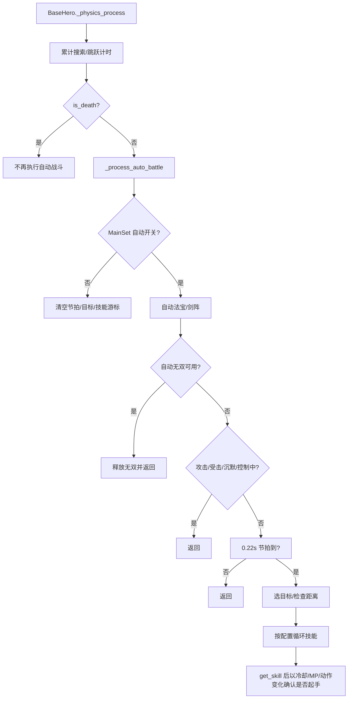
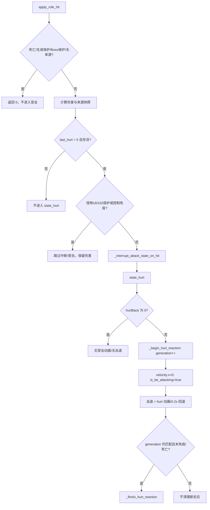

# 战斗实体行为与验证映射（Phase 25-0）

> **状态**：Phase 25-0 已完成（2026-11-03）；本页是行为切片、调用方、验收场景与回滚边界的事实映射，不表示 25-1~25-5 已实现。
> **范围**：`BaseHero` 自动战斗与受击反应、`BaseMonster` 受击反应/控制免疫/死亡，以及 `MainSet`、`BaseLevel`、`BaseThroughLevel`、胜利/失败场景和现有探针的调用面。
> **非目标**：不改战斗数值、动作时序、碰撞层、输入映射或存档格式；不引入 ECS；不把这些调查结论写成已完成迁移。

---

## 1. 首批切片选择

| 候选 | 状态面 | 调用面 | 独立性与风险 | 结论 |
|:---|:---|:---|:---|:---|
| 自动战斗 | 6 个 `_auto_battle_*` 字段、20 个 `_auto_battle*` 方法、配置/重试入口 | `BaseHero`、`MainSet`、`auto_battle_config`、`BaseLevel`、`BaseThroughLevel`、胜利/失败场景 | 目标选择、技能选择、移动/跳跃可通过显式上下文迁出；不直接决定伤害归属；现有自动战斗缺少行为探针 | **25-1 首批：自动战斗控制器** |
| 受击反应 | `_hurt_reaction_active`、`_hurt_reaction_generation`、`is_be_attacking`、控制免疫、Boss 保护、死亡 | 37 个文件包含 `state_hurt` 定义（含基类与覆写），3 个文件包含 `play_hit_effect` 定义，并与伤害/来源/死亡/Boss 保护交叉 | 子类覆写多，和来源归属、Boss 阶段、死亡结算共享状态；独立生命周期较弱 | 保留到 25-4，先做映射 |

**决策**：25-1 先抽 `BaseHero` 自动战斗；25-4 再做受击与来源归属加固。理由不是文件行数，而是自动战斗有独立输入/节拍/目标/技能游标，受击反应与伤害、控制免疫和子类覆写耦合更深。

---

## 2. `BaseHero` 自动战斗

### 2.1 状态与所有者

| 状态 | 当前位置 | 写入方 | 含义/重置 |
|:---|:---|:---|:---|
| `MainSet.auto_battle_enabled_runtime` | `Script/memory_class/main_set.gd` | `auto_battle_config._on_save_pressed` 置 true；`set_menu` 置 false | 仅运行时标志，不写持久设置；应用重启回到 false |
| `AutoBattleSkills` / `AutoBattleSkillsByRole` / `AutoBattleSkillsBySlot` | `MainSet.set_data` | `auto_battle_config._persist_current_skill_config` | 技能列表、角色回退、槽位覆盖；按 `coop_slot` 读取 |
| `AutoBattlePlayerSlot` | `MainSet.set_data` | `auto_battle_config` | 只选择配置界面正在编辑的 1P/2P；当前不被 `BaseHero` 用来选择目标或启用开关 |
| `AutoBattleWushuang` / `AutoBattleRetry` / `AutoBattleSkillOnly` / `AutoBattleMagicWeapon` / `AutoBattleSwordArray` | `MainSet.set_data` | `auto_battle_config` | 无双、自动重试、仅技能、自动法宝、自动剑阵 |
| `_auto_battle_elapsed` | `BaseHero` | `_process_auto_battle` | 技能节拍；关闭自动时归零 |
| `_auto_battle_target_search_elapsed` | `BaseHero` | `_physics_process` 累加、`_get_auto_battle_target` 归零 | 目标缓存/重选节拍；关闭自动时归零 |
| `_auto_battle_target` | `BaseHero` | `_get_auto_battle_target`、关闭自动、`_exit_tree` | 当前目标；失效、死亡、出树或不是 `BaseMonster` 时替换 |
| `_auto_battle_skill_cursor` | `BaseHero` | 技能循环 | 下一次技能尝试位置；关闭自动/空列表时归零 |
| `_auto_battle_skill_cast_counts` | `BaseHero` | 技能循环 | 每个技能已释放次数；与配置 `count` 比较；关闭自动/空列表/失效 ID 时清理 |
| `_auto_battle_jump_elapsed` | `BaseHero` | `_physics_process` 累加、跳跃成功归零 | 障碍跳跃冷却；关闭自动不重置，下一次启用可能立即允许跳跃 |

### 2.2 输入与调用链

| 来源 | 消费方 | 语义 |
|:---|:---|:---|
| `MainSet.is_auto_battle_enabled()` | `BaseHero._process_auto_battle`、`_process_auto_battle_movement`、`BaseLevel`/`BaseThroughLevel` | 全局开关；1P/2P 共用，不由 `AutoBattlePlayerSlot` 单独启用 |
| `AutoBattleSkillsBySlot[slot][role]` → `AutoBattleSkillsByRole[role]` → `AutoBattleSkills` | `_get_auto_battle_skill_entries` | 槽位优先、角色回退、旧配置最后；按 `coop_slot` 取，不按配置界面的当前编辑槽位取 |
| `current_scene.get_active_monsters()`，否则 `get_tree().get_nodes_in_group("monsters")` | `_get_auto_battle_target` | 目标候选；排除死亡、`no_target`、召唤/宠物、出树/待释放对象 |
| `BaseMonster` 位置/生命周期 | `_is_auto_battle_target_valid`、攻击距离与移动 | 目标在 1800 搜索半径、攻击距离/垂直 220 内才施法；失效后重新选择 |
| `MainSet.set_data["AutoBattleSkillOnly"]` | `_process_auto_battle`、`_process_auto_battle_movement` | 仅技能：跳过目标距离门禁、清空目标并停止移动 |
| `get_skill`、`_is_auto_battle_skill_active`、`_can_auto_battle_use_skill` | `BaseHero._process_auto_battle` 及子类覆盖 | 技能释放；冷却/MP 不足跳过；子类可声明技能处于激活态，避免重复释放 |
| `use_fb`、`_try_use_main_sword_array`、`ws_skill` | `_process_auto_battle_equipment`、`_try_auto_battle_wushuang` | 自动法宝/剑阵/无双配置 |
| `PlayerInput` | `BaseHero._physics_process`/`noarmal_control` | 自动战斗开启且非仅技能时，`noarmal_control` 改走自动移动后直接返回，跳过手动移动/技能/跳跃分支 |

### 2.3 单帧顺序与生命周期

- `_exit_tree` 清空目标、技能游标、计数和节拍；不重置 `_auto_battle_target_search_elapsed`/`_auto_battle_jump_elapsed`，节点释放后由新节点重新开始。
- 死亡路径在 `_physics_process` 中设置 `is_death`、清控制并播放死亡；自动战斗从下一帧起跳过。
- 暂停由 SceneTree 暂停控制；自动战斗没有独立暂停状态。
- 场景切换销毁旧英雄；新英雄在自动开关仍为 true 时重新开始，旧目标不得跨场景复用。
- `AutoBattleRetry` 由 `BaseThroughLevel._restart_level_for_auto_battle`、`victory.gd`/`defeat.gd` 的自动重战和 `level_llbt.gd` 的自动推进消费；自动控制器不拥有保存/切场景。

### 2.4 失败与边界

| 场景 | 当前行为 | 25-1 必须保持/验证 |
|:---|:---|:---|
| 无目标/全部死亡 | 目标为 null；非仅技能时向右移动，可能持续到墙边 | 不空引用、不无界移动；停止/巡逻策略必须先取证再改 |
| 目标无效/死亡/召唤物 | `_is_auto_battle_target_valid` 排除并重选 | 不误选宠物、召唤物、待释放对象、`no_target` 怪物 |
| 技能列表为空/全部已满 | 清空游标/计数，不施法 | 不空循环、不重复清状态 |
| 冷却/MP 不足 | `_can_auto_battle_use_skill` 跳过；循环尝试其他技能 | 不扣 MP、不推进错误技能计数 |
| `get_skill` 无起手 | 以冷却/MP/`is_using_skills`/`get_action` 变化判定；无变化则继续尝试 | 不把失败起手计入 `count`，不无限重复同一技能 |
| 技能激活态 | 子类 `_is_auto_battle_skill_active` 返回 true 时清计数并推进游标 | 角色 3 `sd`、角色 4 `wdzt`、哪吒阴阳/火莲等覆盖不得回退 |
| 地形阻挡 | 滑动碰撞 + 射线；障碍时按 0.8s 冷却跳跃；`is_bound_to_the_ground`/空中/攻击中禁止 | 不穿墙、不丢失跳跃冷却、不改碰撞层 |
| 沉默/眩晕/冰冻/定身/攻击/受击 | 自动技能与移动提前返回；装备/无双在控制门禁前执行 | 保持现有优先级；25-1 不把装备/无双误移入控制门禁之后 |
| 仅技能模式 | 停止移动、清目标，只按节拍释放技能 | 不意外追击或回头移动 |
| 手动输入 | 自动移动分支绕过手动移动/技能/跳跃；但 `is_t_mc` 的角色 3 分支仍读取手动技能键，手动法宝输入也仍在外层读取 | 记录为输入冲突，25-1 需显式隔离或保持现状并加测试 |
| 双人 | 开关为全局；每个英雄按自身 `coop_slot` 读技能；配置界面只编辑 `AutoBattlePlayerSlot` 对应档案 | 验证 P1/P2 配置隔离、目标互不覆盖；不把 `AutoBattlePlayerSlot` 当运行时启用开关 |
| 自动重试/切关 | `BaseThroughLevel`/胜利/失败/玲珑塔分别拥有重试/转场；保存失败保留当前场景 | 25-1 不改转场与保存次数；旧目标失效后重选 |
| 退出/死亡/暂停 | 死亡跳过、暂停冻结、退出清理；未清理的计时器在重新启用时可能已累计 | 验证重新启用不残留旧目标/计数 |
| 冷却时间基 | `role1_skill_inter` 在 `_physics_process` 中按每帧 `0.1` 递减；自动节拍按 `delta` 累加 | 25-1 不得顺手把冷却改成 delta 或改变释放节奏；先记录该现状 |
| 目标候选声明 | `_get_auto_battle_target` 当前重复声明 `var candidates`（可编译） | 25-1 迁移时保留单一声明，避免遮蔽/解析差异 |

### 2.5 25-1 切片边界

- 控制器拥有：目标缓存/筛选、技能游标与计数、0.22s 节拍、移动/朝向/障碍跳跃、自动法宝/剑阵/无双的调用顺序。
- `BaseHero` 保留：实体根、`_physics_process` 顺序、`get_skill`/`use_fb`/`ws_skill` 等公开能力、输入视图与死亡/场景生命周期。
- 控制器通过显式上下文读取：自动开关、配置、当前场景活跃怪物、自身位置/朝向/移动状态、技能冷却/MP/起手结果、槽位与角色键；不直接读取/写入 UI 或存档。
- 不在 25-1 迁移 `BaseThroughLevel` 的自动重试/转场；不在同一批改手动输入映射、碰撞层或动作时序。
- 回滚边界：保留现有 `MainSet` 配置键和 `BaseHero` 公开入口；控制器不得成为 Autoload；关闭自动开关应立即停止目标/移动/技能并清理游标。

---

## 3. `BaseMonster` 受击反应

### 3.1 状态

| 状态 | 所有者 | 语义 |
|:---|:---|:---|
| `_hurt_reaction_active` / `_hurt_reaction_generation` | `BaseMonster` | 受击反应是否进行、代次；新反应递增代次，旧异步回调不得结束新反应 |
| `is_be_attacking` | `BaseObject`/`BaseMonster` | 受击/控制表现占用；AI 与移动的互斥依据之一 |
| `is_attacking` / `is_using_skills` | `BaseMonster` | 攻击/技能占用；受击中断路径清理 |
| `get_target` / `get_player` / `hit_dic` | `BaseMonster` | 本次受击的来源/攻击数据；`apply_role_hit` 临时设置后恢复 |
| `super_armor_active` / `boss_protect_active` / `white_bar_armor_time_left` | `BaseMonster` | 控制免疫来源；免疫时取消受击反应并清控制 |
| `is_death` / `death()` / 生成保护 | `BaseMonster` | 死亡/生成保护早退；死亡流程禁用受击箱并结算掉落 |
| `_control_movement_locked` / `_control_movement_tweens` | `BaseMonster` | 控制位移锁与可取消 tween；受击开始时清理 tween |

### 3.2 输入与入口

| 入口 | 路径 | 行为 |
|:---|:---|:---|
| 受击盒碰撞 | `_on_hurt_box_area_entered` → `apply_role_hit` | 过滤死亡、生成保护、Boss 保护、召唤/宠物命中；解析实际出手者；伤害后调用中断与 `state_hurt` |
| 剑阵/神兵弹体 | `main_sword_array_weapon.gd`、`zlw_shenqi_gear_bullet.gd` 直接 `state_hurt` | 不走 `apply_role_hit` 的完整伤害/来源恢复；依赖调用方提供 `get_target`/`hit_dic` |
| 宠物/召唤/范围子弹 | `summon_base_monster.gd`、`monster_bullet.gd`、宠物弹体调用 `play_hit_effect` | 表现型受击；不进入击退代次，可能直接播放 hurt 动画 |
| 伤害结算 | `hurt_reduce_hp`、`hd_reduce`、`_add_boss_protect_from_hit` | 扣血、减伤、Boss 保护累积/激活；保护激活时后续 `apply_role_hit` 返回 0 |
| 控制免疫 | `_process_boss_protect`、`_enforce_control_immunity_state` | Boss 保护/白条/超级护甲期间取消受击反应并清控制 |
| 死亡 | `state_death` / `_finish_sssl_death` | 取消受击反应、清理攻击、结算掉落并释放；普通死亡等待死亡动画 |

### 3.3 受击反应状态机

### 3.4 失败与风险

| 场景 | 当前行为 | 25-4 必须处理 |
|:---|:---|:---|
| `hurtBack` 为 0 | 伤害/中断仍可能发生，但无受击动画与击退 | 明确“无击退但有受击表现/完全没有反应”的预期 |
| 连续受击 | generation 保证旧回调不结束新反应；新反应清理 tween | 验证代次、动画结束、`is_be_attacking` 不悬挂 |
| 控制免疫/Boss 保护 | `_enforce` 取消反应；Boss 保护激活时伤害入口早退 | 保护期间不产生击退/受击动画，不重复清控制 |
| 生成保护/死亡 | 伤害入口早退；死亡禁用受击箱并释放 | 死亡流程不留下活动反应或延迟动画 |
| `Monster114` 特殊分支 | 只处理 `hurtBack`，不击退，动画/0.2s 后按代次结束 | 保留特殊分支，不得套用普通击退 |
| `is_quiescent` / `is_bt` | 跳过击退但可播 hurt | 记录为显式分支，不改变时序 |
| 无 hurt 动画 | 0.2s 回退 | 不依赖动画长度；验证代次/免疫/死亡早退 |
| `play_hit_effect` 表现路径 | 不进入 `_hurt_reaction_generation`；`_deferred_hurt_animation` 只检查免疫/死亡 | 处理与 `state_hurt` 的动画竞争，避免旧 deferred 覆盖新受击 |
| `_cancel_hurt_reaction` | 递增代次、清 active，不直接清 `is_be_attacking` | 调用方必须清 `is_be_attacking`；统一入口后消除遗漏 |
| `state_hurt` 37 个文件（含基类与覆写）/ `play_hit_effect` 3 个文件（含基类与覆写） | 各怪物保留特殊阶段/免控/动画分支 | 不能一次性搬空；先建上下文与统一入口，再逐族迁移 |
| `_exit_tree` | 只清视觉资源，不重置受击/控制字段 | 若未来池化/复用怪物，必须补完整重置；当前释放路径先记录 |
| 来源恢复 | `apply_role_hit` 在调用异步 `state_hurt` 后恢复 `get_target`/`get_player`/props/`hit_dic` | 延迟回调不得读取已恢复的临时来源；25-4 用显式来源快照 |

### 3.5 `BaseHero` 受击边界（25-4）

`BaseHero.state_behit`、`_on_hurt_box_area_entered` 使用 `_hit_reaction_generation`、`_pending_hit_stiff_seconds`、`need_protect`、白条无敌、击退免疫与 `_cancel_hit_reaction`。它与 `BaseMonster` 的受击状态形状相似，但位于 Hero 的伤害/保护路径，不在 25-1 自动战斗切片内；25-4 与怪物受击一起做来源快照与池化/退出重置。

---

## 4. 验证映射

### 4.1 现有基线

当前基线（Phase 24-4 收口）为 `check_all` 9/9、`archive` 344/344、`scene` 17/17、`coop` 33/33、全量 128/128 + 5 SKIP。与本次行为相关的已有覆盖：

| 验证 | 覆盖 | 缺口 |
|:---|:---|:---|
| `coop_probe_matrix` 的 `LocalCoopGameplayProbe` | 关卡双人英雄与 P2 HUD 生成 | 不开启自动战斗，不驱动自动目标/技能/移动 |
| `LocalCoopAttributionSourcesProbe` | 近战/技能/法宝/召唤/弹体的来源、WS、`coop_damage_slot` 恢复 | 不覆盖自动战斗目标/输入 |
| `LocalCoopDamageStatsProbe` | P1/P2 暴击、破甲、等级压制、`damage_bonus` | 不覆盖连续受击代次 |
| `LocalCoopMonsterBalanceProbe` | 双人怪物 HP/攻击/免伤 | 不覆盖 Boss 保护/白条 |
| `LocalCoopPoolReuseProbe` | `mr_hurt` 池取出/回收/复用 | 不覆盖受击状态字段重置 |
| `scene action-frames` | 怪物 `hurt`/`death` 帧 | 不验证进入/退出受击状态 |
| `level_progress_exit_probe` | 自动战斗开关被显式关闭的退出路径 | 不验证自动战斗行为 |
| `archive` | 档案/命令/失败回滚 | 不覆盖战斗实体行为 |

### 4.2 25-1 自动战斗验收场景

新增定向探针（建议名：`LocalCoopAutoBattleProbe`，或 `coop_probe_matrix` 的同职责 case；不得只测 wiring）：

| 场景 | 前置/动作 | 必须观察 |
|:---|:---|:---|
| 单目标起手 | 开启自动，配置 1 个技能，生成 `BaseMonster`；运行若干物理帧 | 目标被选中且在距离内；技能只按节拍起手；MP/冷却按现有语义变化 |
| 无目标 | 无活跃怪物/全部死亡 | 不空引用；不无限施法；移动/停止行为符合现状 |
| 冷却/MP 跳过 | 技能冷却中或 MP 不足 | 不扣 MP、不增加错误技能计数；游标继续尝试后续技能 |
| 技能计数 | 配置 `count=2` | 同一技能按配置次数释放后推进；激活态覆盖不重复 |
| 目标失效 | 目标死亡/移出范围/出树 | 重新选目标或停止；不访问已释放对象 |
| 仅技能 | `AutoBattleSkillOnly=true` | 目标清空、停止移动、只按节拍施法 |
| 障碍跳跃 | 目标在墙后、自动移动被阻挡 | 仅在允许状态跳跃，受 0.8s 冷却；不穿墙 |
| 关闭/死亡/暂停 | 运行中关闭开关、击杀英雄、暂停场景 | 立即停止自动移动/施法并清理目标/游标；恢复后不残留旧目标/计数 |
| P1/P2 配置 | 双人，分别配置槽位技能；同时运行 | 各英雄读自身 `coop_slot` 配置；不串技能、不互相覆盖目标 |
| 自动重试/切关 | `AutoBattleRetry` 成功/保存失败 | 成功只转场一次；失败留在当前场景；旧目标不跨场景 |
| 手动输入冲突 | 自动开启时按移动/技能/法宝/`is_t_mc` 分支 | 明确哪些输入被自动覆盖；不静默双重施法 |

### 4.3 25-4 受击验收场景

| 场景 | 必须观察 |
|:---|:---|
| 有/无 `hurtBack` | 有击退进入受击；零击退不产生击退；两者伤害语义不混淆 |
| 连续受击 | 旧 generation 不结束新反应；`is_be_attacking` 最终回到 false；动画不被旧回调覆盖 |
| 控制免疫/Boss 保护/白条 | 不产生受击反应/击退；保护结束后可恢复；不重复清控制 |
| 生成保护/死亡 | 不受伤/不进入反应；死亡后无延迟回调写活动节点 |
| `play_hit_effect` 与 `state_hurt` 竞争 | 延迟 hurt 动画不覆盖新受击；无来源/零伤害不产生错误表现 |
| P1/P2 来源 | 受击来源/WS/伤害归属仍按实际出手者；不回落 1P |
| 特殊怪物 | Monster114、`state_hurt` 37 个文件、`play_hit_effect` 3 个文件的特殊分支不回归 |
| 释放/未来池化 | 退出或复用前清 `_hurt_reaction_active/generation`、`is_be_attacking`、控制锁与延迟动画 |

---

## 5. 回滚与实施边界

- 25-0 只新增本页与索引/状态文档，不改 `source/`；回滚为删除本页与对应文档引用。
- 25-1 只抽自动战斗控制器；保留 `MainSet` 配置键、`BaseHero` 公开入口、`BaseThroughLevel`/胜利/失败/玲珑塔的转场与保存职责；旧行为由版本控制回滚，不保留双实现。
- 25-4 只统一受击状态/来源快照；不改变伤害数值、Boss 保护阈值、白条持续时间、碰撞层或动作时序；特殊子类覆写按批次保留并逐项验证。
- 任一阶段发现行为语义不明确时，先补探针和记录，再迁移；不以“代码更短”为迁移依据。

---

## 6. 下一步

**25-1 自动战斗控制器**：先建立 `AutoBattleContext`（显式开关/配置/目标/技能/冷却/MP/动作/输入能力），迁出目标选择、技能游标、节拍和移动/跳跃；`BaseHero` 保留实体与公开能力；先实现并验证上表单人、双人、暂停、死亡、切关，再处理手动输入冲突。
