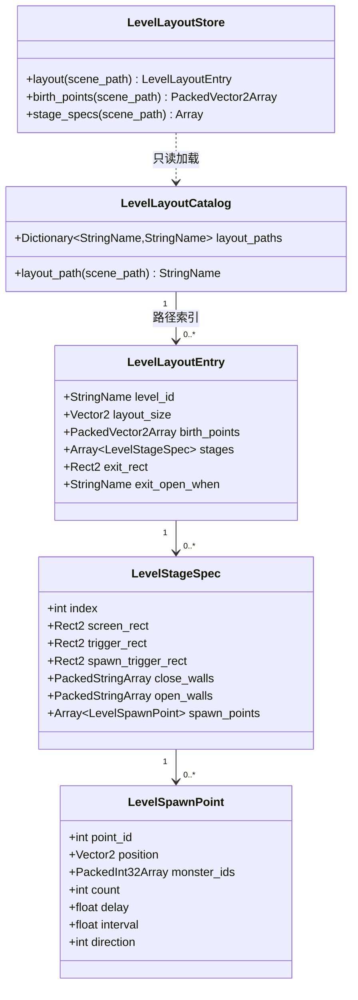

# 关卡布局数据契约

> **定位**：定义「关卡结构化布局」在 BHYH 侧的数据载体、字段语义、构建期生成与运行时访问方式。本文是 **目标契约**，不是实现完成声明；当前实现见 [`architecture.md`](architecture.md)，实施顺序见 [`roadmap.md`](../roadmap/roadmap.md)。
> **决策依据**：[ADR-023](../decisions/ADR-023-level-layout-data-contract.md)（本契约的架构决策）、[ADR-006](../decisions/ADR-006-resource-first-data-and-data-keys.md)（Resource 优先）、[ADR-005](../decisions/ADR-005-no-compatibility-or-fallback-layers.md)（禁止兼容/回退层）。
> **范围**：关卡的结构化数据（出生点、分屏、刷怪触发与刷怪点、出口）。**不含**渲染层（已在关卡 `.tscn` 的 `Parallax2D`/`Sprite2D`）、碰撞层（已生成 `ZMWS_Ground` 静态节点）、战斗数值（走 `ZmwsConfig`）。

---

## 1. 术语

| 术语 | 含义 |
|:---|:---|
| 布局资源 | `LevelLayoutEntry` 类型的 `.tres`，一关一份 |
| 阶段（stage） | 一次「锁屏 + 挡板 + 刷怪」的战斗单元；对应 ZMWS 的 `screen[N]` |
| 刷怪点（spawn point） | 一个具体的怪物出生位置与参数；对应 ZMWS `manCreater[<id>]` |
| 触发区（trigger） | 玩家进入后改变关卡状态的矩形；分「屏幕触发」与「刷怪触发」两类 |
| 挡板（wall） | 可开合的静态碰撞体；对应 ZMWS 的 `triggerWall` / `endOpenWall` |

---

## 2. 对象模型



**分层原则**（照 `LevelPreload*` 范式）：

| 层 | 类型 | 职责 |
|:---|:---|:---|
| Entry / Spec / Point | `Resource` + `@export` | 结构化定义，可 Inspector 审查 |
| Catalog | `Resource` | 只存「场景路径 → 布局资源路径」，**不内联布局内容** |
| Store | `RefCounted` 静态入口 | 按需 `ResourceLoader.load` 单关布局，`CACHE_MODE_REUSE` |

---

## 3. 字段契约

### 3.1 `LevelLayoutCatalog`

| 字段 | 类型 | 语义 | 约束 |
|:---|:---|:---|:---|
| `layout_paths` | `Dictionary[StringName, StringName]` | 关卡场景 `res://` 路径 → 布局资源 `res://` 路径 | 仅已迁移关卡登记；未登记视为「沿用基类默认行为」 |

**方法**：`layout_path(scene_path: String) -> StringName`，未登记返回 `&""`。

### 3.2 `LevelLayoutEntry`

| 字段 | 类型 | 单位 | 语义 |
|:---|:---|:---|:---|
| `level_id` | `StringName` | — | 稳定标识（snake_case，由场景路径派生） |
| `layout_size` | `Vector2` | px | 关卡逻辑尺寸（宽 × 高），用于 Y 轴换算与越界校验 |
| `birth_points` | `PackedVector2Array` | px | 玩家出生点（Godot 坐标，Y 向下）；索引 0 为 1P，1 为 2P，多出部分由关卡自行决定 |
| `stages` | `Array[LevelStageSpec]` | — | 阶段表，索引 0 对应 `current_stage == 1`；**长度可变，上限不设 4** |
| `exit_rect` | `Rect2` | px | 主出口触发区；`Rect2.position` 为左上角 |
| `exit_open_when` | `StringName` | — | 出口开启条件枚举，见 §3.5 |

**不变量**：
- `stages` 非空时，`stages[i].index == i + 1`；
- `stages.size()` 可达 30：实测源数据分屏数量分布为 1 屏 1,403 关、2 屏 59、3 屏 43、4 屏 50、5 屏 89、6 屏 20、7 屏 19、8 屏 2、9 屏 4、10 屏 14、11 屏 1、13 屏 1、**30 屏 3**；
- 现有 `monster_group` 的 `stage_1..stage_4` 固定结构**不足以承载**，必须改为可变长度；
- 所有矩形必须落在 `Rect2(Vector2.ZERO, layout_size)` 内，越界由生成器 `--check` 失败；
- `birth_points` 为空时，关卡沿用现有出生行为。

### 3.3 `LevelStageSpec`

| 字段 | 类型 | 语义 | ZMWS 来源 |
|:---|:---|:---|:---|
| `index` | `int` | 阶段序号，从 1 开始 | `screen` 的键 |
| `screen_rect` | `Rect2` | 摄像机锁定范围 | `screen[N].x / width / height` |
| `trigger_rect` | `Rect2` | 进入该阶段（切屏）的触发区 | `triggers.screenTrigger[screen[N].trigger]` |
| `spawn_trigger_rect` | `Rect2` | 进入后开始刷怪的触发区 | `triggers.monsterTrigger[].x/y/w/h`（按 `screen` 字段匹配） |
| `close_walls` | `PackedStringArray` | 进入阶段时**关闭**的挡板节点名 | `screen[N].triggerWall` |
| `open_walls` | `PackedStringArray` | 该阶段清怪后**开启**的挡板节点名 | `screen[N].endOpenWall` |
| `spawn_points` | `Array[LevelSpawnPoint]` | 该阶段的刷怪点 | `monsterTrigger[].points` → `manCreater[<id>]` |

### 3.4 `LevelSpawnPoint`

| 字段 | 类型 | 单位 | 语义 | ZMWS 来源（`manCreater[<id>]`） |
|:---|:---|:---|:---|:---|
| `point_id` | `int` | — | 点位编号 | `id` |
| `position` | `Vector2` | px | 出生坐标（Godot 坐标） | `x`、`y`（Y 翻转） |
| `monster_ids` | `PackedInt32Array` | — | 可出生的怪物 id 列表；多元素表示随机 | `mIds`（单值）或 `RandomIds` |
| `count` | `int` | 个 | 本次刷怪数量 | `mNums` |
| `delay` | `float` | 秒 | 触发后首次出场延迟 | `delayTime` |
| `interval` | `float` | 秒 | 多只怪物之间的间隔 | `interval` |
| `direction` | `int` | — | 初始朝向：`-1` 左、`1` 右、`0` 不变 | `direction` 归一化（见下） |

**`direction` 归一化规则**（实测源数据 int 与字符串混用）：
- 先转 `int`（`"-1"` → `-1`、`"1.0"` → `1`）；
- 再取符号：`-5` → `-1`、`5` → `1`、`0` → `0`；
- 分布实测：`-1` 11,771、`1` 8,425、`"-1"` 2,765、`-5` 2,095、`"1"` 1,208、`"-5"` 740、`"-1.0"` 77、`"1.0"` 60。

**不变量**：
- `count >= 1`；`delay >= 0`；`interval >= 0`；
- `monster_ids` 非空；元素必须能在 `LevelPreloadCatalog.monster_scene_paths` 或 `monster_<id>.tscn` 解析，否则 `--check` 失败（缺失登记走 [`missing_assets_registry.md`](../standards/missing_assets_registry.md)）。

### 3.5 `exit_open_when` 枚举

| 值 | 语义 | ZMWS 来源 |
|:---|:---|:---|
| `&"stage_clear"` | 所有阶段清怪即可（默认） | 无对应字段时的兜底语义 |
| `&"boss_dead"` | 该阶段 Boss 死亡 | `Gateway[].howOpen_BossDead` |
| `&"mids_dead"` | 指定怪物全部死亡 | `Gateway[].howOpen_MidsDead` |
| `&"all_clear"` | 全部通关条件满足 | `Gateway[].howOpen_AllClear` |
| `&"auto"` | 进入即可用（无战斗） | `howEnter_auto` |

---

## 4. ZMWS → BHYH 字段映射

### 4.1 已映射（第一版）

| ZMWS 字段 | BHYH 字段 | 备注 |
|:---|:---|:---|
| `birth.<group>[].x/y/w/h` | `birth_points[]`（中心点） | 多组时按组序拼接 |
| `screen[N].x/width/height` | `stages[N-1].screen_rect` | |
| `screen[N].trigger` | 关联 `triggers.screenTrigger[<name>]` → `stages[N-1].trigger_rect` | |
| `screen[N].triggerWall[]` | `stages[N-1].close_walls` | 空字符串需过滤 |
| `screen[N].endOpenWall[]` | `stages[N-1].open_walls` | 同上 |
| `triggers.monsterTrigger[].screen` | 定位到对应 `stages[]` | |
| `triggers.monsterTrigger[].x/y/w/h` | `stages[].spawn_trigger_rect` | |
| `triggers.monsterTrigger[].points[]` | `stages[].spawn_points` 的筛选键 | |
| `triggers.manCreater[<id>]` | `LevelSpawnPoint` | §3.4 |
| `Gateway[].x/y/w/h` | `exit_rect` | 多出口时取 `howOpen_AllClear` 或首个，其余待议 |
| `Gateway[].howOpen_*` | `exit_open_when` | §3.5 |

### 4.2 明确不映射（第一版）

以下字段保留在 ZMWS 源中，**不进入**本契约。需要时按单独立项增量，不在迁移中顺手扩张。

| ZMWS 字段 | 出现次数 | 不映射原因 |
|:---|---:|:---|
| `manCreater[].phase` | 5,051 | 多阶段变身/换阶段行为，需战斗系统支持 |
| `createAfterPointDeadAll` | 12,254 | 依赖「点位全部死亡后」的顺序语义 |
| `RandomIds` / `RandomWeight` | 4,734 | 第一版 `monster_ids` 只取 `mIds`；权重待确认 |
| `isBoss` / `isElite` / `isSmallBoss` | 1,747 / 313 / 45 | 影响 AI 与掉落，属战斗域 |
| `BossAppearHint` / `BossKillHint` | 1,174 / 1,184 | 演出提示 |
| `effect`、`music` | 3,467 / 98 | 表现层，走关卡场景与音频域 |
| `camp`、`dropFinal`、`preSetPath`、`clearCallMonster` 等 | 数百 | 战斗与掉落域 |

### 4.3 坐标约定

- ZMWS 使用 Cocos 坐标：原点左下，Y 向上，`ground` 与 `monsterTrigger` 的 `(x, y)` 为**矩形左下角**；
- BHYH 使用 Godot 坐标：原点左上，Y 向下；
- 换算：`y_godot = layout_size.y - y_cocos`；矩形需先求角点再换算，写入 `Rect2` 时取左上角；
- 生成器负责换算，**运行时不再做 Y 翻转**，避免双重换算。

---

## 5. 构建期生成器

**脚本**：`scripts/convert_level_layout_catalog.py`（与 `convert_level_preload_catalog.py` 同族）

| 项 | 约定 |
|:---|:---|
| 输入 | ZMWS 关卡 json 导出目录（默认 `--source-tier G:/source/repos/ZMWS/cocos/assets/resources/map`，路径通过参数或环境变量传入，不写入仓库） |
| 输出 1 | 每关一个 `source/Script/data/level_layouts/<level_id>.tres` |
| 输出 2 | `source/Script/data/level_layout_catalog.tres`（只含路径索引） |
| 校验 | `--check`：schema 完整、矩形落在关卡范围内、`monster_ids` 可解析、`stages[].index` 连续、路径存在 |
| 确定性 | 输出不依赖目录枚举顺序；`level_id` 由场景文件名派生；冲突必须失败 |
| 幂等 | 重复运行输出逐字节一致（以 CSV/`.tres` 字段排序保证） |

**生成失败语义**：任一关卡不满足不变量 → 该关卡不生成 + 退出码非 0 + 列出原因；**不生成占位布局**。

---

## 6. 运行时接入

### 6.1 `BaseLevel` 扩展点

现有方法保持签名不变，默认实现改为读布局资源：

| 方法 | 现状 | 目标 |
|:---|:---|:---|
| `_stage_count() -> int` | 从 `monster_group` 统计非空阶段 | 有布局资源时返回 `stages.size()`；否则维持现状 |
| `_stage_trigger_x() -> Array` | 常量 `[0, 1600, 2700, 4000]` | 有布局资源时由 `stages[].trigger_rect` 派生；否则维持现状 |
| `_screen_starts() -> Array` | 常量 `[0, 2250, 3550, 4650]` | 由 `stages[].screen_rect.position.x` 派生 |
| `_screen_rights() -> Array` | 常量 `[2250, 3550, 4650, 4650]` | 由 `stages[].screen_rect.end.x` 派生 |
| `_birth_points() -> Array` | 返回 `[]`，无调用点 | 返回 `layout.birth_points`；由关卡根在生成玩家时消费 |

**关键约束**：这些是**既有扩展点**，已被多个子类覆写调用（`game4_imported_level.gd`、`level_48.gd`、`level_59.gd`）。改默认实现不得改变方法签名与返回形状。

### 6.2 `LevelLayoutStore` API

```gdscript
class_name LevelLayoutStore
extends RefCounted

static func layout(scene_path: String) -> LevelLayoutEntry
static func birth_points(scene_path: String) -> PackedVector2Array
static func stage_specs(scene_path: String) -> Array[LevelStageSpec]
static func stage_count(scene_path: String) -> int
static func clear_cache() -> void   # 仅供夹具
```

约定：
- 只读；返回数组一律 `duplicate()`，不暴露可写集合（对齐 `LevelPreloadStore`）；
- 缺失登记返回空值，**不**在运行时扫描目录补齐；
- 加载失败 `push_error` 并返回空，由调用方决定拒绝进入或沿用默认。

### 6.3 刷怪调度

`LevelSpawnPoint` 只是**数据**；调度仍由 `BaseLevel` 现有 `create_control` 计时器与 `level_create_monster()` 承担。改造点：

- `level_create_monster(stage)` 从 `monster_group[stage_key]` 取数 → 改为从 `stage_specs[stage-1].spawn_points` 取数；
- `monster_position_x/y` 两个平行数组 → 由 `LevelSpawnPoint.position` 单一来源取代（消除平行数组错位风险）；
- `delay` / `interval` 由 `create_control` 的等待时间消费，语义与现有 `wait_time` 一致；
- `count` 展开为连续多次生成，间隔 `interval`。

**不改**：`Global.create_monster()` 入口、怪物场景解析、对象池、掉落与结算。

---

## 7. 迁移纪律

1. **不保留双份**：关卡迁移后删除脚本内 `monster_group` / `monster_position_x` / `monster_position_y`；不保留 deprecated 别名（ADR-005）。
2. **不建回退层**：布局资源缺失 ≠ 回退到脚本表；只表示该关卡「尚未迁移」，其脚本仍是唯一数据源。迁移完成即删除脚本表，二者不同时存在。
3. **按批验收**：每批迁移后跑 `level_regression_all.py`，与原行为对照；差异必须归因。
4. **不夹带玩法变更**：数值、时序、掉落、输入一律不动（`current-iteration.md` §1.2）。
5. **生成器入库、产物入库**：生成器与 `.tres` 同批提交；`.tres` 若体积超阈值需评估 LFS。

---

## 8. 验收标准

| 维度 | 判据 |
|:---|:---|
| 契约完整性 | `--check` 对 1,701 个可解析关卡全部通过，0 失败；未映射字段清单与实际跳过项一致 |
| 生成确定性 | 连续两次生成结果逐字节一致 |
| 运行时接入 | 抽样 20 关：`LevelLayoutStore.birth_points()` / `stage_count()` / `spawn_points` 与源 json 逐字段一致 |
| 行为等价 | 迁移的 BHYH 关卡（至少 5 个）在 `level_regression_all.py` 中与迁移前结果一致 |
| 静态门禁 | `check_all.py` 全维 PASS；`contract_scan.py` ERROR=0 |
| 无回退 | 全仓 `grep` 确认已迁移关卡不再有 `monster_group = {` 字面量 |

---

## 9. 已确认事实与剩余未决项

### 9.1 已用实测消解的疑问

| 编号 | 原疑问 | 实测结论 | 处置 |
|:---|:---|:---|:---|
| U2 | `direction` 的 `-5` 如何归一 | int 与字符串混用，`-5` 有 2,835 条 | **已定规则**：先转 int 再取符号，见 §3.4 |
| U6 | `stages` 是否可能超过 4 | 是，最多 **30 屏（3 关）**；5 屏以上共 153 关 | **已定**：`stages` 为可变长度数组，现有 `stage_1..4` 固定结构必须改造 |

### 9.2 剩余未决项

| 编号 | 问题 | 实测规模 | 待确认方 | 第一版临时处置 |
|:---|:---|:---|:---|:---|
| U1 | 多 `Gateway` 时主出口如何选 | 0 出口 482 关、1 出口 1,007 关、2 出口 95 关、最多 **32 出口 1 关** | 玩法侧 | 取 `exit_open_when` 最先满足者；多个同条件时取**首个**，其余登记不实现 |
| U3 | `RandomIds`/`RandomWeight` 是否并入第一版 | 4,734 条点位带随机权重 | 玩法侧 | 第一版不使用；`monster_ids` 只取 `mIds` |
| U4 | 布局资源体积是否入 LFS | 预计 20–35 MB / 1,708 个文件 | 发布侧 | 先普通 Git；单文件超 1 MB 时评估 LFS |
| U5 | 挡板节点命名如何对齐 | ZMWS 用中文名（`战斗挡板1`），BHYH 用 `stop1`/`wall` | 场景侧 | 生成器输出安全的 snake_case 名，场景侧按名查找；缺失挡板记录警告不失败 |
