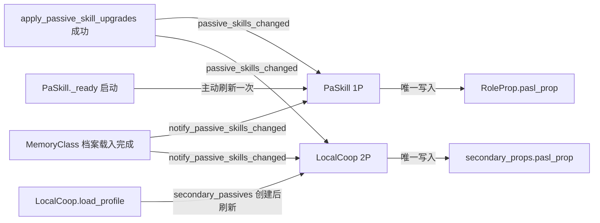

# 被动技能数值与属性快照契约

> **状态**：Phase 28-2 生效（2026-11-09）。本文是被动等级、派生属性快照与刷新事件的唯一契约；实现以源码为准。
>
> **定位**：定义 `PlayerData`、`PaSkill`、`LocalCoop` 与 `RoleProp` 之间关于被动技能等级、数值查表与 `pasl_prop` 快照的所有权、写入者与刷新边界。
>
> **不在本文范围**：被动技能的具体数值表、升级成本与 UI 布局；宠物被动技能的独立域语义。

## 1. 所有权

| 数据/能力 | 所有者 | 写入者 | 说明 |
|:---|:---|:---|:---|
| 被动等级 `PlayerData.player_data[DataKeys.Skill.PASSIVE]` | `PlayerData` | `PlayerData.apply_passive_skill_upgrades()`；`ensure_player_passive_skills()`；`LocalCoop.link_passive_skills()` | UI 不得直接改字典；升级必须走命令 |
| 等级→数值查表 | `PaSkill` | 无状态 | `get_value()`、`get_unlocked_level()`、`get_lh_for_level()` 为纯查表 |
| 属性快照 `RoleProp.pasl_prop` | `PaSkill` 唯一写入 | `PaSkill.get_passive_skill_properties()` | `BaseRoleProperties` 只读消费；不得由业务直接写 |
| 档案变更事件 | `PlayerData` | `PlayerData.passive_skills_changed` | 升级成功、`ensure_*` 实际修正、档案载入完成后发出 |

## 2. 刷新路径

- **启动**：`PaSkill._ready()` 主动刷新一次，覆盖 Autoload 初始化顺序（`PlayerData` 先于 `PaSkill`）导致的启动期信号丢失。
- **升级**：`PlayerData.apply_passive_skill_upgrades()` 保存成功后发出 `passive_skills_changed`；保存失败会恢复快照且不发出信号。
- **读档**：`MemoryClass.load_game()` 完成数据合并与 `ensure_*` 后调用 `PlayerData.notify_passive_skills_changed()`，保证旧档案值不会残留在 `pasl_prop`。
- **双人**：`LocalCoop` 连接同一信号，只刷新 `secondary_passives`；1P 由 `PaSkill` 单例负责。`refresh_passive_skills()` 保留为面板关闭/切换等显式兜底。
- **属性实例重建**：主 `RoleProp` 只在启动 `_ready()` 初始化 `pasl_prop`；`secondary_props` 创建后由 `LocalCoop.load_profile()` 刷新。若未来新增重建路径，必须在装配点调用刷新。

## 3. 快照签名短路

`get_passive_skill_properties()` 以以下签名判断是否需要写快照：

- 7 个被动等级（`PASSIVE_HP`、`PASSIVE_MP`、`PASSIVE_CRIT`、`PASSIVE_HP_REGEN`、`PASSIVE_MP_REGEN`、`PASSIVE_HIT`、`PASSIVE_SOUL_GAIN`）；
- 目标属性实例的 `get_instance_id()`。

签名相同则直接返回；重复触发信号无副作用。`RoleProp` 重建会改变实例 id，强制重写快照。

## 4. 禁止项

1. 禁止在 `_process` / `_physics_process` 中调用 `get_passive_skill_properties()` 或轮询被动等级。
2. 禁止 `PaSkill` 之外的文件写 `pasl_prop`；`BaseRoleProperties._ready()` 的初始化除外。
3. 禁止 UI 直接写 `PlayerData.player_data[DataKeys.Skill.PASSIVE]`；只能通过 `apply_passive_skill_upgrades()`。双人 `link_passive_skills()` 是已登记的档案会话写入。
4. 宠物被动技能的键保持独立语义，不因本契约新增宠物专用全局信号或属性快照。

## 5. 门禁

`scripts/contract_scan.py` 的 `passive_boundary` 类别：

| 规则 | 检查 | 失败级别 |
|:---|:---|:---|
| `PASSIVE_POLLING` | `_process`/`_physics_process` 中调用 `get_passive_skill_properties` | ERROR |
| `PASSIVE_SNAPSHOT_WRITE` | 非白名单文件写 `pasl_prop` | ERROR |
| `PASSIVE_DATA_WRITE` | 非 `player_data.gd`/`local_coop.gd` 写 `player_data[DataKeys.Skill.PASSIVE]` | ERROR |

自测：`python scripts/contract_scan.py --self-test` 覆盖轮询、快照直写、档案直写与正常读取样本。

## 6. 验证矩阵

| 场景 | 断言 |
|:---|:---|
| 新建档 | 被动等级为 0，`pasl_prop` 六项为 0 |
| 读档 | `pasl_prop` 六项与档案等级一致；旧档不残留旧值 |
| 单技能升级 / 一键升级 | 保存成功后 `pasl_prop` 立即更新；保存失败回滚后保持旧值 |
| 双人 link / 取消 link | 1P/2P 各自快照互不串写 |
| 切档 | 快照随档案切换刷新 |
| 属性实例重建 | 新实例的 `pasl_prop` 立即正确 |
| 重复触发 `passive_skills_changed` | 签名相同不重复写，结果不变 |

## 7. 关联

- [`architecture.md`](architecture.md) §2、§3
- [`../decisions/ADR-029-passive-snapshot-event-driven.md`](../decisions/ADR-029-passive-snapshot-event-driven.md)
- [`acceptance.md`](acceptance.md) §4.1
- [`global_runtime_inventory.md`](global_runtime_inventory.md)
