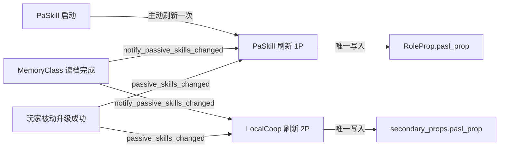

# 被动技能数值与属性快照契约

> **定位**：定义玩家被动等级、派生属性快照与刷新事件的当前契约；实现以源码为准。
> **范围**：`PlayerData`、`PaSkill`、`LocalCoop` 与 `RoleProp` 的所有权、写入者和 `pasl_prop` 刷新边界。
> **宠物域**：宠物被动升级、费用、命令和失败回滚见 [`pet_domain_contract.md`](pet_domain_contract.md)；本页不重复宠物命令契约。

## 1. 所有权

| 数据/能力 | 所有者 | 写入者 | 说明 |
|:---|:---|:---|:---|
| 玩家被动等级 `PlayerData.player_data[DataKeys.Skill.PASSIVE]` | `PlayerData` | `apply_passive_skill_upgrades()`、`ensure_player_passive_skills()`、`LocalCoop.link_passive_skills()` | UI 不得直接改字典 |
| 等级→数值查表 | `PaSkill` | 无状态 | 查表函数不写档案 |
| 属性快照 `RoleProp.pasl_prop` | `PaSkill` | `get_passive_skill_properties()` | `BaseRoleProperties` 只读消费 |
| 档案变更事件 | `PlayerData` | `passive_skills_changed` | 升级成功、补全实际修正、档案载入完成后发出 |
| 玩家/宠物共用数值表 | `PassiveSkillTable` | 无状态 | 查询值/费用；宠物命令消费见宠物域契约 |

## 2. 刷新路径

- `PaSkill._ready()` 主动刷新一次，覆盖 Autoload 初始化时序导致的启动期信号丢失。
- 玩家被动升级保存失败时恢复档案快照，不发出变更信号。
- 读档完成并执行 `ensure_*` 后通知刷新，避免旧档案值残留在快照。
- `LocalCoop` 只刷新 2P；`PaSkill` 负责 1P。
- 重建 `secondary_props` 后，装配路径必须显式刷新该槽位快照。
- 宠物被动不写 `pasl_prop`，也不接玩家快照信号。

## 3. 快照签名短路

`get_passive_skill_properties()` 以玩家被动等级和目标属性实例的 `get_instance_id()` 组成签名。签名相同直接返回；属性实例重建后重新写入。

## 4. 禁止项

1. 禁止在 `_process` / `_physics_process` 中轮询玩家被动等级或调用快照生成。
2. 禁止 `PaSkill` 之外的文件写 `pasl_prop`；`BaseRoleProperties._ready()` 的初始化除外。
3. 禁止 UI 直接写 `PlayerData.player_data[DataKeys.Skill.PASSIVE]`；玩家升级经 `apply_passive_skill_upgrades()`，双人档案 link 是已登记的会话写入。
4. 宠物被动保持独立数据域；不新增宠物专用全局信号或属性快照。

## 5. 门禁与验证

`contract_scan.py` 的 `passive_boundary` 阻断轮询、非法快照写入和非法玩家被动数据写入；`pet_passive_boundary` 的规则归属见 [`pet_domain_contract.md`](pet_domain_contract.md) 与 [`acceptance.md`](acceptance.md) §4.1。规则变更时另跑 `python scripts/contract_scan.py --self-test`。

玩家路径覆盖新建档、读档、升级成功/保存失败、双人 link/取消 link、切档、属性实例重建和重复信号幂等；宠物路径见宠物域契约。

## 6. 关联

- [`architecture.md`](architecture.md) §2
- [`../decisions/ADR-029-passive-snapshot-event-driven.md`](../decisions/ADR-029-passive-snapshot-event-driven.md)
- [`acceptance.md`](acceptance.md)
- [`pet_domain_contract.md`](pet_domain_contract.md)（宠物被动命令）