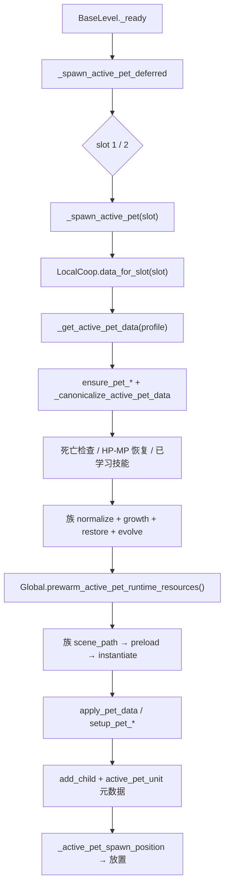

# 宠物关卡调用面与首批抽取矩阵

> **状态**：Phase 23-0 调查、Phase 23-1 龟族抽取已完成（2026-11-03）；Phase 23-2 尚未启动。本页是当前调用面与迁移判定的参考，不把未实施目标写成已实现。
> **范围**：`BaseLevel` 的宠物生成、恢复、归一化、进化、技能、场景路径与槽位解析；同时登记 `BaseMonster`、`PetInterface`、`PlayerData`、`Global` 与召唤物单位的现有调用点。
> **事实源**：`source/Script/base/base_through_level.gd`、`source/Script/base/base_monster.gd`、`source/Script/pet/pet_interface.gd`、`source/Script/pet/pet_level_controller.gd`、`source/Script/pet/pet_turtle_family.gd`、`source/Script/memory_class/player_data.gd`、`source/global.gd`、`source/Script/coop/local_coop.gd`。数量是本次工作区快照，不作为长期 SLA。
> **非目标**：不重写 `BaseLevel` 阶段状态机、不重写 `PlayerData`、不改变宠物数值/进化/出战规则、不新增 Autoload。

---

## 1. 结论

1. 当前有 **8 个宠物族**、**30 个召唤场景**（除子鼠 2 阶外，其余每族 4 阶）。
2. `BaseLevel` 自身包含 **73 个宠物相关函数**；同一套规则还分散在 `BaseMonster`、`PetInterface` 与 `PlayerData`：
   - `BaseLevel` 与 `BaseMonster` 重名 **22 个**；
   - `BaseLevel` 与 `PetInterface` 重名 **19 个**；
   - `BaseMonster` 与 `PetInterface` 重名 **20 个**。
3. **首批选择 `PetTurtle`（龟布系）**。理由不是文件行数，而是：
   - 4 阶规则标准，无子鼠 2 阶、丑牛/寅虎名称折叠、凤凰“存储阶优先”的特殊分支；
   - `coop_probe_runner` 已直接用 `PetTurtle` 数据覆盖 P1/P2 宠物经验、生命加成、槽位归属与 HUD 死亡态；
   - 单位接口 `setup_pet_turtle` 同时是月兔、子鼠、丑牛、寅虎的基类接口，首批可用最小规则验证后续复用面；
   - `BaseLevel` 的龟族分支是完整的 `normalize → growth → restore → evolve → path` 标准链，适合先抽出通用生命周期。
4. 23-1 已新增 `pet/` 下的 `PetLevelController` 与 `PetTurtleFamily`；`BaseLevel` 不再保留龟族规则函数与龟族生成分支。其他 7 族在 23-2 逐族迁移，阶段出口才达到“BaseLevel 只保留控制器入口”。
5. **已由 23-1 修复并回归**：`BaseMonster._cure_active_pet_exp(slot)` 的进化与成长函数显式接收当前槽位档案，P2 升级不再写回 1P `出战宠物`。
6. 以下剩余风险不阻塞 23-1，但会影响后续批次：
   - `Global.prewarm_active_pet_runtime_resources()` 只读 1P 档案且无槽位参数；P2 生成时会预热 1P 宠物；
   - `BaseLevel._active_pet_dead_aliases()` 与 `PetInterface._pet_dead_aliases()` 缺少凤凰别名，而 `BaseRole` 已有；
   - `Global.get_active_pet_preload_data()` 不识别 `PetYinTiger`，寅虎没有预热门禁；
   - 八仙法宝复活入口使用无槽位后缀的死亡元数据，并按 1P 重新生成；
   - `PetTurtleSummonBase.setup_pet_turtle()` 读取全局 `PlayerData` 的装备加成，P2 单位可能拿到 1P 加成；
   - `BaseMonster` 升级循环调用 7 族进化，但没有 `PetNeat`。

未修复项为静态阅读结论；运行期反例与修复放入后续批次，不在本页冒充已验证缺陷。

---

## 2. 当前调用链



外部触发：

| 入口 | 作用 | 槽位来源 | 当前问题 |
|:---|:---|:---|:---|
| `BaseLevel._ready` → `_spawn_active_pet_deferred` | 关卡开始生成 1P，再在双人可用时生成 2P | 显式 1 / 2 | 无 |
| `PetInterface.fight_click` / `rest_click` | 出战/休息后重建或销毁单位 | `LocalCoop.ui_slot` | `PetInterface` 自己的归一化与进化副本 |
| `BaseMonster.set_exp` → `_cure_active_pet_exp` | 宠物经验与升级进化 | `slot` 参数 | 进化写回全局 `PlayerData`，且缺 `PetNeat` |
| `SummonBaseMonster._persist_active_pet_death` | 记录本局死亡，禁止再次出战 | `LocalCoop.slot_for(self)` | 依赖调用方别名表 |
| `EightImmortalMagicWeapon` 复活 | 清除死亡态并重新生成 | 无槽位后缀，按 1P | 2P 复活会落到 1P 元数据 |
| `Global.prewarm_active_pet_runtime_resources` | 战斗前预热场景/帧/弹体 | 1P 档案 | P2 预热错误；寅虎无分支 |
| `BaseRole` HUD 查询 | 读取 `active_pet_unit` 与死亡态 | `LocalCoop.slot_for(self)` | 凤凰别名已有，和 Level/UI 不一致 |

---

## 3. 八族矩阵

| 族 | 单位基类 | 场景 | `BaseLevel` 专门规则 | 特殊点 | 现有覆盖 | 首批判定 |
|:---|:---|:---:|:---|:---|:---|:---|
| `PetTurtle` | `PetTurtleSummonBase` | 4 | `_pet_turtle_stage_*`、`_normalize_pet_turtle_spawn_data`、`_update_pet_turtle_evolution`、`_pet_turtle_scene_path`、`_is_pet_turtle_data` | 标准 4 阶；资质上限固定为 4000/1800/1500/4000 | `coop` 宠物经验、生命加成、槽位归属、HUD 死亡态直接使用龟族数据 | **首批** |
| `PetTiger` | `PetTigerSummonBase` | 4 | `_pet_tiger_stage_*`、`_normalize_pet_tiger_spawn_data`、`_update_pet_tiger_evolution`、`_pet_tiger_scene_path`、`_is_pet_tiger_data` | 标准 4 阶；技能表含“奥义”差异 | `pet-runtime` 头像 4 阶 | 23-2 候选 |
| `PetDragon` | `PetDragonSummonBase` | 4 | `_pet_dragon_stage_*`、`_normalize_pet_dragon_spawn_data`、`_update_pet_dragon_evolution`、`_pet_dragon_scene_path`、`_is_pet_dragon_data` | 标准 4 阶；`IS` 分身与飞行动作复杂 | `pet-runtime` 头像 4 阶 | 23-2 候选 |
| `PetPhoenix` | `PetPhoenixSummonBase` | 4 | `_pet_phoenix_stage_*`、`_normalize_pet_phoenix_spawn_data`、`_update_pet_phoenix_evolution`、`_pet_phoenix_scene_path`、`_is_pet_phoenix_data` | 生成归一化优先使用存储 `阶段`，再由进化按等级重算；有涅槃/复活 | `pet-runtime` 树外初始化、动画轨道 | 暂不作为首批 |
| `PetRabbit` | `PetRabbitSummonBase`（继承龟） | 4 | `_pet_rabbit_stage_name`、`_pet_rabbit_stage_skills`、`_normalize_pet_rabbit_spawn_data`、`_update_pet_rabbit_evolution`、`_pet_rabbit_scene_path`、`_is_pet_rabbit_data` | 阶段阈值借用 `_pet_tiger_stage_for_level`；有永久解锁标记 | 无直接族级探针 | 23-2 |
| `PetMouse` | `PetMouseSummonBase`（继承龟） | 2 | `_pet_mouse_stage_*`、`_normalize_pet_mouse_spawn_data`、`_update_pet_mouse_evolution`、`_pet_mouse_scene_path`、`_is_pet_mouse_data` | 仅 2 阶；技能按 30/50 级分档 | 无直接族级探针 | 23-2 |
| `PetNeat` | `PetNeatSummonBase`（继承龟） | 4 | `_pet_neat_stage_*`、`_normalize_pet_neat_spawn_data`、`_update_pet_neat_evolution`、`_pet_neat_scene_path`、`_is_pet_neat_data` | 4 阶但显示名只有“丑牛元帅/大元帅”；`BaseMonster` 升级循环缺该族 | 无直接族级探针 | 23-2 |
| `PetYinTiger` | `PetYinTigerSummonBase`（继承龟） | 4 | `_pet_yin_tiger_stage_*`、`_normalize_pet_yin_tiger_spawn_data`、`_update_pet_yin_tiger_evolution`、`_pet_yin_tiger_scene_path`、`_is_pet_yin_tiger_data` | 4 阶但显示名只有“寅虎元帅/大元帅”；使用独立动作帧目录 | `pet-runtime` 帧时长 | 23-2 |

---

## 4. `BaseLevel` 函数/字段迁移表

### 4.1 生命周期与选择

| 当前符号 | 位置 | 当前职责 | 目标所有者 | 23-1 动作 |
|:---|:---|:---|:---|:---|
| `_spawn_active_pet_deferred` | `base_through_level.gd:252-262` | 等待落地后按槽位生成 | `PetLevelController` | 保留为入口；调用控制器 |
| `_spawn_active_pet` | `:264-455` | 取档案、死亡/HP/MP、技能、族规则、预热、实例化、注册、放置 | `PetLevelController` | 通用流程迁移；删除龟族分支 |
| `_get_active_pet_data` | `:1257-1314` | `ensure_pet_*`、活跃名归一、凤凰特判、返回当前宠物 | `PetLevelController` + `PlayerData` 读取 | 通用选择迁移；删除龟族特判 |
| `_canonicalize_active_pet_data` | `:1146-1248` | 按族优先级把 `出战` 收敛到单只 | `PetLevelController` + 族规则 | 删除龟族分支；最终由族规则注册表处理 |
| `_pet_active_name` | `:1112-1131` | 把数据映射为 `PetTurtle` 等规范名 | 族规则元数据 | 龟族由 `PetTurtleFamily.kind` 提供 |
| `_set_only_active_pet` | `:1137-1144` | 清其他 `出战`，写当前活跃名 | `PlayerData` 命令/控制器 | 保留语义，移出 Level |
| `_pet_is_fighting` | `:1133-1135` | 读取 `出战` | 控制器 | 保留 |
| `_active_pet_list_key` / `_active_pet_name_key` | `:1104-1110` | 档案键兼容 | `PlayerData` 常量 | 改由档案/控制器提供 |
| `_active_pet_spawn_position` / 碰撞锚点 / `_place_active_pet_near_role` | `:1062-1103` | 按角色与宠物碰撞盒计算落点 | `PetLevelController` | 通用逻辑迁移 |

### 4.2 死亡与槽位

| 当前符号 | 位置 | 当前职责 | 目标所有者 | 23-1 动作 |
|:---|:---|:---|:---|:---|
| `_is_active_pet_dead_this_level` | `:197-212` | 读槽位死亡元数据，判断当前宠物是否本局死亡 | `PetSlotState` / 控制器 | 通用逻辑迁移 |
| `_active_pet_dead_aliases` | `:214-251` | 族名/类型/显示名归一 | 族规则元数据 | 龟族由规则提供；凤凰缺口单独修 |
| `active_pet_unit` 元数据 | `:449` | 记录槽位当前单位 | 控制器 | 保留键与槽位 |
| `active_pet_dead_*` 元数据 | `:198-211`；`summon_base_monster.gd:1107-1116` | 死亡态跨阶段/重战保持 | 控制器 + 召唤物 | 统一读写入口 |
| `coop_slot` 元数据 | `:406` | 标记单位所属槽位 | 控制器 | 保留 |

### 4.3 族规则（23-1 已处理 `PetTurtle`）

| 族 | `BaseLevel` 方法 | 迁移目标 | 状态 |
|:---|:---|:---|:---|
| `PetTurtle` | `_pet_turtle_stage_for_level`、`_pet_turtle_stage_name`、`_pet_turtle_stage_skills`、`_normalize_pet_turtle_spawn_data`、`_update_pet_turtle_evolution`、`_pet_turtle_scene_path`、`_is_pet_turtle_data`（23-0 时为 `:532-604`） | `PetTurtleFamily`（`RefCounted`） | **已删除并迁移** |
| `PetTiger` | `_pet_tiger_stage_for_level`、`_pet_tiger_stage_name`、`_pet_tiger_stage_skills`、`_normalize_pet_tiger_spawn_data`、`_update_pet_tiger_evolution`、`_pet_tiger_scene_path`、`_is_pet_tiger_data`（`:832-970`、`:1249-1255`） | `PetTigerFamily` | 23-2 对应批次 |
| `PetDragon` | `_pet_dragon_stage_for_level`、`_pet_dragon_stage_name`、`_pet_dragon_stage_skills`、`_normalize_pet_dragon_spawn_data`、`_update_pet_dragon_evolution`、`_pet_dragon_scene_path`、`_is_pet_dragon_data`（`:457-529`） | `PetDragonFamily` | 23-2 |
| `PetPhoenix` | `_pet_phoenix_stage_for_level`、`_pet_phoenix_stage_name`、`_pet_phoenix_stage_skills`、`_normalize_pet_phoenix_spawn_data`、`_update_pet_phoenix_evolution`、`_pet_phoenix_scene_path`、`_is_pet_phoenix_data` / `_is_pet_phoenix_name`（`:980-1060`） | `PetPhoenixFamily` | 23-2 |
| `PetRabbit` | `_is_pet_rabbit_data`、`_pet_rabbit_stage_name`、`_pet_rabbit_stage_skills`、`_normalize_pet_rabbit_spawn_data`、`_update_pet_rabbit_evolution`、`_pet_rabbit_scene_path`（`:606-660`） | `PetRabbitFamily` | 23-2 |
| `PetMouse` | `_is_pet_mouse_data`、`_pet_mouse_stage_for_level`、`_pet_mouse_stage_name`、`_pet_mouse_skills_for_level`、`_normalize_pet_mouse_spawn_data`、`_update_pet_mouse_evolution`、`_pet_mouse_scene_path`（`:662-722`） | `PetMouseFamily` | 23-2 |
| `PetNeat` | `_is_pet_neat_data`、`_pet_neat_stage_for_level`、`_pet_neat_stage_name`、`_pet_neat_stage_skills`、`_normalize_pet_neat_spawn_data`、`_update_pet_neat_evolution`、`_pet_neat_scene_path`（`:724-776`） | `PetNeatFamily` | 23-2 |
| `PetYinTiger` | `_is_pet_yin_tiger_data`、`_pet_yin_tiger_stage_for_level`、`_pet_yin_tiger_stage_name`、`_pet_yin_tiger_stage_skills`、`_normalize_pet_yin_tiger_spawn_data`、`_update_pet_yin_tiger_evolution`、`_pet_yin_tiger_scene_path`（`:778-830`） | `PetYinTigerFamily` | 23-2 |

### 4.4 通用成长/技能引用

| 当前符号 | 位置 | 职责 | 目标 |
|:---|:---|:---|:---|
| `PET_LIFE_BONUS_RUNTIME.learned_skill_names` / `.new()` | `:4`、`:286-289`、`:444-448` | 已学习技能的常驻/生命加成运行时 | 保留；由控制器挂到单位 |
| `PET_SKILL_PROGRESSION.get_level` / `ensure_levels` | `:5`、`:289`、`:366` | 技能等级补齐 | 保留；档案/成长命令 |
| `_ensure_pet_growth_fields_for_spawn` | `:876-907` | 资质的 0-25 钳制与悟性加成 | 控制器/成长规则 |
| `_recalculate_active_pet_growth_stats` | `:909-940` | 升级后的生命/魔法/攻击/防御 | 控制器/成长规则 |
| `_restore_active_pet_for_level_start` | `:942-947` | 关卡开始回满 HP/MP | 控制器 |

---

## 5. 槽位调用面

| 入口/函数 | 槽位来源 | 读 | 写 | 当前判定 |
|:---|:---|:---|:---|:---|
| `BaseLevel._spawn_active_pet(slot)` | 显式 `1/2` | `LocalCoop.data_for_slot(slot)` | `active_pet_unit`、`coop_slot`、单位树 | 槽位基本正确 |
| `BaseLevel._get_active_pet_data(profile)` | 调用方传入档案 | `宠物列表`、`出战宠物` | `出战`、活跃名 | 槽位基本正确；会先 `ensure_pet_*` 全族 |
| `BaseLevel._active_pet_dead_aliases` | 调用方传 `slot` | `active_pet_dead_*_{p2}` | 无 | 缺凤凰别名 |
| `BaseMonster._cure_active_pet_exp(value, slot)` | 显式 `slot` | `data_for_slot`、槽位单位 | 槽位宠物经验 | 数据按槽位读，但进化副本写全局 `PlayerData` |
| `PetInterface._spawn_active_pet_now` | `LocalCoop.ui_slot` | 当前面板档案 | 单位树 | 正确 |
| `PetInterface._despawn_active_pet_nodes` | `LocalCoop.ui_slot` | `coop_slot` | 单位树 | 正确 |
| `SummonBaseMonster._persist_active_pet_death` | `LocalCoop.slot_for(self)` | 单位元数据 | `active_pet_dead_*` | 槽位正确；别名依赖外部 |
| `EightImmortalMagicWeapon` 复活 | 无 | 硬编码 `active_pet_dead_*` | 1P 档案与元数据 | 2P 不隔离 |
| `Global.prewarm_active_pet_runtime_resources` | 无 | 全局 `PlayerData` | 缓存 | 仅 1P；寅虎未识别 |
| `PetTurtleSummonBase.setup_pet_turtle` | 无 | 全局 `PlayerData.get_pet_equipment_bonuses` | 单位属性 | P2 可能使用 1P 装备加成 |
| `BaseRole._get_cached_active_pet_unit` | `LocalCoop.slot_for(self)` | `active_pet_unit` 元数据 | 清理失效元数据 | 槽位正确 |

### 5.1 已确认的静态风险

| 风险 | 证据 | 影响 | 归属批次 |
|:---|:---|:---|:---|
| P2 预热 1P 宠物 | `global.gd:2363-2446` 使用 `PlayerData`；`2570` 无 slot 参数；`base_through_level.gd:370` 在槽位生成中调用 | P2 首次出战可能未预热正确场景/帧/弹体 | 23-1 或 23-2 |
| P2 升级写 1P 活跃名 | `base_monster.gd` 的进化与成长函数已改为接收当前槽位档案 | 已修复；P2 升级不再改 1P `出战宠物` | 23-1 已完成 |
| 凤凰死亡不隔离 | `base_through_level.gd:214-251` 与 `pet_interface.gd:2342-2384` 无凤凰分支；`base_role.gd:459-468` 有 | 凤凰死亡后可能仍被视为可出战 | 23-2 |
| 寅虎无预热门禁 | `global.gd:2380-2425` 无 `PetYinTiger`；`prewarm` 分支无寅虎 | 寅虎首次出战直接加载场景/帧 | 23-2 |
| 法宝复活 1P | `eight_immortal_magic_weapon.gd:315-344` 使用无后缀元数据与无 slot `_spawn_active_pet` | 2P 法宝复活落到 1P | 23-3 |
| 龟族单位全局装备加成 | `pet_turtle_summon_base.gd:246-250` 使用 `PlayerData` | P2 龟族可能获得 1P 装备加成 | 未覆盖；后续验证 |
| 丑牛升级无进化 | `base_monster.gd:3003-3009` 缺 `_update_pet_neat_evolution` | 丑牛经验升级可能不刷新阶段/技能 | 23-2 |
| 活跃名清理不覆盖显示名 | `base_through_level.gd:274-278` 仅比较规范名 `pet_name` | 死亡后可能残留显示名，重复进入仍尝试生成 | 23-2 |

---

## 6. 首批 `PetTurtle` 抽取（23-1 已完成）

### 6.1 23-1 目标形状

新增 `source/Script/pet/` 下的普通控制器，不新增 Autoload，不新增场景：

```text
PetLevelController (RefCounted)
  spawn_for_slot(level: BaseLevel, slot: int) -> bool
  despawn_for_slot(level: BaseLevel, slot: int) -> void
  resolve_active_pet(profile: PlayerDataStore, slot: int) -> Dictionary
  family_for(pet_data: Dictionary) -> PetFamilySpec

PetFamilySpec (RefCounted, 各族实现)
  kind: String
  unit_meta: String
  matches(pet_data) -> bool
  normalize(pet_data, profile) -> void
  evolve(pet_data, profile) -> void
  scene_path(stage: int) -> String
  setup(unit: Node, stage: int) -> void
```

23-1 已实现 `PetTurtleFamily`；23-2 每批增加一个族规则并删除对应 `BaseLevel` 分支。未迁移族在 23-1 后仍由 `BaseLevel` 旧分支处理，**龟族不再保留旧分支**；全部批次完成后 `BaseLevel` 只剩控制器入口。

### 6.2 23-1 删除/迁移清单（已完成）

- 已从 `BaseLevel` 删除龟族 7 个规则函数与 `_spawn_active_pet` 的龟族分派；
- `_canonicalize_active_pet_data` 的龟族分支已改为 `PetTurtleFamily.normalize_spawn`，并显式传入当前槽位档案；
- `_pet_active_name` 的龟族识别已改由 `PetTurtleFamily.matches` 提供；
- `BaseMonster._cure_active_pet_exp` 的龟族进化调用已改为 `PetTurtleFamily.evolve`；`BaseMonster` 现有各族进化与成长写入均接收 `profile`，不再写全局 `PlayerData`；
- `PetInterface` 的龟族出战/进化已复用同一 `PetTurtleFamily`，保留 UI 数据刷新；
- `PlayerData._normalize_pet_turtle` 仍作为载入/补全职责保留到 23-4，不作为运行时进化权威。

### 6.3 首批验收

| 验证 | 覆盖 |
|:---|:---|
| `level_1` 1P / 2P | 生成、跟随、受击、死亡、重战、关卡切换 |
| `pet-runtime` | 树外 `apply_pet_data`、头像、动画/帧 |
| `coop_probe_runner` | P1/P2 宠物经验、槽位、生命加成、HUD |
| `archive_probe_runner` | 宠物列表归一化、保存/读档、槽位档案 |
| `scene_probe_runner` | 既有 17 项场景边界 |
| `level_regression_all` | `BaseLevel` 是共享基类，变更会影响所有关卡；至少 `--changed-only`，无法映射时回退全量 |

### 6.4 必测失败路径

1. 无出战宠物 / 宠物数据为空：不生成，不报错。
2. 本局已死亡：不生成，清理活跃名；重战仍不生成。
3. HP 或 MP 为 0：按上限恢复后生成；死亡态优先于恢复。
4. 2P 未启用 / `role_p2` 无效：跳过 2P，不影响 1P。
5. 同槽位已有宠物单位：不重复生成。
6. 宠物类型未知：不生成，不注册元数据。
7. 场景路径加载失败：不崩溃，不注册半成品单位。
8. 2P 宠物升级：只改 P2 档案，1P `出战宠物` 不变。
9. 龟族死亡后法宝复活：只恢复对应槽位（若 23-1 纳入法宝入口）。
10. 关卡切换/重战：旧单位释放，`active_pet_unit` 与死亡态按槽位一致。

---

## 7. 本批验证与边界

- 23-1 已修改 `source/`：新增 `pet_level_controller.gd`、`pet_turtle_family.gd`；修改 `BaseLevel`、`BaseMonster`、`PetInterface`。未修改场景、资源、存档格式或显示基线。
- 已执行：
  - `check_all --godot-bin`：**9/9 PASS**；
  - `pet-runtime`：**PASS**；
  - `archive_probe_runner`：**297/297 PASS**；
  - `coop_probe_runner`：**26/26 用例 PASS**；宠物经验用例新增 P2 升级写回断言；
  - `scene_probe_runner`：**17/17 PASS**；
  - `level_1` 1P 冒烟：**PASS，4 阶段，0 ERROR / 0 WARNING**；
  - 全量关卡回归：**PASS 128/128 + SKIP 5，FAIL 0**（默认 auto 并发，298.8s）。
- 临时定向探针（运行后已删除）：
  - P1 `虎丸`、P2 `PetTurtle` 同时升级：P1 活跃名保持 `虎丸`，P2 为 `PetTurtle`，P2 等级 1→3；
  - 1P `PetTurtle` 等级 15 生成：`pet_turtle_unit`、阶段 2、`墨玄龟`；
  - 2P `PetTurtle` 等级 15 生成：槽位 2 阶段 2 单位存在。
- 未覆盖：2P 预热仍使用 1P 档案；龟族单位装备加成的 2P 归属、凤凰死亡别名、法宝复活槽位、丑牛升级进化为后续批次/单独验证。不得把本页探针全绿外推为这些路径已验证。
- 首批选型不按文件行数；23-1 的 2P 写回回归已固化在现有 `LocalCoopPetExperienceProbe` 用例中。

---

## 8. 下一轮

**23-2：其余宠物族分批迁移。** 复用 `PetTurtleFamily` 的族规则接口，一次迁移一族；每批删除对应 `BaseLevel` 分支并更新本页调用面。优先处理 2P 预热门禁或凤凰死亡别名时，应另立小批次，不与族迁移混在一起。