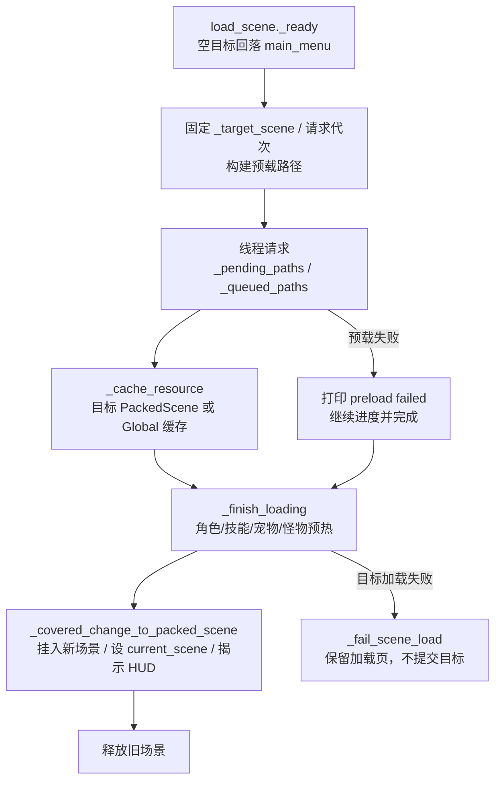

# 运行时调用面与所有权矩阵（Phase 15-1）

> **状态**：Phase 15-1 调查完成；Phase 15-2A/15-2B/15-2C、Phase 15-3A、Phase 15-3B、Phase 15-3C、Phase 15-3D、Phase 15-4A、Phase 15-4B、Phase 15-4C、Phase 15-4D 与 Phase 15-4E 已落地。本页保留当前调用面与所有权事实，不把后续 Phase 16 的目标写成已实现。
>
> **调查基线**：`238a7a6`（2026-10-28 Phase 15-1）；2026-10-28 Phase 15-2A/15-2B 更新调用面与入口契约；2026-10-28 Phase 15-3A/15-3B 更新交接与租约。仓库只有一个活跃工程 `source/`；矩阵中的旧计数保留调查日期语境，当前计数以本页更新后的表格为准。
>
> **方法**：以 `source/**/*.gd`、`source/project.godot` 与当前 Markdown 为事实源，使用 `grep`/`read` 做静态调用面调查。下文的调用次数是静态出现次数，可能包含条件分支、重复调用或暂时不可达路径，不等同于运行期调用次数。
>
> **范围**：`Global` 的场景/加载/缓存/池/UI 编排，`load_scene.gd` 的加载状态，关卡入口与地图释放，档案会话清理，退出与后台请求。`source/addons/`、`source/bin/`、战斗业务规则与素材质量不在本阶段范围。

---

## 1. 结论摘要

1. **业务场景入口已收口**：`Global.change_scene` 是正式入口，Phase 15-2A 后静态发现 **139 处调用、49 个文件**；`hdzm.gd` 的 4 处直接 `change_scene_to_file` 已迁入正式入口，业务代码不再保留低层切换。
2. **低层切换只保留正式入口内部实现**：`Global.change_scene` 2 处（快速路径与加载页入口）；`load_scene.gd` 业务兜底为 0；`hdzm.gd` 旁路为 0，`Global._deferred_change_scene` 已删除。
3. **目标状态在加载页被快照**：`Global.target_scene` 仍作为入口交接值；`load_scene` 在 `_ready` 固定 `_target_scene` 与请求代次，后续不再读取可变的全局目标；空/非场景/缺失目标由正式入口返回 `false`。
4. **缓存所有权集中在 `Global`**：`_resource_cache`、`_monster_scene_cache`、`_sprite_frames_cache`、`_audio_cache`、`_texture_cache`、关卡资源租约与预览槽均由 `Global` 持有；加载页 Phase 15-3A 后只通过 `is_resource_cached`、`get_cached_packed_scene`、`handoff_loaded_resource` 交接，不直接读写私有缓存字典。
5. **关卡资源按租约释放**：`_level_resource_lease` 记录目标场景、本次加载拥有的路径、怪物/弹体/纹理/音频分类、热身场景与已预热怪物 ID；每次 `change_scene` 释放上一租约并建立新租约；目标场景本身走 `_target_packed_scene`，不登记为租约资源。未登记路径、永久 UI 保留。
6. **对象池只在档案结束时整体清空**：池根、伤害文本、受击、角色受击与音效池由 `Global` 持有；关卡切换不清理，复用前重置依赖各消费者。**19-2B**：清池前停止并释放活动声部、清空流与 45ms 节流表，活动计数归零。
7. **临时 UI 只采用显式登记**：临时 UI 工厂调用 `register_transient_ui` 登记并提供可选关闭回调；`cleanup_transient_ui` 只关闭登记实例并清弹出层，名称兜底与 51 处业务显式调用已删除；永久小 UI 跳过清理。
8. **退出与后台已收口**：应用退出由 `Global._exit_tree` 统一结束档案会话、角色/战斗/UI 缓存与对象池，并关闭纹理请求；场景切换与档案结束递增运行时代次，异步预载在写回前检查代次。**19-2A**：`end_archive_session()` 调用 `stop_bgm()`，档案退出不再依赖场景释放停止 BGM。`MemoryClass._exit_tree` 仍独立负责存档线程 flush。

---

## 2. 场景流调用面

### 2.1 低层切换调用

`change_scene_to_file` / `change_scene_to_packed` 的完整静态清单：

| 位置 | 调用 | 所有者 | 分类 |
|:---|:---|:---|:---|
| `source/global.gd` | 缓存命中时 `change_scene_to_packed` | `Global` | 正式入口的快速路径 |
| `source/global.gd` | 切换到 `load_scene.tscn` | `Global` | 正式入口的加载页路径 |

`load_scene.gd` 已不再直接调用 `change_scene_to_file/packed`。加载失败、实例化失败或场景加入后失效时只更新加载页状态，不提交目标场景。

### 2.2 `Global.change_scene` 调用方清单

全部调用点的 owner 都是 `Global.change_scene`；下表只列调用文件与静态次数，避免把同一入口误记成多个所有者。

| 调用文件 | 次数 |
|:---|:---:|
| `source/Scene/other_scene/bacis_ar_button.gd` | 2 |
| `source/Scene/other_scene/level_info.gd` | 2 |
| `source/Scene/other_scene/lsh.gd` | 5 |
| `source/Scene/other_scene/lxdy.gd` | 5 |
| `source/Scene/other_scene/return_back_map.gd` | 2 |
| `source/Scene/other_scene/twenty_eight_constellations_button.gd` | 1 |
| `source/Scene/set_menu.gd` | 3 |
| `source/Script/back_pack/dj_sell.gd` | 1 |
| `source/Script/base/base_hero.gd` | 2 |
| `source/Script/base/base_through_level.gd` | 9 |
| `source/Script/level/bai_gu_level.gd` | 1 |
| `source/Script/level/defeat.gd` | 14 |
| `source/Script/level/hdzm_first_dungeon_transition.gd` | 1 |
| `source/Script/level/level_17.gd` | 1 |
| `source/Script/level/level_2.gd` | 1 |
| `source/Script/level/level_23.gd` | 1 |
| `source/Script/level/level_27.gd` | 1 |
| `source/Script/level/level_28.gd` | 1 |
| `source/Script/level/level_34.gd` | 1 |
| `source/Script/level/level_38.gd` | 1 |
| `source/Script/level/level_55.gd` | 1 |
| `source/Script/level/level_hdgqnmg.gd` | 1 |
| `source/Script/level/level_hdgqzld.gd` | 1 |
| `source/Script/level/hdzm.gd` | 4 |
| `source/Script/level/level_hdzm.gd` | 3 |
| `source/Script/level/level_llbt.gd` | 5 |
| `source/Script/level/level_tzhy.gd` | 1 |
| `source/Script/level/level_xbj.gd` | 1 |
| `source/Script/level/level_xss.gd` | 1 |
| `source/Script/level/level_zhen_yao_tower.gd` | 2 |
| `source/Script/level/liu_sha_river_boss_level.gd` | 1 |
| `source/Script/level/north_continent_level.gd` | 1 |
| `source/Script/level/victory.gd` | 19 |
| `source/Script/main_menu/choose_player.gd` | 2 |
| `source/Script/main_menu/game_over_1.gd` | 1 |
| `source/Script/main_menu/map_0.gd` | 2 |
| `source/Script/main_menu/map_1.gd` | 2 |
| `source/Script/main_menu/map_2.gd` | 3 |
| `source/Script/main_menu/map_3.gd` | 6 |
| `source/Script/main_menu/map_4.gd` | 3 |
| `source/Script/main_menu/map_5.gd` | 3 |
| `source/Script/main_menu/map_6.gd` | 3 |
| `source/Script/main_menu/map_7.gd` | 3 |
| `source/Script/main_menu/map_8.gd` | 4 |
| `source/Script/main_menu/map_8_1.gd` | 3 |
| `source/Script/main_menu/map_9.gd` | 3 |
| `source/Script/main_menu/map_9_1.gd` | 3 |
| `source/Script/main_menu/zhen_yao_tower.gd` | 1 |
| `source/Script/memory_class/player_data.gd` | 1 |

合计：**49 个文件、139 处静态调用**。其中 `force_loading_screen=true` 只有 `source/Script/level/level_zhen_yao_tower.gd:483` 一处。

### 2.3 预载下一场景

`Global.preload_next(path)` 只保存一个预览槽，只有一个路径；调用点如下：

| 位置 | 目标 | 说明 |
|:---|:---|:---|
| `source/Script/base/base_through_level.gd:1322` | `victory.tscn` | 出口可用时预载 |
| `source/Script/base/base_through_level.gd:1328` | `victory.tscn` | 出口可用时预载 |
| `source/Script/base/base_through_level.gd:1339` | `victory.tscn` | 双场景路径的出口预载 |
| `source/Script/level/level_55.gd:524` | `BOSS_SCENE_PATH` | Boss 前预载 |

`Global.change_scene` 只在缓存命中、目标属于 `res://Scene/level/`、不是 `level_hdzm.tscn` 且未强制加载页时，使用这个预览槽直接 `change_scene_to_packed`。Phase 15-2B 后快速路径同步写入 `target_scene`，仍不经过加载页。

### 2.4 目标状态与失败语义

| 场景 | 当前行为 | 后续边界 |
|:---|:---|:---|
| 空字符串目标 | `Global.change_scene` 返回 `false` 并发出 warning；不清理缓存、不写 `target_scene` | 加载页冷启动仍可在空值时回落 `main_menu.tscn`；业务调用不得传空 |
| 非空但不存在目标 | 返回 `false` 并发出 warning；不清理缓存、不进入加载页 | 目标缺失由 15-2B 拒绝；异步加载失败由 15-2C 保留加载页状态 |
| 缓存命中 | 关卡目标写 `target_scene` 后 `change_scene_to_packed`，返回引擎调用结果 | 快速路径不经过加载页；加载页失败语义只作用于其路径 |
| 强制加载页 | `force_loading_screen=true` 跳过快速路径，仍写 `target_scene` 并切加载页 | 仅保留有明确理由的调用方 |
| 切换中再次切换 | 正式入口递增请求代次；旧加载页的目标快照与代次不匹配时不再写缓存或切换；最新请求获胜 | 旧线程请求的底层取消仍属 15-3；代次守卫已阻止过期回调提交 |
| 直接旁路 | 业务旁路为 0；`load_scene.gd` 低层切换为 0；`hdzm.gd` 已迁入正式入口 | 低层切换只保留 `Global.change_scene`；失败不调用 `change_scene_to_*` |

目标状态写入点只有：

- `Global.change_scene`：正式入口在目标通过校验后写入 `target_scene`（快速路径同样写入）；
- `source/Scene/other_scene/load_scene.gd:_ready`：加载页在冷启动空值时写入 `DEFAULT_TARGET_SCENE`。

加载页的 `target_scene` 读取用于战斗判定、预载清单、缓存命中和完成切换；没有独立的目标 token 或版本号。

---

## 3. 加载页状态机

### 3.1 加载页持有的状态

| 状态 | 写入方 | 读取方 | 释放/失效 | 边界 |
|:---|:---|:---|:---|:---|
| `_load_started`、`_finishing`、`_changing_scene` | `load_scene` | `_process`、完成路径 | 加载页释放 | 配合请求代次防重复完成与过期提交 |
| `_pending_paths`、`_queued_paths` | `_fill_preload_slots`、`_request_preload_path`、`_poll_pending_paths` | 加载页 | 加载页释放；代次失效时清空/停止 | 目标变化后不再处理器结果 |
| `_request_limit` | `_start_archive_preload` | `_fill_preload_slots` | 加载页释放 | 移动端 2，桌面 4 |
| `_target_packed_scene` | `_cache_resource` | `_finish_loading` | 加载页释放 | 只接收当前 `_target_scene` 快照的目标 PackedScene |
| `_target_scene`、`_request_generation` | `load_scene._ready` | 加载页所有预载/缓存/切换路径 | 加载页释放 | 目标快照与请求代次；旧代次不写缓存、不切换 |
| `_total_paths`、`_completed_paths` | 加载页 | 进度显示 | 加载页释放 | 预载失败仍计入完成；目标场景失败走独立失败路径 |
| `_battle_vram_baseline_bytes` | 加载页 | VRAM 日志 | 加载页释放 | 仅日志，不参与失败判定 |

### 3.2 失败与取消

- 目标校验失败：`Global.change_scene` 返回 `false`，不清理缓存、不写 `target_scene`、不进入加载页；空目标与缺失目标均在此层拒绝。
- 线程请求 `THREAD_LOAD_FAILED` / `THREAD_LOAD_INVALID_RESOURCE`：移除请求、打印 `preload failed`、仍增加完成数；没有失败聚合状态。
- 同步 `load` 失败：`_cache_resource` 收到 `null` 时直接返回；进度仍前进。
- 目标 `PackedScene` 为 `null`：`_change_to_target_scene_file` 调用 `_fail_scene_load`，不直接切换场景；目标路径缺失已在 `Global.change_scene` 入口拒绝。
- 重复切换：正式入口递增请求代次；旧加载页的代次与当前不一致时停止轮询、缓存写入和场景提交。直接测试“最新目标获胜”通过；加载页用请求代次停止轮询与提交，`ResourceLoader` 无公开取消 API，后台请求完成后丢弃；超时由 120 秒看门狗与 `application/run/load_timeout_msec` 覆盖。
- 目标场景失败：目标无法加载、实例化、加入场景树或加载后失效时，`_fail_scene_load` 只更新加载页文本并停止切换；不调用 `change_scene_to_file/packed`。当前 `current_scene` 保留为加载页，失败目标不会成为当前场景。

---

## 4. 缓存与租约所有权

### 4.0 缓存作用域契约（Phase 15-4A）

| 作用域 | 所有者 | 容量/驻留依据 | 清理事件 | 观测键 |
|:---|:---|:---|:---|:---|
| 构建期只读 | `scripts/convert_level_preload_catalog.py` 等构建转换器；`LevelPreloadStore`/`LevelPreloadCatalog` 只是只读视图 | 构建期生成；运行时无写入、无增长 | 无（不参与运行时清理） | `build_read_only` |
| 永久 | `Global` | 4 条永久小 UI；角色/宠物预热标记各 1；无常规增长 | `release_ui_runtime_cache(release_permanent=true)`、角色切换、`end_archive_session` | `permanent` |
| 关卡 | `Global._level_resource_lease` + `_monster_scene_cache` | 按当前关卡加载路径；无固定上限，随租约释放 | `change_scene` → `release_level_resource_lease`；`clear_level_resource_cache` | `level` |
| 战斗 | `Global` | 池上限 80/32/24/32（预置 12/16/16/6）；模块静态帧缓存随模块 | `end_archive_session` → `clear_combat_runtime_cache`；不随普通关卡切换 | `combat` |
| UI | `Global` 的临时实例登记、实例计数、永久 UI 与 UI 纹理前缀 | 按运行时实例与场景路径；无固定上限 | 实例退出、关闭回调、`release_ui_runtime_cache`、切换/退出 | `ui` |
| 共享运行时 | `Global` 四类资源缓存 | 按租约/UI/永久所有权驻留；无固定上限 | 租约释放、UI 释放、角色资源释放 | `shared_runtime` |

`Global.get_cache_scope_snapshot()` 返回上述键的只读快照；`ui.transient_instance_count` 暴露显式临时 UI 登记数；`level-resource-lease` 探针验证租约/战斗池清理与容量元数据，`load-guard` 探针验证 UI 实例登记与释放、Catalog 只读副本。永久 UI 常量当前为 `PERMANENT_SMALL_UI_SCENE_PATHS`，是所有权边界，不是容量建议值。

### 4.1 编排层缓存

| 对象 | 当前所有者 | 写入方 | 读取方 | 释放/失效 | 失败边界 |
|:---|:---|:---|:---|:---|:---|
| `_resource_cache` | `Global` | `_load_scene`、`_cache_threaded_resource`、`load_scene_uncached`、部分预载函数、`instance_scene` 相关 UI 缓存 | `Global`、`load_scene` 经 `is_resource_cached` / `get_cached_packed_scene` | `release_level_resource_lease`（经 `clear_level_resource_cache` / `clear_combat_runtime_cache`）、`release_role_runtime_resources`、`release_ui_runtime_cache`、`_release_ui_scene_cache_if_unused` | `null` 资源不入缓存；资源预载失败继续进度，目标场景失败停止切换 |
| `_monster_scene_cache` | `Global` | `load_level_monster_scene`、`preload_level_monster_scenes`、`prewarm_monster_scene_paths` | `load_level_monster_scene` | 只删除当前租约登记的怪物场景路径 | 空路径返回 `null`；未命中时重新加载；未登记路径保留 |
| `_sprite_frames_cache` | `Global` | `_cache_threaded_resource`、`prewarm_sprite_frames_paths` 经 `_preload_paths_threaded` | `_preload_paths_threaded`、`_preload_sprite_frames_resource`、`is_resource_cached` | 租约路径释放、角色资源释放、UI 纹理前缀清理；不再按战斗资源前缀批量删除 | 没有外部直接读取；缓存查询包含此表 |
| `_audio_cache` | `Global` | `get_cached_audio`、`_cache_threaded_resource` | `get_cached_audio`、`is_resource_cached` | 租约路径释放、角色资源释放、UI 前缀清理；不再按战斗资源前缀批量删除 | 路径别名解析；空路径返回 `null` |
| `_texture_cache` | `Global` | `get_cached_texture`、`_cache_threaded_resource` | `get_cached_texture`、`is_resource_cached` | 租约路径释放、角色资源释放、UI 前缀清理、`release_cached_texture`；不再按战斗资源前缀批量删除 | 加载失败时删除条目并返回 `null` |

### 4.2 关卡资源与预览槽

| 对象 | 当前所有者 | 写入方 | 读取方 | 释放/失效 | 失败边界 |
|:---|:---|:---|:---|:---|:---|
| `_level_resource_lease` | `Global` | `begin_level_resource_lease`；`_track_level_resource` 由加载页 `handoff_loaded_resource`、`load_scene_uncached`、`load_level_monster_scene`、`preload_level_monster_scenes`、`preload_level_texture_paths`、`_track_level_scene_dependencies`、`prewarm_monster_scene_paths`、`prewarm_monster_bullet_scene_paths` 触发 | `release_level_resource_lease`、`get_level_resource_lease_snapshot`、预载去重 | `release_level_resource_lease`；`clear_level_resource_cache` 间接调用 | 只记录目标场景、路径、怪物/弹体/纹理/音频分类、热身场景与预热怪物 ID；目标场景和未登记路径不释放 |
| `_level_resource_lease["warmed_scene_paths"]` | `Global` | `prewarm_monster_scene_paths`、`prewarm_monster_bullet_scene_paths` | 预载去重 | 随租约释放 | 只记录已预热场景，不记录请求失败 |
| `_level_resource_lease["prewarmed_monster_ids"]` | `Global` | `preload_level_monster_runtime_resources` | 预载去重 | 随租约释放 | 失败仍可能标记为已处理，取决于调用路径 |
| `load_scene._target_packed_scene`、`_target_packed_scene_path` | 加载页 | `_cache_resource` 仅在路径等于 `_target_scene` 时写入 | `_finish_loading` | 消费后清空；失败/取消/退出清空 | 目标路径必须匹配；过期代次不提交 |
| `_preloaded_scene`、`_preloaded_scene_path`、`_preloading_path` | `Global` | `preload_next`、`_get_preloaded`；`clear_preloaded_scene_slot` | `Global.change_scene`、`get_preloaded_scene_slot_snapshot` | 消费、失败、换目标或显式清理时清空 | 单槽；失败路径不会永久占用；后台线程无公开取消 API |

**Phase 15-3A/15-3B API**：`is_resource_cached(path) -> bool` 只读查询四个运行时缓存；`get_cached_packed_scene(path) -> PackedScene` 返回已缓存的场景或 `null`；`handoff_loaded_resource(path, resource, track_level=false) -> bool` 是加载页唯一写入入口，内部决定缓存表并按需登记关卡路径。`begin_level_resource_lease(target_scene) -> int` 建立新租约；`release_level_resource_lease(lease_id=-1) -> int` 只释放指定租约的路径并返回释放数；`get_level_resource_lease_snapshot() -> Dictionary` 返回只读分类快照。加载页不再接触私有字段或私有方法。

**不属于缓存的对象**：`LevelPreloadStore`、`LevelPreloadCatalog`、`RoleRuntimeCatalog`、AtlasMetadata 的只读 View、`.tres` 声明与脚本 `preload` 常量。它们是声明/构建数据或引擎资源，不按本页的运行时缓存清理规则处理。

### 4.3 对象池（Phase 15-4B）

| 对象 | 所有者/池根 | 取出/回收 | 重置语义 | 清理事件 | 容量与作用域 |
|:---|:---|:---|:---|:---|:---|
| `_pool_data["root"]` | `Global`，`RuntimePool` 挂在 `Global` 下 | `_get_pool_root` | 无 | `_clear_runtime_pools` | 跨关卡/重战保留；档案结束清空；应用退出由 `Global._exit_tree` 清理 |
| `_pool_data["damage_text"]` | `Global` | `_take_pooled_node` / `recycle_damage_text` | `prepare_for_pool` + `setup` | 同上 | 池上限 80；预置 12；活动计数上限 80 |
| `_pool_data["mr_hurt"]` | `Global` | `_take_pooled_node` / `recycle_mr_hurt` | 消费者 `recycle` 停止动画并隐藏；`_play_hurt_animation` 重新开始 | 同上 | 池上限 32；预置 16 |
| `_pool_data["role_be_hit"]` | `Global` | `_take_pooled_node` / `recycle_role_be_hit` | `setup` 重置帧/翻转/缩放；`recycle` 停止 | 同上 | 池上限 24；预置 16 |
| `_pool_data["sound_player"]` | `Global` | `_take_pooled_node` / `recycle_sound_player` | `setup` 绑定音频并播放；回收停止并清空 stream | 同上 | 池上限 32；预置 6；另有移动/桌面声部与单音限制 |
| `_active_damage_texts` / `_active_sound_players` | `Global` | 取出时登记；回收/树退出时移除 | 不适用 | `_clear_runtime_pools` 清空 | 活动计数用于上限与声部仲裁；不跨档案保留 |

`preload_combat_hit_resources` 在战斗加载完成时预置池：伤害文本 12、受击 16、角色受击 16、音效 6。`_store_pooled_node` 先移除父节点，池满则 `queue_free`；池根或取出节点已排队删除时不会复用。池节点由消费者 `setup`/`recycle` 重置，`_store_pooled_node` 不负责统一状态重置。

`get_cache_scope_snapshot().combat` 暴露 `pool_sizes`、`pool_limits`、`pool_root_valid`、`active_damage_texts` 与 `active_sound_players`；租约探针验证池容量、池根和退出清理。关卡切换与重战只释放资源租约，不清池；`end_archive_session` 经 `clear_combat_runtime_cache` 清空池与活动映射。

### 4.4 UI 与永久小 UI

| 对象 | 所有者 | 写入方 | 释放/失效 | 边界 |
|:---|:---|:---|:---|:---|
| `_permanent_small_ui_scene_cache` | `Global` | `_load_scene` 对 `PERMANENT_SMALL_UI_SCENE_PATHS` 的缓存；`prewarm_permanent_small_ui_scenes` | `release_ui_runtime_cache(release_permanent=true)` | 只在退出档案时整体清空；预载协程按运行时代次中止 |
| `_ui_runtime_instance_paths` / `_ui_runtime_instance_counts` | `Global` | `register_ui_runtime_instance`；`_on_ui_runtime_instance_exited` 递减 | `release_ui_runtime_cache` 清空登记 | 树退出后延迟释放场景缓存；永久 UI 不按实例释放 |
| `_transient_ui_instances` | `Global` | `register_transient_ui` 由关键 UI 工厂显式调用；`_on_transient_ui_exited` 移除 | `cleanup_transient_ui` 调用关闭回调并释放；实例退出自动移除 | 只登记非永久 UI；可选零参数关闭回调 |
| `_ui_popup_layer` | `Global` | `get_ui_popup_layer` | `cleanup_transient_ui` 清子节点，不清 layer 本身 | `Global` 为 Autoload，layer 随进程存活 |
| `_active_hover_popup` | `Global` | `register_hover_popup` | `clear_hover_popup` / `cleanup_transient_ui` | 只保留一个 |
| 临时 UI 节点 | 各 UI 工厂 | `instance_scene`、`register_transient_ui` | `cleanup_transient_ui` 关闭 `_transient_ui_instances` 并清弹出层；永久 UI 路径跳过；`release_ui_runtime_cache` 只清缓存/属性 | 只登记非永久 UI；业务不得直接调用清理入口；场景自有阴影/按钮与自动消失 `message_show` 不登记 |

`PERMANENT_SMALL_UI_SCENE_PATHS` 当前为 `back_pack.tscn`、`learn_skill.tscn`、`pet_interface.tscn`、`magic_weapon_infor.tscn`。这是实现常量，不是建议上限。

#### 19-2C 节点分类

| 类别 | 对象 | 处理 |
|:---|:---|:---|
| 应登记 | LevelInfo、GameSet、LDL、Shop、mystery_shop、Learn_Skill、RewardInterface、ChooseItem、choose_scene、BasicTask、game_announcement、HDZM、lsh、lxdy、lhhj、return_back_map、TwentyEightConstellations | 工厂调用 `register_transient_ui`；LevelInfo 以无关闭方法登记，避免关闭回调重置四剑模式；GameSet/LDL 使用 `_on_return_pressed` |
| 应保留 | MapShadowTop/Bottom/Left/Right、ShopShadowTop/Bottom/Left/Right、地图 Shop 按钮、`message_show` | 前两类是地图/商店场景自有装饰，随所属节点释放；地图 Shop 是地图按钮；`message_show` 自计时并由父节点释放 |
| 应删除 | 29 项硬编码名称、递归名称兜底、18 个文件的 51 处业务显式调用 | 已删除；清理只由 `Global.change_scene` 调用登记表 |

### 4.5 档案会话与外围静态缓存

| 对象 | 所有者 | 生命周期 | 失败边界 |
|:---|:---|:---|:---|
| `_archive_session`（`ArchiveSession`） | `Global` | `bind_archive_session` 建立；`end_archive_session`、`set_cd_path` 切换、角色变化或 `_exit_tree` 释放 | 退出场景仅 `main_menu.tscn` 与 `choose_player.tscn`；victory/defeat/maps 不结束会话；无会话时保存与关卡入口被拒绝 |
| `_archive_session_generation` | `Global` | `bind_archive_session`、`end_archive_session` 与 `_exit_tree` 递增；档案预热协程检查 | 与 `_runtime_generation` 和 `_archive_session_prewarm_token` 同时约束档案预热；加载页使用自己的请求代次 |
| `FrameSequenceStore` | `Script/data/frame_sequence_store.gd` | `Global._exit_tree` 与 `clear_level_resource_cache` 清理 | 运行时帧序列缓存，不是声明数据 |
| `FrameTextureRequests` | `Script/data/frame_texture_requests.gd` | `Global._exit_tree` 调用 `shutdown_process`；`_closing` 阻止退出后轮询 | 场景切换由帧序列 generation 与 `_closing` 停止写回 |
| 特效/剑阵/宠物/怪物弹体静态缓存 | 各模块 | 由 `clear_level_resource_cache`、`clear_combat_runtime_cache`、`release_role_runtime_resources` 或加载页非战斗清理触发；19-2D 增加怪物帧注册表 | 模块局部缓存；跨档案由注册表清空 |
| 怪物帧/几何等模块静态缓存 | 各怪物脚本 + `MonsterFrameCacheRegistry` | `clear_combat_runtime_cache` 在档案退出/应用退出调用 `clear_all()`；同一档案内关卡切换保留不可变帧缓存 | 跨档案不读取旧缓存；44 个帧/几何脚本 + `MonsterBullet`/`SwordBossBase`/观音效果统一清理；编辑预览缓存保留 |
| 静态缓存保留清单 | `MonsterFrameCacheRegistry` | `clear_level_resource_cache` 仍按关卡清 212 弹体帧；`clear_combat_runtime_cache` 清 44 个模块帧/几何脚本、`MonsterBullet`、`SwordBossBase`、四个观音效果 | 编辑预览 `monster_scene_editor_preview` 不进入运行时清理；不可变帧缓存仅在档案内跨关复用 |

`clear_level_resource_cache` 会释放当前 `_level_resource_lease` 登记的路径，并清理 `FrameSequenceStore`、`MONSTER_212_BULLET_SCRIPTS` 的帧缓存；不再整体清空 `_monster_scene_cache`。`clear_combat_runtime_cache` 在此基础上清理对象池、NeZha 帧缓存，并释放当前法宝召唤物；不再按 `Art`/`Scene`/`Music` 前缀批量删除缓存。`end_archive_session` 再清理五个角色特效静态数据和流式子弹/镜缓存。

---

## 5. 清理与释放入口

| 入口 | 实际所有者 | 调用方 | 覆盖范围 | 失败/边界 |
|:---|:---|:---|:---|:---|
| `Global.change_scene` | `Global` | 139 处业务调用 | 目标校验、请求代次、档案退出、临时 UI、UI 缓存、上一关卡租约释放、新租约建立、快速路径/加载页 | 空/缺失目标拒绝并返回 `false`；加载页失败不提交目标 |
| `cleanup_transient_ui` | `Global` | 仅 `Global.change_scene` | 注册实例关闭回调、弹出层、hover popup | 永久小 UI 跳过；清理期间 active 守卫；业务直接调用由 `POOL_UI_CLEANUP_UNREGISTERED` 阻断 |
| `release_ui_runtime_cache` | `Global` | 仅 `Global.change_scene` | UI 场景缓存、永久 UI、UI 纹理前缀 | 只清缓存，不释放仍在树的 UI 节点 |
| `clear_level_resource_cache` | `Global` | `Global.change_scene`、`clear_combat_runtime_cache` | 当前租约路径、FrameSequence、212 帧缓存 | 只释放租约登记路径；不清理池、UI 或未登记路径 |
| `clear_combat_runtime_cache` | `Global` | 仅 `end_archive_session` | 当前租约、池、NeZha 帧缓存、召唤物 | 不再按战斗资源前缀批量删除缓存；不在普通关卡切换触发 |
| `_clear_runtime_pools` | `Global` | `clear_combat_runtime_cache` | 四个池与池根 | 只随档案结束 |
| `end_archive_session` | `Global` | `Global.change_scene` 进入 `main_menu`/`choose_player`（在 `cleanup_transient_ui()` 之后）与 `set_cd_path` 切换档案 | 运行时代次、档案 generation、预热令牌、战斗缓存、角色特效缓存 | 应用退出由 `_exit_tree` 清理；victory/defeat 不结束 |
| `release_role_runtime_resources` | `Global` | `bind_archive_session` 角色变化、`prewarm_current_role_runtime_resources` 切换角色 | 角色相关缓存与特效静态数据 | 普通关卡切换不调用 |
| `release_map_visual_resources` | 地图脚本 + `Global` | `map_0` 至 `map_9_1` 的 `_exit_tree` | 递归清空 Sprite/TextureRect/按钮/进度条/AnimatedSprite/NinePatch 纹理并清理地图阴影 | 全部地图入口已覆盖 |
| `MemoryClass._exit_tree` / `_notification` | `MemoryClass` | 引擎退出、暂停、关窗 | 存档后台任务 flush | 与运行时缓存/池清理分开 |
| `Global._exit_tree` | `Global` | 引擎退出 | 结束档案会话、角色/战斗/UI 缓存、对象池、预载槽、`FrameSequenceStore` 与 `FrameTextureRequests` | 先递增运行时代次并置 `_shutting_down`，再清理；存档线程仍由 `MemoryClass` 独立 flush |

---

## 6. 候选所有权与 Phase 15 交接

| 能力 | 当前所有者 | 允许调用方 | 释放/失效事件 | 失败语义 | Phase 交接 |
|:---|:---|:---|:---|:---|:---|
| 场景目标选择 | `Global.target_scene` + `Global.change_scene` | 业务 UI/关卡；加载页消费目标快照 | 切换完成/失败 | 空/缺失目标 `false`；加载页代次过期不提交 | Phase 15-2A/15-2B/15-2C 已完成 |
| 线程预载 | `load_scene` 请求 + `Global` 缓存 | 仅加载页 | 完成/加载页释放/超时 | 代次阻止旧回调写回；取消为停止轮询并丢弃后台结果 | Phase 15-3C 已完成 |
| 关卡资源租约 | `Global._level_resource_lease` | `Global.change_scene`、加载页、BaseLevel 预载函数 | 每次切换/战斗清理，只释放本租约 | 未登记路径不释放；目标场景不登记 | Phase 15-3B 已完成 |
| 战斗对象池 | `Global._pool_data` | 战斗表现消费者回收 | 档案结束 | 关卡切换不清理；复用重置依赖消费者 | Phase 15-4B 已完成 |
| 临时 UI | `Global._transient_ui_instances` | UI 工厂/各面板 | 树退出、切换、Global 清理 | 只登记非永久 UI；名称兜底已删除；业务不得直接调用 | 19-2C 完成 |
| 档案会话 | `Global` | 存档入口/选角（`bind_archive_session`） | 主菜单/选角/切档 | 普通切场不结束；应用退出由 `_exit_tree` 清空 | Phase 16-3 已完成 |
| 退出与后台 | `Global` + `MemoryClass` | 引擎 | 应用退出 | `Global._exit_tree` 清理运行时代次、档案/角色/战斗/UI 缓存与池；存档线程单独 flush | Phase 15-4D 已完成；Phase 16 持久化边界 |
| 地图视觉释放 | 地图脚本 | `map_0` 至 `map_9_1` | 地图退出 | 全部地图入口覆盖 | Phase 15-4D 已完成 |

**不新增 Autoload**：本阶段候选所有者仍位于现有 `Global`、加载页、关卡或模块脚本内；所有权拆分不等于新增全局服务。

---

## 7. Phase 15-2/15-3/15-4 待处理边界

以下均是当前事实与风险，不是本阶段已修复内容：

### Phase 15-2A/15-2B 已完成

1. `hdzm.gd` 的 4 处直接 `change_scene_to_file` 已迁入 `Global.change_scene`；业务代码低层切换为 0。
2. `Global.change_scene` 已返回 `bool`：空目标、非 `.tscn/.scn`、`ResourceLoader.exists` 失败均返回 `false`，且不清理缓存、不写 `target_scene`；接受时返回引擎提交结果。
3. 快速路径同步写入 `target_scene`，与加载页路径的观察状态一致。

### Phase 15-2C 已完成

1. 加载页不再直接调用 `change_scene_to_file/packed`；目标场景加载、实例化或加入后失效时保留加载页当前状态并显示失败。
2. 加载页固定 `_target_scene` 与 `_request_generation`；重复切换时旧代次停止轮询、缓存写入和场景提交，最新请求获胜。
3. 入口失败已由 15-2B 在跳转前拒绝；15-2C 不尝试恢复进入加载页时已经释放的上一场景。

### Phase 15-3A 已完成

1. 加载页只通过 `is_resource_cached`、`get_cached_packed_scene`、`handoff_loaded_resource` 交接；不直接读写 `_resource_cache`、`_audio_cache`、`_texture_cache`，不直接调用 `_cache_threaded_resource` 与 `_track_level_resource`。

### Phase 15-3B 已完成

1. `_level_resource_lease` 记录目标场景、租约 ID、拥有路径、场景/怪物/弹体/纹理/音频分类、已预热场景与已预热怪物 ID；`begin_level_resource_lease` 在每次 `change_scene` 建立新租约，`release_level_resource_lease` 只释放本租约路径，永久 UI 与未登记路径保留。
2. `clear_level_resource_cache` 通过租约释放关卡缓存，不再整体清空 `_monster_scene_cache`；`clear_combat_runtime_cache` 不再按 `Art`/`Scene`/`Music` 前缀批量删除缓存。
3. `get_level_resource_lease_snapshot` 提供只读分类快照；旧租约 ID 不能释放新租约。
4. 场景探针 `level-resource-lease` 验证租约分类、按租约释放、共享缓存保留、旧 ID 拒绝、重战清理与 `end_archive_session` 退出清理；连续切关探针仍通过。

### Phase 15-3C 已完成

1. 加载页固定 `_target_scene`、`_request_generation` 与 `_target_packed_scene_path`；目标切换、加载页销毁或失败后 `_is_request_current()` 阻止轮询、缓存写入与场景提交。
2. 新增 120 秒加载看门狗与 `application/run/load_timeout_msec` 覆盖；超时只显示失败并保留加载页，不提交目标。
3. `_preloaded_scene` 单槽增加显式路径、失败/换目标/消费清理与只读快照；缺失、失败和重复请求不会永久占用单槽。
4. 加载页新增过期场景释放：旧目标已加入树但在完成前被取代时，不恢复旧可玩关卡；失败/取消不进入目标场景。

### Phase 15-3D 已完成

1. 移除加载页 `DirAccess` 目录扫描、`ResourceLoader.get_dependencies` 递归清单解析、`FileAccess`/manifest 解析与相关死函数；`load_scene.gd` 不再扫描目录或解析依赖清单。
2. `LevelPreloadStore` 只读 Catalog；数组返回值复制，`level()` 收窄为内部读取；`LevelPreloadCatalog` 的数组查询返回副本。
3. `contract_scan.py` 新增第八类 `preload_boundary` 门禁与负向自测；加载页重新引入目录扫描/清单解析会阻断。

### Phase 15-4A 已完成

1. 定义构建期只读、永久、关卡、战斗、UI、共享运行时六个作用域；每类登记所有者、容量/驻留依据、清理事件与观测键。
2. 新增 `Global.get_cache_scope_snapshot()` 只读快照；包含租约、预载单槽、四类资源缓存计数、永久 UI/角色/宠物标记、对象池大小与上限、UI 实例计数。
3. `level-resource-lease` 探针验证作用域键、容量元数据、租约/战斗池清理；`load-guard` 探针验证 UI 实例登记/释放与 Catalog 只读副本。

### Phase 15-4B 已完成

1. 确认 `RuntimePool` 池根属于 `Global`；跨关卡/重战保留，档案结束清空。
2. 容量上限 80/32/24/32、预置 12/16/16/6；`_store_pooled_node` 池满释放，取出/根节点排队删除时不复用。
3. 复用前由各消费者 `setup`/`recycle` 重置；退出清理补充活动音效映射清空。
4. 租约探针验证池容量、池根、活动音效与档案退出清理；全量回归覆盖实战复用。

### Phase 15-4C 已完成

1. 新增 `_transient_ui_instances`、`register_transient_ui(node, close_method, scene_path)` 与 `cleanup_transient_ui` 的关闭回调阶段；基础任务、神秘商店与游戏公告工厂已显式登记 `_on_close_pressed`，当时其余 UI 保留名称兜底（19-2C 已删除）。
2. 清理顺序为注册实例关闭回调 → 弹出层/hover；永久小 UI 路径跳过，清理有 active 守卫；名称兜底已由 19-2C 删除。
3. `load-guard` 探针验证显式关闭回调、注册实例释放、未登记名称不误删、真实工厂登记与永久小 UI 保留；`get_cache_scope_snapshot().ui` 增加 `transient_instance_count`。

### Phase 15-4D 已完成

1. 新增 `_runtime_generation` 与 `is_runtime_generation_current`；`change_scene`、`bind_archive_session`、`end_archive_session` 与 `_exit_tree` 递增代次。
2. 角色/关卡/纹理/UI 预热及 `_preload_paths_threaded` 在写回缓存前检查代次；档案预热与永久 UI 预热同样中止，过期后台结果丢弃。
3. `Global._exit_tree` 统一结束档案会话、角色/战斗/UI 缓存、对象池、预载槽与纹理请求；`FrameTextureRequests` 的轮询在 `_closing` 后停止。
4. `main_menu` 与读取存档界面的 HTTPRequest 在退出时取消请求，回调增加 `is_inside_tree` 守卫；`map_6` 至 `map_9_1` 补齐地图视觉释放。

### Phase 15-4E 已完成

1. `contract_scan.py` 新增 `scene_entry`、`load_cache`、`pool_ui` 三类 ERROR 门禁：`change_scene_to_*` 仅 `global.gd` 豁免；加载页禁止私有缓存/租约访问；池/UI 清理仅 Global（19-2C 后业务直接调用一律阻断，不再保留 18 文件白名单）。
2. 新增负向/正向自测：场景入口坏样本 3/好样本 3、加载页私有缓存坏样本 3/好样本 2、池/UI 清理坏样本 4/好样本 4；注释与正式入口不误报。
3. `scripts/README.md`、`acceptance.md` 与状态/矩阵同步为十一类契约；`contract_scan --fail-on-error` 当前 ERROR=0。
4. `cleanup_transient_ui` 的硬编码名称列表与 51 处业务显式调用已由 19-2C 删除；19-2D 增加 `MonsterFrameCacheRegistry`，档案退出统一清理模块静态帧/几何缓存。

---

## 8. Phase 15-1/15-2A/15-2B/15-2C/15-3A/15-3B/15-3C/15-3D/15-4A/15-4B/15-4C/15-4D/15-4E 出口核对

- [x] 场景切换调用点已枚举并更新：139 处 `Global.change_scene`（49 文件）、2 处低层内部调用、业务与加载页旁路均为 0；
- [x] 加载页线程请求、缓存读取/写入、目标 PackedScene 与完成/失败路径已记录；加载页已改走窄交接 API；
- [x] `Global` 主要缓存、关卡资源租约、预览槽、永久 UI、对象池与 UI 注册表已登记 owner/写者/释放事件；
- [x] `clear_level_resource_cache`、`clear_combat_runtime_cache`、`end_archive_session`、`release_ui_runtime_cache`、`release_role_runtime_resources`、`release_map_visual_resources`、`_exit_tree` 的调用方已记录；
- [x] 只读 Catalog/声明与运行时缓存已分开；
- [x] `hdzm.gd` 的 4 处业务旁路已迁入正式入口；`Global.change_scene` 已固定目标校验/代次/快速路径；加载页使用目标快照并在失败时保留当前加载页。
- [x] Phase 15-3A：加载页通过 `is_resource_cached` / `get_cached_packed_scene` / `handoff_loaded_resource` 交接，私有缓存字段/方法访问为 0。
- [x] Phase 15-3B：关卡资源按租约记录与释放；`clear_combat_runtime_cache` 不再按宽泛前缀删除共享缓存；租约快照可枚举。
- [x] Phase 15-3C：请求代次、目标路径、超时、失败/取消/销毁路径与 `_preloaded_scene` 单槽均已收口；`ResourceLoader` 无公开取消 API，取消为停止轮询与提交并丢弃后台结果。
- [x] Phase 15-3D：加载页目录扫描/依赖清单解析为 0；`LevelPreloadStore`/Catalog 只读副本；`contract_scan` 第八类门禁与负向自测通过。
- [x] Phase 15-4A：六个缓存作用域均有所有者、容量依据、清理事件与 `get_cache_scope_snapshot` 观测键；租约/战斗池/UI 实例作用域验证通过。
- [x] Phase 15-4B：池根/容量/复用重置/清理事件已确认；池容量、池根、活动音效与档案退出清理通过探针。
- [x] Phase 15-4C：非永久 UI 显式登记/关闭回调、永久 UI 跳过、名称兜底与 active 守卫当时通过探针；19-2C 已删除名称兜底并改为登记表清理。
- [x] Phase 15-4D：`_runtime_generation` 覆盖切换、档案开始/结束与退出；异步预载写回前检查代次；`_exit_tree` 清理档案/角色/战斗/UI 缓存、池、预载槽与纹理请求；HTTP 退出取消；`map_6` 至 `map_9_1` 地图视觉释放补齐。
- [x] Phase 15-4E：`contract_scan.py` 新增 `scene_entry`、`load_cache`、`pool_ui` 三类门禁与正负样本；业务 `change_scene_to_*`、加载页私有缓存、未登记池/UI 清理入口阻断；`contract_scan --self-test` 全部通过，全量扫描 ERROR=0。

**验证**：Phase 15-3A/15-3B/15-3C/15-3D/15-4A/15-4B/15-4C/15-4D/15-4E 已执行 `check_all --godot-bin`（8/8 PASS）、`health_check`（0 Parse / 0 Error / 0 Warning）、`scene_probe_runner` 完整套件（**6/6 PASS**，星座 4.24s / 选择态 15.32s / 租约 3.01s / 加载守卫 4.80s / 法宝 7.07s / 角色技能 4.11s）、全量关卡回归（**PASS 128/128 + SKIP 5，FAIL 0**，723.1s；该次 2/4 并发复跑曾命中夹具 45s 加载阈值，根因已修复）、`contract_scan --self-test` 全部通过（预载边界 4/4+3/3、场景入口 3/3+3/3、加载页缓存 3/3+2/2、池/UI 清理 4/4+4/4）；`contract_scan --fail-on-error` ERROR=0；`level_58` 并发预算 1/2/4/6/8 全通过，加载 3.724 / 3.826~3.837 / 4.096~4.100 / 4.911~4.957 / 5.391~5.565s，墙钟 27.4/28.65/29.58/31.71/34.67s，45s 夹具阈值保持不变；Phase 15-4E changed-only 回归 **PASS 128/128 + SKIP 1，FAIL 0**（696.7s，`level_58` 28.29s）。changed-only 回归 **PASS 128/128 + SKIP 1，FAIL 0**（696.7s）。`level_1` 随全量回归 PASS（25.08s）；租约/守卫探针验证六作用域快照、池容量/池根/活动音效、UI 关闭回调/永久 UI 跳过/名称兜底、运行时代次失效与过期预载跳过。未执行 release 重验与切换中退出验证。

**下一入口**：Phase 15 已完成并归档，本页作为运行时调用面与所有权事实保留；后续阶段见 [`current-iteration.md`](../roadmap/current-iteration.md) 与 [`iteration_15_app_orchestration_lifecycle.md`](../archive/iteration_15_app_orchestration_lifecycle.md)。
