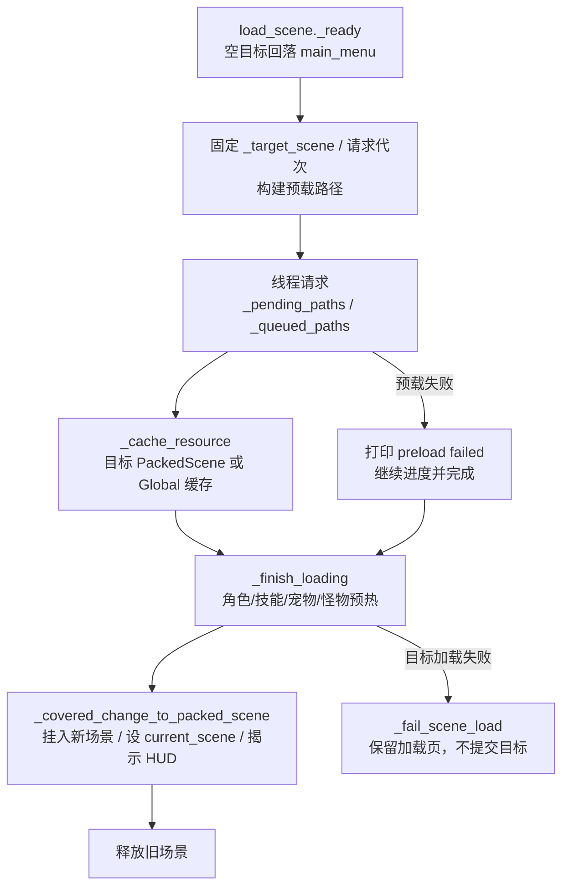

# 运行时调用面与所有权矩阵（Phase 15-1）

> **状态**：Phase 15-1 调查完成；Phase 15-2A/15-2B/15-2C 已落地。本页保留当前调用面与所有权事实，不把后续 Phase 15-3/15-4 的目标写成已实现。
>
> **调查基线**：`238a7a6`（2026-10-28 Phase 15-1）；2026-10-28 Phase 15-2A/15-2B 更新调用面与入口契约。仓库只有一个活跃工程 `source/`；矩阵中的旧计数保留调查日期语境，当前计数以本页更新后的表格为准。
>
> **方法**：以 `source/**/*.gd`、`source/project.godot` 与当前 Markdown 为事实源，使用 `grep`/`read` 做静态调用面调查。下文的调用次数是静态出现次数，可能包含条件分支、重复调用或暂时不可达路径，不等同于运行期调用次数。
>
> **范围**：`Global` 的场景/加载/缓存/池/UI 编排，`load_scene.gd` 的加载状态，关卡入口与地图释放，档案会话清理，退出与后台请求。`source/addons/`、`source/bin/`、战斗业务规则与素材质量不在本阶段范围。

---

## 1. 结论摘要

1. **业务场景入口已收口**：`Global.change_scene` 是正式入口，Phase 15-2A 后静态发现 **139 处调用、49 个文件**；`hdzm.gd` 的 4 处直接 `change_scene_to_file` 已迁入正式入口，业务代码不再保留低层切换。
2. **低层切换只保留正式入口内部实现**：`Global.change_scene` 2 处（快速路径与加载页入口）；`load_scene.gd` 业务兜底为 0；`hdzm.gd` 旁路为 0，`Global._deferred_change_scene` 已删除。
3. **目标状态在加载页被快照**：`Global.target_scene` 仍作为入口交接值；`load_scene` 在 `_ready` 固定 `_target_scene` 与请求代次，后续不再读取可变的全局目标；空/非场景/缺失目标由正式入口返回 `false`。
4. **缓存所有权集中在 `Global`**：`_resource_cache`、`_monster_scene_cache`、`_sprite_frames_cache`、`_audio_cache`、`_texture_cache`、关卡路径集合与预览槽均由 `Global` 持有；加载页直接读取 `_resource_cache`、`_audio_cache`、`_texture_cache`，并通过 `_cache_threaded_resource`、`_track_level_resource` 写回。
5. **关卡资源不是按关卡租约**：`_level_resource_cache_paths` 是一个全局路径集合，每次 `change_scene` 清空；目标场景本身走 `_target_packed_scene`，不登记为关卡资源。
6. **对象池只在档案结束时整体清空**：池根、伤害文本、受击、角色受击与音效池由 `Global` 持有；关卡切换不清理，复用前重置依赖各消费者。
7. **临时 UI 仍按硬编码节点名清理**：`cleanup_transient_ui` 遍历当前场景和根节点，按名称列表移除节点；51 处显式调用来自 18 个文件，另有 `Global.change_scene` 内部调用。
8. **退出清理不完整**：`Global._exit_tree` 只清理 `FrameSequenceStore` 与 `FrameTextureRequests`；对象池、UI 注册、关卡缓存与档案会话没有在应用退出路径统一结束。`MemoryClass._exit_tree` 负责存档线程 flush，是独立所有者。

---

## 2. 场景流调用面

### 2.1 低层切换调用

`change_scene_to_file` / `change_scene_to_packed` 的完整静态清单：

| 位置 | 调用 | 所有者 | 分类 |
|:---|:---|:---|:---|
| `source/global.gd` | 缓存命中时 `change_scene_to_packed` | `Global` | 正式入口的快速路径 |
| `source/global.gd` | 切换到 `load_scene.tscn` | `Global` | 正式入口的加载页路径 |

`load_scene.gd` 已不再直接调用 `change_scene_to_file/packed`。加载失败、实例化失败或场景加入后失效时只更新加载页状态，不提交目标场景。

### 2.2 `Global.change_scene` 调用方清单

全部调用点的 owner 都是 `Global.change_scene`；下表只列调用文件与静态次数，避免把同一入口误记成多个所有者。

| 调用文件 | 次数 |
|:---|:---:|
| `source/Scene/other_scene/bacis_ar_button.gd` | 2 |
| `source/Scene/other_scene/level_info.gd` | 2 |
| `source/Scene/other_scene/lsh.gd` | 5 |
| `source/Scene/other_scene/lxdy.gd` | 5 |
| `source/Scene/other_scene/return_back_map.gd` | 2 |
| `source/Scene/other_scene/twenty_eight_constellations_button.gd` | 1 |
| `source/Scene/set_menu.gd` | 3 |
| `source/Script/back_pack/dj_sell.gd` | 1 |
| `source/Script/base/base_hero.gd` | 2 |
| `source/Script/base/base_through_level.gd` | 9 |
| `source/Script/level/bai_gu_level.gd` | 1 |
| `source/Script/level/defeat.gd` | 14 |
| `source/Script/level/hdzm_first_dungeon_transition.gd` | 1 |
| `source/Script/level/level_17.gd` | 1 |
| `source/Script/level/level_2.gd` | 1 |
| `source/Script/level/level_23.gd` | 1 |
| `source/Script/level/level_27.gd` | 1 |
| `source/Script/level/level_28.gd` | 1 |
| `source/Script/level/level_34.gd` | 1 |
| `source/Script/level/level_38.gd` | 1 |
| `source/Script/level/level_55.gd` | 1 |
| `source/Script/level/level_hdgqnmg.gd` | 1 |
| `source/Script/level/level_hdgqzld.gd` | 1 |
| `source/Script/level/hdzm.gd` | 4 |
| `source/Script/level/level_hdzm.gd` | 3 |
| `source/Script/level/level_llbt.gd` | 5 |
| `source/Script/level/level_tzhy.gd` | 1 |
| `source/Script/level/level_xbj.gd` | 1 |
| `source/Script/level/level_xss.gd` | 1 |
| `source/Script/level/level_zhen_yao_tower.gd` | 2 |
| `source/Script/level/liu_sha_river_boss_level.gd` | 1 |
| `source/Script/level/north_continent_level.gd` | 1 |
| `source/Script/level/victory.gd` | 19 |
| `source/Script/main_menu/choose_player.gd` | 2 |
| `source/Script/main_menu/game_over_1.gd` | 1 |
| `source/Script/main_menu/map_0.gd` | 2 |
| `source/Script/main_menu/map_1.gd` | 2 |
| `source/Script/main_menu/map_2.gd` | 3 |
| `source/Script/main_menu/map_3.gd` | 6 |
| `source/Script/main_menu/map_4.gd` | 3 |
| `source/Script/main_menu/map_5.gd` | 3 |
| `source/Script/main_menu/map_6.gd` | 3 |
| `source/Script/main_menu/map_7.gd` | 3 |
| `source/Script/main_menu/map_8.gd` | 4 |
| `source/Script/main_menu/map_8_1.gd` | 3 |
| `source/Script/main_menu/map_9.gd` | 3 |
| `source/Script/main_menu/map_9_1.gd` | 3 |
| `source/Script/main_menu/zhen_yao_tower.gd` | 1 |
| `source/Script/memory_class/player_data.gd` | 1 |

合计：**49 个文件、139 处静态调用**。其中 `force_loading_screen=true` 只有 `source/Script/level/level_zhen_yao_tower.gd:483` 一处。

### 2.3 预载下一场景

`Global.preload_next(path)` 只保存一个预览槽，只有一个路径；调用点如下：

| 位置 | 目标 | 说明 |
|:---|:---|:---|
| `source/Script/base/base_through_level.gd:1322` | `victory.tscn` | 出口可用时预载 |
| `source/Script/base/base_through_level.gd:1328` | `victory.tscn` | 出口可用时预载 |
| `source/Script/base/base_through_level.gd:1339` | `victory.tscn` | 双场景路径的出口预载 |
| `source/Script/level/level_55.gd:524` | `BOSS_SCENE_PATH` | Boss 前预载 |

`Global.change_scene` 只在缓存命中、目标属于 `res://Scene/level/`、不是 `level_hdzm.tscn` 且未强制加载页时，使用这个预览槽直接 `change_scene_to_packed`。Phase 15-2B 后快速路径同步写入 `target_scene`，仍不经过加载页。

### 2.4 目标状态与失败语义

| 场景 | 当前行为 | 后续边界 |
|:---|:---|:---|
| 空字符串目标 | `Global.change_scene` 返回 `false` 并发出 warning；不清理缓存、不写 `target_scene` | 加载页冷启动仍可在空值时回落 `main_menu.tscn`；业务调用不得传空 |
| 非空但不存在目标 | 返回 `false` 并发出 warning；不清理缓存、不进入加载页 | 目标缺失由 15-2B 拒绝；异步加载失败由 15-2C 保留加载页状态 |
| 缓存命中 | 关卡目标写 `target_scene` 后 `change_scene_to_packed`，返回引擎调用结果 | 快速路径不经过加载页；加载页失败语义只作用于其路径 |
| 强制加载页 | `force_loading_screen=true` 跳过快速路径，仍写 `target_scene` 并切加载页 | 仅保留有明确理由的调用方 |
| 切换中再次切换 | 正式入口递增请求代次；旧加载页的目标快照与代次不匹配时不再写缓存或切换；最新请求获胜 | 旧线程请求的底层取消仍属 15-3；代次守卫已阻止过期回调提交 |
| 直接旁路 | 业务旁路为 0；`load_scene.gd` 低层切换为 0；`hdzm.gd` 已迁入正式入口 | 低层切换只保留 `Global.change_scene`；失败不调用 `change_scene_to_*` |

目标状态写入点只有：

- `Global.change_scene`：正式入口在目标通过校验后写入 `target_scene`（快速路径同样写入）；
- `source/Scene/other_scene/load_scene.gd:_ready`：加载页在冷启动空值时写入 `DEFAULT_TARGET_SCENE`。

加载页的 `target_scene` 读取用于战斗判定、预载清单、缓存命中和完成切换；没有独立的目标 token 或版本号。

---

## 3. 加载页状态机

### 3.1 加载页持有的状态

| 状态 | 写入方 | 读取方 | 释放/失效 | 边界 |
|:---|:---|:---|:---|:---|
| `_load_started`、`_finishing`、`_changing_scene` | `load_scene` | `_process`、完成路径 | 加载页释放 | 配合请求代次防重复完成与过期提交 |
| `_pending_paths`、`_queued_paths` | `_fill_preload_slots`、`_request_preload_path`、`_poll_pending_paths` | 加载页 | 加载页释放；代次失效时清空/停止 | 目标变化后不再处理器结果 |
| `_request_limit` | `_start_archive_preload` | `_fill_preload_slots` | 加载页释放 | 移动端 2，桌面 4 |
| `_target_packed_scene` | `_cache_resource` | `_finish_loading` | 加载页释放 | 只接收当前 `_target_scene` 快照的目标 PackedScene |
| `_target_scene`、`_request_generation` | `load_scene._ready` | 加载页所有预载/缓存/切换路径 | 加载页释放 | 目标快照与请求代次；旧代次不写缓存、不切换 |
| `_total_paths`、`_completed_paths` | 加载页 | 进度显示 | 加载页释放 | 预载失败仍计入完成；目标场景失败走独立失败路径 |
| `_battle_vram_baseline_bytes` | 加载页 | VRAM 日志 | 加载页释放 | 仅日志，不参与失败判定 |

### 3.2 失败与取消

- 目标校验失败：`Global.change_scene` 返回 `false`，不清理缓存、不写 `target_scene`、不进入加载页；空目标与缺失目标均在此层拒绝。
- 线程请求 `THREAD_LOAD_FAILED` / `THREAD_LOAD_INVALID_RESOURCE`：移除请求、打印 `preload failed`、仍增加完成数；没有失败聚合状态。
- 同步 `load` 失败：`_cache_resource` 收到 `null` 时直接返回；进度仍前进。
- 目标 `PackedScene` 为 `null`：`_change_to_target_scene_file` 调用 `_fail_scene_load`，不直接切换场景；目标路径缺失已在 `Global.change_scene` 入口拒绝。
- 重复切换：正式入口递增请求代次；旧加载页的代次与当前不一致时停止轮询、缓存写入和场景提交。直接测试“最新目标获胜”通过；底层线程请求的显式取消仍归 Phase 15-3。
- 目标场景失败：目标无法加载、实例化、加入场景树或加载后失效时，`_fail_scene_load` 只更新加载页文本并停止切换；不调用 `change_scene_to_file/packed`。当前 `current_scene` 保留为加载页，失败目标不会成为当前场景。

---

## 4. 缓存与租约所有权

### 4.1 编排层缓存

| 对象 | 当前所有者 | 写入方 | 读取方 | 释放/失效 | 失败边界 |
|:---|:---|:---|:---|:---|:---|
| `_resource_cache` | `Global` | `_load_scene`、`_cache_threaded_resource`、`load_scene_uncached`、部分预载函数、`instance_scene` 相关 UI 缓存 | `Global`、`load_scene._is_cached`、`load_scene._finish_loading` | `clear_level_resource_cache`、`clear_combat_runtime_cache`、`release_role_runtime_resources`、`release_ui_runtime_cache`、`_release_ui_scene_cache_if_unused` | `null` 资源不入缓存；加载页失败不阻止切换 |
| `_monster_scene_cache` | `Global` | `load_level_monster_scene`、`preload_level_monster_scenes`、`prewarm_monster_scene_paths` | `load_level_monster_scene` | `clear_level_resource_cache` | 空路径返回 `null`；未命中时重新加载 |
| `_sprite_frames_cache` | `Global` | `_cache_threaded_resource`、`prewarm_sprite_frames_paths` 经 `_preload_paths_threaded` | `_preload_paths_threaded`、`_preload_sprite_frames_resource` | 关卡清理、战斗清理、角色资源释放、UI 纹理前缀清理 | 没有外部直接读取；加载页 `_is_cached` 不检查此表 |
| `_audio_cache` | `Global` | `get_cached_audio`、`_cache_threaded_resource` | `get_cached_audio`、`load_scene._is_cached` | 关卡清理、战斗清理、角色资源释放、UI 前缀清理 | 路径别名解析；空路径返回 `null` |
| `_texture_cache` | `Global` | `get_cached_texture`、`_cache_threaded_resource` | `get_cached_texture`、`load_scene._is_cached` | 关卡清理、战斗清理、角色资源释放、UI 前缀清理、`release_cached_texture` | 加载失败时删除条目并返回 `null` |

### 4.2 关卡资源与预览槽

| 对象 | 当前所有者 | 写入方 | 读取方 | 释放/失效 | 失败边界 |
|:---|:---|:---|:---|:---|:---|
| `_level_resource_cache_paths` | `Global` | `_track_level_resource`；直接或间接触发点包括 `load_scene`、`load_scene_uncached`、`load_level_monster_scene`、`preload_level_texture_paths`、`_track_level_scene_dependencies`、`prewarm_monster_scene_paths`、`prewarm_monster_bullet_scene_paths` | `clear_level_resource_cache` | 每次 `Global.change_scene` 与 `clear_combat_runtime_cache` 清空 | 全局一个集合，不是按关卡租约；目标场景本身不登记 |
| `_level_runtime_warmed_scene_paths` | `Global` | `prewarm_monster_scene_paths`、`prewarm_monster_bullet_scene_paths` | 预载去重 | `clear_level_resource_cache` | 只记录已预热场景，不记录请求失败 |
| `_level_runtime_prewarmed_monster_ids` | `Global` | `preload_level_monster_runtime_resources` | 预载去重 | `clear_level_resource_cache` | 失败仍可能标记为已处理，取决于调用路径 |
| `_preloaded_scene`、`_preloading_path` | `Global` | `preload_next`、`_get_preloaded` | `Global.change_scene` | 消费后清空；失败不清理 | 单槽；失败后 `_preloading_path` 可能保留，未验证重试语义 |

**不属于缓存的对象**：`LevelPreloadStore`、`LevelPreloadCatalog`、`RoleRuntimeCatalog`、AtlasMetadata 的只读 View、`.tres` 声明与脚本 `preload` 常量。它们是声明/构建数据或引擎资源，不按本页的运行时缓存清理规则处理。

### 4.3 对象池

| 对象 | 所有者 | 取出/回收 | 重置语义 | 清理事件 | 边界 |
|:---|:---|:---|:---|:---|:---|
| `_pool_data["damage_text"]` | `Global` | `_take_pooled_node` / `recycle_damage_text` | `prepare_for_pool` + `setup` | 仅 `clear_combat_runtime_cache` → `end_archive_session` | 上限 80；活动计数 80；关卡切换不清空 |
| `_pool_data["mr_hurt"]` | `Global` | `_take_pooled_node` / `recycle_mr_hurt` | 消费者 `recycle` 停止动画并隐藏 | 同上 | 上限 32；关卡切换不清空 |
| `_pool_data["role_be_hit"]` | `Global` | `_take_pooled_node` / `recycle_role_be_hit` | `setup` 重置帧/翻转/缩放；`recycle` 停止 | 同上 | 上限 24 |
| `_pool_data["sound_player"]` | `Global` | `_take_pooled_node` / `recycle_sound_player` | `setup` 绑定音频并播放；回收停止并清空 stream | 同上 | 上限 32；另有移动/桌面声部与单音限制 |
| `_pool_data["root"]` | `Global` | `_get_pool_root` | 无 | `_clear_runtime_pools` | 退出路径未统一清理 |

`preload_combat_hit_resources` 在战斗加载完成时预置池：伤害文本 12、受击 16、角色受击 16、音效 6。池节点由 `_take_pooled_node` 返回后由消费者 `setup` 重置；`_store_pooled_node` 只负责移出当前父节点、挂到池根并计入上限，不负责统一状态重置。

### 4.4 UI 与永久小 UI

| 对象 | 所有者 | 写入方 | 释放/失效 | 边界 |
|:---|:---|:---|:---|:---|
| `_permanent_small_ui_scene_cache` | `Global` | `_load_scene` 对 `PERMANENT_SMALL_UI_SCENE_PATHS` 的缓存；`prewarm_permanent_small_ui_scenes` | `release_ui_runtime_cache(release_permanent=true)` | 只在退出档案时整体清空；预载协程没有 generation |
| `_ui_runtime_instance_paths` / `_ui_runtime_instance_counts` | `Global` | `register_ui_runtime_instance`；`_on_ui_runtime_instance_exited` 递减 | `release_ui_runtime_cache` 清空登记 | 树退出后延迟释放场景缓存；永久 UI 不按实例释放 |
| `_ui_popup_layer` | `Global` | `get_ui_popup_layer` | `cleanup_transient_ui` 清子节点，不清 layer 本身 | `Global` 为 Autoload，layer 随进程存活 |
| `_active_hover_popup` | `Global` | `register_hover_popup` | `clear_hover_popup` / `cleanup_transient_ui` | 只保留一个 |
| 临时 UI 节点 | 各 UI 调用方 | `instance_scene`、`load_ui_scene`、具体 UI 脚本 | `cleanup_transient_ui` 按硬编码名称递归删除；`release_ui_runtime_cache` 只清缓存/属性 | 名称匹配可能误删其他场景节点；51 处显式调用来自 18 个文件 |

`PERMANENT_SMALL_UI_SCENE_PATHS` 当前为 `back_pack.tscn`、`learn_skill.tscn`、`pet_interface.tscn`、`magic_weapon_infor.tscn`。这是实现常量，不是建议上限。

### 4.5 档案会话与外围静态缓存

| 对象 | 所有者 | 生命周期 | 失败边界 |
|:---|:---|:---|:---|
| `archive_session_active`、`archive_session_role_id` | `Global` | `begin_archive_session` 建立；`end_archive_session` 或角色变化释放 | 退出场景仅 `main_menu.tscn` 与 `choose_player.tscn`；victory/defeat/maps 不结束会话 |
| `_archive_session_generation` | `Global` | `begin_archive_session` 与 `end_archive_session` 递增；档案预热协程检查 | 只保护档案预热；加载页线程请求不使用该 generation |
| `FrameSequenceStore` | `Script/data/frame_sequence_store.gd` | `Global._exit_tree` 与 `clear_level_resource_cache` 清理 | 运行时帧序列缓存，不是声明数据 |
| `FrameTextureRequests` | `Script/data/frame_texture_requests.gd` | `Global._exit_tree` 调用 `shutdown_process` | 场景切换没有显式取消入口 |
| 特效/剑阵/宠物/怪物弹体静态缓存 | 各模块 | 由 `clear_level_resource_cache`、`clear_combat_runtime_cache`、`release_role_runtime_resources` 或加载页非战斗清理触发 | 模块局部缓存；未经过 `Global` 的调用面不在本阶段逐项展开 |
| 怪物帧/几何等模块静态缓存 | 各怪物脚本 | 当前未见统一场景切换清理入口 | 可能在关卡切换后保留；Phase 15-4 评估作用域，不在本阶段修改 |

`clear_level_resource_cache` 会清理 `FrameSequenceStore`、`MONSTER_212_BULLET_SCRIPTS` 的帧缓存、关卡路径集合、预热集合与 `_monster_scene_cache`。`clear_combat_runtime_cache` 在此基础上清理对象池、NeZha 帧缓存、伤害/角色/怪物/法宝等前缀缓存，并释放当前法宝召唤物。`end_archive_session` 再清理五个角色特效静态数据和流式子弹/镜缓存。

---

## 5. 清理与释放入口

| 入口 | 实际所有者 | 调用方 | 覆盖范围 | 失败/边界 |
|:---|:---|:---|:---|:---|
| `Global.change_scene` | `Global` | 139 处业务调用 | 目标校验、请求代次、档案退出、临时 UI、UI 缓存、关卡缓存、快速路径/加载页 | 空/缺失目标拒绝并返回 `false`；加载页失败不提交目标 |
| `cleanup_transient_ui` | `Global` | `Global.change_scene` + 18 个文件的 51 处显式调用 | 硬编码节点名、弹出层、hover popup | 名称冲突误删；不是节点注册表 |
| `release_ui_runtime_cache` | `Global` | 仅 `Global.change_scene` | UI 场景缓存、永久 UI、UI 纹理前缀 | 只清缓存，不释放仍在树的 UI 节点 |
| `clear_level_resource_cache` | `Global` | `Global.change_scene`、`clear_combat_runtime_cache` | 关卡路径集合、monster cache、预热集合、FrameSequence、212 帧缓存 | 全局一次清空；不清理池和 UI |
| `clear_combat_runtime_cache` | `Global` | 仅 `end_archive_session` | 关卡缓存、池、战斗/角色/法宝前缀缓存、召唤物 | 不在普通关卡切换触发 |
| `_clear_runtime_pools` | `Global` | `clear_combat_runtime_cache` | 四个池与池根 | 只随档案结束 |
| `end_archive_session` | `Global` | `Global.change_scene` 进入 `main_menu`/`choose_player` | 档案 generation、战斗缓存、角色特效缓存 | 应用退出不调用；victory/defeat 不结束 |
| `release_role_runtime_resources` | `Global` | `begin_archive_session` 角色变化、`prewarm_current_role_runtime_resources` 切换角色 | 角色相关缓存与特效静态数据 | 普通关卡切换不调用 |
| `release_map_visual_resources` | 地图脚本 + `Global` | `map_0` 至 `map_5` 的 `_exit_tree` | 递归清空 Sprite/TextureRect/按钮/进度条/AnimatedSprite/NinePatch 纹理 | `map_6` 至 `map_9_1` 未调用 |
| `MemoryClass._exit_tree` / `_notification` | `MemoryClass` | 引擎退出、暂停、关窗 | 存档后台任务 flush | 与运行时缓存/池清理分开 |
| `Global._exit_tree` | `Global` | 引擎退出 | `FrameSequenceStore`、`FrameTextureRequests` | 不清理池、UI 注册、关卡缓存或档案会话 |

---

## 6. 候选所有权与 Phase 15 交接

| 能力 | 当前所有者 | 允许调用方 | 释放/失效事件 | 失败语义 | Phase 交接 |
|:---|:---|:---|:---|:---|:---|
| 场景目标选择 | `Global.target_scene` + `Global.change_scene` | 业务 UI/关卡；加载页消费目标快照 | 切换完成/失败 | 空/缺失目标 `false`；加载页代次过期不提交 | Phase 15-2A/15-2B/15-2C 已完成 |
| 线程预载 | `load_scene` 请求 + `Global` 缓存 | 仅加载页 | 完成/加载页释放 | 失败继续进度，无取消 | Phase 15-3 窄接口与取消 |
| 关卡资源租约 | `Global._level_resource_cache_paths` | 加载页、BaseLevel 预载函数 | 每次切换/战斗清理 | 全局集合，不是按关卡 | Phase 15-3 改为可枚举租约 |
| 战斗对象池 | `Global._pool_data` | 战斗表现消费者回收 | 档案结束 | 关卡切换不清理；复用重置依赖消费者 | Phase 15-4 作用域与清理 |
| 临时 UI | `Global` 注册表 + 硬编码清理 | UI 工厂/各面板 | 树退出、切换、手动清理 | 名称冲突；永久 UI 异步预载 | Phase 15-4 注册/关闭回调 |
| 档案会话 | `Global` | 存档入口/选角 | 主菜单/选角 | 退出路径不结束 | Phase 16 会话/持久化 |
| 退出与后台 | `Global` + `MemoryClass` | 引擎 | 应用退出 | `Global` 只清帧缓存；存档线程单独 flush | Phase 15-4 与 Phase 16 |
| 地图视觉释放 | 地图脚本 | `map_0` 至 `map_5` | 地图退出 | `map_6` 至 `map_9_1` 未覆盖 | Phase 15-4 补齐或说明 |

**不新增 Autoload**：本阶段候选所有者仍位于现有 `Global`、加载页、关卡或模块脚本内；所有权拆分不等于新增全局服务。

---

## 7. Phase 15-2/15-3/15-4 待处理边界

以下均是当前事实与风险，不是本阶段已修复内容：

### Phase 15-2A/15-2B 已完成

1. `hdzm.gd` 的 4 处直接 `change_scene_to_file` 已迁入 `Global.change_scene`；业务代码低层切换为 0。
2. `Global.change_scene` 已返回 `bool`：空目标、非 `.tscn/.scn`、`ResourceLoader.exists` 失败均返回 `false`，且不清理缓存、不写 `target_scene`；接受时返回引擎提交结果。
3. 快速路径同步写入 `target_scene`，与加载页路径的观察状态一致。

### Phase 15-2C 已完成

1. 加载页不再直接调用 `change_scene_to_file/packed`；目标场景加载、实例化或加入后失效时保留加载页当前状态并显示失败。
2. 加载页固定 `_target_scene` 与 `_request_generation`；重复切换时旧代次停止轮询、缓存写入和场景提交，最新请求获胜。
3. 入口失败已由 15-2B 在跳转前拒绝；15-2C 不尝试恢复进入加载页时已经释放的上一场景。

### Phase 15-3

1. 加载页当前直接读取 `_resource_cache`、`_audio_cache`、`_texture_cache`，直接调用 `_cache_threaded_resource` 与 `_track_level_resource`；需要收束为窄接口。
2. `_level_resource_cache_paths` 需要按本次关卡加载形成租约，记录目标场景、首波/阶段怪物、弹体、纹理与预热标记；释放只处理本租约。
3. 线程请求失败/取消/超时、目标切换、加载页销毁时需要使旧回调失效；失败不能进入可玩场景。
4. `_target_packed_scene` 需要绑定目标路径或 generation，完成阶段不能使用过期目标。
5. `_preloaded_scene` / `_preloading_path` 需要明确失败清理和重复请求语义；不能让失败路径永久占用单槽。

### Phase 15-4

1. 对象池清理只在档案结束时发生；需要确认关卡切换、重战与退出是否应保留、部分清理或重建。
2. `cleanup_transient_ui` 的硬编码名称列表与 51 处显式调用需要收束为实例登记/关闭回调；不能按名称误删其他场景节点。
3. `prewarm_permanent_small_ui_scenes` 没有 generation；异步预载可能在永久 UI 缓存清空后继续写入。
4. `map_6` 至 `map_9_1` 没有 `release_map_visual_resources` 的 `_exit_tree` 调用；需要确认是否有意省略。
5. `Global._exit_tree` 只清理帧缓存/纹理请求，不清理池、UI 注册、关卡缓存或结束档案会话；应用退出路径需要与普通场景切换区分。
6. 模块局部静态帧缓存（怪物、特效、宠物）未统一走 `Global` 清理；需要按作用域决定保留、按关卡释放或进程生命周期持有。

---

## 8. Phase 15-1/15-2A/15-2B/15-2C 出口核对

- [x] 场景切换调用点已枚举并更新：139 处 `Global.change_scene`（49 文件）、2 处低层内部调用、业务与加载页旁路均为 0；
- [x] 加载页线程请求、缓存读取/写入、目标 PackedScene 与完成/失败路径已记录；
- [x] `Global` 主要缓存、关卡路径集合、预览槽、永久 UI、对象池与 UI 注册表已登记 owner/写者/释放事件；
- [x] `clear_level_resource_cache`、`clear_combat_runtime_cache`、`end_archive_session`、`release_ui_runtime_cache`、`release_role_runtime_resources`、`release_map_visual_resources`、`_exit_tree` 的调用方已记录；
- [x] 只读 Catalog/声明与运行时缓存已分开；
- [x] `hdzm.gd` 的 4 处业务旁路已迁入正式入口；`Global.change_scene` 已固定目标校验/代次/快速路径；加载页使用目标快照并在失败时保留当前加载页。

**验证**：Phase 15-2A/15-2B/15-2C 已执行 `check_all --godot-bin`（8/8 PASS）、`health_check`（0 Parse / 0 Error / 0 Warning）、`level_1` 冒烟（PASS，日志 0 ERROR / 0 WARNING）、`scene_probe_runner --probe level-selection`（PASS，14.67s）、全量关卡回归（**PASS 128/128 + SKIP 5，FAIL 0**，735.6s；`level_58` 单次瞬态失败后重试通过），以及临时探针（空/缺失目标拒绝、重复切换最新目标获胜、目标加载后失效时 current_scene 保留加载页）。未执行 release 重验、底层线程显式取消与切换中退出，这些仍属待验证或 Phase 15-3 范围。

**下一入口**：Phase 15-2C 加载页交接。恢复时先读本页 §2、§6、§7 与 [`current-iteration.md`](../roadmap/current-iteration.md) 的 Phase 15-2C 切片。
