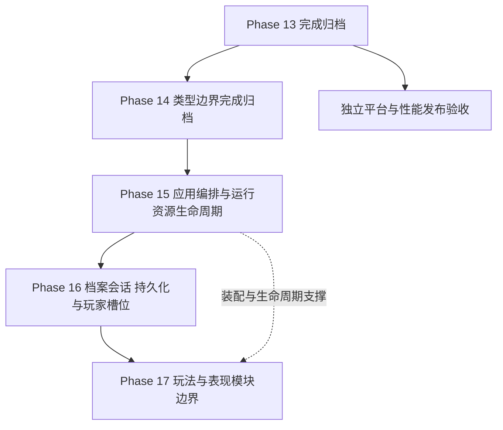

# BHYH 后续开发路线图

> **定位**：长期阶段顺序、阶段状态与独立项目的唯一来源；不保存批次实施流水账。
> **当前版本**：6.9。Phase 12~Phase 17 均已完成并归档；当前候选为 **Phase 18~20 综合收尾**（18-1A 已完成、18-1B/18-1C/18-1D 未启动、18-2 成长与奖励命令、18-3 档案提交与进度、19-1 表现与路径、19-2 音频与运行时、19-3 资源与 Atlas、19-4 输入与 HUD、20-1 独立项目、20-2 平台/发布、20-3 守卫扩面均未启动）；平台与发布验证按独立工作流推进。
> **目标依据**：[`项目总体目标架构契约`](../standards/target_architecture_contract.md)；当前实现见 [`architecture.md`](../reference/architecture.md)，验证事实见 [`status.md`](../reference/status.md)，档位见 [`acceptance.md`](../reference/acceptance.md)。

## 1. 状态与文档边界

| 项目 | 状态 | 边界 |
|:---|:---|:---|
| [Phase 12 显示/HUD](../archive/iteration_12_display_hud.md) | 完成、归档 | 保留已接受显示基线 |
| [Phase 13 视觉资产契约](../archive/iteration_13_visual_asset_contract.md) | 完成、归档 | 保留构建/共享/失败/流式/导出成果及机读登记例外，不重开历史阶段 |
| [Phase 14 类型化数据边界（AtlasMetadata 试点）](../archive/iteration_14_atlas_metadata_boundary.md) | 完成、归档 | 六个直接消费者均使用只读 View；旧入口、`source_masks` 与惰性配置已清除；边界守卫进入 `contract_scan.py` |
| [Phase 15 应用编排与运行资源生命周期](../archive/iteration_15_app_orchestration_lifecycle.md) | 完成、归档 | 场景切换、加载、缓存/池/临时 UI 与退出生命周期；边界守卫进入 `contract_scan.py`；矩阵见 [`runtime_lifecycle_matrix.md`](../reference/runtime_lifecycle_matrix.md) |
| [Phase 16 档案会话、持久化与玩家槽位](../archive/iteration_16_archive_session_slots.md) | 完成、归档 | 档案会话、共享账本、槽位查询、面板显式操作者与档案/槽位契约门禁；矩阵见 [`archive_session_matrix.md`](../reference/archive_session_matrix.md)，旧计划见归档页 |
| [Phase 17 玩法与表现模块边界](../archive/iteration_17_gameplay_module_boundaries.md) | 完成、归档 | 归属/阶段/结算/成长/HUD/音频/模块 API 与 17-7 静态守卫；矩阵见 [`gameplay_module_matrix.md`](../reference/gameplay_module_matrix.md)、[`module_api_matrix.md`](../reference/module_api_matrix.md) |
| Phase 18~20 综合收尾 | 当前候选；18-1A 已完成，18-1B~20-3 未启动 | 归属/成长/档案/表现/运行时/资源/Atlas/平台与守卫；详细批次见 [`current-iteration.md`](current-iteration.md) |
| 平台与性能发布验收 | 独立工作流 | 按目标平台与设备条件启动，不等待目录迁移 |
| 高版本内容回植 | 未确认 | 不把 7.0 写成承诺，按 [`migration_playbook`](../guides/migration_playbook.md) 另立范围 |

本次修订只改变目标与规划，不改变玩法、数值、档案格式或运行时能力。此前“Phase 16 目录/场景现代化”的计划被本页修正：目录治理作为各阶段的受控附带工作，不再单列全仓搬迁阶段。

| 文档 | 唯一职责 |
|:---|:---|
| 总体目标契约 | 长期职责、依赖方向、不变量与迁移约束 |
| 本页 | 工作流、长期顺序、候选方向与启动依赖 |
| `current-iteration.md` | 当前候选阶段的任务、状态、入口与出口 |
| `architecture.md` / `status.md` | 实际实现 / 带日期的验证与当前边界 |

## 2. 总体架构工作流

方向是 Godot 原生场景组合的模块化架构，而不是资产格式、类层次或目录外观统一。

| 工作流 | 目标契约 | 收敛结果 |
|:---|:---|:---|
| 应用编排 | 目标契约 §2~§3、§4.3 | 有唯一切换入口，装配/输入交接/清理明确，异步结果不写入过期场景 |
| 档案与双人会话 | §3、§5 | 档案、共同账本、玩家槽位分离；保存与 UI 不依赖全局视图交换 |
| 战斗与关卡 | §4 | 来源与结算单一真源，继承稳定、组合按需，保留已验收行为 |
| 数据与资源 | §5、§7 | 静态 Resource、可变状态、JSON 编解码分离；AtlasMetadata 是有限试点 |
| UI/输入/音频 | §6 | 显式操作者、命令/查询、分层输入与完整退出，不把业务塞入界面 |
| 构建/发布/平台 | §7.5、§8、§11 | 确定性、依赖闭包、实际包加载与平台性能分别证明 |
| 模块/目录 | §9 | 保留类型顶层，在内部功能聚合；仅有收益证据才迁移路径 |

### 2.1 推荐顺序与真实依赖

- 这是推荐执行队列，不声称 AtlasMetadata 是所有应用/会话工作的技术前置。独立清单调查和只读设计可提前；实施顺序由真实调用、共享状态与验证条件决定。
- Phase 15 的退出/资源所有权与 Phase 16 的档案/槽位边界已稳定；Phase 17 的归属与结算替换以这两组边界为前置，不重新打开全局视图交换或直接写档路径。
- 平台工作可独立推进；Windows 基线不证明跨平台或战斗峰值性能。
- 不预先决定精确服务类名、组件数量、Autoload 目标数量或全局目录布局。进入候选阶段前补调用面、边界、原子迁移批次与可执行验收。

## 3. 各候选阶段的职责

### 3.1 Phase 14：类型化数据边界（AtlasMetadata 试点）

范围是 `AtlasMetadata` 的真实运行时消费边界与构建校验，不是完成全部档案、装备或成长数据的类型化。

- 14-1 已完成生产者、schema、直接/间接消费者与构建边界矩阵：379 个 manifest、8 种顶层形态，运行时只需 `pages+sequences` 与 `animation+frames`；不按旧“四种 schema”建立统一模型。
- 14-1~14-3 已完成生产者/消费者矩阵与六个直接消费者迁移；14-4 已清理惰性配置，并把旧入口、非 View `.data` 与 `source_masks` 守卫加入 `contract_scan.py`。Phase 14 完成并归档。
- 静态序列化数据仍可使用 Resource；纯运行时只读视图可使用强类型 `RefCounted`。按需求选，不要求用户先在两者中盲选。
- 校验完整源格式，但仅为实际消费字段提供类型 API；不泄露可写共享集合、不复制纹理页。
- 旧 `data_for`、`validate_path`、`clear_cache` 与 `NorthBossProjectile.source_masks` 已删除，不保留 deprecated 兼容层；`.data` 只作为序列化存储，只允许拥有者内部使用。
- Atlas 转换器同步与自测已在契约域；本阶段强化既有检查，不重复规划“首次加入门禁”。
- 详细矩阵、批次、触发式验证与恢复条件见 [Phase 14 归档](../archive/iteration_14_atlas_metadata_boundary.md) 与 [`atlas_metadata_schema.md`](../reference/atlas_metadata_schema.md)。

### 3.2 Phase 15：应用编排与运行资源生命周期（已完成、归档）

阶段记录见 [`iteration_15_app_orchestration_lifecycle.md`](../archive/iteration_15_app_orchestration_lifecycle.md)；Phase 15-1 调用面与所有权矩阵见 [`runtime_lifecycle_matrix.md`](../reference/runtime_lifecycle_matrix.md)；本节只保留阶段职责。

- 先核对启动、加载页、切换旁路、缓存/池/UI 所有权与退出依赖；先完成一个可运行职责切片。
- 单一场景流转能力覆盖冷启动、覆盖式切换、返回/重战与失败；保留首帧/HUD 防黑屏语义。
- 按实际持有者拆清关卡资源、UI、对象池和后台请求；不要仅把 Global 字段搬进另一个 Manager。
- 正式入口职责正确可保留名称；被替换的旧 API 与全部生产调用方同批迁移，不以永久 facade 降低完成标准。
- Autoload 增删/合并先评审，不预批新的全局服务，也不强制减到指定数量。

### 3.3 Phase 16：档案会话、持久化与玩家槽位

- 明确档案会话、1P/2P 个体与共同账本；以现有共享规则为不变量，不先改业务格式。
- 保存快照与工作线程隔离，处理顺序、切档/退档与关闭；维持加密、稳定密钥、原子写、备份与有限幂等补全。
- 2P 面板改为显式操作者/数据视图时，必须同时处理保存快照的视图互斥；不能只改 LocalCoop 或只改 UI。
- 迁移共享账本与界面绑定按业务域闭环，移除被替代的全局交换入口；运行中不能并存两套可写真源。
- 玩家档案按域类型化另列具体批次，不把整个 `player_data` 改成 Resource 作为目标。
- 本阶段已完成并归档：详细批次、验证与恢复记录见 [`iteration_16_archive_session_slots.md`](../archive/iteration_16_archive_session_slots.md)。

### 3.4 Phase 17：玩法与表现模块边界

- 根据热点与实际耦合选择试点，不为缩短基类而大拆继承。
- 攻击/弹体/召唤/法宝显式携带来源，池化复用清除旧状态；伤害、Buff、吸血与无双归属不漂移。
- 关卡阶段与胜败/重战提交保持唯一所有者；通关与保存不重复执行。
- HUD/面板用只读查询与明确命令，输入与音频表现不拥有领域规则。
- 成长系统按实际域抽取命令：购买/锻造/学习/奖励先校验，再提交扣除与产出；保留共同账本与个体分配，验证失败无部分扣费、无重复领取，不引入通用事务框架。
- 模块公开 API、场景依赖与必要的功能子目录一起治理；深层路径只在受影响边界清理，不全仓替换。
- 当前候选批次：18-1A 已完成；18-1B/18-1C/18-1D、18-2 成长与奖励命令、18-3 档案提交与进度、19-1 表现与路径、19-2 音频与运行时、19-3 资源与 Atlas、19-4 输入与 HUD、20-1 独立项目、20-2 平台/发布、20-3 守卫扩面未启动；Phase 17 已归档，详细任务见 [`current-iteration.md`](current-iteration.md)。

## 4. 独立平台与内容工作

### 4.1 Spine 与目标平台

先明确目标平台，再核对 Godot/Spine 运行库、许可证、扩展二进制、导出能力与设备验证；未验证平台不得宣传可用。不把 macOS/Linux/Android/Web 全部补齐写成默认承诺。

Windows release 的已有验证见 `status.md`。后续战斗负载、峰值驻留、首帧和重复进出需要对应设备实测；PCK 路径可达不代替加载与性能。

### 4.2 内容回植

只有目标版本、合法来源与范围确认后才进入活动批次；按三方语义合并接入当前总体架构，不恢复旧路径/旧后端/旧存档迁移链。

## 5. 跨阶段纪律与验收

- 保持 Phase 13 登记例外的机读冻结；不要在活跃路线复制会漂移的条目数或历史迁移台账。
- 功能子目录不是第二套顶层；`source/` 路径迁移走 `rename_path.py`，同步引用/UID/导入/Catalog/发布清单。`_bundled` 必须按实际格式取证，不以文件名搜索结果宣布不存在。
- 每批以一个职责与调用面闭环，迁移正式调用方、删除旧入口、验证正常/边界/失败/退出路径；回滚用版本控制。
- 静态、引擎、生产路径冒烟、相关回归、发布包与性能验证按 `acceptance.md` 的变更矩阵触发；不要求每次文档或清单修改都做 release，也不以通用套件代替新增行为验证。
- 架构目标与进度分开。Phase 15 与 Phase 16 已全部完成并归档；当前候选为 Phase 17，17-1、17-2A、17-2B、17-2C、17-3 与 17-4 已完成，其余批次未实施；Phase 17 的归属/阶段/成长/表现边界以 [`gameplay_module_matrix.md`](../reference/gameplay_module_matrix.md) 与 [`current-iteration.md`](current-iteration.md) 为准。
- 归档和已接受 ADR 保留历史；当前决定由 [ADR-021](../decisions/ADR-021-project-wide-target-architecture.md) 解释，后续具体实现选择再按需追加 ADR。
