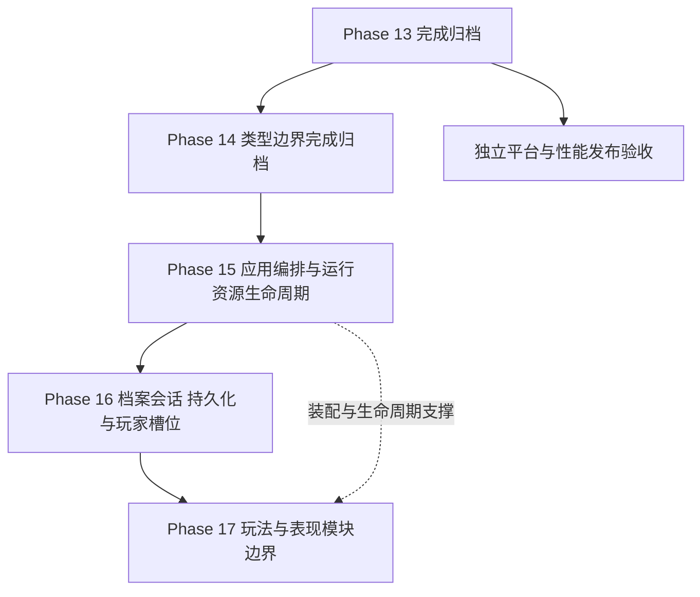

# BHYH 后续开发路线图

> **定位**：长期阶段顺序、阶段状态与独立项目的唯一来源；不保存批次实施流水账。
> **当前版本**：6.9。Phase 12~Phase 20 均已完成并归档；**Phase 21 平台/发布验证的可执行项已完成**，21-2A 最低设备确认与 21-2B 暂缓。**Phase 22 已完成并归档**：22-1 清单、22-2 零引用清理、22-3A/22-3B/22-3C/22-3D-1/22-3D-2 状态迁移、22-3E 组合根复核与 22-4 Global 表面守卫均完成；**Phase 23-0 调查已完成**（8 族、30 召唤场景、首批 `PetTurtle`），**Phase 23-1 龟族抽取已完成**（控制器/规则、2P 写回修复），**Phase 23-2 八族全部完成；Phase 23-3 关卡结算单一提交、Phase 23-4 宠物域只读 View/命令与 Phase 23-5 阶段验收已完成，Phase 23 已完成并归档**。**Phase 24-0 面板契约盘点、Phase 24-1 `PetAttributePages` 拆分、Phase 24-2 `CoopPanelHost` 宿主分离、Phase 24-3 阵法升级命令与 Phase 24-4 阶段验收已完成，Phase 24 已关闭；**Phase 25-0 行为与验证映射、25-1 自动战斗控制器、25-2 法宝展示实例与 25-3 Boss 保护状态、25-4 受击/来源归属与 25-5 阶段验收已完成**，Phase 25 已关闭；**Phase 27-0 Theme/字体盘点与表面色守卫、Phase 27-1 Token 单一来源与生成/校验、Phase 27-2 字号标尺收敛、Phase 27-3 字体色收敛与 StyleBox 精确重复合并、Phase 27-4 变体层级与共享样式合并、Phase 27-5 字体族与资产收敛、Phase 27-6 动态覆盖收敛已完成（2026-11-05），Phase 27-7 已规划、未启动；Phase 26 平台与发布验证长期暂缓**。**Phase 31 已完成**（31-0A TileMap/物理层/图标去重，31-0B 拒绝 BMFont 替换，31-1 视差迁移）。**Phase 30 已完成并归档**（[归档页](../archive/iteration_30_level_layout_data_contract.md)）：30-1 `level_48` 试点、30-2 外部怪物映射/原始 ZMWS 驱动、30-3 69 迁出 + 6 空表 + 10 例外、30-4 85 脚本逐项复核。**Phase 32-0/32-1/32-2A/32-2B/32-3A/32-3B/32-3C/32-3D/32-3E/32-3F/32-3G-1/32-3G-2/32-3G-3/32-3G-4/32-3G-5/32-3G-6/32-3G-7/32-3G-8/32-3G-9/32-3G-10 与 32-4 已完成**（UI Theme 基线、`game_set`、标签/Button 密集、混合控件/布局与多批标签/混合/阵法/输入/地图/技能/主菜单/关卡结算/运行时面板）。**Phase 33-0/33-1/33-2/33-3/33-4/33-5 已完成**（装备数据契约、规则层、全部消费方迁移、旧脚本与 `AE` Autoload 删除、全量回归与 PCK 闭包）。详细批次见 [`current-iteration.md`](current-iteration.md)。
> **目标依据**：[`项目总体目标架构契约`](../standards/target_architecture_contract.md)；当前实现见 [`architecture.md`](../reference/architecture.md)，验证事实见 [`status.md`](../reference/status.md)，档位见 [`acceptance.md`](../reference/acceptance.md)。

## 1. 状态与文档边界

| 项目 | 状态 | 边界 |
|:---|:---|:---|
| [Phase 12 显示/HUD](../archive/iteration_12_display_hud.md) | 完成、归档 | 保留已接受显示基线 |
| [Phase 13 视觉资产契约](../archive/iteration_13_visual_asset_contract.md) | 完成、归档 | 保留构建/共享/失败/流式/导出成果及机读登记例外，不重开历史阶段 |
| [Phase 14 类型化数据边界（AtlasMetadata 试点）](../archive/iteration_14_atlas_metadata_boundary.md) | 完成、归档 | 六个直接消费者均使用只读 View；旧入口、`source_masks` 与惰性配置已清除；边界守卫进入 `contract_scan.py` |
| [Phase 15 应用编排与运行资源生命周期](../archive/iteration_15_app_orchestration_lifecycle.md) | 完成、归档 | 场景切换、加载、缓存/池/临时 UI 与退出生命周期；边界守卫进入 `contract_scan.py`；矩阵见 [`runtime_lifecycle_matrix.md`](../reference/runtime_lifecycle_matrix.md) |
| [Phase 16 档案会话、持久化与玩家槽位](../archive/iteration_16_archive_session_slots.md) | 完成、归档 | 档案会话、共享账本、槽位查询、面板显式操作者与档案/槽位契约门禁；矩阵见 [`archive_session_matrix.md`](../reference/archive_session_matrix.md)，旧计划见归档页 |
| [Phase 17 玩法与表现模块边界](../archive/iteration_17_gameplay_module_boundaries.md) | 完成、归档 | 归属/阶段/结算/成长/HUD/音频/模块 API 与 17-7 静态守卫；矩阵见 [`gameplay_module_matrix.md`](../reference/gameplay_module_matrix.md)、[`module_api_matrix.md`](../reference/module_api_matrix.md) |
| [Phase 18~20 综合收尾](../archive/iteration_18_20_comprehensive_closeout.md) | 完成、归档 | 归属/成长/档案/表现/运行时/资源/Atlas/守卫与 Autoload 拆分；边界见 [`autoload_boundary_matrix.md`](../reference/autoload_boundary_matrix.md) |
| Phase 21 独立立项与平台发布 | 完成（21-2A 最低设备确认与 21-2B 平台测量暂缓）：21-1A/21-1B/21-1C、21-3、21-4A/21-4B、21-2C 已完成 | 承接 20-1A/20-1C/20-1D、20-2；S5 已由 21-3 收口；平台决策见 [`spine_platform_baseline.md`](../reference/spine_platform_baseline.md)，暂缓边界见 [`status.md`](../reference/status.md) |
| Phase 22 `Global` 状态与入口契约 | **完成并归档**：22-1/22-2/22-3A/22-3B/22-3C/22-3D-1/22-3D-2/22-3E/22-4 已完成 | 先清单、再零引用清理、按所有权迁移状态；见 [`global_runtime_inventory.md`](../reference/global_runtime_inventory.md) 与 [`current-iteration.md`](current-iteration.md) |
| Phase 23 关卡、宠物与档案数据边界 | **已完成并归档；23-0~23-5 全部通过；八族生成只保留 `PetLevelController`，宠物相关函数 73→16；`PlayerData` 宠物域只读 View/命令已建立** | 依赖 Phase 22；24-0 已完成；见 [`pet_level_boundary_matrix.md`](../reference/pet_level_boundary_matrix.md) |
| Phase 24 UI 与成长命令边界 | **24-0/24-1/24-2/24-3/24-4 已完成；Phase 24 已关闭** | 依赖 Phase 23（已完成）；面板显式操作者、命令/快照、拒绝表现层写档 |
| Phase 25 战斗实体行为切片 | **25-0/25-1/25-2/25-3/25-4/25-5 已完成；Phase 25 已关闭** | 依赖 Phase 22；`BaseHero`/`BaseMonster` 行为切片，不引入 ECS |
| Phase 26 平台与发布验证 | **长期暂缓**；未启动；独立工作流 | release 启动、目标设备 VRAM/首帧、Spine 平台；不以 PCK 闭包替代 |
| Phase 27 Theme 与字体契约收敛 | **27-0~27-7 已完成（27-5 字体资产 5，27-7 全源动态覆盖 352/静态 0；2026-11-05），Phase 27 已关闭** | `theme_font_inventory.md` 为现状依据；token 源见 `scripts/ui_theme_tokens.json`；见 §3.10 与 [`current-iteration.md`](current-iteration.md) |
| [Phase 30 关卡布局数据契约](../archive/iteration_30_level_layout_data_contract.md) | 完成、归档：30-1~30-4；30-3 含 10 个登记例外 | 见 §3.5、[`level_layout_contract.md`](../reference/level_layout_contract.md) |
| Phase 31 引擎废弃 API 与局部现代化 | **完成**：31-0A（`TileMap`/具名物理层/重复函数）完成；31-0B BMFont 评估后拒绝；31-1 视差完成 | 见 §3.6、[`iteration_31_33_modernization_gap_matrix.md`](../archive/iteration_31_33_modernization_gap_matrix.md) |
| Phase 32 UI Theme 契约 | **32-0/32-1/32-2A/32-2B/32-3A/32-3B/32-3C/32-3D/32-3E/32-3F/32-3G-1/32-3G-2/32-3G-3/32-3G-4/32-3G-5/32-3G-6/32-3G-7/32-3G-8/32-3G-9/32-3G-10 与 32-4 完成** | 唯一 Theme；旧 Theme 退役；静态直接属性 0，仅 26 条 `hit_text` 动画轨道最终例外；见 §3.7、[`program_21_33_closeout.md`](../archive/program_21_33_closeout.md) §5C |
| Phase 33 装备数据契约 | **完成**：33-0/33-1/33-2/33-3/33-4/33-5 | 1,035 条定义、32 字段、163 条随机定义/258 个随机字段值；Resource Catalog、258 个随机规格、Rules/Roller、全部消费方迁移、旧脚本/Autoload 删除、全量回归与 PCK 闭包；见 §3.8、[`equipment_data_contract.md`](../reference/equipment_data_contract.md) |
| 平台与性能发布验收 | 独立工作流 | 按目标平台与设备条件启动，不等待目录迁移 |
| 高版本内容回植 | 未确认 | 不把 7.0 写成承诺，按 [`migration_playbook`](../guides/migration_playbook.md) 另立范围 |

本次修订只改变目标与规划，不改变玩法、数值、档案格式或运行时能力。此前“Phase 16 目录/场景现代化”的计划被本页修正：目录治理作为各阶段的受控附带工作，不再单列全仓搬迁阶段。

| 文档 | 唯一职责 |
|:---|:---|
| 总体目标契约 | 长期职责、依赖方向、不变量与迁移约束 |
| 本页 | 工作流、长期顺序、候选方向与启动依赖 |
| `current-iteration.md` | 当前候选阶段的任务、状态、入口与出口 |
| `architecture.md` / `status.md` | 实际实现 / 带日期的验证与当前边界 |

## 2. 总体架构工作流

方向是 Godot 原生场景组合的模块化架构，而不是资产格式、类层次或目录外观统一。

| 工作流 | 目标契约 | 收敛结果 |
|:---|:---|:---|
| 应用编排 | 目标契约 §2~§3、§4.3 | 有唯一切换入口，装配/输入交接/清理明确，异步结果不写入过期场景 |
| 档案与双人会话 | §3、§5 | 档案、共同账本、玩家槽位分离；保存与 UI 不依赖全局视图交换 |
| 战斗与关卡 | §4 | 来源与结算单一真源，继承稳定、组合按需，保留已验收行为 |
| 数据与资源 | §5、§7 | 静态 Resource、可变状态、JSON 编解码分离；AtlasMetadata 是有限试点 |
| UI/输入/音频 | §6 | 显式操作者、命令/查询、分层输入与完整退出，不把业务塞入界面 |
| 构建/发布/平台 | §7.5、§8、§11 | 确定性、依赖闭包、实际包加载与平台性能分别证明 |
| 模块/目录 | §9 | 保留类型顶层，在内部功能聚合；仅有收益证据才迁移路径 |

### 2.1 推荐顺序与真实依赖

- 这是推荐执行队列，不声称 AtlasMetadata 是所有应用/会话工作的技术前置。独立清单调查和只读设计可提前；实施顺序由真实调用、共享状态与验证条件决定。
- Phase 15 的退出/资源所有权与 Phase 16 的档案/槽位边界已稳定；Phase 17 的归属与结算替换以这两组边界为前置，不重新打开全局视图交换或直接写档路径。
- 平台工作可独立推进；Windows 基线不证明跨平台或战斗峰值性能。
- 后续依赖：**Phase 22 → Phase 23 → Phase 24 → Phase 25**；Phase 26 长期暂缓，可独立推进但涉及资源/导出变化时与当前代码批次协调；**Phase 27 依赖 Phase 32/P0/P2 的 Theme 与 token 基础，不依赖 Phase 26**。Phase 22 先收口状态所有权，Phase 23 再动关卡/宠物（已完成），Phase 24 再动 UI/成长命令，Phase 25 最后动实体行为。
- 不预先决定精确服务类名、组件数量、Autoload 目标数量或全局目录布局。进入候选阶段前补调用面、边界、原子迁移批次与可执行验收。

## 3. 各候选阶段的职责

### 3.1 Phase 14：类型化数据边界（AtlasMetadata 试点）

范围是 `AtlasMetadata` 的真实运行时消费边界与构建校验，不是完成全部档案、装备或成长数据的类型化。

- 14-1 已完成生产者、schema、直接/间接消费者与构建边界矩阵：379 个 manifest、8 种顶层形态，运行时只需 `pages+sequences` 与 `animation+frames`；不按旧“四种 schema”建立统一模型。
- 14-1~14-3 已完成生产者/消费者矩阵与六个直接消费者迁移；14-4 已清理惰性配置，并把旧入口、非 View `.data` 与 `source_masks` 守卫加入 `contract_scan.py`。Phase 14 完成并归档。
- 静态序列化数据仍可使用 Resource；纯运行时只读视图可使用强类型 `RefCounted`。按需求选，不要求用户先在两者中盲选。
- 校验完整源格式，但仅为实际消费字段提供类型 API；不泄露可写共享集合、不复制纹理页。
- 旧 `data_for`、`validate_path`、`clear_cache` 与 `NorthBossProjectile.source_masks` 已删除，不保留 deprecated 兼容层；`.data` 只作为序列化存储，只允许拥有者内部使用。
- Atlas 转换器同步与自测已在契约域；本阶段强化既有检查，不重复规划“首次加入门禁”。
- 详细矩阵、批次、触发式验证与恢复条件见 [Phase 14 归档](../archive/iteration_14_atlas_metadata_boundary.md) 与 [`atlas_metadata_schema.md`](../reference/atlas_metadata_schema.md)。

### 3.2 Phase 15：应用编排与运行资源生命周期（已完成、归档）

阶段记录见 [`iteration_15_app_orchestration_lifecycle.md`](../archive/iteration_15_app_orchestration_lifecycle.md)；Phase 15-1 调用面与所有权矩阵见 [`runtime_lifecycle_matrix.md`](../reference/runtime_lifecycle_matrix.md)；本节只保留阶段职责。

- 先核对启动、加载页、切换旁路、缓存/池/UI 所有权与退出依赖；先完成一个可运行职责切片。
- 单一场景流转能力覆盖冷启动、覆盖式切换、返回/重战与失败；保留首帧/HUD 防黑屏语义。
- 按实际持有者拆清关卡资源、UI、对象池和后台请求；不要仅把 Global 字段搬进另一个 Manager。
- 正式入口职责正确可保留名称；被替换的旧 API 与全部生产调用方同批迁移，不以永久 facade 降低完成标准。
- Autoload 增删/合并先评审，不预批新的全局服务，也不强制减到指定数量。

### 3.3 Phase 16：档案会话、持久化与玩家槽位

- 明确档案会话、1P/2P 个体与共同账本；以现有共享规则为不变量，不先改业务格式。
- 保存快照与工作线程隔离，处理顺序、切档/退档与关闭；维持加密、稳定密钥、原子写、备份与有限幂等补全。
- 2P 面板改为显式操作者/数据视图时，必须同时处理保存快照的视图互斥；不能只改 LocalCoop 或只改 UI。
- 迁移共享账本与界面绑定按业务域闭环，移除被替代的全局交换入口；运行中不能并存两套可写真源。
- 玩家档案按域类型化另列具体批次，不把整个 `player_data` 改成 Resource 作为目标。
- 本阶段已完成并归档：详细批次、验证与恢复记录见 [`iteration_16_archive_session_slots.md`](../archive/iteration_16_archive_session_slots.md)。

### 3.4 Phase 17：玩法与表现模块边界

- 根据热点与实际耦合选择试点，不为缩短基类而大拆继承。
- 攻击/弹体/召唤/法宝显式携带来源，池化复用清除旧状态；伤害、Buff、吸血与无双归属不漂移。
- 关卡阶段与胜败/重战提交保持唯一所有者；通关与保存不重复执行。
- HUD/面板用只读查询与明确命令，输入与音频表现不拥有领域规则。
- 成长系统按实际域抽取命令：购买/锻造/学习/奖励先校验，再提交扣除与产出；保留共同账本与个体分配，验证失败无部分扣费、无重复领取，不引入通用事务框架。
- 模块公开 API、场景依赖与必要的功能子目录一起治理；深层路径只在受影响边界清理，不全仓替换。
- Phase 18~20 已完成并归档，结论与延期去向见 [`iteration_18_20_comprehensive_closeout.md`](../archive/iteration_18_20_comprehensive_closeout.md)；Phase 30/31 已完成并归档，Phase 32 已完成，Phase 33-0/33-1/33-2/33-3/33-4/33-5 已完成；实施记录见 [`program_21_33_closeout.md`](../archive/program_21_33_closeout.md)，当前候选见 [`current-iteration.md`](current-iteration.md)。

### 3.5 Phase 30：关卡布局数据契约与绞杀式迁移（已完成并归档）

> **状态**：30-0 设计与评审完成；30-1 **已完成**（`level_48` 试点）；30-2 **已完成**（外部怪物映射 + 原始 ZMWS 驱动器 + 20 个代表关卡）；30-3 **已完成**（69 迁出 + 6 空表删除 + 10 例外登记）；30-4 **已完成**（85 个原数据容器脚本逐项复核）。
> **决策依据**：[ADR-023](../decisions/ADR-023-level-layout-data-contract.md)（Accepted）
> **契约细节**：[`level_layout_contract.md`](../reference/level_layout_contract.md)；归档：[`iteration_30_level_layout_data_contract.md`](../archive/iteration_30_level_layout_data_contract.md)

**为什么存在这个阶段**：接入外部关卡数据（ZMWS 1,701 关）暴露了「关卡结构化数据硬编码在 85 个脚本里」的差距。直接接线会把 1,701 个关卡都变成脚本，因此先做数据契约与驱动器，再接线、再迁移。

**启动前提（进入 30-1 前必须成立）**：

1. `ADR-023` 由 Proposed 转为 Accepted；
2. 明确该阶段的批次与 [`current-iteration.md`](current-iteration.md) 的关系（本阶段不并入 Phase 21）；
3. 确认不改动任何现有玩法数值、时序、掉落与输入。

**30-0 设计（已完成，2026-10-31）**

- 产出 `ADR-023` 与 `level_layout_contract.md`；
- 实测基线入库：85 个脚本硬编码 `monster_group`、76 个脚本 <100 行、分屏最多 30 屏、`Gateway` 最多 32 个、`direction` 存在 int/字符串混用与 `-5` 值；
- 复用既有扩展点 `_stage_count()` / `_stage_trigger_x()` / `_screen_starts()` / `_screen_rights()` / `_birth_points()`，不改变签名与调用面；
- 照 `LevelPreloadCatalog` / `LevelPreloadStore` / `convert_level_preload_catalog.py` 既有范式设计五件套（Entry / StageSpec / SpawnPoint / Catalog / Store）。

**30-1 五件套与单关验证（已完成）**

- 新增 `LevelLayoutEntry`、`LevelStageSpec`、`LevelSpawnPoint`、`LevelLayoutCatalog`、`LevelLayoutStore`；
- 新增构建期生成器 `scripts/convert_level_layout_catalog.py` 与 `scripts/level_layout_sources.json`（含 `--check`）；
- `BaseLevel` 五个扩展点默认实现改为「有布局资源时读资源，未登记沿用现状」；玩家出生点与刷怪点分离；
- 迁移 `level_48`（朱雀街，ZMWS 导入关）：删除脚本内布局常量与五个覆写；预载生成器从布局源补齐怪物集合；
- 验收：`level_48` Stage 1–5 冒烟 PASS（22.7s，0/0）；`check_all --godot-bin` 9/9 PASS。

**30-2 怪物映射与代表关卡铺开（已完成）**

- 新增 `ExternalMonsterCatalog` / `ExternalMonsterStore`：`monster.json` 中文名与 BHYH `my_mr_name` 精确匹配，唯一归一化补 6 条，当前 512 条；重复名称固定取最小 BHYH ID；
- 新增 `ZmwsLevel` + `zmws_level_base.tscn`：组合原始地图、归一地面层、隐藏基础背景、布局驱动分屏/出口、深坐标刷怪；
- 20 个 `Scene/level/zmws_playable/*.tscn` 包装关卡，覆盖单屏、2 屏、5 屏与活动/剧情关；
- 验收：20/20 Stage 全 PASS 且 `can_pass=True`，日志 0 ERROR / 0 WARNING；`check_all` 全维 PASS；`level_48` 与既有回归无新增失败。

**30-3 数据容器脚本迁出（已完成）**

- 把 85 个硬编码 `monster_group` 的脚本按批迁出到布局资源；
- 收口：69 个脚本迁出布局（20 单屏 + 13 多阶段 + 36 个最小长度截断），6 个空数据表删除，10 个动态/非连续脚本登记例外；布局资源 90 个；
- 每批迁移后删除脚本内数据表，不保留双份（ADR-005）；新增 `level_layout_migration_audit.py` 阻断双源；
- 验收：全仓 `grep "monster_group = {"` 计数逐批下降（85 → 65 → 52 → 42 → 30 → 20 → 10 例外）；每批 `level_regression_all.py` 与原行为一致。

**30-4 边界收尾（已完成）**

- 85 个原数据容器脚本逐项复核：55 个逻辑脚本保留，30 个标准/空表脚本分类；10 个动态/非连续例外登记；
- 更新 `architecture.md` §4.3、`status.md` 与 [`phase_30_4_script_decisions.md`](../archive/phase_30_4_script_decisions.md)；
- 验收：文档与实现一致，无未分类数据表。

**阶段出口**：30-1~30-3 完成并有回归证据；30-4 给出保留/迁出清单。**不做的事**：不改玩法数值与时序、不重写 `base_hero`/`base_monster` 继承、不把 `PlayerData` 整体 Resource 化。

### 3.6 Phase 31：引擎废弃 API 与局部现代化（已完成）

> **状态**：31-0A 已完成（2026-11-01）；31-0B 评估后拒绝（保留旧数字图）；31-1 已完成（2026-11-01）。**不依赖 Phase 30**。
> **依据**：[`iteration_31_33_modernization_gap_matrix.md`](../archive/iteration_31_33_modernization_gap_matrix.md) §3.1、§3.2。

**31-0 顺手包（A2/B2/B4/B5）**

- `TileMap` → `TileMapLayer`（基类 `base_through_level.tscn` 1 个节点；12 个关卡场景的 `layer_0/tile_data` 覆盖需同步迁移，不能按单行替换）；
- 数字显示：**31-0B 评估后拒绝**。现有 7 个 BMFont 与 3 个文件的数字图不同源，等级字形 alpha IoU 最高 0.866、颜色差异 0.988；伤害数字 15 种样式无等价字体。保留旧数字图，未改代码；如未来迁移需从现有数字图生成同源 BMFont。
- `collision_layer` 裸整数提取具名常量（30 处，`godot_design_standard.md` §6 要求）；
- `func load_item_icon` 19 处重复定义提取共享实现。

**31-1 视差节点迁移（A1，已完成）**

- 89 个场景 95 个 `ParallaxLayer` + 1 个 `ParallaxBackground` 迁移到 `Parallax2D`；8 个只覆盖继承 `floor_2` position 的场景一并转 `scroll_offset`；
- 容器 `BackGround` 改为 `CanvasLayer`（`layer=-100`、`follow_viewport_enabled=true`），每层独立 `Parallax2D`；
- 语义映射：`motion_scale`→`scroll_scale`、`motion_mirroring`→`repeat_size`；`position`→`scroll_offset`（避免 Parallax2D 进树覆盖）；
- 验收：89 场景 × 4 相机 2,520 节点 transform 对照；7 个代表场景截图对照；全量回归 **128/128 PASS + 5 SKIP**；`ParallaxLayer`/`ParallaxBackground` 全仓 0。

**阶段出口（已达成）**：`ParallaxLayer`/`ParallaxBackground`/`TileMap` 全仓计数归零；数字图保留已验收的旧实现（BMFont 替换已拒绝）；`check_all` 9/9 PASS；全量回归 128/128 PASS + 5 SKIP。

### 3.7 Phase 32：UI Theme 契约（32-0/32-1/32-2A/32-2B/32-3A/32-3B/32-3C/32-3D/32-3E/32-3F/32-3G-1/32-3G-2/32-3G-3/32-3G-4/32-3G-5/32-3G-6/32-3G-7/32-3G-8/32-3G-9/32-3G-10 与 32-4 完成）

> **状态**：**32-0 已完成（2026-11-01）**：基线审计与契约；**32-1 已完成（2026-11-01）**：`game_set` 239→0；**32-2A 已完成（2026-11-01）**：`equipment_properies` 173→18、`level_info` 118→34；**32-2B 已完成（2026-11-01）**：五个 Button 密集面板 1,649→44；**32-3A 已完成（2026-11-01）**：混合控件/布局七场景 624→0；**32-3B 已完成（2026-11-01）**：标签/混合五场景 1,042→0；**32-3C 已完成（2026-11-01）**：首批标签五场景 452→0；**32-3D 已完成（2026-11-01）**：标签/混合五场景 375→0；**32-3E 已完成（2026-11-01）**：阵法/帮助四场景 245→0；**32-3F 已完成（2026-11-01）**：自动战斗/幻化/法宝/阵眼四场景 223→0；**32-3G-1 已完成（2026-11-01）**：首批高密度五场景 236→0；**32-3G-2 已完成（2026-11-01）**：低密度八场景 207→0；**32-3G-3 已完成（2026-11-01）**：中高密度八场景 329→0；**32-3G-4 已完成（2026-11-01）**：关卡/帮助/信息八场景 254→0；**32-3G-5 已完成（2026-11-01）**：十二场景 224→0；**32-3G-6 已完成（2026-11-01）**：十四场景 200→0；**32-3G-7 已完成（2026-11-01）**：十六场景 162→0；**32-3G-8 已完成（2026-11-01）**：十六场景 105→0；**32-3G-9 已完成（2026-11-01）**：十四场景 37→0；**32-3G-10 已完成（2026-11-02）**：hit_text 静态 6→0、26 条动画轨道保留；**32-4 已完成（2026-11-02）**：旧 Theme 退役、全局 Theme 不启用，Phase 32 完成。批次与验收见 [`current-iteration.md`](current-iteration.md) §5C。
> **依据**：[`iteration_31_33_modernization_gap_matrix.md`](../archive/iteration_31_33_modernization_gap_matrix.md) §3.2 B1。

- 定义 Theme 资源：字体、字号层级、颜色、`Button`/`Label` 变体；
- 定义 `theme_type_variation` 命名规范，登记进命名白名单；
- **试点、标签/Button 密集与混合控件批次已完成**：`game_set`、`equipment_properies`、`level_info`、五个 Button 面板、七个混合场景、五个首批标签场景、五个标签/混合场景、阵法/帮助四场景、输入/信息四场景、首批高密度五场景、低密度八场景、中高密度八场景与关卡/帮助/信息八场景、十二场景扩批、十四场景扩批、两批十六场景扩批、十四场景与 hit_text 收口、旧 Theme 退役；Phase 32 完成，Phase 33 完成；
- 静态直接 `theme_override_*` 已为 0；26 条 `hit_text` 动画轨道已由 32-4 接受为最终例外；动态 `add_theme_*` 保留为数据驱动例外；旧 Theme 已退役；
- Phase 32 不替换字体族，不改变 1280×800 显示基线；2026-11-05 P0 字体覆盖修正仅用同族完整版 FZY4K 替换 FZCuYuan 资源并增加显式 fallback，详见 [`ui_theme_contract.md`](../reference/ui_theme_contract.md) §7。

**阶段出口**：Theme 资源登记并覆盖主要面板；试点与每批有截图/几何对照；未迁移面板明确列表，不假装全量完成。

### 3.8 Phase 33：装备数据契约（完成）

> **状态**：Phase 33 已完成（2026-11-02）：32 字段契约、字段审计、1,035 条定义的只读 Resource Catalog、生成器/Store、258 个随机规格、`EquipmentRoller`/`EquipmentRules`；33-3 全部消费方迁移、33-4 删除旧脚本与 `AE` Autoload、33-5 全量回归与 PCK 闭包均完成。批次见 [`program_21_33_closeout.md`](../archive/program_21_33_closeout.md) §5D。
> **依据**：[`iteration_31_33_modernization_gap_matrix.md`](../archive/iteration_31_33_modernization_gap_matrix.md) §3.2 B3、[ADR-006](../decisions/ADR-006-resource-first-data-and-data-keys.md)。

- `all_equipment_data.gd`（19,185 行）的 1,035 条定义已落入 `EquipmentDefinition`/`EquipmentCatalog` + 构建源/生成器；旧脚本与字典入口已在 33-4 删除，运行时只加载 Catalog；
- 33-1/33-2 已验证 1,035 条 ID、32 字段、`强化属性` 嵌套键、字段存在性与确定性字段；163 条定义/258 个随机字段值由 `EquipmentRoller` 恢复，旧实现对照 0 差异；
- 规则（神铸、强化、宝石共鸣、五行随机）已由 `EquipmentRules` 提供；全部 UI/背包、商店/奖励/掉落/关卡、锻造/合成/分解/神铸、PlayerData/坐骑/玉兔与角色属性调用均改用 `EquipmentService`；
- 与 `PlayerData.player_data`（可变档案）的边界不变，不把档案整体 Resource 化。

**阶段出口**：已满足。33-4 删除旧脚本/Autoload 与字典 API；33-5 完成构建源/Catalog 审计、L2/UI/关卡回归、全量回归与包含 `equipment_catalog` 的 PCK 闭包（4,200/4,200 可达，7,628,138,078 字节）。

**Phase 30~33 共同不做的事**：不改玩法数值、动画时序、掉落规则、输入映射、存档格式或显示基线；不把「现代化」等同于目录搬迁或 Autoload 数量目标。

### 3.9 Phase 22~26：后续现代化候选

> **状态**：Phase 22 已完成并归档（22-1/22-2/22-3A/22-3B/22-3C/22-3D-1/22-3D-2/22-3E/22-4）；**Phase 23-0/23-1/23-2/23-3/23-4/23-5 已完成，Phase 23 已归档**；**Phase 24-0/24-1/24-2/24-3/24-4 已完成，Phase 24 已关闭**；**Phase 25-0 行为与验证映射、25-1 自动战斗控制器、25-2 法宝展示实例、25-3 Boss 保护状态、25-4 受击/来源归属与 25-5 阶段验收已完成，Phase 25 已关闭**。
> **详细任务与验收**：[`current-iteration.md`](current-iteration.md)；Phase 22 基线见 [`global_runtime_inventory.md`](../reference/global_runtime_inventory.md)。

| 阶段 | 目标 | 主要边界 | 依赖 |
|:---|:---|:---|:---|
| **Phase 22** Global 状态与入口契约 | 清单、零引用清理、状态迁移与守卫；`Global` 只保留组合根/getter/稳定窄入口 | 不新增 Autoload/业务字段；不改场景流与玩法 | 已完成并归档；65 字段基线见清单 |
| **Phase 23** 关卡、宠物与档案数据边界 | `BaseLevel` 宠物生成/进化抽取，`PlayerData` 宠物域只读视图 | 保留阶段/结算；不重写 `PlayerData` | Phase 22 状态边界稳定 |
| **Phase 24** UI 与成长命令边界 | 面板显式操作者、命令/快照；拆分 `pet_interface` 与 `LocalCoop` 面板宿主 | 不改 Theme/布局/显示基线；不直接写档 | Phase 23 已完成 |
| **Phase 25** 战斗实体行为切片 | `BaseHero` 自动战斗/法宝表现、`BaseMonster` 保护/掉落、受击归属 | 不引入 ECS；不改数值/时序/碰撞层；已完成并关闭 | Phase 22；建议 Phase 24 后 |
| **Phase 26** 平台与发布验证 | release 启动、最小包、目标设备 VRAM/首帧、Spine 平台 | 路径闭包 ≠ release；headless ≠ VRAM | **长期暂缓；未启动**；资源变化时协调 |

**编号边界**：Phase 22~27 为本轮新增候选，不重开已归档的 Phase 30~33；历史归档保持原貌。
**共同非目标**：不改变玩法、数值、掉落、输入、存档格式或显示基线；不以目录搬迁、Autoload 数量或文件行数作为完成标准。

### 3.10 Phase 27：Theme 与字体契约收敛（27-0~27-7 完成，Phase 27 已关闭）

> **状态**：27-0~27-7 已完成（2026-11-05）；27-7 完成全源动态审计、29 处 Scene 字面覆盖 token 化、双档截图与全量回归，Phase 27 已关闭。现状与指标见 [`theme_font_inventory.md`](../reference/theme_font_inventory.md)，任务与出口见 [`current-iteration.md`](current-iteration.md) §5。
> **依据**：Phase 32 单一 Theme、P0 字体覆盖修正与 P2-1~P2-11 token 批次；不依赖 Phase 26。

- **问题**：618 个变体、3,218 个属性中，111 个变体使用 17 种 off-token 字号，79 处字体色在 token 集外；49 个重复签名组覆盖 239 个变体；Theme 引用 10 个字体资产约 68.2 MB；385 处动态 `add_theme_*` 绕过 Theme。
- **27-1 已完成**：`scripts/ui_theme_tokens.json` 成为文字/表面 token、受管 Theme 属性、默认字体与 Theme 审计集合的单一来源；`convert_ui_theme_tokens.py --check` 进入契约门禁，受管 Theme 属性与脚本常量不再双写。
- **27-2 已完成**：111 个 off-token 字号分三批映射到常规标尺，off-token **111→0**；16 个代表场景截图/控件几何归档；`theme_token_audit` 强制所有当前字号在 token 内。
- **27-3 已完成（颜色/精确样式）**：139 处 off-token 字体色赋值收敛到 0，实际字体色 35 个 / 语义 palette 37；8 类字体色属性全部纳入审计；StyleBox 精确重复 54→47；跨色族 47→≤36 转入 27-4。
- **27-4 已完成（语义基类/共享样式）**：保留 618 个冻结变体名，新增 103 个 `Semantic*` 基类；Theme 属性 **3,218→1,719**，StyleBox **47→36**，独立变体重复签名组 **3**；新增 `theme_variant_audit.py` 并接入 `contract_gate.py`。
- **27-5 已完成（字体族/资产）**：4 个字体角色 + fallback；Theme 字体资产 **10→5 个文件**、约 **68.2→44.98 MB**；静态 135/790/0、动态 5/0 缺字；私有未引用字体保留边界已登记。
- **27-6 已完成（动态覆盖）**：脚本 `add_theme_*` **332→299**，字面静态角色 **0**；新增 `ui_dynamic_theme_audit.py` 与基线；保留 `hit_text` 26 条动画轨道例外。
- **27-7 已完成（阶段验收）**：审计范围扩至 `source/**/*.gd` 并支持跨行调用，动态调用 352（Scene 53），29 处字面覆盖 token 化；新增 `FONT_SIZE_8` 与 2 个阵发色 token；直接字体引用 0；18 场景双档截图/2,323 控件 0 位移；全量回归 128/128 + 5 SKIP；Phase 27 关闭。P0/P1 随后清理 8 个无引用字体（约 35.84 MB），并为字体角色增加显式回退与边界调整。
- **方向**：字号/颜色/StyleBox 语义收敛 → 变体语义基类与重复合并 → 4 个字体角色 + fallback 与资产清理 → 静态动态覆盖归零、数据驱动覆盖 token 化 → 截图/字体覆盖/内存验收。
- **边界**：保留 618 个冻结变体名；不一次性重排布局；不改玩法、输入、存档；字体删除/子集化必须有授权、零引用与回滚证据。
- **出口**：off-token 字号/颜色 0；Theme 属性 ≤2,000；重复签名组 ≤10；Theme 字体资产 ≤6；静态角色动态覆盖 0；`check_all` 9/9、字体覆盖 0 缺字、0 ERROR/0 WARNING。

## 4. 独立平台与内容工作

### 4.1 Spine 与目标平台

先明确目标平台，再核对 Godot/Spine 运行库、许可证、扩展二进制、导出能力与设备验证；未验证平台不得宣传可用。不把 macOS/Linux/Android/Web 全部补齐写成默认承诺。

Windows release 的已有验证见 `status.md`。后续战斗负载、峰值驻留、首帧和重复进出需要对应设备实测；PCK 路径可达不代替加载与性能。

### 4.2 内容回植

只有目标版本、合法来源与范围确认后才进入活动批次；按三方语义合并接入当前总体架构，不恢复旧路径/旧后端/旧存档迁移链。

## 5. 跨阶段纪律与验收

- 保持 Phase 13 登记例外的机读冻结；不要在活跃路线复制会漂移的条目数或历史迁移台账。
- 功能子目录不是第二套顶层；`source/` 路径迁移走 `rename_path.py`，同步引用/UID/导入/Catalog/发布清单。`_bundled` 必须按实际格式取证，不以文件名搜索结果宣布不存在。
- 每批以一个职责与调用面闭环，迁移正式调用方、删除旧入口、验证正常/边界/失败/退出路径；回滚用版本控制。
- 静态、引擎、生产路径冒烟、相关回归、发布包与性能验证按 `acceptance.md` 的变更矩阵触发；不要求每次文档或清单修改都做 release，也不以通用套件代替新增行为验证。
- 架构目标与进度分开。Phase 15、Phase 16、Phase 17、Phase 22、Phase 30、Phase 31、Phase 32 与 Phase 33 已完成并归档/收口；**Phase 23-0/23-1/23-2/23-3/23-4/23-5 已完成，Phase 23 已归档**；**Phase 24-0/24-1/24-2/24-3/24-4 已完成，Phase 24 已关闭**；**Phase 25-0/25-1/25-2/25-3/25-4/25-5 已完成，Phase 25 已关闭**；**Phase 27-0~27-7 已完成（27-7 全源动态覆盖 352/静态 0），Phase 27 已关闭**；Phase 26 长期暂缓，详见 [`current-iteration.md`](current-iteration.md) 与验证事实 [`status.md`](../reference/status.md)。
- 归档和已接受 ADR 保留历史；当前决定由 [ADR-021](../decisions/ADR-021-project-wide-target-architecture.md) 解释，后续具体实现选择再按需追加 ADR。
