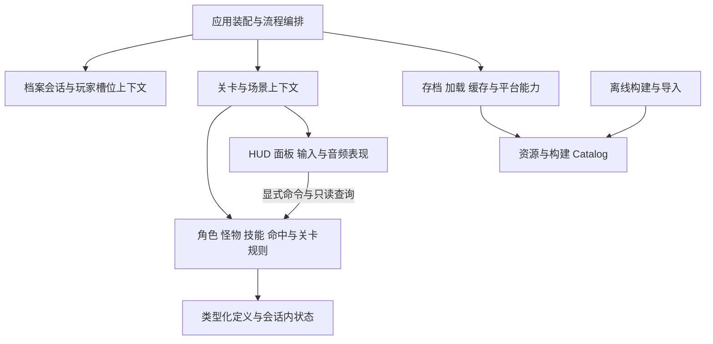

# BHYH 项目总体目标架构契约

> **定位**：定义项目应收敛到的职责边界、依赖方向、状态所有权、生命周期与验收要求。视觉资产是其中一个子系统，不再代表全部目标架构。
> **适用范围**：`source/` 内新增与主动重构的代码、场景、资源，以及为其服务的构建、验证与发布工具。存量实现按明确遗留边界分批收敛，不授权全工程重写。
> **状态区分**：本文是目标与规则，不是实现完成声明。当前实现见 [`architecture.md`](../reference/architecture.md)，验证事实见 [`status.md`](../reference/status.md)，实施顺序见 [`roadmap.md`](../roadmap/roadmap.md)。
> **决策关联**：[ADR-021](../decisions/ADR-021-project-wide-target-architecture.md) 记录总体选择，并局部替代 ADR-017 的长期 UI 全局视图交换策略；当前保存保护在完整迁移前仍有效。[ADR-020](../decisions/ADR-020-typed-visual-assets-and-streaming-lifecycle.md) 继续作为视觉资产子契约。

## 1. 架构选择与效力

### 1.1 采用什么架构

采用 **Godot 原生场景组合的模块化架构**：以角色、战斗、关卡、档案、成长系统、UI 等业务边界组织能力；由上层上下文装配依赖；以强类型数据、显式调用与局部信号连接模块。

工程继续使用 Godot 4.7.2、GDScript 2.0 与优先静态类型；默认渲染 `mobile`，Web 配置为 `forward_plus` 不代表 Web 已验收。引擎升级、显示基线与平台支持变化另行评审，不夹带在架构治理中。

- 场景负责节点生命周期与表现；领域规则负责状态变化；应用编排负责跨场景流程；基础设施负责 IO、加载、平台与第三方接入。
- 这是职责划分，不是要求每一层都增加一个目录、基类、Autoload 或转发接口。稳定的规则可直接使用 Godot 类型，不强求与引擎完全隔离。
- 优先复用已有 `BaseObject`、`BaseHero`、`BaseMonster`、`BaseLevel`、Catalog、槽位路由与构建工具；仅在职责和变化原因确实分离时提取组件。
- 不引入万能 `Manager`、全局服务定位器、包揽所有事件的总线、通用资源平台或平行战斗框架；不为“现代化”强制改成 ECS、深层继承或另一套引擎抽象。
- 不以文件行数、目录美观、Autoload 减到某个数字作为完成标准。可验证的行为、所有权与资源释放才是标准。

### 1.2 文档分工与裁决

| 文档 | 权威内容 | 不承担 |
|:---|:---|:---|
| 本文 | 总体目标、跨模块不变量、收敛与验收边界 | 当前完成列表、阶段进度、性能实测值 |
| [`godot_design_standard.md`](godot_design_standard.md) | 场景、节点通信、数据载体与 Autoload 的详细设计规则 | 总体迁移计划 |
| [`naming_standard.md`](naming_standard.md) | 文件、目录、节点、标识符、数据键与路径迁移 | 改变业务边界的授权 |
| [`architecture.md`](../reference/architecture.md) | 已实现架构与明确遗留边界 | 用目标冒充现状 |
| [`acceptance.md`](../reference/acceptance.md) / [`status.md`](../reference/status.md) | 验收判据 / 带日期的实测事实 | 通过一项验证外推全部能力 |
| [`roadmap.md`](../roadmap/roadmap.md) / [`current-iteration.md`](../roadmap/current-iteration.md) | 长期顺序 / 当前候选阶段的批次与出口 | 另建与目标契约冲突的架构 |

Godot 官方文档用于查证引擎行为；本文中的所有权、选型与禁止扩张规则是项目选择，不宣称是引擎强制。规范冲突必须显式修订并按需记录 ADR；不得用摘要、阶段计划或历史例外静默覆盖详细契约。

## 2. 总体职责与依赖方向

- 图表示职责依赖，不是现有类名或必须新增的节点树。装配入口可以由现有启动流程与场景根承担。
- 上层创建或获取依赖，注入下层；下层通过局部 `signal` 报告事实，不反向查找上层场景或控制全局业务。
- UI 不直接读写存档文件，存档层不查找 HUD；命中规则不操作弹窗，资源加载器不决定伤害、通关或任务奖励。
- 模块以小型公开方法、明确返回结果、强类型数据或 `Callable` 协作。不要把整个 `Global` 或无限制上下文字典注入每个组件。
- 同一业务状态只有一个权威写入者；只读视图、计算结果与持久化快照不是第二份可写真源。

## 3. 状态所有权与生命周期

### 3.1 所有权表

| 作用域 | 权威所有者 | 典型内容 | 结束条件 |
|:---|:---|:---|:---|
| 应用 | 启动装配入口及经评审的长期服务 | 设置、存档 IO 协调、场景流转、跨场景 BGM | 进程关闭，完成后台任务收尾 |
| 档案会话 | 当前载入档案的会话上下文 | 玩家档案、共享成长状态、1P/2P 槽位与存档标识 | 退出或切换档案，撤销所有借用上下文 |
| 玩家槽位 | 会话创建的独立数据/属性/输入实例 | 个体装备选择、HP/MP、技能 CD、伤害归属 | 槽位离开或会话结束 |
| 关卡 | 关卡根及其编排组件 | 阶段、刷怪、胜败状态、关卡缓存租约、战斗 UI | 关卡退出或挑战重开 |
| 实体 | 角色/怪物/技能/弹体自身 | 当前动作、计时、Buff、伤害来源、池化重置状态 | 释放或归还池 |
| UI | 界面根与其打开者 | 显示数据、槽位绑定、焦点、连接、输入占用 | 关闭/换档/场景退出 |
| 内容定义 | 构建资源及只读 Catalog | 数值定义、帧数据、资源身份与预载清单 | 最后引用释放；不得混入实例状态 |

“共享”必须指明共享给谁、谁能写、谁释放；不得仅因多个调用点使用就变成全局可变状态。

### 3.2 装配、Autoload 与上下文

- 当前 Autoload 注册是遗留基线，不是最终数量目标，也不是每项必须永久保留的承诺。新增、合并、移除均先评估调用面、初始化顺序、生命周期与回归。
- 先尝试普通场景节点、`RefCounted`、`Resource` 或静态工具；确需跨场景且管理自身信息的能力才评审 Autoload。
- `Global` 不再接收新业务职责。抽取按一个所有权边界闭环：迁移该能力的生产调用方、删除旧实现与过时入口；不留 deprecated 别名或兼容转发链。
- 若公共入口名称与职责仍正确，可保留唯一正式入口并委托其实现；这不同于为旧调用方无限期保留第二套 API。每批必须说明留下的入口为何仍是正式契约。
- 不承诺先建一个“大上下文对象”再传遍全项目。只注入消费者实际需要的档案、槽位、关卡或加载能力。

### 3.3 进入、切换与退出

1. 进入前校验目标、依赖与会话；失败时不提交部分新状态。
2. 预载、实例化、依赖注入、信号绑定与可显示就绪具有明确先后；不靠任意等待帧数掩盖初始化顺序。
3. 覆盖式切换期间只能有一个有效输入/结算拥有者；新旧场景同时存在不代表可同时处理挑战或存档。
4. 退出时解除输入与信号、停止计时、使过期回调失效、释放租约/池对象；异步结果不得写回已结束的关卡或档案。
5. 普通场景退出不得同步等待未完成的纹理请求；应用关闭须完成保存与后台请求的明确收尾。

## 4. 场景、战斗与关卡

### 4.1 场景组合

- 场景根编排自身子节点；内部节点优先 `%UniqueName` + `@onready`，外部引用由父上下文注入。`@export` 用于需要 Inspector 配置的依赖，运行期依赖用明确初始化方法/属性注入。
- 父级调用子级公开方法，子级发出事件；禁止新增跨场景深层路径、绝对路径或按脚本路径猜业务身份。分组可用于已声明的场景内查询，不代替槽位与权限上下文。
- 保留稳定“是一个”继承；对输入、动作、受击、技能、表现等有独立状态/生命周期的职责按需要组合，不要求每个字段都变成组件。

### 4.2 战斗状态与伤害归属

- 角色、怪物、召唤物、法宝与弹体的实例状态不写回共享资源。移动/碰撞走物理节拍，视觉播放不成为独立伤害真源。
- 一次攻击的发起槽位、来源实体、目标与结算结果必须可追溯；延迟、反弹、召唤和池化后仍保持正确归属，不能用“当前最近玩家”或默认 1P 替代。
- 伤害、吸血、无双、Buff、掉落与进度更新经过各自权威入口；UI 与特效只消费结果。
- 池化实体在复用前重置来源、信号、计时、碰撞、动画与临时引用；池有明确作用域与容量依据，不自动全局化。
- 不在本契约中改变现有数值、碰撞层、动作时序或引入网络同步/回滚系统。

### 4.3 关卡编排

- `BaseLevel` 的阶段、触发点、刷怪与出口契约是当前复用基础；新关卡不复制第二套独立循环。
- 关卡配置与运行状态分离；胜利、失败、重战、退出由单一编排者提交，避免重复结算。
- 怪物与弹体预载使用构建 Catalog；不在运行时解析 `.gd/.tscn` 源文本或扫描目录。特例关卡须显式声明预载与阶段规则。
- 场景切换能力统一管理加载、UI 清理、资源交接与会话边界；现有直接切换旁路是待清理项，不是新增依据。

## 5. 数据、档案与持久化

### 5.1 数据载体

| 数据 | 默认载体 | 禁止混入 |
|:---|:---|:---|
| 编辑器配置、共享静态定义 | 强类型 `Resource` / `.tres`、只读 Catalog | HP、CD、播放器时间、临时 UI、加载句柄 |
| 实例与会话内可变状态 | 节点、`RefCounted`、强类型容器 | 跨槽位隐式全局写入 |
| 当前存档/设置传输格式 | 有校验的 JSON 数据与显式编解码边界 | Node/Resource 实例引用、任意运行时对象反序列化 |
| 遗留档案与源元数据 | `DataKeys` 或类型化访问边界 | 新增散落字面量、泄露可写共享字典 |

`Resource` 优先针对结构化静态配置，不等于将玩家存档全部改成 `.tres`。已加载 Resource 通常共享；“只读”是项目不变量，不由扩展名或返回类型自动保证。复制/`resource_local_to_scene` 必须按确需独立的状态使用，不能盲目深复制纹理。

### 5.2 档案与本地双人

- 档案、个体槽位状态与共同库存/成长状态必须分别标明所有者；保留现有共享项目与独立项目的业务语义。
- 1P/2P 通过明确槽位上下文获取数据、属性与输入；共享库存不等于共享 HP/CD/伤害统计。目标不是再建第二组 Autoload。
- 新面板接收操作者与数据视图，不通过临时交换全局 1P/2P 对象获得权限；现有交换机制作为有范围的遗留债务逐步替换。
- 所有存量字典键继续通过 `DataKeys`；类型化改造按业务域推进，不建立一次性重写整个 `player_data` 的前置条件。

### 5.3 存档 IO

- 持久化由明确存档边界统一管理。界面、战斗规则和奖励结算不直接拼档案路径或写文件。
- 保留加密 JSON、稳定密钥、`.tmp` 校验、`.bak` 备份与原子替换语义；后台保存使用与当前档案隔离的快照，回写结果校验会话身份与保存顺序。
- 退出/切档前处理未完成保存；失败不伪报成功，不用默认空档覆盖原有不可读档。备份恢复属于明确可靠性策略，不是允许猜旧格式。
- 缺失当前字段由 `ensure_*` 补全；仅允许有限、幂等的当前格式规范化/退役清理。不建立跨版本号迁移链，不迁移旧目录/旧任务键/旧配置。
- 历史密钥读取等现有有限例外按当前实现与 ADR 登记，不借总体重构扩大或擅自删除。
- 加密不等于可信输入或防作弊保证；导入档案同样先校验类型、范围与结构，再提交到会话。

### 5.4 成长、库存与奖励

- 装备、技能、任务、商店、锻造、宠物和坐骑分别拥有业务命令；共享库存/货币由明确账本管理，不由各面板维护第二份可写副本。
- 定义数据与玩家拥有状态分离：装备数值、配方、价格、掉落表属于配置，物品实例、穿戴、出战、进度与余额属于档案/槽位状态。
- 购买、合成、学习、领取奖励先校验资格与成本，再由一个命令提交扣除和产出；失败不能只扣成本或重复发奖。跨集合更新在同一主线程业务操作内完成，不引入数据库或通用事务框架。
- UI 刷新、信号重复连接、重开面板或关卡结算不能再次提交同一业务动作；任务与副本领取状态由领域拥有者检查，持久化只保存已提交状态。
- 现有共享/个体分配与数值保持不变；抽取某一域时验证真实消费/奖励路径，不先重写全部成长系统。

## 6. UI、输入、显示与音频

- UI 呈现只读查询并发出明确命令，不拥有成长规则、伤害或存档格式。HUD 订阅本槽位状态，不按固定树路径取另一个玩家。
- 面板由打开者提供槽位、容器与依赖；关闭时恢复焦点、输入占用、连接与借用状态。禁止靠全局节点名白名单承担所有 UI 清理。
- ESC 按现有窗口栈语义只关闭一层；复用 `request_escape_close() -> bool` 与关卡 HUD 分发，不增加各窗口重复监听。
- 输入意图与角色行为分开；动作集中定义，键位/设备适配不散入技能。当前 `LocalCoop` 生成 `p2_*` 是已登记派生动作边界，新动态注册需同样集中管理。
- 保留 1280×800 设计画布、1600×1000 默认窗口、16:10、`canvas_items` + `expand` 及已接受相机/HUD 基线；布局调整不能借架构重构静默改变产品行为。
- 复杂面板采用可见性短路、脏标记与数值/文本 10Hz 节流；必要逐帧几何与输入不套用文本节流。
- BGM 可跨场景，战斗音效归关卡/实体或受控池；音频能力只处理播放与设置，不反向决定业务。

## 7. 资源与视觉资产子契约

以下保留 ADR-020 的构建、资源、运行时三层边界；它是总体架构的资源子契约，不是全项目必须套用的唯一三层模型。

### 7.1 内容选型

| 内容/需求 | 默认选择 | 边界 |
|:---|:---|:---|
| 普通逐帧动画 | 构建期 `SpriteFrames` + `AnimatedSprite2D` | 可共享 `AtlasTexture` 页；帧数不等于内存 |
| 规则精灵表或多属性/事件时间轴 | `Sprite2D` + `AnimationPlayer`，或 `AnimatedSprite2D` 配合 `AnimationPlayer` | 不重复驱动同一时钟；混合需求才评估 `AnimationTree` |
| 静态图/UI | `Texture2D` / `AtlasTexture` + 原生显示节点 | 不增加无意义动画包装 |
| 现有 Spine 内容 | Spine 资源 + `SpineSprite` | 保留骨骼、皮肤、附件、变形，不为统一而烘焙 |
| 新骨骼内容 | 按制作链选择 Spine 或原生 `Skeleton2D` / `Bone2D` / `Polygon2D` + `AnimationPlayer` | 不因骨骼需求自动增加第三方依赖 |
| 按需驻留逐帧内容 | `FrameSequence` + 专用流式播放器 | 依据目标平台驻留、并发、首帧与峰值；背景也可适用 |
| 图集源元数据 | `AtlasMetadata` 或明确源格式适配器 | 不是播放器，也不是所有资源的强制中间层 |

预录序列都是有限的；不得用“有限/超大”或是否高频复用作为唯一后端判据。

### 7.2 构建层

1. 固定视觉资产离线生成播放定义；战斗热路径不扫描目录、猜编号、解析源 manifest 或拼路径建帧。规则 sheet、程序化内容、当前格式用户数据不因此被禁止。
2. 同一资产只有一个声明的正式来源。缺失动画不改用单图或其它命名；合法静态保持须在定义中声明。
3. 通用 schema 复用通用转换器；专用 schema 使用范围明确的适配器，不预建万能转换器。
4. `--check` 验证内容、schema、路径、ID/UID、Catalog 与发布依赖闭包，不只验证文件存在。
5. 确定性输出不依赖目录枚举、运行时状态或随机 UID。文件名由身份派生可读 slug，身份由 `asset_id` 与稳定 UID 承载；slug 冲突必须失败。
6. 陈旧清理只作用于工具明确拥有的输出集合。转换器与规格入库，第三方素材及素材侧派生产物不进入公开仓。

### 7.3 资源层

- 共享只读定义与实例播放时间、循环覆盖、末帧、速度、预取窗口分离；不回写共享资源。资产 ID 不编码浮点 FPS 或播放策略。
- `AtlasMetadata.data` 是遗留序列化边界。按真实 schema 与消费者需要提供强类型访问，不强行用一个模型吞并所有形态，也不为未消费字段建立一套对象。
- 类型化入口不得泄露可修改的共享集合；构建期全面校验，运行时接纳边界校验类型、空序列、数组长度、时间与 region。
- 后端显式声明；SpriteFrames 动画缺失不改走 FrameSequence。不同资产选择不同正式后端是合法选型，不是兼容回退。
- debug 可加 `assert`，release 也必须报告错误并拒绝错误消费者；失败交回拥有者，不通过猜名、旧路径或空白占位隐藏。

### 7.4 播放、加载、预热与退出

- 原生节点优先。流式播放器只负责时钟、纹理窗口、区域与显示事件，不侵入伤害或关卡编排；资源启动前注入，不建万能播放器。
- 明确顺播、循环、末帧、跳帧、空白帧和失败信号。碰撞使用实际显示帧几何，而非未就绪未来帧；`.tres` 只是序列化格式。
- 小型固定依赖可 `preload`，大型内容按需加载；禁止全局 preload 间接常驻所有大资产。
- 允许主线程跨帧轮询后台状态；取回未完成资源可能阻塞，因此普通运行期只取回已完成结果，不在退出树时同步等待。
- 每个请求有所有者；共享请求去重并记录持有者。消费者退出后仍由受控收尾者取回完成结果并释放；清字典不等于取消或释放其它引用。
- 预热区分元数据、纹理资源与可显示首帧。纹理引用保持到消费者接手或所有者释放，按共享页去重。
- 缓存、池与预取都有作用域、容量/驻留依据、失效与观察入口；预算来自目标平台实测，不虚构统一阈值。

### 7.5 导入、UID 与导出

- 外部 PNG/音频等源素材维护 `.import`；`.godot/imported` 是可重建缓存。原生 `.tres/.tscn` 使用资源头 UID，不伪造 `.import`；脚本/着色器按引擎机制维护 `.uid`。
- UID 身份稳定、全局唯一；路径移动使用专用迁移工具。
- 字符串延迟路径不自动构成导出依赖；生成独立依赖清单，通过显式导出规则或插件打包，不通过强引用全部纹理破坏流式驻留。
- 构建资源齐全不等于包齐全；发布包须验证路径闭包与实际加载。
- Spine `.atlas` 不等于 AtlasMetadata；版本、许可证、二进制与目标平台逐项核实。本机编辑器通过不能证明其它平台可交付。

## 8. 基础设施、线程与发布边界

- 活跃 SceneTree 与玩法状态在主线程修改。后台任务只处理明确隔离的数据、IO 或受支持加载；不从工作线程操作活动 UI/实体或并发修改共享 Resource。
- 保存快照、加载结果与线程交接必须有明确同步及关闭路径。不能用 `call_deferred` 本身代替状态所有权和过期结果检查。
- 禁止在 `_process/_physics_process` 无节制磁盘 IO、同步加载、源 JSON 解析和高频字符串拼装；不把合法跨帧状态轮询等同 IO。
- 平台行为集中在边界，说明桌面/移动/Web 的输入、窗口、渲染、文件与扩展库差异；不承诺尚未验证的平台。
- `source/addons/` 与 `source/bin/` 作为第三方边界，不把核心业务反向绑到编辑器调试桥；测试夹具不得成为生产入口或发布依赖。
- 公开仓排除第三方美术/音乐/字体/精灵表；代码 MIT 不覆盖被排除素材或第三方运行库。脚本用参数/环境变量接收本地引擎路径，文档/日志证据不泄露私有来源路径。

## 9. 目录、命名与模块组织

- 单一活跃 `source/`；沿用 `Scene/Script/Art/Music/Font/Shader/Spritesheet` 顶层及公开/私有素材边界。功能在现有顶层内部形成对应子目录与清晰 API。
- Godot 官方推荐资源靠近使用场景；本项目因历史路径、素材分仓与导出契约保留顶层类型目录，这是明确项目选择，不是必须清零的技术债。
- 不新增 `features/` 平行工程，不把“现代化”定义为搬完全部目录。只有实际降低耦合且依赖稳定时才提出单模块路径迁移。
- 文件/功能目录 `snake_case`，节点/`class_name` 使用 `PascalCase`；路径大小写逐字一致。`DataKeys`、机器导出与数字 ID 白名单规则继续有效，普通业务不得新增豁免。
- `source/` 内改名走 `scripts/rename_path.py`，同步引用、UID/`.import`、轨道、Catalog 与导出清单；`docs/scripts` 自身路径迁移按其工具边界处理。
- 不以 `*bundled*` 文件名判断是否存在二进制或内嵌场景；只有格式/资源检查证据才能登记此类迁移任务。

## 10. 失败语义与迁移纪律

- 无效输入、缺失配置、资源失败、保存失败必须返回明确结果给拥有者；拥有者决定拒绝操作、停止该消费者或中止本次进入。正常错误处理不等于被禁止的兼容层，也不等于全进程退出。
- 不猜旧路径、旧 schema、旧资源后端，不以 0/空白/默认成功掩盖错误；可选能力必须预先声明，不能事后自动降级。
- 迁移按职责边界形成可运行的原子批次，完整迁移该批调用方、删除旧实现与过时入口；回滚通过版本控制，不通过永久双实现。
- 不要求先完成全部 AtlasMetadata 类型化才能研究场景切换或会话边界。阶段依赖必须来自真实调用/数据依赖，不来自“先数据、再全局、最后目录”的抽象顺序。
- 不改已验收玩法、数值、存档业务格式与共享规则。确需改变则另立 ADR、范围与验收，不混入架构清理。

## 11. 收敛与验收

### 11.1 分域收敛与验收责任

| 架构域 | 目标责任 | 验收重点 |
|:---|:---|:---|
| 应用与关卡编排 | 唯一切换/结算拥有者，依赖装配与输入交接 | 冷启动、返回、重战、失败、过期回调与退出 |
| 档案、成长与玩家槽位 | 共同账本和个体状态分离；保存边界独立 | 共享/隔离、消费/奖励、切档、快照与损坏档拒绝 |
| 战斗 | 稳定继承加按需组合，命中来源可追溯 | 弹体/法宝/召唤、池化复用、吸血/无双/Buff 归属 |
| UI、输入与音频 | 显式操作者、命令/查询、注册/释放 | 面板开关、ESC、焦点/暂停、双人和显示基线 |
| 资源与构建 | 共享只读定义、确定性生成、显式失败与加载所有权 | 完整视觉时序、提前销毁、预热、依赖与驻留 |
| 模块、平台与交付 | 保留目录/素材边界，平台能力显式声明 | 引用/UID、实际包加载、许可证与目标设备证据 |

当前差距与完成状态只在 `architecture.md`、`status.md` 维护，分期只在 roadmap 维护。本文不复制 PASS 计数、当前消费者数量或迁移台账。

### 11.2 验收维度

执行命令与档位以 [`acceptance.md`](../reference/acceptance.md) 为准，每批按受影响行为选择：

1. **结构**：公开调用方迁完、旧入口删除、命名/路径/UID/资源闭包正确，无新增隐式全局依赖。
2. **行为**：正常进入、边界输入、失败分支与副作用；场景切换、返回、重战与重复结算防护。
3. **会话**：1P/2P 独立与共享项、来源归属、切档/退档、面板打开关闭与上下文恢复。
4. **持久化**：当前格式读写、缺字段补全、损坏档拒绝、备份策略、保存排队/退出与不覆盖错误档。
5. **生命周期**：提前销毁、在途回调、信号断开、资源交接、池化重置、重复进入退出。
6. **视觉**：完整播放/循环/末帧/跳帧/空白帧、显示几何与失败传播；共享请求、预热与退出回收。
7. **质量/发布**：静态门禁、引擎健康、生产消费者冒烟、相关回归；影响发布时验证 release、实际包依赖与目标平台性能。

完整私有工作区保持 0 ERROR / 0 WARNING；公开 clone 缺素材不冒充完整运行验证。headless 不证明 HUD 外观、峰值 VRAM 或跨平台可运行；首帧存在不证明整段动画。运行时夹具与枚举源码的门禁必须串行，避免临时夹具污染检查。

只改文档时验证链接、格式、规则一致性与修改范围，不为文档修订声称重新通过引擎或 release。新增门禁必须先登记工具与验收，再成为阶段出口，不虚构现有检查能力。

## 12. 官方依据与维护

以下官方依据支撑设计方法；项目业务不变量由已接受 ADR 与本文规定：

- [Scene organization](https://docs.godotengine.org/en/4.7/tutorials/best_practices/scene_organization.html)：自包含场景与依赖注入。
- [Autoloads versus regular nodes](https://docs.godotengine.org/en/4.7/tutorials/best_practices/autoloads_versus_regular_nodes.html)：按作用域选择服务，不以全局访问替代所有权。
- [Resource](https://docs.godotengine.org/en/4.7/classes/class_resource.html)：共享资源、引用与序列化。
- [Project organization](https://docs.godotengine.org/en/4.7/tutorials/best_practices/project_organization.html) / [GDScript style](https://docs.godotengine.org/en/4.7/tutorials/scripting/gdscript/gdscript_styleguide.html)：组织与命名。
- [Background loading](https://docs.godotengine.org/en/4.7/tutorials/io/background_loading.html) / [Thread-safe APIs](https://docs.godotengine.org/en/4.7/tutorials/performance/thread_safe_apis.html)：取回阻塞与线程边界。
- [Import process](https://docs.godotengine.org/en/4.7/tutorials/assets_pipeline/import_process.html) / [Exporting](https://docs.godotengine.org/en/4.7/tutorials/export/exporting_projects.html)：导入与交付。

先修订规范/决策，再实施代码，完成验收后更新实际架构与状态。已接受 ADR 的实质变更用新 ADR 表达；归档保持原貌。每个例外必须有范围、理由、拥有者与出口，不允许借遗留例外继续扩张。
